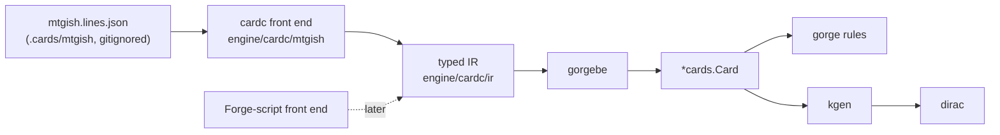

# cardc: mtgish as the card compiler front end, proven end to end on a side branch

Status: plan on branch `cardc`, for the operator. Wave-1 seat briefs are in `briefs/` beside this file.

Bases:
- gorge origin/main `86b960f2c5`;
- gorge-compliance origin/main `285a7038`;
- mtgish upstream `1553384` (i5jb/mtgish head on 11-23).

Corpus figures marked "at `153451e`" were measured on compliance's current data pin. Anything marked INFERRED was not
read from code or data.

Operator decisions (11-23):
- mtgish is the basis of a new card compiler front end and the unified input to both engines, proven end to end on a
  side branch.
- The Forge-script compiler (`engine/cards`) stays on main unchanged.
- We keep our own mtgish fork for fixes, and send upstream issues only, never pull requests (section 5).

## 1. Pipeline



1. **Source.** mtgish's typed tree, `data/mtgish.lines.json`, at `MTGISH_REF`.
   - The file is one JSON object per card. Every Rust enum is a tagged union:
     `{"_Action":"SpellDealsDamage","args":[…]}`.
   - At `1553384` it holds 33,673 lines and uses 7,407 distinct `Enum.Variant`s. mtgish's own schema declares 7,455
     (section 2a).
   - `MTGISH_REF` may name a commit of our fork, `github.com/adams-shaun/mtgish` (section 5). Compliance keeps its
     own upstream pin (gorge-compliance PR #373).
2. **IR.** `engine/cardc/ir`, stdlib only. Its core is four leaf families, shaped after oracle-grammar's schema 192
   (MIT; shapes only, no code), so an oracle-grammar front end can map onto the same nodes later.

   | family | node | mtgish enums | oracle-grammar |
   |---|---|---|---|
   | references | `ir.Ref` | `Permanent`, `Player`, `Spell`, `Card`, `Exilable` … | `ObjectRef`, `PlayerRef` |
   | filters | `ir.Filter`, `ir.Target` | `Permanents`, `Players`, `Spells`, `CardsIn*`, `Target` | `ObjectFilter` |
   | values | `ir.Value`, `ir.Compare` | `GameNumber`, `Comparison`, `CounterType` | `Expr` |
   | conditions | `ir.Cond` | `Condition` | `Condition` |

   The core shapes (the CC-01 brief gives every field):

   ```go
   type Ref struct {
       Kind RefKind; Slot uint8; Of *Ref; Filter *Filter; N *Value
       Receipt ReceiptKind; Union []*Ref; Src string
   }
   type Filter struct {
       Subject Subject; Zones ZoneSet; Op FilterOp; Args []*Filter; Pred Pred
       Word string; Colors ColorSet; Ref *Ref; Cmp CmpOp; Value *Value; Src string
   }
   type Value struct {
       Kind ValueKind; N int32; Args []*Value; Filter *Filter; Ref *Ref
       Word string; Colors ColorSet; Receipt ReceiptKind; Src string
   }
   type Cond struct {
       Kind CondKind; Args []*Cond; L, R *Value; Cmp CmpOp; Filter *Filter
       Ref *Ref; Word string; Receipt ReceiptKind; Src string
   }
   ```

   - Around the core sit `Card`, `Face`, `Ability`, `Keyword`, `Trigger`, `Target`, `Program`, `Step` and `Cost`.
   - `Src` is the mtgish variant path a node came from, never Oracle text.
3. **Gorge binding.** `engine/cardc/gorgebe` lowers IR to `*cards.Card`, the struct gorge's rules and kgen already
   read (`engine/cards/ir.go:619`).
   - It emits script lines in gorge's own vocabulary, the `ParamKey` names of `engine/cards/params.go:27`.
   - It loads them through the existing path, `cards.ParseBytes` (`engine/cards/parse.go:21`).
   - So the proof changes no engine code, and any divergence is a card-definition difference.
4. **Committed vs not.**
   - Committed: cardc code, the IR schema, lowering code, and registers holding card names and class tokens only.
   - Gitignored, under `.cards/`: mtgish data and anything derived from Oracle text (per-card IR, generated script
     text).
   - The data sits under `.cards` because agentctl links `.cards` into every seat worktree; a top-level `.mtgish/`
     would be missing in seats.
   - cardc never copies Forge script text. The per-card fallback (section 5) loads Forge's IR at run time.

## 2. What to reuse

### 2a. mtgish's own tooling (repo at `1553384`)

What exists:
- **Parser:** Go, in `go_mtg_parser/` (`main.go`, `prefix_tree.go`). It is template-driven:
  - `grammars/english_grammar*.json5` maps English phrases to mtgish templates (58,338 lines in the main file);
  - `grammars/mtgish_grammar*.json5` constrains the templates (7,987 lines);
  - `just parser_generate_mtgish` writes `data/mtgish.lines.ron`.
- **Schema of record:** `rust_syntax/src/mtg_types.rs` (12,836 lines; serde, bincode and ts-rs derives).
  `rust_syntax/src/main.rs` converts RON to bincode to `mtgish.lines.json` (`just convert_to_json`), and RON to
  `mtgish.pretty.ron`.
- **TypeScript bindings:** `typescript_types/oracle_cards.d.ts`, generated by ts-rs. It is one union line per variant
  (`| { "_Permanent": "TheChosenPermanentForPlayer", "args": Player }`): 403 types and 7,455 variants. It covers all
  7,407 variants the data uses (measured).
- **Viewer:** `web_src/card_parser.js` and `card-display.html`, a browser view of parsed cards.

What cardc does with it:
- **Use the TS schema as a variant catalogue (wave 1).** CC-00 fetches `oracle_cards.d.ts` beside the data. CC-02
  parses it to:
  - check that every data variant is declared;
  - derive the face keys (it finds `Vengeance`, the `Avenger` layout, which compliance's list lacks);
  - fail any registered lowering whose key the schema lacks, which catches renames at each pin bump.
- **Not a cardc-specific output template.** mtgish's templates map English to its own AST, and the AST's shape is
  fixed by `mtg_types.rs`. A gorge-shaped output would mean a second target on every grammar production, which
  amounts to forking the grammar wholesale. Lowering in Go is far cheaper.
- **Not gorgebe either.** mtgish has no renderer to Forge script or any engine format; gorgebe stays ours.
- **Typed Go decoding generated from the TS schema:** possible later, if the generic tagged-union reader proves
  error-prone. Not needed for the proof.
- **Effect on the fork (section 5):** regenerating data needs Go (the parser) and Rust (the RON-to-JSON step).

### 2b. gorge-compliance `oracle/mtgish` (at `285a7038`, 15,355 lines of Go)

| piece | lift | why |
|---|---|---|
| `node.go` (tagged-union helpers) | as code (CC-02) | stdlib only; the generic reader |
| `load.go` (`Card`, faces, `Read`) | as code (CC-02) | stdlib only; face order already right |
| `mtgish-fetch.sh`, `MTGISH.lock` | as a recipe (CC-00) | same sha256 check |
| `map_*.go`, `effects_mtgish.go` | reference only | lossy summary tokens; use for variant meanings |
| `from_gorge.go`, `effects_gorge.go` | no; run in place | coarse second diff from compliance (CC-30) |
| ledger `known/T1-T4.tsv` | as data, names + class | seeds the gap register (section 5) |

About the ledger:
- PR #373 (`1553384`) records 329 `mtgish-bug` rows and 97.4% T4 agreement.
- Its `equivalent` notes name canonicalisations the static diff must apply, for example "if/else merged" (17 rows).

**Proof-slice scale** at `153451e`: distinct `Enum.Variant`s per slice, each name looked up by front face first (CC-02's
index rule). The deck slices count main decks only; FDN and the Legacy 12 share 10 names.

| slice | cards | variants |
|---|---:|---:|
| FDN pool (`dirac/cardset/pools/fdn/cards.txt`) | 286 | 530 |
| BLB pool | 276 | 616 |
| 12 Legacy decks (`testkit/testutil/decks.go:65`) | 136 | 399 |
| **FDN + Legacy 12 (the proof slice)** | 412 | **684** |

The largest enums in the proof slice are `Action` 108, `Rule` 62, `Permanents` 45, `Trigger` 28 and `GameNumber` 28.

## 3. The side branch

- **Branch:** `cardc` in gorge. Tickets use `agentctl issue add --target-branch cardc`, which bases, gates, merges and
  pushes to `cardc`, never main.
- **Main is untouched by construction.** CC-00's `TestNothingImportsCardc` allows only `engine/cardc/...` and
  `cmd/cardc` to import cardc. So:
  - golden heads, set heads, wire goldens and `scripts/dirac-gate.sh` do not move;
  - `engine/cards` is not edited, so `cacheVersion` 8 (`engine/cards/registry.go:338`) and `CompilerFingerprint`
    (`engine/cards/fingerprint.go:21`) are unchanged.
- **Edits outside new directories, all in CC-00:**
  - one `include cardc.mk` line in the Makefile;
  - `.gitignore`;
  - a `mtgish-data` rule in `TestPublicBoundary` (`internal/archtest/public_boundary_test.go:339`);
  - three forbidden edges in `TestDependencyOrderHolds` (`internal/archtest/arch_test.go:204`);
  - the new `TestNothingImportsCardc`.
- **Staying current:** a rolling `cardc-follow` ticket merges origin/main into `cardc` every 6 hours and re-runs
  `make cardc-check`. It merges rather than rebases, because many seats branch from `cardc`.

Layout:

```
engine/cardc/ir/        schema, printer, Equal, JSON codec       stdlib only
engine/cardc/mtgish/    reader, schema catalogue, fe_*.go        imports ir
engine/cardc/canon/     meaning-preserving IR canonicalisation   imports ir
engine/cardc/gorgebe/   IR -> *cards.Card, registry, fallback    imports ir, engine/cards
engine/cardc/lockstep/  record/replay harness, ledger            imports rules, replay
cmd/cardc/              report | compile | diff | lockstep | agree
cardc.mk                mtgish-fetch, cardc-check, cardc-lockstep
```

## 4. The end-to-end proof

**Slice:**
- FDN: the 1,500 game pairs of `dirac/oracle/testdata/slices/fdn/pairs.tsv`.
- Legacy: the 12 Legacy decks in the acceptance games at 2/4/6/8 seats (`engine/rules/acceptance_game.go:49`).
- Stage 2: `cmd4`, the four-seat Commander pod.
- Then BLB.

**Static diff (CC-30).** `cardc diff` compares each card's cardc `*cards.Card` with its Forge one, after the
compliance ledger's canonicalisations:
- the ability multiset by kind and API;
- targets;
- amounts;
- trigger modes.

**Lockstep (CC-31).** It uses gorge's replay contract (`engine/replay/replay.go:62` `Replay`, `:288`
`FirstDivergence`).
- Forward: play on the Forge registry, then replay the recorded intents with decks rebuilt from cardc.
- Reverse: play on cardc, then replay on Forge.
- `Replay` expects "the same *cards.Card pointers", so swapping definitions is outside its documented contract.
  CC-31's first test swaps identical definitions to prove the swap is neutral. INFERRED until it passes.
- Tests run in chunks of 100 games or fewer, to fit the one-minute budget; `make cardc-lockstep SLICE=fdn` runs them
  all.

**Divergence classes.** One ledger file per card, `engine/cardc/testdata/ledger/<card>.tsv`, held both ways.

| class | meaning | action |
|---|---|---|
| `mtgish-bug` | mtgish's tree is wrong | fork commit plus upstream issue (section 5) |
| `cardc-gap` | cardc loses a correct tree | fix cardc; must be 0 at the bar |
| `forge-bug` | the Forge script is wrong | record it; a normal main ticket fixes gorge's Forge path |
| `gorge-suspect` | cardc matches the Oracle text and gorge's rules path differs | file a gorge defect; never bend cardc |
| `equivalent` | same meaning, different event order | backend canonicalises; 0 at the bar |

**Pass bar (FDN stage):**
1. At least 95% of the 412 proof-slice cards compile with no refusal and no fallback. The rest each have a fallback
   row with a class.
2. No unledgered divergence over the 1,500 FDN pairs (forward and reverse) and the Legacy games.
3. `cardc-gap` and `equivalent` are both 0.
4. Every cardc-compiled card plays in at least 3 clean games (`EvidenceMinPlays`, `dirac/oracle/evidence.go:11`).
5. Stage 2: `cmd4` replays clean at 4 seats.

**The Forge path becomes an independent cross-check.** A passing card has two readings that agree in lockstep: Oracle
text through mtgish, and the Forge script. A disagreement is the forge-bug or mtgish-bug signal that xproof lacks
today. CC-40 exports a per-card `reading-agreement` column for the proof page.

## 5. Gaps: the mtgish fork

We fix mtgish bugs in our fork, `github.com/adams-shaun/mtgish`. That unblocks cardc at once, and the upstream issue
stays open. cardc has no patch layer of its own; `engine/cardc/canon` only canonicalises meaning, and never fixes
bugs.

**Prerequisite (operator, before CC-00 is queued).** Seats may lack GitHub credentials, so the operator creates the
fork and its `gorge` branch by hand, once:

```sh
gh repo fork i5jb/mtgish --clone=false && gh api repos/adams-shaun/mtgish/git/refs -f ref=refs/heads/gorge -f sha=1553384c9a970a02514b337db9c86697313530e8
```

CC-00 only checks that the branch exists (`git ls-remote`, no credentials) and reports BLOCKED if not.

**Fork rules:**
- Branch `gorge` is the upstream ref plus our patches. **One patch is one commit**, whose subject names the upstream
  issue (`fix: up-to targets read as exact (i5jb/mtgish#3)`).
- Each commit carries the grammar or code fix plus the `data/mtgish.lines.json` it regenerates. The data stays in the
  fork; gorge fetches it into `.cards/mtgish/` and never commits it.
- `engine/cardc/MTGISH.lock` records the fork URL, the upstream base, the ref, the file sums, and one
  `patch <sha> <issue>` line per fork commit.
- **Patch register:** `engine/cardc/testdata/mtgish-fork.tsv`, with columns `sha`, `upstream_issue` (required),
  `class`, `status` (`carried`, `fixed-upstream` or `dropped`) and `cards`. `TestMtgishForkRegister` holds its
  `carried` rows equal to the lock's `patch` lines, offline.
- **Pin bump**, one cardc ticket each time:
  1. tag the current pinned ref `pin/<sha12>`, so older locks stay fetchable after the rebase orphans it;
  2. rebase `gorge` onto the new upstream ref;
  3. drop commits whose issue is closed;
  4. regenerate each remaining commit's data (never hand-merge it);
  5. pin;
  6. re-run report, diff and ledger.
- **Upstream etiquette:** the mtgish author accepts only hand-written pull requests.
  - No script, seat or agent ever opens a PR to i5jb/mtgish.
  - Upstream gets issues only, as with our #1 to #4.
  - Any PR is the operator's, by hand.
- **Toolchain:** regeneration needs Go (the parser) and Rust (the JSON step). Neither `cargo` nor `rustc` is on this
  box (checked 11-23). CC-00 pins the unpatched upstream ref, which needs neither. CC-33 sets up regeneration as a
  GitHub Actions workflow in the fork, so no box change is needed. Its first run must reproduce upstream's committed
  data byte for byte before any patch is trusted.

**Known classes.** Row counts are from the compliance ledger at `153451e`:

| class | rows | handling |
|---|---:|---|
| "up to N" read as exactly N (mtgish#3) | 68 | fork commit |
| morph line duplicated, face-up trigger lost (mtgish#1) | 52 | fork commit |
| Class level costs | 32 | fork commit; Forge fallback until then (no Class card in FDN) |
| haste dropped (mtgish#2) | 13 | fork commit |
| MDFC back-face cost | 9 | file the issue, then a fork commit |

Two hazards have no ledger row:
- **mtgish never refuses.** A wrong tree is silent, so the static diff and lockstep are the only detectors. cardc's
  front end refuses every variant it has no lowering for, by name.
- **Rules meaning in AI fields:** `AILogic$ Random` on charms (`engine/effects/charm_params.go:79`) and `FriendOrFoe`
  (`engine/effects/assigngroup_params.go:19`). gorgebe emits them from IR facts.

**Fallback:**
- A card the fork cannot fix yet gets `engine/cardc/testdata/fallback/<card>.txt`, naming its class and upstream
  issue.
- The registry builder then serves Forge's `*cards.Card` for that card, by reference.
- Fallback cards do not count toward the 95% bar.
- The register only shrinks after the proof.
- Tokens use Forge's `tokenscripts` during the proof, and are counted.

## 6. Tickets

Every ticket targets `cardc`, ends with `make test-targeted BASE=origin/cardc`, and runs
`make test-smart BASE=origin/cardc` before DONE.
- Both targets honour `BASE` (`scripts/test-targets.sh` diffs against `git merge-base $BASE HEAD`). `origin/cardc`
  must resolve in the worktree (`git fetch origin cardc`), or the verdict is `ENV`.
- A missing `.cards/mtgish` is `ENV`, never green.
- No ticket, seat or script ever opens a pull request to i5jb/mtgish. Upstream gets issues only, filed by the
  operator (section 5).

Sonnet implements every ticket. Opus reviews CC-01, CC-11, CC-12 and CC-20, the tickets that fix shared shapes. Each
lowering registers itself from its own file, so no shared switch is edited twice.

| id | scope | depends | seat-days |
|---|---|---|---:|
| CC-00 | fork + pin, fetch, hooks, archtest guards | none | 0.3 |
| CC-01 | IR schema, printer, Equal, codec (**high**) | CC-00 | 0.75 |
| CC-02 | reader, name index, registry, schema catalogue, `cardc report` | CC-01 | 0.5 |
| CC-10 | compile driver, characteristics, keyword-only rules | CC-02 | 0.4 |
| CC-11 | references | CC-02 | 0.5 |
| CC-12 | filters and target declarations | CC-02 | 0.6 |
| CC-13 | values, comparisons, counter kinds | CC-02 | 0.4 |
| CC-14 | conditions | CC-02 | 0.4 |
| CC-15a/b | actions, A-L / M-Z | CC-10..14 | 2 × 0.6 |
| CC-16a/b | rules, triggers, statics, replacements, costs | CC-15a | 2 × 0.6 |
| CC-20 | gorgebe card skeleton, registry, fallback | CC-10 | 0.75 |
| CC-21a/b | gorgebe printers: Ref, Filter / Value, Cond | CC-20, CC-11..14 | 2 × 0.6 |
| CC-22a/b | gorgebe actions to API + params | CC-15, CC-21 | 2 × 0.6 |
| CC-23 | gorgebe triggers, statics, replacements, costs | CC-16, CC-21 | 0.75 |
| CC-24 | front end: bare-string enum words (a wave-2 defect) | CC-23 | 0.1 |
| CC-30 | static diff | CC-22, CC-23, CC-24 | 0.5 |
| CC-31 | lockstep harness | CC-20 | 0.6 |
| CC-32 | divergence ledger, blame + ratchet | CC-30, CC-31 | 0.4 |
| CC-33a | fork register, lock check, fork regeneration workflow | CC-00 | 0.3 |
| CC-33b | fallback rows for uncarried mtgish bugs | CC-32, CC-33a | 0.2 |
| CC-33c | fork patch commits (grammar fix + regenerated data) | CC-33a, fork CI installed | 0.4 |
| CC-34..39 | burn-down, one class family each | CC-33 | 6 × 0.5 |
| CC-40 | reading-agreement export | CC-34..39 | 0.3 |
| cardc-follow | rolling: merge main into `cardc` | CC-00 | ~0.05/day |

What each backend ticket checks:
- **CC-21:** every printed spelling is one gorge reads:
  - a known `Defined$` (`engine/effects/defined_selector_census_test.go`);
  - a modelled count head (`engine/effects/value_heads.go:20`);
  - no unknown filter predicate (`engine/effects/filter_compiled.go:117`).
- **CC-22:** every emitted API is in `effects.Supported()` (`engine/effects/registry.go:692`).

**Collisions:**
- CC-01 and CC-20 are the hubs.
- CC-10..14 run in parallel after CC-02. Each owns its `fe_*.go` files and tests stub the other families (CC-02's
  `withStubs`).
- After CC-01, a family appends enum values only in its own `ir/<family>.go`.
- Front end (`engine/cardc/mtgish`) and backend (`engine/cardc/gorgebe`) are disjoint, so their waves overlap.
- Ledger and fallback rows are one file per card.
- Peak parallelism is about 8 seats.

**Estimate: about 15 seat-days of tickets, about 21 with rework; 7-9 calendar days at 10-15 seats.** The critical
path is CC-00 → 01 → 02 → 12 → 15a → 16a → 23 → 30 → 32 → 33 → burn-down.

Basis:
- **The compliance mtgish cross-check** mapped 2,612 variant names corpus-wide, at summary grain, in 2 days: 217
  commits dated 10-20/10-21 in gorge-compliance's git log. The proof needs 684 variants at engine grain.
- **W4 on 10-03:** every string-code family in effects and rules converted to named enums in one day. That was 46
  commits, 1,172 file changes, +36,587 / −20,584 lines (`git log --grep='^W4'`).
- **The operand-algebras (dsd) tickets:**
  - Medium tickets took 2.3-10.5 h from dispatch to merge, median about 3.5 h. The eight measured: T04 2.6, T11 2.3,
    T12 3.1, T13b 4.0, T13c 9.2, T17b 3.1, T17c 5.4, T21 10.5 (agentctl ledger events).
  - 8 of 25 were superseded, mostly high-complexity representation tickets (T07 after 11 rounds). Hence the +35%
    rework allowance and the Opus reviews.

## 7. After the proof

1. **More slices:** BLB, then the setheads sets (`engine/rules/testdata/setheads/games.txt`). Each is one slice
   ticket plus burn-down, on the same bar.
2. **kgen consumes cardc, step 1 (no kgen change).** Point kgen at the cardc registry, then:
   - diff `kgen -lir` per card (`dirac/kgen/main.go:36`);
   - run dirac lockstep on FDN with both engines reading cardc.
3. **kgen consumes cardc, step 2 (native).**
   - kgen lowers IR families directly: `ir.Ref` to SetExpr, `ir.Filter` to `PredProg`, and `ir.Value`/`ir.Cond` to
     `kop.Expr`.
   - This refiles the operand-algebras ports that stalled on text parsing: `dsd-t07-defined-grammar` (PR #2795, 11
     rounds), T08, T10 and `dsd-t16-expr-conditions`.
   - A card whose LIR block is unchanged keeps its evidence key (`dirac/kgen/lirkey.go:16`).
4. **A Forge front end into the same IR**, built from gorge's existing parsers:
   - `cards.ValueHead`, `engine/cards/value_heads.go:37`;
   - `definedSpec`, `engine/effects/context.go:684`;
   - `compileSpec`, `engine/effects/filter_compiled.go:285`;
   - the condition readers, `engine/effects/conditions.go:296` and `engine/rules/trigger_condition.go:258`.

   The cross-check then compares IR to IR, statically.
5. **Promotion to main.** One PR from `cardc`, signed off by the operator, when all of these hold:
   - FDN, BLB and `cmd4` pass the bar.
   - With cardc serving every card it covers, `TestHeads`, `TestSetHeads` and `TestRepoDeckGamesReplayExactly` pass
     **without** re-pinning.
   - `scripts/dirac-gate.sh` is unedited and green.
   - The fallback register and the fork register's `carried` rows are shrink-only ratchets.
   - Sources are selected per card (cardc only for lockstep-clean cards). That selector changes the IR cache schema,
     so `cacheVersion` goes 8 → 9 (`engine/cards/registry.go:338`).
   - `TestPublicBoundary` still refuses mtgish data and cardc output.

## 8. Risks

- **mtgish guesses where oracle-grammar refuses** (the 11-23 oracle-grammar evaluation; session notes, not
  committed). So no card is promoted on compile success alone. The IR keeps oracle-grammar's shapes, so a second
  front end needs no schema change.
- **Event-order equivalences.** If `equivalent` rows exceed about 10% of the slice after CC-30, gorgebe emits Forge's
  ability order. The bar does not relax.
- **Upstream pace.** Between `153451e` and `1553384`, upstream fixed 127 ledger rows (PR #373). Every bump is a cardc
  ticket.
- **Fork CI.** GitHub Actions in the fork must reproduce upstream data byte for byte. If it cannot, regeneration
  falls back to a user-local `rustup` under `$HOME`, which needs the operator's OK.

## Decisions log

- 11-24, operator: targets are scoped per `ir.Program` (`Program.Targets`, set by `Actions.Targeted`), mirroring
  mtgish's `Actions.Targeted(targets, actions)`. `Ability.Targets` (CC-01/CC-12) is removed in CC-15a and must not
  return; `TestTargetsLiveOnPrograms` guards it. Nested abilities save and restore the target frame (CC-15a/CC-16a).
- 11-24, operator: CC-15a owns every wave-2 IR edit; CC-15b, CC-16a and CC-16b only register lowerings after it.
