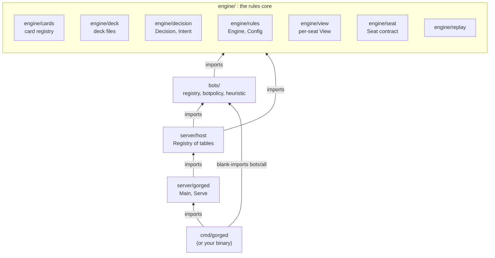
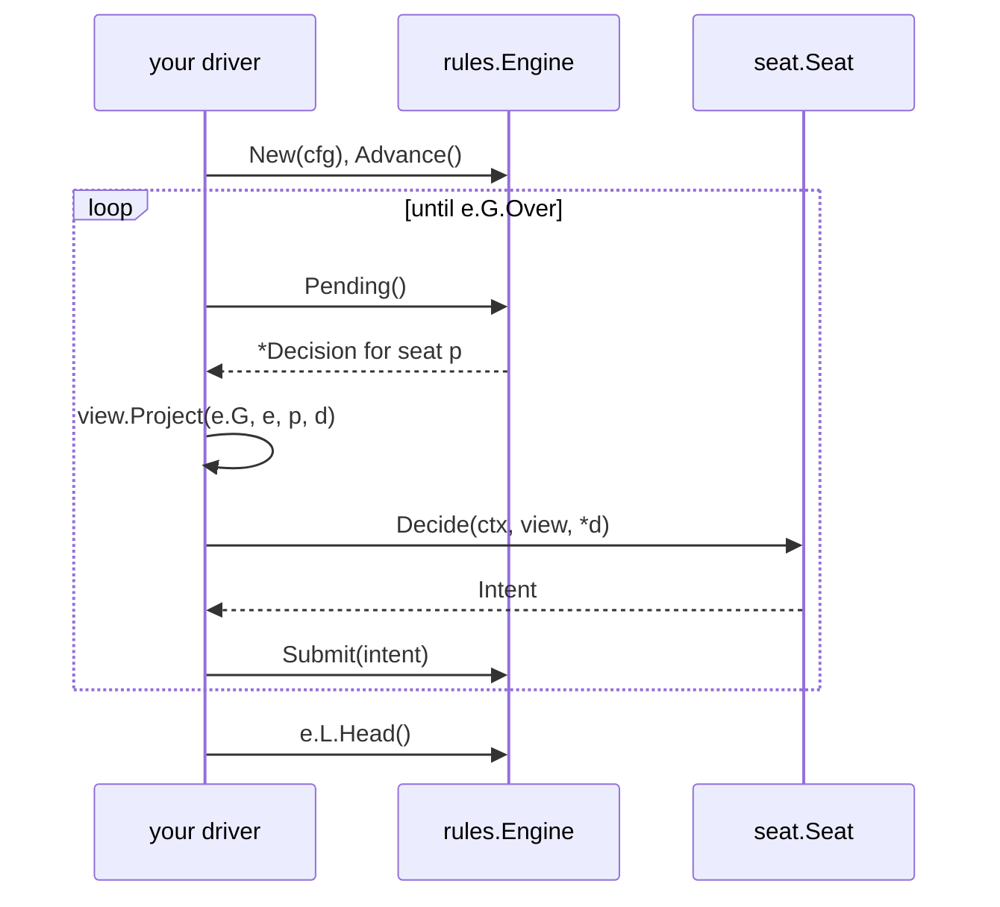

# Go embedding API

This page is for Go developers who import gorge as a library: to play games in their own program, to write a bot policy, or
to build their own server around gorge's host. It walks the entry points package by package, with signatures from the code, a
program that was compiled and run, and an account of which parts of the surface are pinned by tests. Terms such as *seat*,
*decision*, *intent*, *view* and *chain head* are in the [glossary](../contributing/glossary.md). gorge has no tagged releases, so pin a
commit ([Stability](#stability)).

## The layers you touch

An embedder only ever touches a few packages. The arrows mean "imports".



You can stop at any layer. A batch simulator needs only `engine/` (and a bot
from `bots/`). A custom server builds on `server/host`. A binary that is
gorged plus one extra bot needs only `server/gorged` and a `bots.Register`
call. See [Architecture](../architecture/index.md) for why the
engine is split this way, [The game loop](../architecture/gorge/game-loop.md)
for what happens between two decisions, and [Packages](../architecture/packages.md) for
every package in the tree.

## 1. Playing a game: the engine

### Load the cards: `engine/cards`

[pkg.go.dev](https://pkg.go.dev/github.com/adams-shaun/gorge/engine/cards) ·
[source](https://github.com/adams-shaun/gorge/tree/main/engine/cards)

Card behaviour comes from Forge card scripts compiled into an IR. The scripts
are GPL-3.0 and gorge never ships them, so you fetch them once into a
directory (`make fetch-cards` in a gorge checkout writes `.cards/`; see
[Getting started](../getting-started.md)) and open that directory at run time.

| Signature | Purpose |
|---|---|
| `func SharedCorpus(dir string) (*Registry, error)` | Opens `dir`'s compiled IR cache once per process and returns the same registry on every later call. Use this one. |
| `func OpenCorpus(dir string) (*Registry, error)` | Uncached open: loads `dir/ir-<fingerprint>.gob.gz`, or compiles `dir/cardsfolder` when the cache is missing or older than `dir/cards.lock`, and writes the fresh cache back. |
| `func (r *Registry) Lookup(name string) (*Card, bool)` | One card by name (names are normalised). |
| `func (r *Registry) Universe() *Universe` | Every card, in registry order: the list a "name a card" decision ranges over. |
| `Registry.Tokens map[string]*Card` | Compiled token scripts, keyed by file stem. |

Why `SharedCorpus`: the registry is about 400 MB, and the rules layer keys
memo tables on its pointers, so a process that reopens it per game keeps every
copy alive. The cache file name carries the compiler's fingerprint, so a
binary never reads a cache another parser version wrote.

### Load a deck: `engine/deck`

[pkg.go.dev](https://pkg.go.dev/github.com/adams-shaun/gorge/engine/deck) ·
[source](https://github.com/adams-shaun/gorge/tree/main/engine/deck)

| Signature | Purpose |
|---|---|
| `func Load(r *cards.Registry, path string) (File, []*cards.Card, error)` | Reads, parses and resolves one deck JSON file. The slice is what `rules.Config.Decks` wants. |
| `func Parse(raw []byte) (File, error)` | Decodes a deck file and rejects empty or malformed lists. |
| `func (f File) Resolve(r *cards.Registry) ([]*cards.Card, error)` | Looks every entry up and expands it by its count, in file order; the first unknown card is named in the error. |

The repository's own decks live in
[`testkit/testutil/decks/`](https://github.com/adams-shaun/gorge/tree/main/testkit/testutil/decks).

### Build and drive the engine: `engine/rules`

[pkg.go.dev](https://pkg.go.dev/github.com/adams-shaun/gorge/engine/rules) ·
[source](https://github.com/adams-shaun/gorge/tree/main/engine/rules)

| Signature | Purpose |
|---|---|
| `func New(cfg Config) *Engine` | Builds a game at genesis. The toss winner takes the first turn without being asked. |
| `func NewStartingPlayerChoice(cfg Config) *Engine` | The same, but the toss winner may choose who goes first (CR 103.1). The host uses this one. |
| `func (e *Engine) AskStartingPlayer() *decision.Decision` | With `NewStartingPlayerChoice`: poses that choice (call before the first `Advance`), or returns nil when there is nothing to choose. If you never call it, `Advance` applies the default. |
| `func (e *Engine) Advance()` | Runs engine work until a decision is needed or the game ends. Call it once after construction. |
| `func (e *Engine) Pending() *decision.Decision` | The decision currently posed to a seat, or nil. The pointer and its `Options` are valid only until the next `Submit`; copy with `Decision.Clone()` to keep it. |
| `func (e *Engine) Submit(in decision.Intent) error` | Applies an answer and runs on to the next decision. Anything the engine did not offer is rejected. |
| `func (e *Engine) EnsurePaymentActions() []decision.PaymentAction` | Lazily builds the mana-payment plans on the pending priority decision, for a seat that wants them (see `seat.PaymentPlanConsumer`). A pure read: no event, no RNG. |
| `func (e *Engine) EnsureTargetHints()` | Same pattern for per-option target counts (`seat.TargetHintConsumer`). |
| `func (e *Engine) Clone() *Engine` | An independent copy, for look-ahead. |
| `e.G *state.Game`, `e.L *events.Log` | The game state (`G.Over`, `G.Draw`, `G.Winner`, `G.Turn`) and the event log (`L.Head()` is the chain head). Read them; never write them. |

`Config` has many fields; each one's zero value is the old behaviour, so a
`Config` that leaves a field unset plays exactly as it did before that field
existed. The ones an embedder sets:

| Field | Meaning |
|---|---|
| `Seed uint64` | The game's only source of randomness. Same seed, same seats, same game. |
| `Names []string`, `Decks [][]*cards.Card` | One per seat. `Names` appear in event text, which is hashed. |
| `Tokens map[string]*cards.Card` | `reg.Tokens`. Without it a token-making card has nothing to make. |
| `NameUniverse *cards.Universe` | `reg.Universe()`, for "name a card" decisions. |
| `Mulligans int` | London mulligans allowed; 0 skips the mulligan round. |
| `Format Format`, `StartingLife int32`, `Commanders [][]int` | Commander play. |
| `PlayerNames []string` | Display names, separate from the hashed `Names`. |
| `LoopGuard *LoopGuard` | Livelock-watcher thresholds; nil is the defaults. |

A replay needs the same `Config` again (the log alone cannot rebuild the
decks), so keep it.

Other exported entry points you may meet: `AcceptanceConfig` and
`PlayAcceptance` play the golden acceptance game that `TestHeads` pins (and
`cmd/headdiff` replays), and `RunOracleScenarioJSON` runs one oracle scenario,
which is how [gorge-compliance](https://github.com/adams-shaun/gorge-compliance)
plays its corpora against the engine.

!!! warning "`*rules.Engine` exports far more than this"
    `go doc ./engine/rules Engine` lists a few hundred methods (`Emit*`,
    `Begin*Batch`, `Chars`, `LegalTargets`, ...). Most exist so `engine/effects`
    can call back into the engine without an import cycle. They are not an
    embedding API; a driver needs only the rows above.

### Decisions and intents: `engine/decision`

[pkg.go.dev](https://pkg.go.dev/github.com/adams-shaun/gorge/engine/decision) ·
[source](https://github.com/adams-shaun/gorge/tree/main/engine/decision)

The engine never asks "what do you want to do?". It poses a `Decision` that
lists every legal option, and the seat answers with an `Intent` naming
option indices. That is what keeps clients and bots rules-ignorant: a client
cannot make an illegal play, because it can only pick from the list.

| Signature | Purpose |
|---|---|
| `type Decision struct{ Seq uint64; Player state.PlayerID; Kind Kind; Prompt string; Min, Max int; Options []Option; ... }` | One question to one seat: choose between `Min` and `Max` of `Options`. Further fields carry budgets, payment plans and diagnostics. |
| `type Option struct{ Index int; Kind string; Label string; Obj state.ObjID; Player state.PlayerID; ... }` | One offered choice. |
| `type Intent struct{ Seq uint64; Player state.PlayerID; Choices []int; Rest []int; Payment *PaymentSelection; Announce *AnnounceSelection }` | The answer. `Seq` and `Player` must match the decision. |
| `func (d *Decision) Validate(in Intent) error` | Rejects anything the engine did not offer: stale `Seq`, wrong player, bad indices, wrong count, duplicates. `Engine.Submit` runs it. |
| `func (d *Decision) Clone() *Decision` | A deep copy that outlives the next `Submit`. |
| `type Kind string`, `var Kinds = []Kind{...}` | The decision kinds. |

`Kinds`, in declaration order:

| Kind | Wire name | Asked when |
|---|---|---|
| `KPriority` | `priority` | A seat holds priority: cast, activate, play a land, pass, concede. |
| `KTarget` | `target` | Choosing targets. |
| `KAttackers` | `attackers` | Declaring attackers. |
| `KBlockers` | `blockers` | Declaring blockers. |
| `KMulligan` | `mulligan` | London mulligan: keep or mulligan, then which cards to bottom. |
| `KModes` | `modes` | A modal choice or an "unless pays" ask. |
| `KTriggerOrder` | `trigger_order` | Ordering simultaneous triggers. |
| `KTriggerOptional` | `trigger_optional` | Whether to use a "may" trigger. |
| `KCommanderZone` | `commander_zone` | A commander's owner chooses the command zone (CR 903.9). |
| `KChoose` | `choose` | X values, cost choices, "as it enters" choices, yes/no. |
| `KReplacement` | `replacement` | Ordering competing replacement effects (CR 616.1). |
| `KArrange` | `arrange` | Scry, surveil and other ordered-subset asks. |
| `KStartingPlayer` | `starting_player` | Who takes the first turn (CR 103.1). |

A seat must be able to answer every kind. The simplest legal answer to any
decision is `botpolicy.Clamp(d, decision.Intent{Seq: d.Seq, Player: d.Player})`
from `bots/botpolicy`: it tops the empty answer up to `Min` and prefers "pass".

### The seat contract: `engine/seat`

[pkg.go.dev](https://pkg.go.dev/github.com/adams-shaun/gorge/engine/seat) ·
[source](https://github.com/adams-shaun/gorge/tree/main/engine/seat)

```go
type Seat interface {
	Decide(ctx context.Context, v view.View, d decision.Decision) (decision.Intent, error)
}
```

A seat is handed a `view.View` and never a `*state.Game` or `*rules.Engine`,
so it sees only what a real player at that seat would. A bot ignores `ctx`
and never returns an error; a human seat uses `ctx` to time out. Two optional
interfaces let a seat ask the driver for extra, engine-computed help:

| Interface | Effect |
|---|---|
| `PaymentPlanConsumer { WantsPaymentActions() bool }` | The driver calls `Engine.EnsurePaymentActions` before handing this seat a decision, so `Decision.PaymentActions` carries ready-made mana payments. |
| `TargetHintConsumer { WantsTargetHints() bool }` | The driver calls `Engine.EnsureTargetHints`, filling per-option target counts. |

### What a seat sees: `engine/view`

[pkg.go.dev](https://pkg.go.dev/github.com/adams-shaun/gorge/engine/view) ·
[source](https://github.com/adams-shaun/gorge/tree/main/engine/view)

| Signature | Purpose |
|---|---|
| `func Project(g *state.Game, ch Chars, viewer state.PlayerID, d *decision.Decision) View` | One seat's view: hidden zones it does not own are counts only, and `d` is attached only for the seat it was asked of. `*rules.Engine` satisfies `Chars`, so pass the engine. |
| `func ProjectFor(g *state.Game, ch Chars, viewer state.PlayerID, vis Visibility, d *decision.Decision) View` | The same with an explicit `Visibility`: `Seat` (exactly `Project`), `Public` (spectator) or `Omniscient` (every hand). |

### Replaying: `engine/replay`

[pkg.go.dev](https://pkg.go.dev/github.com/adams-shaun/gorge/engine/replay) ·
[source](https://github.com/adams-shaun/gorge/tree/main/engine/replay)

| Signature | Purpose |
|---|---|
| `func Replay(l *events.Log, cfg rules.Config) (*rules.Engine, error)` | Re-runs a match from its `Config` and recorded intents and checks every rebuilt event against the log. |
| `func ReplayTo(l *events.Log, cfg rules.Config, n int) (*rules.Engine, error)` | The same, stopping after `n` intents. |

### The drive loop



### A complete program

This program loads the corpus, loads two of the repository's deck files,
seats the default heuristic bot against a seat that always passes, plays to
the end, prints the result and the chain head, then replays the log and
prints the replayed head.

```go title="main.go"
// Command playtwo plays one 2-player game between two deck files and prints
// the winner and the event log's chain head.
//
//	go run . -cards /path/to/gorge/.cards deckA.json deckB.json
package main

import (
	"context"
	"flag"
	"fmt"
	"os"

	"github.com/adams-shaun/gorge/bots"
	_ "github.com/adams-shaun/gorge/bots/all" // links the built-in policies ("bot", ...)
	"github.com/adams-shaun/gorge/bots/botpolicy"
	"github.com/adams-shaun/gorge/engine/cards"
	"github.com/adams-shaun/gorge/engine/decision"
	"github.com/adams-shaun/gorge/engine/deck"
	"github.com/adams-shaun/gorge/engine/replay"
	"github.com/adams-shaun/gorge/engine/rules"
	"github.com/adams-shaun/gorge/engine/seat"
	"github.com/adams-shaun/gorge/engine/view"
)

// passSeat is the smallest seat that always answers legally: it asks
// botpolicy.Clamp to fill the empty answer up to the decision's Min, which
// passes priority whenever passing is offered.
type passSeat struct{}

func (passSeat) Decide(_ context.Context, _ view.View, d decision.Decision) (decision.Intent, error) {
	return botpolicy.Clamp(&d, decision.Intent{Seq: d.Seq, Player: d.Player}), nil
}

func main() {
	dir := flag.String("cards", ".cards", "corpus directory (cardsfolder + IR cache)")
	seed := flag.Uint64("seed", 1, "game seed")
	flag.Parse()
	if flag.NArg() != 2 {
		fmt.Fprintln(os.Stderr, "usage: playtwo [-cards DIR] [-seed N] deckA.json deckB.json")
		os.Exit(2)
	}

	// 1. The card registry: the compiled IR cache, compiled on first use.
	reg, err := cards.SharedCorpus(*dir)
	if err != nil {
		fmt.Fprintln(os.Stderr, err)
		os.Exit(1)
	}

	// 2. Two decks, resolved against the registry.
	var names []string
	var decks [][]*cards.Card
	for _, path := range flag.Args() {
		f, list, err := deck.Load(reg, path)
		if err != nil {
			fmt.Fprintln(os.Stderr, err)
			os.Exit(1)
		}
		names = append(names, f.Name)
		decks = append(decks, list)
	}

	// 3. The engine. Tokens and NameUniverse come from the same registry.
	cfg := rules.Config{
		Seed: *seed, Names: names, Decks: decks,
		Tokens: reg.Tokens, NameUniverse: reg.Universe(),
	}
	e := rules.New(cfg)

	// 4. One seat per player: the default heuristic bot, and passSeat.
	bot, err := bots.New("bot", bots.Options{Seed: *seed})
	if err != nil {
		fmt.Fprintln(os.Stderr, err)
		os.Exit(1)
	}
	seats := []seat.Seat{bot, passSeat{}}

	// 5. The drive loop: run to the next decision, show the asked seat its
	// own view, submit its answer.
	ctx := context.Background()
	e.Advance()
	intents := 0
	for !e.G.Over {
		d := e.Pending()
		if d == nil {
			break
		}
		s := seats[d.Player]
		if pc, ok := s.(seat.PaymentPlanConsumer); ok && pc.WantsPaymentActions() {
			e.EnsurePaymentActions()
		}
		v := view.Project(e.G, e, d.Player, d)
		in, err := s.Decide(ctx, v, *d)
		if err == nil {
			err = e.Submit(in)
		}
		if err != nil {
			fmt.Fprintf(os.Stderr, "intent %d: %v\n", intents, err)
			os.Exit(1)
		}
		intents++
	}

	switch {
	case !e.G.Over:
		fmt.Println("game did not finish")
	case e.G.Draw:
		fmt.Println("draw")
	default:
		fmt.Printf("winner: seat %d (%s)\n", e.G.Winner, names[e.G.Winner])
	}
	fmt.Printf("turns: %d  intents: %d  events: %d  head: %s\n",
		e.G.Turn, intents, len(e.L.Events), e.L.Head())

	// 6. Replay: the same Config plus the recorded intents rebuild the game.
	r, err := replay.Replay(e.L, cfg)
	if err != nil {
		fmt.Fprintln(os.Stderr, "replay:", err)
		os.Exit(1)
	}
	fmt.Printf("replay head: %s\n", r.L.Head())
}
```

Build it as its own module whose `go.mod` requires `github.com/adams-shaun/gorge` with a `replace` pointing at a local gorge
checkout, or `go get github.com/adams-shaun/gorge@<commit>` without one. Run on 2026-10-31 from the gorge checkout, with `$P` the
program's directory:

```console
$ go -C "$P" run . -cards "$PWD/.cards" \
    "$PWD/testkit/testutil/decks/mono-red-goblins.json" \
    "$PWD/testkit/testutil/decks/mono-green-stompy.json"
winner: seat 0 (Mono-Red Goblins)
turns: 8  intents: 189  events: 1092  head: fa3bb1cf9402af98
replay head: fa3bb1cf9402af98
```

A second run prints the same three lines: the game is a pure function of the seed, the decks and the seats. The head differs at
another commit whenever an engine or corpus change alters any event of this game, which is what the chain head is for.

### Running any engine: `engine/game`

[source](https://github.com/adams-shaun/gorge/tree/main/engine/game)

`engine/game` is the seam a host runs an engine through, so a server isn't tied to `rules.Engine`.
`engine/game/gorgegame` adapts gorge's engine to it, and `gorged -engine` selects among the engines a binary links; a plain build
links only `gorge`.

!!! tip "A ready-made loop"
    [`testkit/bench.PlayGame`](https://pkg.go.dev/github.com/adams-shaun/gorge/testkit/bench)
    (`func PlayGame(cfg rules.Config, seats []seat.Seat, maxTurns, maxIntents int, hooks Hooks) (Outcome, *rules.Engine, error)`)
    is the same loop with turn and intent caps, the match-lifecycle hooks
    below, and stall classification. Use it when you want batch games rather
    than a loop of your own.

## 2. Bots

### The registry: `bots`

This section is the reference. For a guided walkthrough (a real policy,
options, playing it in-process, testing it) see
[Writing a native Go bot](../bots/native-go.md).

[pkg.go.dev](https://pkg.go.dev/github.com/adams-shaun/gorge/bots) ·
[source](https://github.com/adams-shaun/gorge/blob/main/bots/registry.go)

A bot policy is a named factory in a process-wide registry. Registering is
done from a package's `init`, so linking the package (usually a blank import)
is what makes the policy exist; `bots/all` links every built-in one.

| Signature | Purpose |
|---|---|
| `func Register(e Entry)` | Adds a policy. Panics on a bad name (`^[a-z0-9-]+$`), a nil factory, a tier other than `Production`/`Experimental`, a duplicate, or an invalid option declaration. |
| `type Entry struct{ Info; New Factory }` | A registration. |
| `type Factory func(Options) (seat.Seat, error)` | Builds one seat. |
| `func New(name string, o Options) (seat.Seat, error)` | Builds a seat of the named policy, filling every declared option's default into `o.Config` first. `""` means `bots.Default` (`"bot"`). |
| `func Lookup(name string) (Entry, bool)`, `func Names() []string`, `func Entries() []Entry` | Inspect the registry. |

`Info` describes a policy to the host and to the lobby:

| Field | Meaning |
|---|---|
| `Name, Label, Description string` | Registry key, display name, one-line description. |
| `Tier Tier` | `bots.Production` or `bots.Experimental`. |
| `Formats []string` | `"constructed"`, `"commander"`; gorged refuses a play-vs-bot game in a format the policy does not list. |
| `MaxSeats int` | The most seats the policy plays at; the host refuses a bigger table. 0 means no limit. |
| `Options []OptionSpec` | Configuration keys the factory reads: `{Key, Type, Default, Help, Required}`, `Type` one of `string`, `int`, `float`, `bool`, `path`. Read them in the factory with `Options.String/Int/Float/Bool`. |
| `NeedsAutoPay bool` | The policy only plays through payment plans; the host refuses a table without them. |
| `Caretaker string` | A registered, non-`Env` policy declared as this one's stand-in; `bots.Validate` checks it exists and is not an `Env` policy. The host does not read it: a human seat's think-timeout caretaker is built from the table's own `BotPolicy`. |
| `Env, Search, ClosedLists bool` | For search policies that build an engine from the decklists. A policy with `Env` and without `ClosedLists` reads every seat's real decklist, so the host never seats it against a human. |
| `Cost Cost` | The published per-decision cost, shown by `/api/bot-policies`. |

`Options` is what a factory receives: `Seed`, `AutoPayMana` (play through
payment plans), `SearchParallelism`, `DecisionDeadlineMS`, `CommonSense`,
`Deps` (`Deps{Cards *cards.Registry}`, for a policy that needs the corpus)
and `Config` (the resolved option values).

Optional seat interfaces, all in package `bots`, which the host detects with
a type assertion:

| Interface | Called |
|---|---|
| `MatchSeat { AttachMatch(*MatchContext) error }` | Once per match, after the engine exists and before the first decision; carries game id, seat index, format, own decklist, seed. An error refuses the match. `bots.AttachMatch(s, ctx)` is the no-op-safe caller. |
| `MatchEnd { EndMatch(MatchResult) }` | Once after the match ends. |
| `RefusalAnswerer { AnswerRefused(v view.View, d decision.Decision, refused decision.Intent) decision.Intent }` | When the engine refused this seat's answer: one second attempt before the host's fallbacks. |
| `EnvSeat` | A search seat that answers some decisions from host-built inputs (`bots.Env`) richer than a view. |
| `BudgetedSeat { DecisionBudgetMS() int }` | A per-decision wall-clock budget the host turns into a context deadline. |

Two building blocks most Go bots use:

- [`bots/botpolicy`](https://pkg.go.dev/github.com/adams-shaun/gorge/bots/botpolicy):
  the shared heuristic policy over a `Board` (a compact, bot-oriented reading
  of the game), plus `Clamp`, which makes any answer legal in count.
- [`bots/heuristic`](https://pkg.go.dev/github.com/adams-shaun/gorge/bots/heuristic):
  the default bot as a `seat.Seat` (`func NewBot(seed uint64) *Bot`, and
  variants). A seat that also implements `heuristic.BoardSeat`
  (`DecideBoard(ctx, b botpolicy.Board, d decision.Decision)`) is handed a
  `Board` instead of a `View`, which saves the host the projection.

### What a server offers

[Writing a native Go bot](../bots/native-go.md) has a complete policy, registered and served from a one-line `main` over
`gorged.Main`.

How gorged decides what to offer:

- `-bot-policies` is the offered set. Empty (the default) offers every
  registered policy that does not read opponents' decklists, so a newly
  linked bot is offered with no flag at all. A list narrows it; an unknown or
  duplicated name, or a decklist reader, is a startup error.
- `-bot-policy` is the default for a request that names none
  (`lethal-pressure` unless set). It must be in the offered set and support
  both `constructed` and `commander`.
- Option values resolve, highest first, from `-bot-opt`, the environment, `-bot-config`, then the declared default
  ([Options](../bots/native-go.md#options)).

## 3. The server: `server/gorged`

[pkg.go.dev](https://pkg.go.dev/github.com/adams-shaun/gorge/server/gorged) ·
[source](https://github.com/adams-shaun/gorge/tree/main/server/gorged)

`server/gorged` is the whole reference server as a library.
[`cmd/gorged`](https://github.com/adams-shaun/gorge/blob/main/cmd/gorged/main.go)
is a one-line `main` over it that links `bots/all` and passes only the
`gorged review` loader.
A binary that wants more (a bot, a plugin) is the same one line with something extra linked in.

| Signature | Purpose |
|---|---|
| `func Main(args []string, ext Extensions) int` | Runs gorged: parses `args` (the command line after the program name), binds, serves, handles signals, returns the exit status. |
| `func Serve(ctx context.Context, args []string, ln net.Listener, ext Extensions) error` | `Main` without signal handling or the bind: serves on `ln` until `ctx` is done. The entry point for a test that drives a real server. |
| `func ServeReview(ctx context.Context, args []string, ln net.Listener, ext Extensions) error` | `gorged review` (which `Main` runs when `args[0]` is `review`) without signal handling or the bind: serves saved games read-only on `ln` until `ctx` is done. Needs `ext.Review`. |
| `func ServeFlagSet() *flag.FlagSet` | A fresh copy of the flag set `Main` parses (`ContinueOnError`, no output), so a caller can check an argument list against the real flags. |
| `func ServeFlagSetFor(ext Extensions) *flag.FlagSet` | The same, including the extensions' own flags. |
| `func RegisterNetBot(policy string, nb NetBot)` | Links a network-backed policy into this binary; gorged gives it `-<policy>-net`, `-decks`, `-belief`, `-belief-pool` and `-demo-table`. Call before `Main`. |

```go
type Extensions struct {
	// Events, when set, serves draft events under /api/events with -events.
	// Without it -events is refused at startup.
	Events EventsPlugin
	// Flags, when set, registers the extensions' own flags on gorged's
	// command line; a flag name gorged already defines panics.
	Flags func(fs *flag.FlagSet)
	// Review, when set, is the loader `gorged review` turns each input path
	// into a recorded match with. Without it review mode refuses to start;
	// the live server ignores it entirely.
	Review ReviewLoader
}
```

The zero `Extensions` is the live server with no draft events and no review
mode, so `-events` is refused at startup. gorge's own `cmd/gorged` sets `Review`
and sets `Events` to `gorgedevents.Plugin{}` from
[`draft/gorgedevents`](https://pkg.go.dev/github.com/adams-shaun/gorge/draft/gorgedevents).
`server/gorged` cannot import that package itself, because it imports
`server/gorged`. `EventsPlugin`, `EventsWiring`, `EventsEnv` and `EventRuntime`
are the interfaces a draft-event runtime implements to be served under
`/api/events`. The maintainers' private companion module links its network-backed policies through `RegisterNetBot`; gorge's own binary links
none.

## 4. The host: `server/host`

[pkg.go.dev](https://pkg.go.dev/github.com/adams-shaun/gorge/server/host) ·
[source](https://github.com/adams-shaun/gorge/tree/main/server/host)

`server/host` runs tables: each table plays matches on its own goroutine,
seats bots or human seats, persists matches, and answers seat-scoped and
spectator reads. It never hands out a `*rules.Engine` or `*state.Game`:
everything that leaves it is a `view.View`, a `decision.*` value or a
`protocol.*` frame (pinned by `TestNoExportLeaksAnEngineGame`, below).
`server/host/httpapi` puts it on HTTP; gorged wires the two together
(see [The server](../architecture/gorge/server.md)).

| Signature | Purpose |
|---|---|
| `func New(o Options) (*Registry, error)` | Validates `o`; when `o.Dir` is set, reads persisted tables back. Nothing runs until `Start`. |
| `func (r *Registry) AddTable(c TableConfig) error` | Registers (and persists) a table without starting it. |
| `func (r *Registry) Start(id TableID) error`, `StartAll() error` | Launches the table goroutine(s). |
| `func (r *Registry) Wait(id TableID)` | Blocks until the table goroutine exits. |
| `func (r *Registry) Close() error` | Stops every table. |
| `func (r *Registry) Pending(id TableID, k int, player state.PlayerID) (*decision.Decision, error)` | A copy of the decision parked on a human seat, or an error (no such match, a bot seat, nothing parked). |
| `func (r *Registry) SubmitIntent(id TableID, k int, player state.PlayerID, in decision.Intent) error` | Answers that decision. It validates exactly as `Decision.Validate` does and wakes the match goroutine, which runs the engine's `Submit`; a caller can never race the log. |
| `func (r *Registry) ViewAtSeat(id TableID, k int, seq uint64, player state.PlayerID) (view.View, error)` | One seat's own view as of event `seq`; past the head it returns `ErrBeyondHead{Head}`. |
| `func (r *Registry) ViewAt(id TableID, k int, seq uint64) (view.View, error)` | The table's spectator view at `seq`. |
| `func (r *Registry) Tables() []protocol.TableInfo`, `Matches(id TableID) ([]protocol.MatchInfo, error)` | Lobby and history reads. |

`k` is the match number within the table, counting from **1**.

`Options` fields an embedder sets: `LoadDeck func(name string) (Deck, error)`
(the host never reads deck files itself), `Tokens` and `NameUniverse` (as in
`rules.Config`), `Dir` (persistence), `Sleep` (the table's only clock; a test
passes a no-op), `ThinkTimeout` (after which a human seat's caretaker bot
answers), `MaxDecisionsPerTurn` (`DefaultMaxDecisionsPerTurn` is 25000; 0 turns
the stall guard off), `BotDeps`, and `Seats func(names []string, seed uint64)
[]seat.Seat`, which replaces the named-policy seats with your own.
`TableConfig` holds `ID`, `Name`, `Seats`, `Decks` (names for `LoadDeck`;
seat `i` of match `k` plays `Decks[(i+k)%len]`), `Seed`, `BotPolicy` or
`SeatBotPolicies`, `Humans []int` (slots driven through
`Pending`/`SubmitIntent`), `Spectator`, `Mulligans`, `Format` and more.

A tested sketch of a human seat answered from outside, the way an HTTP
handler would (the full test seats slot 1 as human against the default bot
and answered 20 decisions in 0.6 s):

```go
d, err := r.Pending(id, 1, 1) // match 1, seat 1
if err != nil {
	// not parked yet: the bot seat is still thinking; poll again
}
in := botpolicy.Clamp(d, decision.Intent{Seq: d.Seq, Player: d.Player})
err = r.SubmitIntent(id, 1, 1, in)
```

!!! warning "Wait for a new `Seq` before answering again"
    Right after `SubmitIntent`, `Pending` can still return the decision you
    just answered until the match goroutine picks the answer up. A poller
    must skip a decision whose `Seq` it has already answered, or its second
    `SubmitIntent` lands on a slot that is being retired.

### The contract harnesses

[source](https://github.com/adams-shaun/gorge/blob/main/server/host/contract.go)

The host exports the gates every hosted bot policy owes it, so a module that
registers its own policies runs exactly the harness gorge runs on its own,
through the real host internals. They are test support: gorged never calls
them, so the linker drops them from every binary. Each takes a `ContractT`
(`Helper`, `Logf`, `Errorf`, `Fatalf`, `Cleanup`), which `*testing.T`
satisfies, so the host package does not import `testing`. Call them from your
own `_test.go` files.

| Harness | Asserts |
|---|---|
| `func RunContractTable(t ContractT, o Options, cfg TableConfig) ContractRun` | Builds a registry, plays the table's first match to completion, and replays its log under the match's own `rules.Config`; the replay must reach the recorded head. Two calls with the same inputs are the determinism check. |
| `func RunEnvLeakContract(t ContractT, c EnvLeakContract) uint64` | For an `EnvSeat` policy: swaps the opponent's hidden cards in one of two otherwise identical live matches and requires the policy's answer at that decision to be identical, proving it reads only what the seat may know. Returns the asserted decision's `Seq`. |
| `func RunClosedPrivacyContract(t ContractT, c ClosedPrivacyContract)` | For a closed-list policy: plays it against a human seat and checks at every decision that no unrevealed card of the human's reached anything handed to the bot. |
| `func RunShadowParityContract(t ContractT, o Options, policy string, seed uint64, maxIntents int)` | The host's shadow scan of a policy's own seat reports zero divergences. |
| `func RunCaretakerLifePlanContract(t ContractT, policy string)` | A human seat's caretaker answers a life-paying payment plan from the ordinary options, while the hosted bot of the same policy submits the plan. |

[Writing a native Go bot](../bots/native-go.md#test-it) shows `RunContractTable` in an embedder's test.

## 5. Test support: `testkit/`

[pkg.go.dev](https://pkg.go.dev/github.com/adams-shaun/gorge/testkit/testutil) ·
[source](https://github.com/adams-shaun/gorge/tree/main/testkit)

These packages are importable and are what gorge's own tests use. The deck
helpers read decks embedded in the package, so they work anywhere; the corpus
helpers find `.cards` through `git rev-parse`, so they work inside a gorge
checkout or with `GORGE_CARDS_DIR` set (otherwise use `OpenCorpusRegistry`
with an explicit directory).

| Signature | Purpose |
|---|---|
| `func CorpusRegistry(t testing.TB) *cards.Registry` | The repository's `.cards` registry, opened once per process. Skips the test when `.cards` was never fetched; fails when it exists but will not open. |
| `func OpenCorpusRegistry(dir string) (*cards.Registry, error)` | `cards.SharedCorpus` for a directory you name. |
| `func SharedCorpusDir(dir string) (corpus string, ok bool)` | Where the corpus is for code inside the repository rooted at `dir` (`GORGE_CARDS_DIR` overrides). |
| `func RepoDeckNames() []string`, `func LegacyDeckNames() []string` | The embedded repository decks by file stem; the 12 pinned Legacy decks. |
| `func LoadRepoDeck(r *cards.Registry, name string) ([]*cards.Card, error)`, `func RepoDeck(t testing.TB, r *cards.Registry, name string) []*cards.Card` | One embedded deck, resolved (the `t` form fails the test on error). |
| `func SampleDecks(t testing.TB, n int) (names []string, decks [][]*cards.Card)` | `n` small decks authored inline: no corpus needed. |
| `func AcceptanceDecks(r *cards.Registry, seats int) ([]string, [][]*cards.Card, error)` | The seating of the golden acceptance game. |
| `func CheckInvariants(t testing.TB, g *state.Game, d *decision.Decision, where string)` | The engine's state invariants, for a fuzz or property test. |
| `feedback.EngineAt(t testing.TB, dir string, n int) *rules.Engine` | Package [`testkit/testutil/feedback`](https://pkg.go.dev/github.com/adams-shaun/gorge/testkit/testutil/feedback): loads a captured feedback snapshot and replays it to `n` intents (`n < 0`: all of them), so a bug report becomes a test at the exact board the reporter saw. `go run ./cmd/repro -emit-test <pkg> <dir>` writes the skeleton. |
| `bench.PlayGame(...)` | Package [`testkit/bench`](https://pkg.go.dev/github.com/adams-shaun/gorge/testkit/bench): the batch drive loop described above. |

The server tier is forbidden from importing `testkit/testutil` (see the
layering table), so these stay out of production binaries.

## Stability

gorge's Go API is **not versioned**:

- **No releases.** The module has no semver tags. Depend on a commit's pseudo-version and move it deliberately.
- **Go signatures can change in any commit.** Nothing checks exported Go
  signatures against a previous version. Field additions to `rules.Config`
  have so far been zero-value compatible (each field's doc says so), but that
  is a habit, not a test.
- **`internal/` is not importable** outside the module (Go's own rule):
  `internal/archtest`, `codeshape`, `corpusheap`, `testbudget`, `tsgen`.
- **`testkit/` is test support**, shaped by gorge's own tests.

What *is* pinned, and by which test:

| Surface | What holds | Enforced by |
|---|---|---|
| Wire frames | Every frame type's JSON shape matches a committed golden. `protocol.Version` (1) "bumps only on a breaking change"; that bump is a convention, not a test. | `TestGoldens`, [`server/protocol/protocol_test.go`](https://github.com/adams-shaun/gorge/blob/main/server/protocol/protocol_test.go) over `server/protocol/testdata/*.json` |
| TypeScript wire types | `web/src/protocol.ts` is exactly what `cmd/gentypes` generates from `server/protocol`. | `TestCommittedProtocolTSIsFresh`, [`cmd/gentypes/main_test.go`](https://github.com/adams-shaun/gorge/blob/main/cmd/gentypes/main_test.go) |
| Event log and replay | `events.Kind` is append-only (documented on the type). Renumbering a kind changes every chain head, so the golden heads catch it; the acceptance games must also replay byte for byte. | `TestHeads`, [`engine/rules/heads_test.go`](https://github.com/adams-shaun/gorge/blob/main/engine/rules/heads_test.go) against `engine/rules/testdata/heads/{2,4,6,8}.txt`; `TestRepoDeckGamesReplayExactly`, [`engine/rules/acceptance_test.go`](https://github.com/adams-shaun/gorge/blob/main/engine/rules/acceptance_test.go); `TestEveryKindHasADescriptor`, `engine/events/kindinfo_test.go` |
| Decision kinds | `decision.Kinds` lists every declared kind exactly once. Adding a kind is a breaking change for every client, but no test forbids it. | `TestKindsListsEveryKindOnce`, [`engine/decision/decision_test.go`](https://github.com/adams-shaun/gorge/blob/main/engine/decision/decision_test.go) |
| Hosted-policy gates | The `Run*Contract` harnesses above are the same functions gorge's own host tests call. | `server/host/hosted_policies_test.go`, `hosted_closed_test.go`, `shadowscan_test.go`, `caretaker_life_plan_test.go` |
| Import layering | Which tier may import which, and that the root `go.mod` has no `require`. | [`internal/archtest`](https://github.com/adams-shaun/gorge/tree/main/internal/archtest); [Invariants](../architecture/invariants.md) |

See [Invariants](../architecture/invariants.md) for the design rules behind
these tests and [Repository layout](../contributing/repo-layout.md) for where
each kind of change goes.
