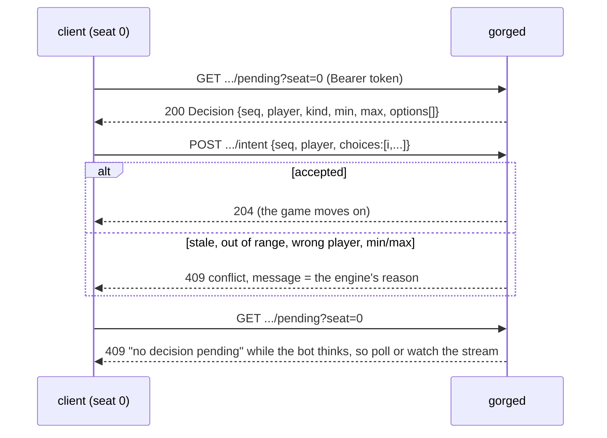

# HTTP API reference

`gorged` is gorge's game server: it runs bot tables, seats humans and bots, and serves
everything over plain HTTP plus one Server-Sent-Events stream. This page is the reference for
that surface, endpoint by endpoint: who may call what, which flag arms it, the bodies, the
statuses and the errors. It is for anyone writing a client: a bot that plays a seat over HTTP,
a dashboard, a replay viewer. For a walkthrough that plays a game end to end, start with
[Playing a seat over HTTP](../bots/http.md); come back here for the field-by-field detail.

The machine-readable spec is the authority, and this page is a reading of it:

| File | What |
|---|---|
| [`openapi.json`](openapi.json) | OpenAPI 3.1, every operation, schema and real example. Feed it to a client generator. |
| [`openapi.yaml`](openapi.yaml) | The same document as YAML (rendered from the JSON). |
| [`schemas/gorge-protocol.schema.json`](schemas/gorge-protocol.schema.json) | The wire types alone, as one JSON Schema 2020-12 document (`$defs`). |
| [Interactive reference](redoc.html) | The spec rendered by Redoc 2.1.5 (needs JavaScript). |

!!! info "How the spec stays true"
    The spec is derived from the code and guarded by a test,
    [`server/host/httpapi/openapi_test.go`](https://github.com/adams-shaun/gorge/blob/main/server/host/httpapi/openapi_test.go).
    It reads every method-qualified route that `server/host/httpapi` and `server/gorged`
    register, and fails when a registered route is missing from the spec or the spec has an
    operation that no code registers. It also builds a fully armed handler and checks that each
    of httpapi's operations is actually routed. Every schema marked `x-go-type` is generated
    from that Go type's source, so a renamed field or a new one fails the test until the spec
    is regenerated. The decision-kind enum is compared with `decision.Kinds`. The examples are
    real responses, captured from a live server on 2026-10-20 at commit `ad3777023`.

    After you change a route or a wire type, regenerate the derived parts and then document
    any new route by hand in `openapi.json`:

    ```sh
    go test ./server/host/httpapi -run TestOpenAPI -update
    ```

## Try it

Start a server (see [Install and build](../guide/install.md)), then:

```sh
GORGE=http://127.0.0.1:8080
curl -s $GORGE/api/tables | python3 -m json.tool | head -20
curl -sN --max-time 2 $GORGE/api/stream | head -c 300
```

Against a two-table server started with `-tables 2 -seats 2 -humans 0`, the first command
printed this (2026-10-20, the server on another port):

```json
[
    {
        "id": "t1",
        "name": "Table 1",
        "seats": 2,
        "spectator": "public",
        "state": "live",
        "match": 1,
        "perpetual": false,
        "format": "constructed",
        "bot_policy": "lethal-pressure",
        "seat_names": [
            "Player 1",
            "Player 2"
        ],
        "mulligans": 1,
        "auto_mana": true
    },
```

and the second printed the stream's first frame, `hello`:

```text
event: hello
data: {"v":1,"t":"hello","seq":0,"body":{"session":"sd10b14058b154be1d85ac19eada7c909","tables":[...
```

## Who may call what

gorged has no login. A request is either a **spectator** or holds a **seat claim**.

- **Spectator.** Every read endpoint works without credentials and returns what the table's
  spectator visibility allows. `public` hides every hand; `omniscient` shows them. You set it
  with `-spectator` for the startup tables and `-vsbot-spectator` for play-vs-bot tables.
- **Seat claim.** A seat token resolves to exactly one (table, seat) pair. Send it as
  `Authorization: Bearer <token>` or as `?token=<token>`; the header wins when both are present.
  The server never trusts a seat number the client sends. It only compares that number with
  the claim:

| The request | Result |
|---|---|
| Names no seat (no `?seat=`), on a read endpoint | Spectator view; no token is consulted |
| `?seat=N` or a seat action, on a server with no seat claims at all (no `-humans`, `-vsbot` or `-events`) | 403 `forbidden`, "this server is spectator-only" |
| Has no valid token | 401 `unauthorized` |
| The token's table is not this table | 403 `forbidden` |
| The token's seat is not `N` | 403 `forbidden` |
| The claim matches | The seat's own view and actions |

You get a seat token in one of three ways:

- `POST /api/games` returns one for the seat it creates. That response is the only place
  the token ever leaves the server.
- With `-humans 0,2`, gorged mints one per human slot of table `t1` and prints the join URL
  for each at startup: `table t1 seat 0 joins at http://127.0.0.1:8080/t/t1?seat=0&token=…`.
- `-seat-token TOKEN` fixes the first human slot's token. It is meant for tests and local use.

## Which routes exist

Some routes exist only when a flag mounts them. Without the flag, an `/api/` path answers the
JSON 404 `no such endpoint`, and a non-API path falls through to the web client.

| Flag | Mounts |
|---|---|
| none | The lobby, matches, seat and stream routes, and the `/art/` and `/cards/` card cache |
| `-vsbot` | `POST /api/games`. It also arms seat claims, so a seat request without a token is a 401, not a 403. |
| `-humans 0,…` | Seat claims for those slots of `t1` |
| `-feedback DIR` | `POST /api/feedback`. The binary's default directory is `feedback`; an empty value disarms the route. |
| `-pprof` | `/debug/pprof/…`. gorged refuses the flag unless `-addr` is a loopback address. |
| `-events` | `/api/events…`, off by default. gorge's `cmd/gorged` links the runtime ([Draft events](../guide/draft.md)); an embedding program whose [`server/gorged.Extensions`](go.md) has no `Events` is refused at startup. |
| `gorged review` | A separate, read-only mode: the lobby, match and stream routes over saved games, plus `GET …/decisions`. Every seat route answers 403. |
| `-manabrew` | The ManaBrew adapter under `/api/manabrew/v0/tables/`. This is a separate, deprioritised protocol and is not covered here (see [below](#not-covered)). |

Every other path (`/`, `/t/t1`, …) serves the embedded web client with an SPA fallback to
`index.html`. A binary built without the web bundle answers those paths with
`503 web build missing`.

## Endpoints

The **Auth** column tells you whether an endpoint is open to spectators, or what credential it
reads. A seat token exists only when one of the seat flags is on; see
[Who may call what](#who-may-call-what). Every `/api/` route also answers 405
`method_not_allowed` to a wrong method. Full request and response schemas, and an example for
each, are in [`openapi.json`](openapi.json) and the [interactive reference](redoc.html).

### Lobby

| Method | Path | What | Auth | Statuses |
|---|---|---|---|---|
| `GET` | `/api/tables` | The lobby's tables (`TableInfo[]`). Play-vs-bot tables are not listed. | none | 200 |
| `GET` | `/api/decks` | The deck catalogue (`DeckInfo[]`). With `?policy=NAME`, only the decks a game against that policy may use. | none | 200 |
| `GET` | `/api/bot-policies` | The offered bot policies and the default (`BotPolicyList`) | none | 200 |
| `GET` | `/api/capabilities` | Which optional surfaces this server serves (`Capabilities`): `events` is true when `/api/events` is mounted; `engine` names the engine this server creates tables on, absent for gorge | none | 200 |
| `GET` | `/api/stats/decks` | Deck leaderboard over finished bot-vs-bot games (`DeckTally`). `?min_games=N`, default 10. | none | 200, 400 |

### Matches

| Method | Path | What | Auth | Statuses |
|---|---|---|---|---|
| `GET` | `/api/tables/{t}/matches` | The table's matches, finished ones first and the live one last (`MatchInfo[]`) | none | 200, 404 |
| `GET` | `/api/tables/{t}/matches/{k}/view` | The board at `?seq=` (inclusive; default: the latest event). With `?seat=`, that seat's view, including its pending decision when `seq` is the live head (`View`). | spectator, or a seat token with `?seat=` | 200, 400, 401, 403, 404, 409 |
| `GET` | `/api/tables/{t}/matches/{k}/events` | Redacted events from `?since=` (inclusive, default 0) to the head, each with its transcript line (`EventBody[]`) | spectator, or a seat token with `?seat=` | 200, 400, 401, 403, 404, 409 |
| `GET` | `/api/tables/{t}/matches/{k}/decisions` | Only on a `gorged review` server: the recorded match's decision index, one entry per intent, with the options offered, the answer and the bot's explain note ([Replays](../guide/replays.md#reading-a-decision)) | none | 200, 400, 404 |

`k` is the match index and counts from 1; 0 or a non-number is a 400. A `seq` or `since` past
the head is a 409 `beyond_head`, and the body's `head` names the last valid seq so you can
clamp and retry:

```json
{"code": "beyond_head", "message": "host: seq beyond head 3994", "head": 3994}
```

### Playing a seat

| Method | Path | What | Auth | Statuses |
|---|---|---|---|---|
| `GET` | `/api/tables/{t}/matches/{k}/pending?seat=N` | The full decision your seat is being asked (`Decision`) | seat token, required | 200, 400, 401, 403, 404, 409 |
| `POST` | `/api/tables/{t}/matches/{k}/intent` | Answer it (`Intent` body). `?auto=1` marks an autopilot answer. | seat token, required | 204, 400, 401, 403, 404, 409 |
| `POST` | `/api/tables/{t}/matches/{k}/undo` | Rewind the live match to the decision you last answered | seat token, required | 204, 401, 403, 404, 409 |

### The stream

| Method | Path | What | Auth | Statuses |
|---|---|---|---|---|
| `GET` | `/api/stream` | Server-Sent Events. A fresh connection starts with `hello`. | none | 200 |
| `POST` | `/api/subscribe` | `{session, table, mode}`: `overview` or `focus`; `table` `*` means every table, overview only | none (the session id is the capability) | 204, 400, 404 |
| `POST` | `/api/unsubscribe` | `{session, table}` | none | 204, 400, 404 |

The stream has its own page: [The event stream](sse.md).

### Games, feedback, cards and profiling

| Method | Path | What | Auth | Statuses |
|---|---|---|---|---|
| `POST` | `/api/games` | Start a play-vs-bot game (`CreateGameRequest` in, `CreateGameResponse` out, including the seat token and join path) | none | 200, 400, 404 |
| `POST` | `/api/feedback` | A bug report, as `multipart/form-data` with fields `text` (required), `url`, `table`, `seat`, `screenshot` (PNG) and `client.json`. Answers `201 {"id": …}`. | none | 201, 400, 500 |
| `GET` | `/art/named?exact=NAME` | Card art reference, Scryfall-shaped: `{name, image_uris: {normal}}` | none | 200, 400, 404, 502, 503 |
| `GET` | `/art/token?exact=NAME&types=…&ppt=P/T` | Token art reference, same shape | none | 200, 400, 404, 502, 503 |
| `GET` | `/art/blob/{key}` | The cached JPEG, `Cache-Control: immutable` | none | 200, 404 |
| `GET` | `/cards/named?exact=NAME` | A card's printed facts: `name`, `mana_cost`, `type_line`, `oracle_text`, `power`, `toughness` | none | 200, 400, 404, 502, 503 |
| `GET` | `/debug/pprof/`, `…/cmdline`, `…/profile`, `…/symbol`, `…/trace`; `POST …/symbol` | Go's `net/http/pprof` | none (loopback only) | 200 |

The card routes fetch from Scryfall the first time a name is asked for, paced and
single-flight, and cache the result under `-art-dir`. A fetch that outlives the wait budget
answers 503 and keeps running, so a retry soon after is served from disk. Errors from these
gorged-owned routes (`/art/`, `/cards/`, `/api/feedback`, `/debug/`) are `text/plain`, not
`ErrorBody`.

### Draft events

These 15 operations appear only on a server running with `-events`, and otherwise answer the
JSON 404. The walkthrough is in the [user guide](../guide/draft.md#run-an-event-over-http). A seat is identified by an event token (`Authorization: Bearer` or `?token=`), and a
request without one is a spectator. The backend picks the status and `code` of its own refusals.

| Method | Path | Body in → out |
|---|---|---|
| `POST` | `/api/events` | `CreateEventRequest` → `CreateEventResponse` |
| `GET` | `/api/events` | → `EventState[]` |
| `GET` | `/api/events/sets` | → `EventSetInfo[]` |
| `GET` | `/api/events/personas` | → `EventPersonas` |
| `GET` | `/api/events/{id}` | → `EventState` |
| `POST` | `/api/events/{id}/join` | `JoinEventRequest` → `EventState` |
| `GET` | `/api/events/{id}/pack` | → `DraftPack` |
| `POST` | `/api/events/{id}/pick` | `PickRequest` → `DraftPack` |
| `GET` | `/api/events/{id}/pool` | → `EventPool` |
| `POST` | `/api/events/{id}/deck/check` | `DeckRequest` → `DeckCheck` |
| `POST` | `/api/events/{id}/deck` | `DeckRequest` → `DeckCheck` |
| `POST` | `/api/events/{id}/ready` | `ReadyRequest` → `EventState` |
| `POST` | `/api/events/{id}/sideboard` | `SideboardRequest` → `EventState` |
| `GET` | `/api/events/{id}/log` | → `EventLog` |
| `POST` | `/api/events/{id}/subscribe` | `EventSubscribe` → 204; routes the event's frames to a stream session |

## The decision loop

A seat plays by repeating one exchange: read the pending decision, then answer it with option
indices. gorge lists every legal option and validates every answer. A bot can choose badly, but
it can never choose illegally.



A real `attackers` decision, as `pending` returned it:

```json
{"seq": 550, "player": 0, "kind": "attackers", "prompt": "turn 4 — declare attackers",
 "min": 0, "max": 1,
 "options": [{"index": 0, "kind": "attacker", "label": "Attack with Experiment One at Bot",
              "obj": 33, "player": 1}]}
```

The answer echoes `seq` and `player` and names indices:

```json
{"seq": 550, "player": 0, "choices": [0]}
```

Some rules about intents:

- `choices` must be distinct, in range, and between `min` and `max` in number. The kind's own
  constraints apply too. For example, at most one option per `group` may be chosen, and an
  option marked `required` must be included when it can be.
- A stale `seq` is refused: `intent seq 153, pending decision seq 53`.
- Wait for a new `seq` before answering again. Resubmitting the same decision before the
  server has moved on is never useful.
- A `cast` option on an auto-mana table may come with `payment_actions`. You answer those with
  the intent's `payment` field (a full plan) or its `announce` field (pay in the payment
  window) instead of `choices`. A plain `choices: [i]` on the cast option still works.
- The request body is strict. A field the schema does not name, trailing data, or a body over
  64 KiB is a 400.

### Decision kinds

The set of kinds is closed (`decision.Kinds`), and the spec's `Kind` enum is checked against it.

| kind | min / max | options and answer |
|---|---|---|
| `priority` | 1 / 1 | One option per legal action (`play_land`, `cast`, `activate`, `ability`, …), plus `pass` and `concede`. |
| `target` | per spell | One option per legal target (`player` or an object). `target_effect` says what the targeting does: damage, removal or granted statics. |
| `attackers` | 0 / N | One `attacker` option per (creature, defender) pair. `player` is the defender seat; `battle` is a permanent being attacked. Options sharing a `group` are mutually exclusive. |
| `blockers` | 0 / N | One `block` option per (blocker, attacker) pair, with `attacker` naming the attacker. `group` keeps each blocker on one attacker; `min_blockers`/`max_blockers` bound an attacker's blocker count. |
| `mulligan` | 1 / 1, or k / k | Keep phase: `keep`, plus `mulligan` while one remains. Bottom phase: one `bottom` option per card in hand; choose as many cards as you took mulligans. |
| `modes` | MinCharmNum / CharmNum | One `mode` option per mode, in printed order. An unless-pay ask uses option `mode` `unless_pay` / `unless_decline`. |
| `trigger_order` | N / N | A permutation of your simultaneous triggers. `choices[0]` goes on the stack **first**, so it resolves **last**. |
| `trigger_optional` | 1 / 1 | Exactly `yes`, then `no`. |
| `commander_zone` | 1 / 1 | Exactly `command_zone`, then `leave`. This is asked of the commander's owner. |
| `choose` | varies | One list pick. Every option shares a kind saying what is chosen: `x` (with `amount`), `exile`, `sacrifice`, `discard`, `search`, `dig`, `name`, `type`, `number`, `yes`/`no`, `keep`, `dungeon`, `room`. |
| `replacement` | 1 / 1 | Which applicable `replacement` applies next (`obj` is its source). Also `mana` colour options, and `apply`/`decline` for an optional replacement. |
| `arrange` | varies | An ordered subset. The chosen indices, in answer order, become pile A, and index 0 ends closest to the top. The rest form pile B, whose destination is the shared option kind (`bottom`, `graveyard`, `exile`, `hand`). `rest` may order pile B when `restable` is set. |
| `starting_player` | 1 / 1 | The toss winner picks who takes the first turn. A host-run table asks this before the mulligans. |

The live captures in the spec include real `priority`, `target`, `attackers`, `blockers`,
`mulligan`, `choose` and `starting_player` decisions. The other six kinds are documented from
`engine/decision/decision.go`.

## Errors

Every `/api/` error has the same body, `protocol.ErrorBody`:

```json
{"code": "unauthorized", "message": "request does not hold a seat claim"}
```

| Status | `code` | When |
|---|---|---|
| 400 | `bad_request` | A malformed parameter or JSON body, or a value the handler rejects (unknown format, mode or policy) |
| 401 | `unauthorized` | A seat-scoped request with no seat claim |
| 403 | `forbidden` | The server is spectator-only, or the claim is for another seat or table |
| 404 | `not_found` | Unknown table, match, stream session or endpoint |
| 405 | `method_not_allowed` | A known path with the wrong method |
| 409 | `conflict` | The match is not in the state the request assumed: not live, not a human seat, nothing pending, or a stale or illegal intent. `message` is the engine's reason. |
| 409 | `beyond_head` | `seq` or `since` is past the head; `head` holds the last valid seq |
| 500 | `internal` | A bug or an I/O failure |

## Conventions

- **Unknown fields.** Responses gain fields without notice: that is the additive rule of
  [the wire protocol](protocol.md#versioning), so ignore fields you do not know. Requests are
  the opposite: unknown fields are refused.
- **Omitted vs null.** A field the schema lists as `required` is always present. A Go
  `omitempty` field is omitted when it is zero, so a missing `obj`, `amount` or `required`
  means 0 or false. A required array or object can be `null` when the server's value is nil.
  The schemas say exactly where (`"type": ["array", "null"]`).
- **Integers.** Seeds are unsigned 64-bit and exceed 2^53, so parse them as 64-bit integers or
  as strings, not as JS doubles. `viewer` is 255 for a spectator view.
- **Seats** are 0-indexed (`player`, `seat`). Match indices are 1-indexed.

## Not covered

- **ManaBrew** (`-manabrew`, `server/host/manabrewhttp`): a separate, deprioritised adapter
  protocol, mounted under `/api/manabrew/v0/tables/{t}/matches/{k}/{stream,send,state}`. The
  drift guard does not cover it, because its routes are mounted under a computed prefix.
- **The SpellBench seat** (`-sb-agent`) is not HTTP. It speaks
  [SpellBench v2](spellbench-v2.md) to an agent subprocess.
