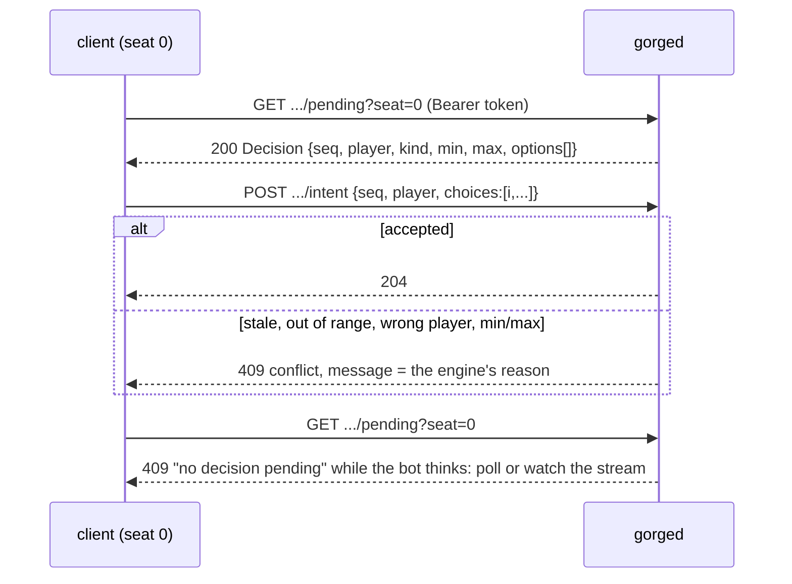

# HTTP API reference

Reference for `gorged`'s HTTP surface (plain HTTP plus one Server-Sent-Events stream), endpoint by
endpoint: who may call what, which flag arms it, bodies, statuses, errors. For clients: a bot
playing a seat, a dashboard, a replay viewer. For a walkthrough, start with
[Playing a seat over HTTP](../bots/http.md).

The machine-readable spec is the authority, and this page is a reading of it:

| File | What |
|---|---|
| [`openapi.json`](openapi.json) | OpenAPI 3.1, every operation, schema and real example. Feed it to a client generator. |
| [`openapi.yaml`](openapi.yaml) | The same document as YAML (rendered from the JSON). |
| [`schemas/gorge-protocol.schema.json`](schemas/gorge-protocol.schema.json) | The wire types alone, as one JSON Schema 2020-12 document (`$defs`). |
| [Interactive reference](redoc.html) | The spec rendered by Redoc 2.1.5 (needs JavaScript). |

!!! info "How the spec stays true"
    [`openapi_test.go`](https://github.com/adams-shaun/gorge/blob/main/server/host/httpapi/openapi_test.go)
    fails when a route registered by `server/host/httpapi` or `server/gorged` is missing from
    the spec, or the spec lists an operation no code registers. Every `x-go-type` schema is
    generated from that Go type's source, so a renamed or new field fails until the spec is
    regenerated. The `Kind` enum is compared with `decision.Kinds`. Examples are real responses
    from a live server.

    After you change a route or a wire type, regenerate the derived parts and then document
    any new route by hand in `openapi.json`:

    ```sh
    go test ./server/host/httpapi -run TestOpenAPI -update
    ```

## Try it

```sh
go run ./cmd/gorged -addr 127.0.0.1:8080 -dir /tmp/gorge-api -tables 2 -seats 2 -humans 0
GORGE=http://127.0.0.1:8080
curl -s $GORGE/api/tables | python3 -m json.tool | head -20
curl -sN --max-time 2 $GORGE/api/stream | head -c 300   # first frame: event: hello
```

`/api/tables` returns `TableInfo` objects (`id`, `name`, `seats`, `spectator`, `state`, `match`, `format`, `bot_policy`, ...).

## Who may call what

gorged has no login. A request is a **spectator** or holds a **seat claim**.

- **Spectator:** every read endpoint works without credentials and returns what the table's visibility allows (`public` hides
  every hand, `omniscient` shows them; `-spectator` for startup tables, `-vsbot-spectator` for play-vs-bot tables).
- **Seat claim:** a seat token resolves to one (table, seat) pair. Send `Authorization: Bearer <token>` or `?token=<token>`
  (the header wins). The server compares any seat number the client sends with the claim and never trusts it.

| The request | Result |
|---|---|
| No `?seat=` on a read endpoint | Spectator view; no token consulted |
| `?seat=N` or a seat action on a server with no seat claims (no `-humans`, `-vsbot`, `-events`) | 403 `forbidden`, "this server is spectator-only" |
| No valid token | 401 `unauthorized` |
| Token for another table, or another seat than `N` | 403 `forbidden` |
| Claim matches | The seat's own view and actions |

Where tokens come from:

- `POST /api/games` returns one for the seat it creates (the only place a token leaves the server).
- `-humans 0,2` mints one per human slot of `t1` and prints each join URL at startup
  (`table t1 seat 0 joins at http://127.0.0.1:8080/t/t1?seat=0&token=…`).
- `-seat-token TOKEN` fixes the first human slot's token, for tests and local use.

## Which routes exist

Without its flag, an optional `/api/` route answers the JSON 404 `no such endpoint`; a non-API path falls through to the web client.

| Flag | Mounts |
|---|---|
| none | The lobby, matches, seat and stream routes, and the `/art/` and `/cards/` card cache |
| `-vsbot` | `POST /api/games`. It also arms seat claims, so a seat request without a token is a 401, not a 403. |
| `-humans 0,…` | Seat claims for those slots of `t1` |
| `-feedback DIR` | `POST /api/feedback`. The binary's default directory is `feedback`; an empty value disarms the route. |
| `-pprof` | `/debug/pprof/…`. gorged refuses the flag unless `-addr` is a loopback address. |
| `-events` | `/api/events…`, off by default. gorge's `cmd/gorged` links the runtime ([Draft events](../guide/draft.md)); an embedding program whose [`server/gorged.Extensions`](go.md) has no `Events` is refused at startup. |
| `gorged review` | A separate, read-only mode: the lobby, match and stream routes over saved games, plus `GET …/decisions`. Every seat route answers 403. |
| `-manabrew` | The [ManaBrew wire](manabrew.md) under `/api/manabrew/v0/tables/`. Needs `-humans` or `-vsbot`. |
| `-sbv2` | [SpellBench v2 seats over HTTP](spellbench-v2.md#extensions-on-the-http-human-seat) under `/api/sbv2/v1/tables/`. Needs `-humans` or `-vsbot`. |

Every other path serves the embedded web client (SPA fallback to `index.html`). A binary built without the bundle answers
them `503 web build missing — run make web`; the bundle is embedded at build time, so `make web` comes before `go build`.

## Endpoints

The **Auth** column tells you whether an endpoint is open to spectators, or what credential it
reads. A seat token exists only when one of the seat flags is on; see
[Who may call what](#who-may-call-what). Every `/api/` route also answers 405
`method_not_allowed` to a wrong method. Full request and response schemas, and an example for
each, are in [`openapi.json`](openapi.json) and the [interactive reference](redoc.html).

### Lobby

| Method | Path | What | Auth | Statuses |
|---|---|---|---|---|
| `GET` | `/api/tables` | The lobby's tables (`TableInfo[]`). Play-vs-bot tables are not listed. | none | 200 |
| `GET` | `/api/decks` | The deck catalogue (`DeckInfo[]`). With `?policy=NAME`, only the decks a game against that policy may use. | none | 200 |
| `GET` | `/api/bot-policies` | The offered bot policies and the default (`BotPolicyList`) | none | 200 |
| `GET` | `/api/capabilities` | Which optional surfaces this server serves (`Capabilities`): `events` is true when `/api/events` is mounted; `engine` names the engine this server creates tables on, absent for gorge; `paired_bots` lists the paired bots a new game may choose, the default first, absent when it offers none | none | 200 |
| `GET` | `/api/stats/decks` | Deck leaderboard over finished bot-vs-bot games (`DeckTally`). `?min_games=N`, default 10. | none | 200, 400 |

### Matches

| Method | Path | What | Auth | Statuses |
|---|---|---|---|---|
| `GET` | `/api/tables/{t}/matches` | The table's matches, finished ones first and the live one last (`MatchInfo[]`) | none | 200, 404 |
| `GET` | `/api/tables/{t}/matches/{k}/view` | The board at `?seq=` (inclusive; default: the latest event). With `?seat=`, that seat's view, including its pending decision when `seq` is the live head (`View`). | spectator, or a seat token with `?seat=` | 200, 400, 401, 403, 404, 409 |
| `GET` | `/api/tables/{t}/matches/{k}/events` | Redacted events from `?since=` (inclusive, default 0) to the head, each with its transcript line (`EventBody[]`) | spectator, or a seat token with `?seat=` | 200, 400, 401, 403, 404, 409 |
| `GET` | `/api/tables/{t}/matches/{k}/decisions` | Only on a `gorged review` server: the recorded match's decision index, one entry per intent, with the options offered, the answer and the bot's explain note ([Replays](../guide/replays.md#reading-a-decision)) | none | 200, 400, 404 |

`k` is the match index and counts from 1; 0 or a non-number is a 400. A `seq` or `since` past
the head is a 409 `beyond_head`, and the body's `head` names the last valid seq so you can
clamp and retry:

```json
{"code": "beyond_head", "message": "host: seq beyond head 3994", "head": 3994}
```

### Playing a seat

| Method | Path | What | Auth | Statuses |
|---|---|---|---|---|
| `GET` | `/api/tables/{t}/matches/{k}/pending?seat=N` | The full decision your seat is being asked (`Decision`) | seat token, required | 200, 400, 401, 403, 404, 409 |
| `POST` | `/api/tables/{t}/matches/{k}/intent` | Answer it (`Intent` body). `?auto=1` marks an autopilot answer. | seat token, required | 204, 400, 401, 403, 404, 409 |
| `POST` | `/api/tables/{t}/matches/{k}/undo` | Rewind the live match to the decision you last answered | seat token, required | 204, 401, 403, 404, 409 |
| `GET` | `/api/tables/{t}/paired-bot` | Whether this table offers a paired bot (`PairedBotStatus`) | none | 200, 404 |
| `GET` | `/api/tables/{t}/matches/{k}/advice?seq=N` | The paired bot's evaluation of decision `N`, pending on your seat (`Advice`) | seat token, required | 200, 400, 401, 403, 404, 409 |

#### The paired bot

A server run with `-paired-bot` lets a human ask a bot to evaluate the decision in front of them. It is off by default
and only advises: nothing it says reaches the game, a replay or the hash chain; the seat still answers through `intent`.

- **What it sees:** the seat's own deck list and everything the seat has observed. Opponent hands, library order and
  the opponent's list are guessed from a set of decks (`-paired-bot-decks`, default the server's constructed decks).
  The seat comes from the token alone.
- **`advice` blocks** until the search ends; hanging up cancels it. `state` is `ready` (a note in `explain`, the shape
  of a review decision's), `none` (no answer possible) or `refused`.
- **Every decision kind gets an answer.** Where search can rank options (priority, attackers, blockers, targets, modes,
  optional triggers, small choices) the note carries the `search`. Elsewhere (mulligan, ordering, who plays first, manual
  taps, large choices, decisions inside a resolving effect) the state is still `ready`, the note has no `search`, `bot`
  names what the bot's own rules would pick, and `reason` says why. `reason` is plain words for any state.
- **`advice_stale` (409)** means the game moved on; ask about the decision you hold now.
- **Rows:** `choices` index the decision's `options` (a row with `payment` names one of its `payment_actions`). `q` and
  `root_value` run -1 to +1 for the seat (the client shows `(q + 1) * 50` percent); no `visits` means no estimate.
  `line` is the expected continuation, up to four plies `{actor, label, visits, share, q}`; `line_end` (`hidden` or
  `unexplored`) says why it stopped short.
- **Limits:** a table with several humans needs `-paired-bot-shared` (then `paired-bot` tells every seat it is on). One
  search runs per table and `-paired-bot-searches` across the server, at a fixed `-paired-bot-sims`; extra requests wait.
  A server without `-paired-bot` lets no game choose one.
- **Browser client:** asks once per decision, only while the player's switch is on, and hangs up when it moves on.

### The stream

| Method | Path | What | Auth | Statuses |
|---|---|---|---|---|
| `GET` | `/api/stream` | Server-Sent Events. A fresh connection starts with `hello`. | none | 200 |
| `POST` | `/api/subscribe` | `{session, table, mode}`: `overview` or `focus`; `table` `*` means every table, overview only | none (the session id is the capability) | 204, 400, 404 |
| `POST` | `/api/unsubscribe` | `{session, table}` | none | 204, 400, 404 |

The stream has its own page: [The event stream](sse.md).

### Games, feedback, cards and profiling

| Method | Path | What | Auth | Statuses |
|---|---|---|---|---|
| `POST` | `/api/games` | Start a play-vs-bot game (`CreateGameRequest` in, `CreateGameResponse` out, including the seat token and join path). `paired_bot` chooses its paired bot: a name from `paired_bots`, or `off` for none; omitted, the server's default. Any other name is a 400. `seats` (2 to 4), `humans` and `decks` seat a Commander pod: seats 0 to `humans`-1 are people, each with a token in `seats` of the response, and the rest bots; `decks` gives a ManaBrew deck per seat, which the server resolves, checks for format, legality and engine support, and refuses with a 400 naming the cards. A pod is refused under `-engine dirac`. | none | 200, 400, 404 |
| `POST` | `/api/feedback` | A bug report, as `multipart/form-data` with fields `text` (required), `url`, `table`, `seat`, `screenshot` (PNG) and `client.json`. Answers `201 {"id": …}`. | none | 201, 400, 500 |
| `GET` | `/art/named?exact=NAME` | Card art reference, Scryfall-shaped: `{name, image_uris: {normal}}` | none | 200, 400, 404, 502, 503 |
| `GET` | `/art/token?exact=NAME&types=…&ppt=P/T` | Token art reference, same shape | none | 200, 400, 404, 502, 503 |
| `GET` | `/art/blob/{key}` | The cached JPEG, `Cache-Control: immutable` | none | 200, 404 |
| `GET` | `/cards/named?exact=NAME` | A card's printed facts: `name`, `mana_cost`, `type_line`, `oracle_text`, `power`, `toughness` | none | 200, 400, 404, 502, 503 |
| `GET` | `/debug/pprof/`, `…/cmdline`, `…/profile`, `…/symbol`, `…/trace`; `POST …/symbol` | Go's `net/http/pprof` | none (loopback only) | 200 |

The card routes fetch from Scryfall the first time a name is asked for, paced and
single-flight, and cache the result under `-art-dir`. A fetch that outlives the wait budget
answers 503 and keeps running, so a retry soon after is served from disk. Errors from these
gorged-owned routes (`/art/`, `/cards/`, `/api/feedback`, `/debug/`) are `text/plain`, not
`ErrorBody`.

### Draft events

These 16 operations appear only on a server running with `-events`, and otherwise answer the
JSON 404. The walkthrough is in the [user guide](../guide/draft.md#run-an-event-over-http). A seat is identified by an event token (`Authorization: Bearer` or `?token=`), and a
request without one is a spectator. The backend picks the status and `code` of its own refusals.

| Method | Path | Body in → out |
|---|---|---|
| `POST` | `/api/events` | `CreateEventRequest` → `CreateEventResponse` |
| `GET` | `/api/events` | → `EventState[]` |
| `GET` | `/api/events/sets` | → `EventSetInfo[]` |
| `GET` | `/api/events/personas` | → `EventPersonas` |
| `GET` | `/api/events/{id}` | → `EventState` |
| `POST` | `/api/events/{id}/join` | `JoinEventRequest` → `EventState` |
| `GET` | `/api/events/{id}/pack` | → `DraftPack` |
| `GET` | `/api/events/{id}/advice` | → `DraftAdvice` (the seat's own drafter's suggested picks; a Commander draft only) |
| `POST` | `/api/events/{id}/pick` | `PickRequest` → `DraftPack` |
| `GET` | `/api/events/{id}/pool` | → `EventPool` |
| `POST` | `/api/events/{id}/deck/check` | `DeckRequest` → `DeckCheck` |
| `POST` | `/api/events/{id}/deck` | `DeckRequest` → `DeckCheck` |
| `POST` | `/api/events/{id}/ready` | `ReadyRequest` → `EventState` |
| `POST` | `/api/events/{id}/sideboard` | `SideboardRequest` → `EventState` |
| `GET` | `/api/events/{id}/log` | → `EventLog` |
| `POST` | `/api/events/{id}/subscribe` | `EventSubscribe` → 204; routes the event's frames to a stream session |

## The decision loop

A seat repeats one exchange: read the pending decision, answer with option indices. gorge lists every legal option and
validates every answer, so a client can choose badly but never illegally.



A real `attackers` decision and its answer (the answer echoes `seq` and `player`):

```json
{"seq": 550, "player": 0, "kind": "attackers", "prompt": "turn 4 — declare attackers", "min": 0, "max": 1,
 "options": [{"index": 0, "kind": "attacker", "label": "Attack with Experiment One at Bot", "obj": 33, "player": 1}]}
{"seq": 550, "player": 0, "choices": [0]}
```

Rules for intents:

- `choices` are distinct, in range, and between `min` and `max` in number, plus the kind's own constraints (one option per
  `group`; a `required` option must be included when it can be).
- A stale `seq` is refused (`intent seq 153, pending decision seq 53`). Wait for a new `seq` before answering again.
- A `cast` option on an auto-mana table may carry `payment_actions`: answer with the intent's `payment` (a full plan) or
  `announce` (pay in the payment window). A plain `choices: [i]` still works.
- The body is strict: an unknown field, trailing data or more than 64 KiB is a 400.

### Decision kinds

The set of kinds is closed (`decision.Kinds`), and the spec's `Kind` enum is checked against it.

| kind | min / max | options and answer |
|---|---|---|
| `priority` | 1 / 1 | One option per legal action (`play_land`, `cast`, `activate`, `ability`, …), plus `pass` and `concede`. |
| `target` | per spell | One option per legal target (`player` or an object). `target_effect` says what the targeting does: damage, removal or granted statics. |
| `attackers` | 0 / N | One `attacker` option per (creature, defender) pair. `player` is the defender seat; `battle` is a permanent being attacked. Options sharing a `group` are mutually exclusive, and so are two options with the same `obj`. An option with `alone_restricted` is legal only when another creature is declared too ("can't attack alone"). |
| `blockers` | 0 / N | One `block` option per (blocker, attacker) pair, with `attacker` naming the attacker. `group` keeps each blocker on one attacker; `min_blockers`/`max_blockers` bound an attacker's blocker count. `alone_restricted` means legal only with another blocker declared. |
| `mulligan` | 1 / 1, or k / k | Keep phase: `keep`, plus `mulligan` while one remains. Bottom phase: one `bottom` option per card in hand; choose as many cards as you took mulligans. |
| `modes` | MinCharmNum / CharmNum | One `mode` option per mode, in printed order. An unless-pay ask uses option `mode` `unless_pay` / `unless_decline`. |
| `trigger_order` | N / N | A permutation of your simultaneous triggers. `choices[0]` goes on the stack **first**, so it resolves **last**. |
| `trigger_optional` | 1 / 1 | Exactly `yes`, then `no`. |
| `commander_zone` | 1 / 1 | Exactly `command_zone`, then `leave`. This is asked of the commander's owner. |
| `choose` | varies | One list pick. Every option shares a kind saying what is chosen: `x` (with `amount`), `exile`, `sacrifice`, `discard`, `search`, `dig`, `name`, `type`, `number`, `yes`/`no`, `keep`, `dungeon`, `room`. |
| `replacement` | 1 / 1 | Which applicable `replacement` applies next (`obj` is its source). Also `mana` colour options, and `apply`/`decline` for an optional replacement. |
| `arrange` | varies | An ordered subset. The chosen indices, in answer order, become pile A, and index 0 ends closest to the top. The rest form pile B, whose destination is the shared option kind (`bottom`, `graveyard`, `exile`, `hand`). `rest` may order pile B when `restable` is set. |
| `starting_player` | 1 / 1 | The toss winner picks who takes the first turn. A host-run table asks this before the mulligans. |

The live captures in the spec include real `priority`, `target`, `attackers`, `blockers`,
`mulligan`, `choose` and `starting_player` decisions. The other six kinds are documented from
`engine/decision/decision.go`.

## Errors

Every `/api/` error has the same body, `protocol.ErrorBody`:

```json
{"code": "unauthorized", "message": "request does not hold a seat claim"}
```

| Status | `code` | When |
|---|---|---|
| 400 | `bad_request` | A malformed parameter or JSON body, or a value the handler rejects (unknown format, mode or policy) |
| 401 | `unauthorized` | A seat-scoped request with no seat claim |
| 403 | `forbidden` | The server is spectator-only, or the claim is for another seat or table |
| 404 | `not_found` | Unknown table, match, stream session or endpoint |
| 405 | `method_not_allowed` | A known path with the wrong method |
| 409 | `conflict` | The match is not in the state the request assumed: not live, not a human seat, nothing pending, or a stale or illegal intent. `message` is the engine's reason. |
| 409 | `beyond_head` | `seq` or `since` is past the head; `head` holds the last valid seq |
| 500 | `internal` | A bug or an I/O failure |

## Conventions

- **Unknown fields:** responses gain fields without notice ([additive rule](protocol.md#versioning)), so ignore unknown
  ones. Requests are the opposite: unknown fields are refused.
- **Omitted vs null:** a `required` field is always present. An `omitempty` field is omitted when zero (a missing `obj`,
  `amount` or `required` means 0 or false). A required array or object can be `null` when nil (`"type": ["array", "null"]`).
- **Integers:** seeds are unsigned 64-bit and exceed 2^53: parse as 64-bit integers or strings. `viewer` is 255 for a spectator view.
- **Indexing:** seats are 0-indexed (`player`, `seat`); match indices start at 1.

## Other wires

- **ManaBrew** (`-manabrew`) and **SpellBench v2 over HTTP** (`-sbv2`) mount under computed prefixes, so the OpenAPI drift guard doesn't
  cover them; [Wires](../architecture/wires.md) lists the tests that do. See [ManaBrew](manabrew.md) and
  [SpellBench v2](spellbench-v2.md#extensions-on-the-http-human-seat).
- **The SpellBench seat** (`-sb-agent`) isn't HTTP. It speaks [SpellBench v2](spellbench-v2.md) to an agent subprocess.
