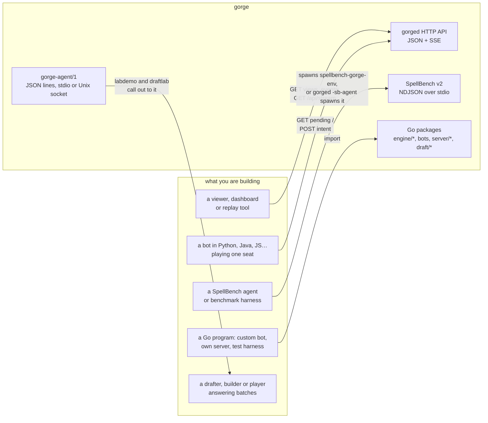

# API reference

This section is the reference for gorge's public interfaces: watch and play games over **HTTP** with a live **event stream**, plug in
agents and harnesses over **SpellBench v2**, play a seat from a **ManaBrew** client, answer draft and game batches over
**gorge-agent/1**, or import gorge as a **Go library**. For a walkthrough, start with [Bots](../bots/index.md) or the
[User's guide](../guide/index.md).

## Which API for which job



| You want to… | Use | Reference |
|---|---|---|
| Show tables, boards and transcripts live | HTTP and the SSE stream | [HTTP API](http.md), [Event stream](sse.md) |
| Decode stream frames or view JSON in another language | The wire types | [Wire protocol](protocol.md), [`gorge-protocol.schema.json`](schemas/gorge-protocol.schema.json) |
| Play a seat from any language | `pending` / `intent` over HTTP | [HTTP API: the decision loop](http.md#the-decision-loop), walkthrough in [Playing a seat over HTTP](../bots/http.md) |
| Run gorge as the engine behind a SpellBench host, or seat a SpellBench agent at a gorge table | SpellBench v2 | [SpellBench v2](spellbench-v2.md) |
| Play a seat from a ManaBrew client | The ManaBrew wire (`-manabrew`) | [ManaBrew](manabrew.md) |
| Answer draft picks, deck builds and game decisions in batches from another language | `gorge-agent/1` | [gorge-agent/1](gorge-agent.md) |
| Write a bot in Go, embed the engine, or run your own server | The Go packages | [Go embedding API](go.md) |

All of them sit on one engine contract. The engine asks a **decision** that lists every legal
option, and the player answers with an **intent** naming option indices. No rules knowledge
crosses any of these boundaries, and the engine validates every answer. A client of any API can
play badly, but never illegally.

## Versioning and compatibility

Each surface states its rule in the code. The table gives the rule, and says what enforces it
and what is only a convention.

| Surface | Version marker | Rule | Enforced by |
|---|---|---|---|
| HTTP API and stream frames | `protocol.Version` = **1**, the `v` field of every frame. No URL prefix. | The version bumps only on a breaking change to a body. Additive fields do not bump it, so clients ignore unknown fields. | The shape is pinned by `TestGoldens` (server/protocol), `TestOpenAPISchemasMatchGo` and `TestCommittedProtocolTSIsFresh`; each fails on any wire change until its artifact is regenerated. The route set is pinned by `TestOpenAPIRoutesMatchSpec`. **The bump itself is a convention**: no test tells breaking from additive. |
| Decision kinds | the closed `decision.Kinds` set (13) | A new kind is a new case for every client | `TestOpenAPISchemasMatchGo` compares the spec's enum with `decision.Kinds`; `TestKindsListsEveryKindOnce` (engine/decision) |
| Event kinds | `events.Kind` | Append-only: kinds are added at the end and existing ordinals never move | The golden replay heads (`TestHeads`, `TestRepoDeckGamesReplayExactly` in engine/rules) |
| SpellBench | protocol string `spellbench/v2`; `protocol_minor` (gorge answers 0) | Any other protocol string is `protocol_mismatch`. New features arrive as `x_` extensions. | The request decoder (`server/spellbench/protocol`), the goldens in `server/spellbench/testdata/goldens`, and `TestSemanticSchemaMatchesKindTable` / `TestSchemaErrorCodesMatchErrorsGo` for the published schemas |
| gorge-agent | protocol string `gorge-agent/1`, `wire.Version` = **1**, the `v` field of every line | The version bumps only on a breaking change. Additive fields do not bump it, and both sides ignore unknown fields. | The golden messages in `draft/draftlab/extern/wire/testdata` |
| Go packages | none: the module has no release tags | Any commit may change an exported signature. Pin a commit. | Nothing, beyond the import-layering tests in `internal/archtest` and the `server/host` contract harnesses (`RunContractTable` and friends) that embedders can run in their own tests. See [Go: Stability](go.md#stability). |
| ManaBrew | `/api/manabrew/v0/` | Follows the published ManaBrew protocol; gorge's additions are `x_`-prefixed optional members | `server/protocol/manabrew`'s schema equivalence tests and the [wire matrix](../architecture/wires.md) |

gorge has no contract registry and no deprecation process. When a surface changes, the commit
that changes it regenerates the artifacts above, and that diff is the changelog.

## Machine-readable files

Everything below is published with the site, next to this page, so a generator can fetch it by
URL (`https://adams-shaun.github.io/gorge/api/<file>`):

| File | Format | Covers | Generated from |
|---|---|---|---|
| [`openapi.json`](openapi.json) | OpenAPI 3.1 (JSON Schema 2020-12 dialect) | Every gorged HTTP operation, schema and real example | Routes and examples written by hand; `x-go-type` schemas generated from Go source. Guarded by `server/host/httpapi/openapi_test.go`. |
| [`openapi.yaml`](openapi.yaml) | The same, as YAML | | Rendered from `openapi.json` by the same test |
| [`schemas/gorge-protocol.schema.json`](schemas/gorge-protocol.schema.json) | JSON Schema 2020-12 | The host-client wire types, `$defs` (validate a frame against `#/$defs/StreamFrame`) | Rendered from `openapi.json`'s components by the same test |
| [`schemas/spellbench-v2/*.schema.json`](schemas/spellbench-v2/semantic.schema.json) | JSON Schema 2020-12 | SpellBench v2 requests, responses, observation, candidate kinds | Written by hand. Kinds, vocabularies and error codes are guarded by `server/spellbench/protocol/schema_doc_test.go`. |
| [`web/src/protocol.ts`](https://github.com/adams-shaun/gorge/blob/main/web/src/protocol.ts) | TypeScript | The wire types, for the web client | `cmd/gentypes` (`make gentypes`) |

To generate a client, point your generator at `openapi.json`. For example, with
[openapi-generator](https://openapi-generator.tech):

```sh
openapi-generator generate -i https://adams-shaun.github.io/gorge/api/openapi.json -g python -o gorge-client
```

The stream is Server-Sent Events, which OpenAPI 3.1 can only describe as a
`text/event-stream` response. Generated clients will not parse it for you. Read the frames as
`StreamFrame` (see [Event stream](sse.md)).
