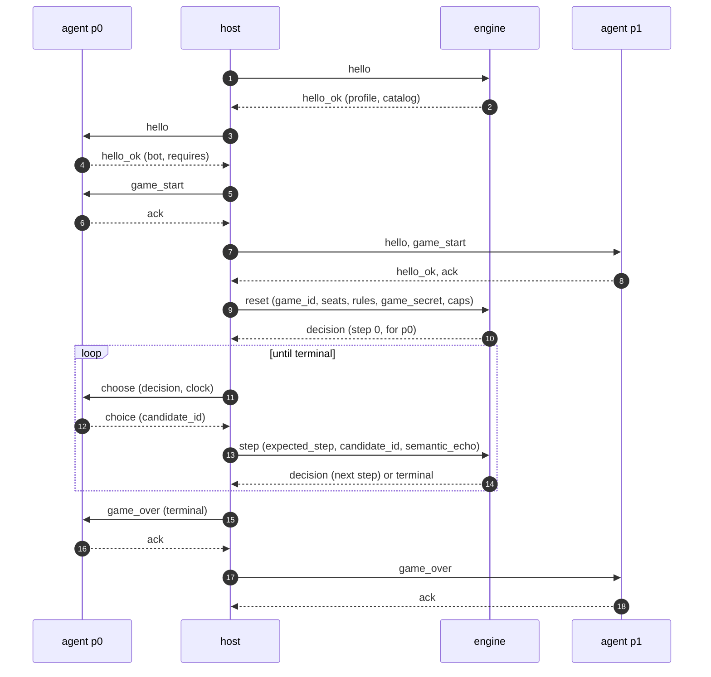

# SpellBench v2 protocol

[SpellBench](https://github.com/jackmaiorino/spellbench) is a public, MIT-licensed benchmark for
Magic: The Gathering agents. Its v2 protocol is newline-delimited JSON between a **host** that runs
games, an **engine** that plays them, and two **agents** that decide. This page is the wire reference
for writing a client, an agent or a harness against gorge: how a session starts, what each role does,
every message, how a candidate maps to a choice, what gorge adds to the protocol, what a v2 client can't
see or do, and how each part fails. For the overview and the commands, see
[SpellBench v2 agents](../bots/spellbench.md).

The examples were exchanged with binaries built from this repository on 2026-10-31. Build identities and
object ids differ on your build. gorge's packages are ported from the SpellBench repository's gorge adapter
(`engines/gorge`, revision `1beea4c104911bba77a5672c644e570ed9afe28a`, MIT). Where the upstream
specification and this page disagree, the specification governs SpellBench and this page says what gorge
does.

## Roles and how a session starts

| You are writing | Run | gorge is | Your transport |
|---|---|---|---|
| An agent that plays at gorge tables | `gorged -sb-agent name=/path` or `mtgsim -sb-agent name=/path` | host and engine | your process's stdin and stdout |
| A harness that hosts games on gorge's rules | [`spellbench-gorge-env`](https://github.com/adams-shaun/gorge/blob/main/cmd/spellbench-gorge-env/main.go) | engine | its stdin and stdout |
| A harness that needs gorge's bots as agents, on any engine | [`spellbench-gorge-agent`](https://github.com/adams-shaun/gorge/blob/main/cmd/spellbench-gorge-agent/main.go), one process per seat | agent | its stdin and stdout |
| A client for a human at a gorge table | `gorged -sbv2` | host and engine | [HTTP](#extensions-on-the-http-human-seat) |

The host sits between engine and agents. It relays each engine `decision` to the acting seat's agent as a
`choose`, and turns the agent's `choice` into the next `step`. Engine and agent never see each other, so
the engine's messages carry everything an agent needs and nothing it shouldn't see.



Each `decision` addresses one seat, `seat_decision.acting_seat`, and the host sends it to that seat's agent
only. gorge's engine doesn't require `hello` before `reset`, and one engine process plays any number of
games in sequence: a `reset` after a `terminal` starts the next.

### The engine and agent binaries

Both need the compiled card corpus (`make fetch-cards`; see [Getting started](../getting-started.md)):

```text
go build -trimpath -o bin/ ./cmd/spellbench-gorge-env ./cmd/spellbench-gorge-agent
```

| Flag | Binary | Meaning |
|---|---|---|
| `-corpus DIR` | both | the compiled corpus |
| `-registry FILE`, `-registry-sha256 HEX` | both | a frozen card registry and its expected digest, instead of a corpus |
| `-manual-mana` | env | offer interactive mana taps instead of engine auto-pay. `-auto-pay` is accepted for compatibility and is the default |
| `-source-revision REV` | env | reported as `engine.source_revision` |
| `-policy KEY` | agent | a registered bot policy, default `bot`; `-list-policies` prints them |
| `-world WORLD` | agent | `gorge` (the default) or `neutral`; see below |
| `-audit-dir DIR` | agent | write aggregate policy coverage there when the process closes (or `$GORGE_AGENT_AUDIT_DIR`) |

`-corpus` defaults to `$GORGE_CARDS`. The env needs `-corpus` or the pair `-registry` + `-registry-sha256`,
and exits 2 without them, or when a catalog deck doesn't resolve.

The agent's world decides what it can pair with:

- `-world gorge` (the default) reads the [`x_gorge_view_v1`](#x_gorge_view_v1) extension, so it plays only against
  `spellbench-gorge-env` with `reset.rules.extensions` naming it. Its `hello_ok` requires the extension, and
  `gorged -sb-agent` refuses it for that reason.
- `-world neutral` rebuilds gorge's view from the plain observation and candidates, so it plays against
  any engine. It needs the corpus or registry, and it requires the `keywords` observation flag. It also reads
  the kinds gorge's engine never asks: `choose_cast_method` and `choose_cost_option` reuse gorge's cast and
  mode asks, `distribute` follows the [engine-order split](#what-a-v2-client-cant-see-or-do) and
  spreads counters, mana and life evenly, and `choose_pile` takes the first pile. A decision it can't
  translate is answered with its first candidate.
  Policies that need an engine root (`Env` or `Search` in their registry entry) are refused in this world.

### A host in 60 lines

This host starts the env, plays one Burn mirror by always taking candidate 0, and prints the result and
the [game digest](#game-digest). A real host forwards each decision to the acting seat's agent instead.

```python title="minimal_host.py"
import hashlib, json, subprocess, sys

def canon(v):
    if isinstance(v, dict):
        keys = sorted(v, key=lambda k: k.encode("utf-16-be"))
        return "{" + ",".join(canon(k) + ":" + canon(v[k]) for k in keys) + "}"
    if isinstance(v, list):
        return "[" + ",".join(canon(e) for e in v) + "]"
    if isinstance(v, str):
        short = {'"': '\\"', "\\": "\\\\", "\b": "\\b", "\f": "\\f", "\n": "\\n", "\r": "\\r", "\t": "\\t"}
        return '"' + "".join(short.get(c) or ("\\u%04x" % ord(c) if ord(c) < 0x20 else c) for c in v) + '"'
    return json.dumps(v)  # null, true, false, integers

def sha(v):
    return "sha256:" + hashlib.sha256(canon(v).encode()).hexdigest()

def deck_id(rows):
    rows = sorted(rows, key=lambda r: r["name"].encode())
    return sha([{"count": r["count"], "name": r["name"]} for r in rows])

class Digest:  # the chain over reset and every later engine-channel line
    def __init__(self): self.d = None
    def add(self, m):
        c = canon({k: x for k, x in m.items() if k != "request_id"}).encode()
        self.d = hashlib.sha256((b"spellbench/v2/game-digest" if self.d is None else self.d) + c).digest()

engine = subprocess.Popen(sys.argv[1:], stdin=subprocess.PIPE, stdout=subprocess.PIPE, text=True)
ids = (f"q-{i}" for i in range(10**9))

def ask(request_type, **fields):
    m = {"request_type": request_type, "protocol": "spellbench/v2", "request_id": next(ids), **fields}
    engine.stdin.write(json.dumps(m, ensure_ascii=False) + "\n")
    engine.stdin.flush()
    return m, json.loads(engine.stdout.readline())

_, hello = ask("hello", protocol_minor=0)
burn = next(d for d in hello["catalog"] if d["catalog_id"] == "Burn")
deck = {"deck_id": deck_id(burn["decklist"]), "catalog_id": "Burn"}
names = sorted(r["name"] for r in burn["decklist"])
sent, reply = ask(
    "reset", game_id="g-1", format="pauper-bo1",
    seats=[{"seat": "p0", "deck": deck}, {"seat": "p1", "deck": deck}],
    rules={"opponent_decklist": "visible", "mulligan": "london",
           "starting_player": "host_assigned", "starting_seat": "p0",
           "card_name_domain": {"domain_id": sha(sorted(names, key=str.encode)), "names": names},
           "extensions": [], "probe": False},
    game_secret="ab" * 32, max_decisions=10000, max_steps=100000)
chain = Digest()
chain.add(sent)
chain.add(reply)
while reply["response_type"] == "decision":
    c = reply["seat_decision"]["candidates"][0]  # a real host forwards this to the acting seat's agent
    sent, reply = ask("step", game_id="g-1", expected_step=reply["step"],
                      selection={"candidate_id": c["candidate_id"], "semantic_echo": c["semantic"]})
    chain.add(sent)
    chain.add(reply)
print(reply["outcome"], reply["classification"], reply["reason"], reply["step_count"], reply["decision_count"])
print("sha256:" + chain.d.hex())
```

```text
$ python3 minimal_host.py bin/spellbench-gorge-env -corpus .cards
p0_win natural p1_decked 1860 1860
sha256:7a33a7527020ddd30cf827ecdf8fe9d83a5d5286751004ea8acfa649071a0e1d
```

Candidate 0 is `pass` whenever a pass is offered, so nobody plays a card and p1 decks first.

### Seating an agent at a gorge table

```text
gorged -vsbot -sb-agent mybot=/path/to/mybot
```

The name must match `^[a-z0-9-]+$` and must not collide with a registered policy. The path must be
executable. gorged runs it directly, with no shell and no arguments (put arguments in a wrapper
script), discards its stderr, starts one process per seat per match and stops it at match end, after
[`game_over`](#game_over-ack). The agent
becomes a bot policy, so `POST /api/games` with `"bot_policy":"mybot"` plays against it; see
[Bot-vs-bot games](../guide/bot-games.md) for matches between policies. The policy is two-seat,
constructed-only and needs automatic mana. The adapter reads gorge's own engine: on a table whose engine
has no v2 reader, the seat refuses the match.

## Framing and strict JSON

[`wire/frame.go`](https://github.com/adams-shaun/gorge/blob/main/server/spellbench/wire/frame.go),
[`wire/strict.go`](https://github.com/adams-shaun/gorge/blob/main/server/spellbench/wire/strict.go).

- One JSON object per line, UTF-8, requests on the child's stdin and responses on its stdout. A line ends
  with `\n` or `\r\n`.
- A line holds at most **8 MiB** (8,388,608 bytes) without its terminator. A longer line is read through
  to its newline and answered `malformed_json` with `request_id` `""`, and reading resumes on the next line.
- Every request line gets one response line, in order. The engine writes canonical JSON and flushes each
  line.
- Diagnostics go to stderr. Clean end of input exits 0. Input that ends in the middle of a line, with no
  terminator, gets no answer and exits 1.

The engine role checks each line before decoding it. A line breaking one of these rules is `malformed_json`
with `request_id` `""`:

| Rule | Fails |
|---|---|
| valid UTF-8, nothing after the value | `{"a":1} x` |
| no duplicate keys at any depth | `{"request_type":"hello","request_type":"hello"}` |
| integers only: no fraction, no exponent | `"protocol_minor":1.0` |
| integers of absolute value at most 2^53-1 | `9007199254740992` |
| no leading zeros | `007` |
| nesting at most 64 levels | 65 nested arrays |
| no raw control characters in strings, valid escapes, no unpaired surrogate escapes | `"\ud800"` |

A strict-JSON value that isn't an object is `malformed_request`. After that, the decoder holds each request
to an **exact field set**: a missing or extra field, a wrong type (including `null` where a string, boolean or
array is expected), an out-of-range integer, an empty `request_id` or `game_id`, an unknown `request_type`,
or a card name not in Unicode NFC is `malformed_request`, with the `request_id` if it could be read.

```text
{"request_type":"hello","protocol":"spellbench/v2","request_id":"m-1","protocol_minor":1.0}
{"error":{"code":"malformed_json","message":"malformed_json: number with a fraction or an exponent at 87"},"protocol":"spellbench/v2","request_id":"","response_type":"error"}
{"request_type":"hello","protocol":"spellbench/v2","request_id":"m-4","protocol_minor":4294967296}
{"error":{"code":"malformed_request","message":"protocol_minor is not a u32"},"protocol":"spellbench/v2","request_id":"m-4","response_type":"error"}
```

A `u32` is `0..4294967295`, an `i32` is `-2147483648..2147483647`, and a `u64` (`expected_step`, `max_steps`)
stops at the strict-JSON limit 2^53-1. `-0` reads as `0`.

Only the engine role is strict. `spellbench-gorge-agent` and gorged's seat adapter read lines with Go's
`encoding/json`, which takes duplicate keys and fractional numbers. Send strict JSON anyway: upstream hosts
and engines are strict.

### Request ids and retransmission

`request_id` is any nonempty string. The engine caches every answered request since the last accepted `reset`
by `request_id`. Sending the **same bytes** again returns the cached answer without re-running anything.
Sending a **different** line with a used id is `request_id_reuse_mismatch`, so correct a refused request
under a new id. An accepted `reset` clears the cache, and a request the decoder refused
(`malformed_*`, `protocol_mismatch`) is never cached.

## Engine role

Schemas: [requests.schema.json](schemas/spellbench-v2/requests.schema.json) (`$defs/engine_request`),
[responses.schema.json](schemas/spellbench-v2/responses.schema.json) (`$defs/engine_response`). Every request
carries `request_type`, `protocol` (`"spellbench/v2"`) and `request_id`; every response carries `response_type`,
`protocol` and the request's `request_id`.

### hello → hello_ok

The host names the protocol and the engine answers with its profile.

```json
{"request_type":"hello","protocol":"spellbench/v2","request_id":"h-1","protocol_minor":0}
```

`protocol_minor` is any u32. gorge always answers `0` and leaves it to the host to decide whether that's
enough.

| `hello_ok` field | gorge's value | Meaning |
|---|---|---|
| `protocol_minor` | `0` | the minor version gorge speaks |
| `engine` | `name` `gorge`; `version` `gorge-<rev>/spellbench-adapter-0.1.0`, with `/autopay` appended under auto-pay; `rules_snapshot_id` `gorge/<rev>/ir-<compiler fingerprint>`; `card_pool_identity` `forge-<corpus ref>/corpus-<hash>/catalog-<hash>`; `source_revision` from `-source-revision`, else `null` | identifies the build, rules and card pool. `<rev>` is the first 12 characters of the commit, with `+dirty` for a build from a modified tree; a tagged module version is printed whole |
| `formats` | `["pauper-bo1"]` | the only format `reset` accepts |
| `deck_sources` | `["catalog"]` | gorge plays catalog decks, never a pasted decklist |
| `catalog` | Wildfire, Rally, Spy, Burn, CawGates | `catalog_id`, `name`, `decklist` |
| `rules_supported` | `mulligan: [london, none]`, `starting_player: [host_assigned]` | |
| `observation` | `day_night`, `designations`, `exiled_by`, `keywords`, `pending_triggers`, `permanent_details`, `player_counters` and `poison` true; `full_name`, `known_cards`, `passed_seats`, `player_progress` and `stack_text` false | a field behind a false flag is `null` |
| `decision_kinds` | the 25 kinds below | `pass` through `choose_option`; see [Candidates](#candidates) |
| `engine_defaults` | `combat_damage_assignment: "engine_order"`; `mana_payment: "engine_autopay"`, or `null` with `-manual-mana`; `trigger_order` and `replacement_order` `null` | choices the engine makes itself |
| `rewind` | `false` | gorge never rewinds a decision |
| `fairness` | `noninterference_probe: false` | no probe |
| `extensions` | `[{"name":"x_gorge_view_v1","native_ids":false}]` | the one extension `reset` may enable |

The `engine` block on this build:

```json
{"card_pool_identity": "forge-91402ac51104/corpus-a59b417462be378f/catalog-ddaa89bf514cd72d",
 "name": "gorge", "rules_snapshot_id": "gorge/v0.0.0-20261/ir-71fa985afcdf0384c637f7724452c47d",
 "source_revision": null, "version": "gorge-v0.0.0-20261/spellbench-adapter-0.1.0/autopay"}
```

### reset → decision or terminal

Starts a game. Schema: [`$defs/reset`](schemas/spellbench-v2/requests.schema.json).

| Field | Type | gorge accepts |
|---|---|---|
| `game_id` | nonempty string | any id this process hasn't started a game with; a reused id is `malformed_request` |
| `format` | string | `pauper-bo1`, else `unsupported_format` |
| `seats` | exactly `[{"seat":"p0","deck":D},{"seat":"p1","deck":D}]` | `D` is `{deck_id, catalog_id}` or `{deck_id, decklist}`. A decklist or unknown id is `unsupported_deck`; a `deck_id` that doesn't hash the catalog deck is `deck_id_mismatch` |
| `rules.opponent_decklist` | `visible` or `hidden` | both |
| `rules.mulligan` | `london` or `none` | both |
| `rules.starting_player` | `host_assigned` or `toss_winner_chooses` | `host_assigned`, else `unsupported_rule` |
| `rules.starting_seat` | `p0`, `p1` or null | a seat exactly when `host_assigned` |
| `rules.card_name_domain` | `{domain_id, names}` | names nonempty, NFC and distinct; `domain_id` must hash them. A `choose_name` for card names offers only names in this list |
| `rules.extensions` | array of distinct `x_[a-z0-9_]+` names | `[]` or `["x_gorge_view_v1"]`; another is `unsupported_rule` |
| `rules.probe` | boolean | `false`, else `unsupported_rule` |
| `game_secret` | 64 lowercase hex characters | seeds the game's randomness and its object ids |
| `max_decisions`, `max_steps` | u64 | caps: the engine ends the game `truncated` at a group start when `decisions >= max_decisions` or when the group would pass `max_steps`, so a cap never splits a group |

A `reset` while a game is running is `game_already_active`, checked first. A failed `reset` doesn't use up the
game id. The request `minimal_host.py` sends, with the domain cut to three of its twelve names:

```json
{
  "request_type": "reset", "protocol": "spellbench/v2", "request_id": "q-1",
  "game_id": "g-1", "format": "pauper-bo1",
  "seats": [
    {"seat": "p0", "deck": {"deck_id": "sha256:20e44003dba8100a83d84878c55f6736f1cb033ec76596a740cdbeb558b580c9", "catalog_id": "Burn"}},
    {"seat": "p1", "deck": {"deck_id": "sha256:20e44003dba8100a83d84878c55f6736f1cb033ec76596a740cdbeb558b580c9", "catalog_id": "Burn"}}
  ],
  "rules": {
    "opponent_decklist": "visible", "mulligan": "london",
    "starting_player": "host_assigned", "starting_seat": "p0",
    "card_name_domain": {
      "domain_id": "sha256:e8319bb3ce5c4959cb9e39b3a570c9a85ac1f1338e1acc07d56f0f24686c508b",
      "names": ["Faithless Looting", "Fiery Temper", "Fireblast"]
    },
    "extensions": [], "probe": false
  },
  "game_secret": "abababababababababababababababababababababababababababababababab",
  "max_decisions": 10000, "max_steps": 100000
}
```

### decision

The engine's question to one seat. Schema: [`$defs/decision`](schemas/spellbench-v2/responses.schema.json),
`$defs/SeatDecision` in [common.schema.json](schemas/spellbench-v2/common.schema.json).

| Field | Type | Meaning |
|---|---|---|
| `game_id` | string | the game |
| `step` | u64 | the game's step counter: one per answered `step`, both seats together. The next `step` echoes it as `expected_step` |
| `seat_decision.acting_seat` | seat | who must answer |
| `seat_decision.seat_step` | u64 | this seat's own step counter |
| `seat_decision.group` | `{group_id, substep_index, substep_count}` | see [Groups](#groups-one-decision-many-picks) |
| `seat_decision.context` | `{kind, source, purpose, text, rewind}` | `kind` is `priority` or `choice`; `source` is the object asking, or null; `purpose` is a snake_case word such as `mulligan_bottom`, `scry`, `search`, `mana_payment` or `triggers`, or null; `text` is always null from gorge and `rewind` always false |
| `seat_decision.observation` | object | what this seat can see ([below](#the-observation)) |
| `seat_decision.candidates` | array, at least one | `{candidate_id, semantic, display_text}`; ids count from 0; `display_text` is `null` from gorge |
| `seat_decision.extensions` | object | `x_` keys only, `{}` when none |
| `provenance` | `{engine_name, engine_version, rules_snapshot_id, card_pool_identity}` | the `hello_ok.engine` identity |

The answer to that reset, with p0's hand cut from seven cards to one. p1's `hand` is `null` because p0 can't
see it:

```json
{
  "game_id": "g-1", "protocol": "spellbench/v2",
  "provenance": {"card_pool_identity": "forge-91402ac51104/corpus-a59b417462be378f/catalog-ddaa89bf514cd72d",
    "engine_name": "gorge", "engine_version": "gorge-v0.0.0-20261/spellbench-adapter-0.1.0/autopay",
    "rules_snapshot_id": "gorge/v0.0.0-20261/ir-71fa985afcdf0384c637f7724452c47d"},
  "request_id": "q-1", "response_type": "decision", "step": 0,
  "seat_decision": {
    "acting_seat": "p0", "seat_step": 0,
    "candidates": [
      {"candidate_id": 0, "display_text": null,
       "semantic": {"hand_size": 7, "keep": true, "kind": "mulligan", "mulligans_taken": 0}},
      {"candidate_id": 1, "display_text": null,
       "semantic": {"hand_size": 7, "keep": false, "kind": "mulligan", "mulligans_taken": 0}}
    ],
    "context": {"kind": "choice", "purpose": null, "rewind": false, "source": null, "text": null},
    "extensions": {},
    "group": {"group_id": 0, "substep_count": 1, "substep_index": 0},
    "observation": {
      "active_seat": "p0", "day_night": "none", "known": [], "passed_seats": null,
      "pending_triggers": [], "phase_step": "pregame", "priority_seat": null,
      "stack": [], "turn": 0, "viewer": "p0",
      "players": [
        {"seat": "p0", "life": 20, "poison": 0, "counters": {}, "designations": [],
         "progress": null, "hand_count": 7, "library_count": 53, "lands_played_this_turn": 0,
         "mulligans_taken": 0, "mana_pool": {"B": 0, "C": 0, "G": 0, "R": 0, "U": 0, "W": 0},
         "battlefield": [], "command": [], "exile": [], "graveyard": [],
         "hand": [
           {"object_id": "o-bdc077c66cfba373", "card_name": "Masked Meower",
            "owner_seat": "p0", "controller_seat": "p0", "zone": "hand",
            "copy": false, "exiled_by": null, "face_down": false, "full_name": null,
            "permanent": null, "token": false,
            "characteristics": {"colors": ["red"], "keywords": ["haste"],
              "mana_value": 1, "power": 1, "subtypes": ["spider", "cat", "hero"],
              "supertypes": [], "toughness": 1, "types": ["creature"]}}
         ]},
        {"seat": "p1", "life": 20, "poison": 0, "counters": {}, "designations": [],
         "progress": null, "hand_count": 7, "library_count": 53, "lands_played_this_turn": 0,
         "mulligans_taken": 0, "mana_pool": {"B": 0, "C": 0, "G": 0, "R": 0, "U": 0, "W": 0},
         "battlefield": [], "command": [], "exile": [], "graveyard": [], "hand": null}
      ]
    }
  }
}
```

### step → decision or terminal

Answers the pending decision. Schema: [`$defs/step`](schemas/spellbench-v2/requests.schema.json).

| Field | Type | Rule |
|---|---|---|
| `game_id` | string | the current game, else `game_id_mismatch`; `step_before_reset` if no game was ever reset |
| `expected_step` | u64 | the pending decision's `step`, else `expected_step_mismatch` |
| `selection.candidate_id` | u32 | an offered id, else `candidate_id_out_of_range` |
| `selection.semantic_echo` | object | that candidate's `semantic`, copied back. It is compared as decoded JSON, so key order doesn't matter, else `semantic_echo_mismatch` |

The echo exists so a confused host fails loudly instead of playing the wrong move. A `step` naming the finished
game is `game_already_terminal`. To answer the decision above:

```json
{"request_type": "step", "protocol": "spellbench/v2", "request_id": "s-1",
 "game_id": "g-1", "expected_step": 0,
 "selection": {"candidate_id": 1,
   "semantic_echo": {"hand_size": 7, "keep": false, "kind": "mulligan", "mulligans_taken": 0}}}
```

### terminal

The game is over. Schema: [`$defs/terminal`](schemas/spellbench-v2/responses.schema.json).

| Field | gorge's values |
|---|---|
| `outcome` | `p0_win`, `p1_win`, `draw`, `truncated`, `halted` |
| `classification` | `natural` (the rules ended it), `truncated` (a cap), `halted` (the engine couldn't continue) |
| `winner` | the winning seat, else `null` |
| `reason` | natural: `draw`, or the **loser's** cause, `<seat>_life_zero`, `<seat>_decked`, `<seat>_poison`, `<seat>_lost`. Truncated: `max_decisions` or `max_steps`. Halted: `engine_contract_failure:<cause>`; see [Failure modes](#failure-modes) |
| `step_count`, `decision_count` | answered steps, and completed decision groups |
| `provenance` | as in `decision` |
| `x_gorge` | `{"autopay_fallbacks": N}`, only under auto-pay: how many payment asks the engine answered itself instead of forwarding (mana windows, mana colour picks, triggered-cost elections) |

From a Wildfire against CawGates game:

```json
{"classification":"natural","decision_count":1274,"game_id":"game-3","outcome":"p1_win","protocol":"spellbench/v2","provenance":{"card_pool_identity":"forge-91402ac51104/corpus-a59b417462be378f/catalog-ddaa89bf514cd72d","engine_name":"gorge","engine_version":"gorge-v0.0.0-20261/spellbench-adapter-0.1.0/autopay","rules_snapshot_id":"gorge/v0.0.0-20261/ir-71fa985afcdf0384c637f7724452c47d"},"reason":"p0_decked","request_id":"s-2322","response_type":"terminal","step_count":1303,"winner":"p1","x_gorge":{"autopay_fallbacks":3}}
```

### validate_deck → deck_ok or error

Asks whether the engine would play a deck, without starting a game. Schema:
[`$defs/validate_deck`](schemas/spellbench-v2/requests.schema.json). `deck` is `{catalog_id}` or `{decklist}`.

```text
{"request_type":"validate_deck","protocol":"spellbench/v2","request_id":"v-1","format":"pauper-bo1","deck":{"catalog_id":"Burn"}}
{"protocol":"spellbench/v2","request_id":"v-1","response_type":"deck_ok"}
{"request_type":"validate_deck","protocol":"spellbench/v2","request_id":"v-2","format":"pauper-bo1","deck":{"decklist":[{"name":"Lightning Bolt","count":4},{"name":"Mountain","count":18}]}}
{"error":{"code":"unsupported_deck","message":"only the engine catalog decks are playable"},"protocol":"spellbench/v2","request_id":"v-2","response_type":"error"}
{"request_type":"validate_deck","protocol":"spellbench/v2","request_id":"v-3","format":"modern","deck":{"catalog_id":"Burn"}}
{"error":{"code":"unsupported_format","message":"modern"},"protocol":"spellbench/v2","request_id":"v-3","response_type":"error"}
```

### probe_resample → error

The non-interference probe. gorge decodes it strictly (`game_id`, `samples` as a u32) and refuses it: it has no
probe, declares `noninterference_probe: false`, and refuses `rules.probe: true` at reset.

```text
{"request_type":"probe_resample","protocol":"spellbench/v2","request_id":"p-1","game_id":"g-1","samples":4}
{"error":{"code":"unsupported_request","message":"probe_resample is not implemented"},"protocol":"spellbench/v2","request_id":"p-1","response_type":"error"}
```

### error

`{"response_type":"error","protocol":"spellbench/v2","request_id":R,"error":{"code":C,"message":M}}`, schema
[`$defs/engine_error`](schemas/spellbench-v2/responses.schema.json). `request_id` is the request's id when it
could be read, else `""`. Compare `code`, never `message`. An error leaves the game as it was. The
[Error codes](#error-codes) table lists every code.

## Agent role

Schemas: [requests.schema.json](schemas/spellbench-v2/requests.schema.json) (`$defs/agent_request`),
[responses.schema.json](schemas/spellbench-v2/responses.schema.json) (`$defs/agent_response`). The host sends and
the agent answers each line with one line. An agent's answer must carry the request's `request_id` and
`protocol`; gorged ignores any other extra field. The smallest agent that works is
[`minimal_bot.py`](https://github.com/adams-shaun/gorge/blob/main/server/spellbench/seat/testdata/minimal_bot.py),
which always picks candidate 0:

```python
import json, sys

for line in sys.stdin.buffer:
    request = json.loads(line)
    reply = {"protocol": "spellbench/v2", "request_id": request["request_id"]}
    if request["request_type"] == "hello":
        reply.update(response_type="hello_ok", bot={"name": "minimal", "version": "1.0.0"})
    elif request["request_type"] == "choose":
        reply.update(response_type="choice", selection={"candidate_id": 0})
    else:
        reply.update(response_type="ack")
    sys.stdout.write(json.dumps(reply) + "\n")
    sys.stdout.flush()
```

### hello → hello_ok

The same `hello` as the engine role. The agent answers with who it is and what it needs.

| Field | Type | Meaning |
|---|---|---|
| `bot` | `{name, version}` | both nonempty; gorged's seat forfeits an agent without them |
| `requires.observation` | array of flag names | observation flags the agent can't play without |
| `requires.extensions` | array of `x_` names | extensions it can't play without |
| `extensions_accepted` | array of `x_` names | extensions it can read |

`requires` and `extensions_accepted` may be omitted. gorged's seat refuses the match when
`requires.observation` names a flag it doesn't know or `requires.extensions` is nonempty, because it offers no
extensions to stdio agents. A known flag that gorge declares false passes this check, so read the profile in
`game_start`. `spellbench-gorge-agent`'s answer:

```json
{"bot":{"name":"gorge-bot","version":"7e4926cca887d1e9e14d74e31a10d120ddb3199b"},"extensions_accepted":["x_gorge_view_v1"],"protocol":"spellbench/v2","request_id":"r-2","requires":{"extensions":["x_gorge_view_v1"],"observation":[]},"response_type":"hello_ok"}
```

With `-world neutral`, `version` gains `/neutral-0.1.0`, `extensions_accepted` is `[]` and `requires` is
`{"extensions":[],"observation":["keywords"]}`.

### game_start → ack

Introduces one game to one seat. Schema: [`$defs/game_start`](schemas/spellbench-v2/requests.schema.json).

| Field | Meaning |
|---|---|
| `game_id`, `seat` | the game, and which seat this agent plays |
| `agent_seed` | u53 seed for the agent's own randomness |
| `engine`, `engine_profile` | the engine's `hello_ok` identity and profile (`decision_kinds`, `engine_defaults`, `extensions`, `fairness`, `observation`, `rewind`, `rules_supported`) |
| `format`, `rules` | as in `reset` |
| `own_deck`, `opponent_deck` | `{deck_id, decklist, name}`; `opponent_deck` only when `rules.opponent_decklist` is `visible` |
| `limits` | `max_decisions`, `max_seat_decisions_per_game`, `max_seat_decisions_per_turn`, `max_seat_steps_per_game`, `max_steps` |
| `resources` | `cpus`, `engine_cpus`, `gpu`, `memory_mb` |
| `time_control` | `bank_ms`, `engine_step_ms`, `game_start_ms`, `increment_ms`, `max_decision_ms`, `startup_ms` |

What gorged's seat sent an agent, with decklists, names, `decision_kinds` and the `observation` flags cut to their first entries:

```json
{
  "request_type": "game_start", "protocol": "spellbench/v2", "request_id": "r-2",
  "agent_seed": 608617540958772, "game_id": "g-0faf80117d331ab5", "seat": "p1",
  "format": "constructed",
  "engine": {"name": "gorge", "version": "gorge-v0.0.0-20261/spellbench-adapter-0.1.0", "source_revision": null,
    "rules_snapshot_id": "gorge/v0.0.0-20261/ir-71fa985afcdf0384c637f7724452c47d",
    "card_pool_identity": "forge-unknown/corpus-unknown/catalog-ddaa89bf514cd72d"},
  "engine_profile": {"decision_kinds": ["activate_ability", "activate_mana_ability", "arrange_card"],
    "engine_defaults": {"combat_damage_assignment": "engine_order", "mana_payment": "engine_autopay",
      "replacement_order": null, "trigger_order": null},
    "extensions": [], "fairness": {"noninterference_probe": false}, "observation": {"exiled_by": true},
    "rewind": false,
    "rules_supported": {"mulligan": ["london", "none"],
      "starting_player": ["host_assigned", "toss_winner_chooses"]}},
  "limits": {"max_decisions": 10000, "max_seat_decisions_per_game": 4999,
    "max_seat_decisions_per_turn": 500, "max_seat_steps_per_game": 49999, "max_steps": 100000},
  "own_deck": {"deck_id": "sha256:33daa2c23e6f264ff244c1c41500e19bbeb44ccc22b5a8d412ca8c89936ef121",
    "name": "mono-green-stompy",
    "decklist": [{"name": "Aspect of Hydra", "count": 4}, {"name": "Elvish Mystic", "count": 4}]},
  "resources": {"cpus": 1, "engine_cpus": 1, "gpu": false, "memory_mb": 4096},
  "rules": {"card_name_domain": {"domain_id": "sha256:4477eef1ee8fe3ca27f5937e215225a02e764aa724d123831577f2d72d6a4a62",
      "names": ["\"Ach! Hans, Run!\"", "\"Lifetime\" Pass Holder"]},
    "extensions": [], "mulligan": "london", "opponent_decklist": "hidden", "probe": false,
    "starting_player": "toss_winner_chooses", "starting_seat": null},
  "time_control": {"bank_ms": 600000, "engine_step_ms": 120000, "game_start_ms": 60000,
    "increment_ms": 2000, "max_decision_ms": 2000, "startup_ms": 300000}
}
```

gorged's values differ from `spellbench-gorge-env`'s in ways an agent can see:

- `format` is the table's format, `constructed`.
- `decision_kinds` is sorted and adds `choose_starting_player`; `rules.starting_player` is
  `toss_winner_chooses` when the toss winner chooses, and then `starting_seat` is null.
- `engine_profile.extensions` and `rules.extensions` are empty.
- `card_name_domain` holds every name the table can name, 34,929 in this game, so `game_start` is a large line.
- `opponent_decklist` is `hidden` unless the table shows decklists.
- `agent_seed` is a SHA-256 of the match secret, game id and seat, not the
  [HMAC construction](#secrets-game-ids-and-object-ids) an upstream host uses.
- Only `max_decision_ms` is enforced: 2,000 ms on a gorged table and 0 (unbounded) in `mtgsim`. The bank,
  increment, limits and resources are fixed advisory values, and `hello` plus `game_start` must finish within
  `startup_ms`.

### choose → choice

Asks the agent to pick. Schema: [`$defs/choose`](schemas/spellbench-v2/requests.schema.json).

| Field | Meaning |
|---|---|
| `game_id` | the game |
| `decision` | the engine's `seat_decision`, forwarded unchanged |
| `clock` | `{max_decision_ms, remaining_ms}`; gorged always sends `remaining_ms: 600000` |

The answer is `{"response_type":"choice", ..., "selection":{"candidate_id":N}}` with `N` one of the offered ids.
The agent doesn't echo the semantic; the host does.

```json
{"protocol":"spellbench/v2","request_id":"r-7","response_type":"choice","selection":{"candidate_id":1}}
```

### game_over → ack

Tells the agent the game ended. Schema: [`$defs/game_over`](schemas/spellbench-v2/requests.schema.json).
`terminal` is `{classification, outcome, reason, seat_step_count, winner}`. gorged's seat writes it, gives the agent
up to 1,000 ms to read it and answer, then kills the process. The kill comes as soon as the answer arrives, so finish
any work before answering. The answer's content isn't checked and can't change the result. A host shutting down, which
cancels the match, doesn't wait, and an agent that has already died or timed out doesn't get the line. What an agent
saw after forfeiting:

```json
{"request_type":"game_over","protocol":"spellbench/v2","request_id":"r-6","game_id":"g-4eb9ed22ea3d3dad","terminal":{"classification":"forfeit","outcome":"p0_win","reason":"forfeit:agent_error","seat_step_count":2,"winner":"p0"}}
```

A match that ended without a result has `"outcome":"halted"`. The schema also admits `"outcome":""`, which gorge
doesn't send.

### Agent errors

An agent may answer any request with an `error`
([`$defs/agent_error`](schemas/spellbench-v2/responses.schema.json)). `spellbench-gorge-agent` sends three:
`malformed_json` (an undecodable line, `request_id` `""`), `malformed_request` (a `choose` before `game_start`, or
a `game_start` its policy can't play) and `internal_error` (the policy failed). It answers any request type it
doesn't know with `ack`. Under gorged, any `error` to a `choose` forfeits the seat; see
[Failure modes](#failure-modes).

## Candidates

A candidate's `semantic` is `{"kind": K, ...}` with exactly the fields listed for `K`, all required, no others.
Answering means naming the candidate's `candidate_id`. Candidates follow these rules:

- `pass`, when offered, is candidate 0.
- Candidates that reference hidden-zone cards come, among themselves, in `(card_name, object_id)` order, so their
  order says nothing about the library.
- No two candidates in a decision have the same `semantic`, and a decision has at most 4,096 candidates. A
  decision that would break either halts the game.
- A `choice` context's `source` is the object asking. While casting, it's the card itself until the
  spell is on the stack.

### Groups: one decision, many picks

One gorge decision can be asked as several `choose` lines. `group_id` counts the seat's groups. While a group is
open the engine asks the other seat nothing, and `step` and `seat_step` advance per substep, while
`decision_count` advances per group.

| Ask | How it's split |
|---|---|
| Fixed number of picks (`minimum` = `maximum`) | one group, `substep_count` = the number of picks, one pick per substep |
| Variable number of picks | each pick is its own group of one substep. `selected_count` rises, and `finish_selection` or `finish_target_selection` appears once `minimum` is met |
| `declare_attack`, `declare_block` | one group, one substep per creature; a blocker that may block several attackers repeats |
| `order_pick` | one group, one substep per position; a last position with one item left is implied |
| `arrange_card` | one group: one substep per card picking its destination, then `order_pick` substeps with context purpose `arrangement` |

A priority `cast_spell` whose card has an optional cost asks `optional_cost` next. Targets, modes and cost choices
follow as their own decisions.

### Kinds

Field types: **ObjectRef** and **TargetRef** are [below](#the-observation); **OrderItem** is `{"object": ObjectRef}` or
`{"trigger": {source, source_name, ability_index, event_objects, instance, label}}`; **seat** is `p0` or `p1`;
**snake** is an open `^[a-z][a-z0-9_]*$` word. A *word* field is a closed vocabulary, `$defs/vocab_*` in
[semantic.schema.json](schemas/spellbench-v2/semantic.schema.json) (for example `vocab_method`,
`vocab_select_object.purpose`), and any other word is invalid. The schema holds each kind's exact shape as
`$defs/kind_*`; `kindTable` and `Vocab` in
[`protocol/kinds.go`](https://github.com/adams-shaun/gorge/blob/main/server/spellbench/protocol/kinds.go) are the code.

The six *priority* kinds are the moves offered at a `priority` context. gorge's engine role advertises and asks
the first 25 kinds here (the `hello_ok` list).

| Kind | Fields | Choosing it means |
|---|---|---|
| `pass` *(priority)* | none | pass priority |
| `play_land` *(priority)* | `source`: ObjectRef, `face`: u32 | play this land; `face` 1 is a modal card's back face |
| `cast_spell` *(priority)* | `source`: ObjectRef, `method`: word or null | cast this card this way. gorge sends a `method` word; under auto-pay it pays with the planner's first plan |
| `activate_mana_ability` *(priority)* | `source`: ObjectRef, `ability_index`: u32, `mana_choice`: word or null, `cost_target`: TargetRef or null | tap for mana. Offered only with `-manual-mana` |
| `activate_ability` *(priority)* | `source`: ObjectRef, `ability_index`: u32 | activate this non-mana ability. An ability offered at its own cost and at an alternate cost is one candidate, the printed cost |
| `special_action` *(priority)* | `source`: ObjectRef, `action`: word | turn face up, plot, foretell, suspend, unlock a door |
| `choose_target` | `source`: ObjectRef, `slot`: u32, `target`: TargetRef, `selected_count`, `minimum`, `maximum`: u32 | take this target for `slot`. `selected_count` < `maximum` |
| `finish_target_selection` | `source`: ObjectRef, `slot`: u32, `selected_count`: u32 | stop adding targets to `slot` |
| `choose_cost_target` | `source`: ObjectRef, `cost_kind`: word, `candidate`: ObjectRef, `selected_count`, `minimum`, `maximum`: u32 | pay a cost with this object (sacrifice, discard, exile, ...) |
| `choose_spell_mode` | `source`: ObjectRef, `mode_index`, `mode_count`, `selected_count`, `minimum`, `maximum`: u32 | take this mode. `mode_index` < `mode_count` |
| `choose_color` | `source`: ObjectRef or null, `purpose`: word, `color`: word | name this colour |
| `choose_number` | `source`: ObjectRef or null, `purpose`: word, `value`, `minimum`, `maximum`: i32 | take this number ({X}, an amount) |
| `choose_boolean` | `source`: ObjectRef or null, `purpose`: word, `value`: bool | answer yes or no (a "may", an optional trigger) |
| `choose_name` | `source`: ObjectRef or null, `purpose`: word, `value`: string | name this card or type. With purpose `card_type`, `value` is a `vocab_card_type` word |
| `select_object` | `source`: ObjectRef or null, `purpose`: word, `choice`: TargetRef, `selected_count`, `minimum`, `maximum`: u32 | pick this object or player (discard, search, legend rule, ...) |
| `finish_selection` | `source`: ObjectRef or null, `purpose`: word, `selected_count`: u32 | stop picking |
| `optional_cost` | `source`: ObjectRef, `cost`: word, `pay`: bool | pay or decline this optional cost (kicker, an "unless" payment, ...) |
| `optional_cast` | `card`: ObjectRef, `method`: word, `cast_it`: bool | cast this card now or not (madness, ...) |
| `mulligan` | `hand_size`, `mulligans_taken`: u32, `keep`: bool | keep or mulligan. Bottoming after a London mulligan is `order_pick` under purpose `mulligan_bottom` |
| `order_pick` | `source`: ObjectRef or null, `purpose`: word, `item`: OrderItem, `position`, `count`: u32 | put this item at `position` (triggers, library top or bottom) |
| `arrange_card` | `source`: ObjectRef or null, `purpose`: word, `card`: ObjectRef, `card_index`, `card_count`: u32, `destination`: word | send this card to `destination` (scry, surveil, dig) |
| `choose_replacement` | `affected`: TargetRef, `event`: word, `replacement_source`: ObjectRef or null, `replacement_index`, `replacement_count`: u32 | apply this replacement effect next. `replacement_count` is at least 2 |
| `declare_attack` | `attacker`: ObjectRef, `defender`: TargetRef or null | attack `defender`; null means this creature stays home |
| `declare_block` | `blocker`: ObjectRef, `attacker`: ObjectRef or null | block `attacker`; null means no block |
| `choose_option` | `source`: ObjectRef or null, `purpose`: word, `option_index`, `option_count`: u32, `option_label`: string or null | take this named option of an effect, or a vote |
| `choose_starting_player` | `player`: seat | the toss winner picks who goes first. Only gorged's seat and HTTP routes ask it |
| `choose_cast_method` | `source`: ObjectRef, `method`: word | Valid protocol gorge's engine never asks |
| `choose_cost_option` | `source`: ObjectRef, `choice`: snake | Valid protocol gorge's engine never asks |
| `distribute` | `source`: ObjectRef or null, `purpose`: word, `recipient`: TargetRef, `amount`, `remaining`: u32 | Valid protocol gorge's engine never asks; [the host answers combat damage itself](#what-a-v2-client-cant-see-or-do) |
| `choose_pile` | `source`: ObjectRef or null, `purpose`: word, `pile_index`: u32, `piles`: array of arrays of ObjectRef | Valid protocol gorge's engine never asks. Exactly two piles |

## The observation

What the acting seat may know, never more.
[`protocol/observation.go`](https://github.com/adams-shaun/gorge/blob/main/server/spellbench/protocol/observation.go)
holds the types and [observation.schema.json](schemas/spellbench-v2/observation.schema.json) the schema.

| Field | Type | Notes |
|---|---|---|
| `viewer` | seat | the acting seat |
| `turn` | u32 | `0` before the first turn |
| `phase_step` | string | `pregame`, `untap`, `upkeep`, `draw`, `precombat_main`, `beginning_of_combat`, `declare_attackers`, `declare_blockers`, `combat_damage`, `end_of_combat`, `postcombat_main`, `end_step`, `cleanup` |
| `active_seat`, `priority_seat` | seat or null | `priority_seat` is set at a priority decision and through the rest of that seat's action |
| `passed_seats` | null | the flag is false |
| `day_night` | string | `day`, `night`, or `none` for neither |
| `players` | exactly two, p0 then p1 | below |
| `stack` | array | below |
| `pending_triggers` | array | triggers waiting to go on the stack: `source`, `source_name`, `controller_seat`, `optional`, `label` (null). One from a hidden source is omitted |
| `known` | array | hidden-zone cards the current decision shows this seat: `owner_seat`, `zone`, `card_name`, `object_id` or null, `position_from_top`, `position_from_bottom`, `how` (`revealed`, `looked_at`, `searching`), sorted in that field order with nulls first |

A **player** has `seat`, `life`, `poison`, `counters` (a map; a poison counter the engine keeps at zero appears
here as its presence marker, a positive one only in `poison`), `designations` (`monarch`, `initiative`),
`progress` (null: `player_progress` is false, so dungeon, ring and speed aren't projected), `mana_pool`
(`W U B R G C`), `lands_played_this_turn`, `mulligans_taken`, `hand_count`, `library_count`, and zone arrays `hand`
(`null` for the other seat), `battlefield`, `graveyard`, `exile`, `command`.

An **object reference** is `{object_id, card_name, owner_seat, controller_seat, zone}`, with `card_name` null for a
face-down card the viewer can't look at. A **target reference** is exactly one of `{"player": seat}` and
`{"object": reference}`. A reference whose object has since changed zones is null.

An **object record** is a reference plus `full_name` (null: the flag is false), `face_down`, `token`, `copy`,
`characteristics`, `permanent` and `exiled_by`, the reference of the source that exiled it. `characteristics`
is `{supertypes, types, subtypes, colors, mana_value, power, toughness, keywords}`; `power` and `toughness` are
set for a creature only. Open words (subtypes, keywords, counter names, statuses) are lowercase with apostrophes
removed and spaces and hyphens as `_`. A face-down object on the battlefield or stack shows a colourless 2/2 creature;
a face-down object elsewhere has null characteristics. A phased-out permanent is left out of the observation. A
permanent from this build:

```json
{"card_name": "Mountain", "object_id": "o-6274b11c6c54c29a", "owner_seat": "p0", "controller_seat": "p0",
 "zone": "battlefield", "copy": false, "exiled_by": null, "face_down": false, "full_name": null, "token": false,
 "characteristics": {"colors": [], "keywords": [], "mana_value": 0, "power": null, "subtypes": ["mountain"],
   "supertypes": ["basic"], "toughness": null, "types": ["land"]},
 "permanent": {"attached_to": null, "attack_target": null, "attacking": false, "blocked_attackers": [], "blocking": false,
   "chosen": [], "class_level": null, "counters": {}, "damage": 0, "phased_out": false, "statuses": [],
   "summoning_sick": true, "tapped": false}}
```

`statuses` holds `suspected`, `renowned`, `monstrous`, `harnessed`, `solved`, `cloaked`, `goaded`, `ring_bearer`,
`morphed`, `disguised`, `left_door`, `right_door`. `chosen` is a list of `{kind, value}` choices (a name, a type, a
colour, a number). `class_level` is set on a Class. A face-down permanent the viewer can't look at hides
`chosen`, `class_level` and the doors.

A **stack entry** is a reference plus `stack_kind` (`spell`, `activated_ability`, `triggered_ability`), `source` (an
ability's source, null once it has left), `face_down`, `copy`, `characteristics` (spells), `targets` (references;
an entry is null once its object changed zones), `modes` (chosen mode indices), `x_value`, and `divided` and `text`, which are
null from gorge.

## Extensions

Everything gorge adds to the protocol has an `x_` name.

| Extension | Where | Enabled by |
|---|---|---|
| `x_gorge` on `terminal` | `spellbench-gorge-env` | auto-pay; [terminal](#terminal) |
| `x_gorge_view_v1` in `seat_decision.extensions` | `spellbench-gorge-env`; the HTTP seat | `reset.rules.extensions`; always on HTTP |
| `x_gorge_human_v1` in `seat_decision.extensions`, and on `POST .../send` | the HTTP seat | always on HTTP |

`gorged -sb-agent` offers a stdio agent no extensions.

### x_gorge_view_v1

gorge's own seat view and native decision, for gorge's bots and render clients. Field by field it is the Go type
`Payload` in [`xview/xview.go`](https://github.com/adams-shaun/gorge/blob/main/server/spellbench/xview/xview.go), so its
detail follows the gorge revision you run.

| Field | Meaning |
|---|---|
| `version` | `1` |
| `native_index` | counts this seat's native decisions; substeps of one decision share it |
| `view` | the seat's `view.View`, without its library order and own-deck list. Another seat's hand and library and face-down identities are never present |
| `decision` | the native `decision.Decision` behind the candidates, with `seq` set to `native_index` and option groups relabelled `g0`, `g1`, ... It shows options no candidate offers, such as `activate` under auto-pay and `concede`, and `payment_actions` under auto-pay |
| `policy_facts` | decision facts the native JSON hides from clients, which gorge's bots read: per option `attach`, `grant`, `controller`, `set_props`, `block_must`, `attack_must`, and for ranking an ability `loyalty`, `self_skip_turns`, `foreign_source`, `grant_statics`; `produces`, each card's mana-production flags; and `effect_optional`, `copy_of_copy`, `affordable_targets`, `targets_with_same_controller`, `set_prop_mode`, `resume_kind`, `resume_api`, `resume_unless_cost` |
| `followups` | follow-up decisions a candidate folds in, keyed `<option>` or `<option>/<follow-up option>` |
| `ops` | parallel to `candidates`: `{op, option, ...}`, what each candidate does natively. `op` is `choose`, `payment` (with the plan in `payment`), `cast`, `list`, `dest`, `finish` or `none` |

On `spellbench-gorge-env` under auto-pay, a priority decision's `policy_facts` also carry the cast census an auto-pay
agent's tap gate reads: `potential_casts_known`, `potential_unpayable_casts`, and `potential_casts`, which holds only
what the host offers to cast in this window. Taps are hidden on that table, so a card the host doesn't offer isn't one
the seat can cast, whatever tapping the engine's census priced. The HTTP seat doesn't carry the census.

Object ids in this payload are small integers, 0 for null; see [below](#what-a-v2-client-cant-see-or-do). From a Rally
game, the `ops` entry of a `cast_spell` candidate:

```json
{"op": "payment", "option": -1, "payment": {"action_id": "3c04748475d6d561b8dc5baa57e9d1d5329070496dc63c319a54b204fdda9afa",
  "plan": {"version": 1, "id": "4d9681ba1659c20e26f4492eb7e2914a11cd1756e4e2a91393ecd08c05107339",
    "cost": {"generic": 0, "mana": [0, 0, 0, 1, 0, 0]},
    "activations": [{"source": 22, "source_zone_seq": 0, "ability": {"kind": "intrinsic", "intrinsic": "basic_land"}, "produces": [0, 0, 0, 1, 0, 0]}],
    "pool_spend": [0, 0, 0, 0, 0, 0], "pool_after": [0, 0, 0, 0, 0, 0]}}}
```

## Extensions on the HTTP human seat

`gorged -sbv2` serves a human seat's v2 decisions over HTTP on the main listener. It needs `-humans` or `-vsbot`
(`gorged: -sbv2 requires a seat gate: pass -humans or -vsbot` otherwise). Without the flag, the prefix answers the
server's JSON 404 `{"code":"not_found","message":"no such endpoint"}`.

| Route | Answers |
|---|---|
| `GET /api/sbv2/v1/tables/{t}/matches/{k}/state` | `{"request": R}`: the seat's open request, or `null` between decisions |
| `GET /api/sbv2/v1/tables/{t}/matches/{k}/stream` | Server-Sent Events: `data: {"request": R}` on connect and on each change, including `null` when a request closes. A reconnect re-serves what's open |
| `POST /api/sbv2/v1/tables/{t}/matches/{k}/send` | answers the open request; `204` with no body |

The seat is the claim of the [native wire's seat token](http.md), given as `Authorization: Bearer` or
`?token=`, never a path or body field. `POST /api/games` returns a token for the seat it creates. A table is
covered when it's two-seat, constructed and has automatic mana; `-auto-mana` is on by default.

`R` is a `choose` without its `clock`, since the seat's think timeout is the native one. `request_id` is a decimal
string counting up per seat, and `decision` is the `seat_decision`:

```text
$ gorged -addr 127.0.0.1:8080 -dir /tmp/gorge-v2 -vsbot -sbv2
$ curl -s -X POST http://127.0.0.1:8080/api/games -d '{"format":"constructed","human_deck":"mono-red-goblins","bot_deck":"mono-green-stompy","bot_policy":"bot"}'
{"table":"g1","match":1,"seed":18138067177183697358,"seat":0,"token":"<token>","bot_policy":"bot","join":"/t/g1?seat=0\u0026token=<token>"}
$ curl -s -H "Authorization: Bearer <token>" http://127.0.0.1:8080/api/sbv2/v1/tables/g1/matches/1/state
{"request":{"request_type":"choose","protocol":"spellbench/v2","request_id":"1","game_id":"g-ec04ed07432c6aeb","decision":{"acting_seat":"p0","seat_step":0,"group":{"group_id":0,"substep_index":0,"substep_count":1}, ...}}}
```

The first frames of a stream opened before the first decision, with the decision shortened:

```text
data: {"request":null}

data: {"request":{"request_type":"choose","protocol":"spellbench/v2","request_id":"1","game_id":"g-fb2cdd02953a0da1","decision":{"acting_seat":"p0","seat_step":0,"group":{"group_id":0,"substep_index":0,"substep_count":1}, ...}}}

data: {"request":null}
```

Every request carries `x_gorge_view_v1` and `x_gorge_human_v1` in `decision.extensions`.

| `x_gorge_human_v1` field | Meaning |
|---|---|
| `log` | transcript lines since the previous request, redacted and described for this seat as on the native wire. An undo moves the cursor to the new head without replaying lines |
| `labels` | `candidate_id` → the native option label, for display: `{"0":"Pass priority","1":"Cast Monastery Swiftspear"}` |
| `plans` | every payment plan for a plan-bearing candidate: `{candidate_id, action_id, plan}`. `ops[].payment` shows only the first, which is the one the candidate pays with; no action picks another |
| `can_undo` | the seat has an own intent in the log, so undo may work; the host still refuses undo on a table with a second human seat |
| `native_only` | `true` on a request v2 can't pose: see below |
| `name_domain` | `{total, offered}`, present only on a `choose_name` whose candidates are a window of the engine's list: `total` names exist, `offered` (at most 4,096) are candidates |

`POST .../send` takes one of:

```json
{"request_id":"7","candidate_id":1}
{"request_id":"7","x_gorge_human_v1":{"concede":true}}
{"request_id":"7","x_gorge_human_v1":{"undo":true}}
{"request_id":"7","x_gorge_human_v1":{"choose_name":"Cabal Therapy"}}
```

- `candidate_id`: the first answer wins and closes the request. A choice that takes several substeps gets a new
  request, with a new `request_id`, per substep. When a request goes unanswered until the think timeout, it closes and
  the caretaker answers the whole native decision, as for a native human seat. Partial picks are dropped.
- `concede` submits the native concede and works only at a priority decision.
- `undo` rewinds to the seat's previous intent. The next request shows the rewound board under fresh ids.
- `choose_name` answers a card-name ask with any name the engine offered, past the candidate window too: the exact,
  case-sensitive `label` of a name option in `x_gorge_view_v1.decision.options`. A name ask folded into a priority
  decision's follow-ups is `409 stale`: answer it with `candidate_id`.

A candidate-less request with `native_only: true` means v2 can't pose this decision. Only `decision.extensions` is
filled: `x_gorge_view_v1` then holds the native view and decision with native ids, and the client answers over
[the native routes](http.md). `send` is `409 stale` for it, and the next v2 decision supersedes it.
`TestSBV2NativeOnlyCensus` plays the Legacy deck pairs with its ratchet,
[`native_only.tsv`](https://github.com/adams-shaun/gorge/blob/main/server/host/sbv2http/testdata/native_only.tsv), empty:
those games hit none. The picks a scripted client couldn't name as a candidate, because auto-pay hides
priority `activate` candidates, are ratcheted in
[`parity_misses.tsv`](https://github.com/adams-shaun/gorge/blob/main/server/host/sbv2http/testdata/parity_misses.tsv).

The routes have no `terminal` or `game_over`. When a match ends, `request` stays `null`; read the result from the
[native routes](http.md), for example `over` and `winner` in `GET /api/tables/{t}/matches/{k}/view`.

| Status | Body | When |
|---|---|---|
| 400 | `{"error":"bad_request"}` | `{k}` isn't a positive integer; an unreadable or over-64-KiB body; more than one action; a `choose_name` the decision doesn't offer |
| 401 | `{"error":"unauthorized"}` | no token, or an unknown one |
| 403 | `{"error":"forbidden"}` | a token for another table |
| 404 | `{"error":"not_found"}` | the table no longer exists |
| 409 | `{"error":"unsupported"}` | the table isn't two-seat, constructed and automatic-mana. Use the native routes |
| 409 | `{"error":"stale"}` | the `request_id` is absent or isn't the open request, the `candidate_id` is absent or out of range, or the action no longer applies. Nothing changed |
| 404, 405 | plain text | another path under the prefix, or the wrong method |

[`testdata/golden/2seat.ndjson.gz`](https://github.com/adams-shaun/gorge/blob/main/server/host/sbv2http/testdata/golden/2seat.ndjson.gz)
pins one fixed-seed game on these routes byte for byte (`TestSBV2Golden`). `TestSBV2ParityLegacyDecks` requires a scripted v2
client and a native table to end on the same chain head. [Wires](../architecture/wires.md) has the matrix.

## What a v2 client can't see or do

Compared with the [native wire](http.md), a v2 client gets an engine-neutral vocabulary and gives up the following.

| Difference | What happens | Why |
|---|---|---|
| **Taps are hidden on an auto-pay table** | No priority candidate taps a land. `cast_spell` pays with the engine planner's first plan, and a client can't pick another or float mana. On that table the host itself answers a mid-resolution mana window, a mana ability's colour ask, and a triggered cost's pay-or-decline, taking pay when it can. On `spellbench-gorge-env`, `x_gorge.autopay_fallbacks` counts these | `mana_payment: "engine_autopay"`; a v2 semantic has no field for a plan. `spellbench-gorge-env -manual-mana` poses `activate_mana_ability` instead, which gorged's tables don't |
| **Hidden-zone order is gone** | A search or dig list comes sorted by `(card_name, object_id)`, and `x_gorge_view_v1.decision.options` is reordered the same way. The native option order isn't visible | The native order would leak library order. Object ids are HMACs, so the sort reveals nothing either |
| **The host divides combat damage** | An attacker blocked by several creatures is never asked. The host assigns lethal to each blocker in gorge's order, 1 for lethal under deathtouch, and the rest to the last. No `distribute` is posed | `combat_damage_assignment: "engine_order"`. The native wire asks the division |
| **Object ids are by first appearance** | A plain id is `o-` + hex, per viewer, new on every zone change and every look into a hidden zone; it can't link a card across a shuffle. `x_gorge_view_v1` maps each plain id to a small integer in first-appearance order per seat, so a card that changes zones gets a new integer. `x_gorge_human_v1.log` lines print native ids (`Goblin Guide #24`), which match neither | A stable id would let an agent track a hidden card across zones. Join a candidate to the payload by position (`ops[i]` is candidate `i`), never by number |
| No concede on stdio | `concede` is not a candidate. An agent leaves by forfeiting. The HTTP seat has the `concede` action | `concede` has no v2 kind |
| No undo on stdio | The stdio protocol declares `rewind: false`. After a host undo, a seated agent's next `choose` shows the rewound board under fresh ids with no notice. The HTTP seat has the `undo` action | |
| No events between decisions | A stdio agent sees the game only at its own decisions. There's no log and no stream. The HTTP seat adds `log` | The protocol has no event message |
| No text | `display_text`, `context.text`, stack `text` and trigger `label` are null. The HTTP seat adds `labels` | `stack_text` is false, and upstream's vocabulary is the interface |
| Fewer tables | Two seats. On stdio, `pauper-bo1` catalog decks (env) or constructed with auto-mana (seat). No spectators | The protocol is two players |
| Name asks | On stdio, a `choose_name` over 4,096 names can't be posed. On HTTP, the candidates are a window, and the rest go through `choose_name` | The candidate bound |
| Variants collapse | An ability offered at its own cost and at an alternate cost is one candidate, the printed cost, because the semantic has no cost field. A cast with two optional costs can't be posed | |
| A decision v2 can't pose | `spellbench-gorge-env` halts with `engine_contract_failure:unmapped_decision`, gorged's seat answers it with the heuristic bot, and the HTTP seat signals `native_only` | |

### What the plain observation doesn't carry

A client that renders from the observation, and not from `x_gorge_view_v1`, has no field for these:

- the engine's available-mana walk (`available`) and its "what could I still do after tapping out" projection
  (`potential_actions`);
- per-turn tallies: spells cast, life gained and lost, tokens created, abilities activated;
- a card's offer-time cost with live modifiers (`effective_mana_cost`), including a granted reduction;
- a stack entry's text, optional flag and decider, and a target's label;
- a keyword's parameter: `Protection from red` is `protection`, duplicate lines are one word, and a `-walk` is
  `landwalk`;
- exact type spelling when an effect changes the type line (case and punctuation are folded);
- the engine's internal `Shield` and `Deathtouched` counter markers;
- an extra land-drop allowance: `lands_played_this_turn` counts lands, not how many are allowed.

A face-down card's printed identity is redacted on both planes. `TestObservationDegradationCensus`
([`server/spellbench/neutral`](https://github.com/adams-shaun/gorge/blob/main/server/spellbench/neutral/observation_degradation_test.go))
measures the difference field by field over 100 seeded games and holds the result to
[`observation_degradation.tsv`](https://github.com/adams-shaun/gorge/blob/main/server/spellbench/neutral/testdata/observation_degradation.tsv),
which may only shrink.

## Failure modes

**An engine request is refused.** The answer is an `error` and the game is unchanged. Fix the request and resend
under a new `request_id`.

**The engine can't continue.** The answer is a `terminal` with `classification: "halted"` and reason
`engine_contract_failure:<cause>`, where `<cause>` is `unmapped_decision`, `dead_end`, `candidate_limit`,
`duplicate_candidates`, `unresolvable_source`, `unplanned_randomness`, `id_collision`, `identity_shadow_diverged`,
`followup_mismatch`, `submit_rejected`, `no_pending_decision`, `projection`, `livelock` or `panic`. Details go to
stderr, never into `reason`.

**The env process.** Exit 0 on clean end of input; 1 on input ending mid-line or a write failure; 2 at startup on a
bad corpus, registry or digest. `spellbench-gorge-agent` exits the same way, with 2 on an unknown policy or world
too.

**An agent seated by gorged forfeits.** From then on the seat concedes at its next priority decision and the heuristic bot
answers anything earlier. `game_over` reports classification `forfeit` and reason `forfeit:<cause>`, and the opponent wins.

| Cause | When |
|---|---|
| `timeout` | no answer within `max_decision_ms` (2,000 ms on gorged), or no finished handshake within `startup_ms` |
| `invalid_selection` | a `candidate_id` that wasn't offered |
| `agent_error` | an `error` answer, an unexpected `response_type`, unparsable JSON, or a wrong `protocol` or `request_id` |
| `transport_error` | the process can't start or dies, stdin or stdout fails, a line over 8 MiB, or `hello_ok` with no `bot.name` or `bot.version` |

Recorded on `gorged -sb-agent` with an agent that broke at its third `choose`:

```text
spellbench seat 1 (logbot): choose: invalid selection: candidate 999 out of range (forfeit invalid_selection)
spellbench seat 1 (logbot): choose: context deadline exceeded (forfeit timeout)
spellbench seat 1 (logbot): choose: agent error internal_error: boom (forfeit agent_error)
```

An unmet `requires` refuses the match instead of forfeiting. A decision v2 can't pose isn't the agent's fault: the
heuristic bot answers that one decision and the agent carries on.

### Error codes

[`protocol/errors.go`](https://github.com/adams-shaun/gorge/blob/main/server/spellbench/protocol/errors.go);
`$defs/engine_error_code` in [responses.schema.json](schemas/spellbench-v2/responses.schema.json). The engine checks
a request in this order: strict JSON, the request shape, the request-id cache, then the request's own checks. For
`reset`, those run in the order: game active, game id, format, decks, starting player, probe, domain, extensions, secret. For `step`:
no game, game id, finished game, expected step, candidate, echo.

| Code | When gorge sends it |
|---|---|
| `malformed_json` | the line breaks a strict-JSON rule or exceeds 8 MiB; `request_id` is `""` |
| `malformed_request` | not an object; missing, extra or mistyped field; empty `request_id` or `game_id`; a `protocol` that's missing or isn't a string; unknown `request_type`; non-NFC or repeated name; `reset` with a used `game_id`, a `domain_id` that doesn't hash its names, or a bad `game_secret` |
| `protocol_mismatch` | `protocol` is a string other than `spellbench/v2` |
| `request_id_reuse_mismatch` | a used `request_id` with a different line |
| `step_before_reset` | `step` before any game was reset |
| `game_already_active` | `reset` while a game is running |
| `game_id_mismatch` | `step` naming another game |
| `game_already_terminal` | `step` naming the finished game |
| `expected_step_mismatch` | `expected_step` isn't the pending step |
| `candidate_id_out_of_range` | `candidate_id` isn't an offered id |
| `semantic_echo_mismatch` | `semantic_echo` differs from that candidate's semantic |
| `unsupported_format` | a format other than `pauper-bo1` (`reset`, `validate_deck`) |
| `unsupported_deck` | a decklist, an unknown `catalog_id`, a deck that doesn't resolve, or a game the engine can't start |
| `deck_id_mismatch` | `deck_id` doesn't hash the named catalog deck |
| `unsupported_rule` | `starting_player: toss_winner_chooses`, `probe: true`, or an extension other than `x_gorge_view_v1` |
| `unsupported_request` | `probe_resample` |
| `probe_refused` | never sent by gorge, which has no probe |

Gorge's goldens in
[`testdata/goldens`](https://github.com/adams-shaun/gorge/blob/main/server/spellbench/testdata/goldens) record its answer for
each code and are replayed byte for byte by `TestGoldensProtocolV2Unchanged`. The `protocol_v2` directory there vendors the
upstream conformance corpus, pinned by SHA-256 in
[`env/protocol_v2_test.go`](https://github.com/adams-shaun/gorge/blob/main/server/spellbench/env/protocol_v2_test.go); gorge can't replay
it, because its rows surround a fake engine with a different catalog. It uses the agent codes `malformed_json`,
`malformed_request`, `protocol_mismatch`, `decision_pending`, `game_already_active`, `unknown_game` and `internal_error`.

## Canonical JSON, ids and digests

### Canonical JSON

[`wire/canonical.go`](https://github.com/adams-shaun/gorge/blob/main/server/spellbench/wire/canonical.go).
Every hash in the protocol is over **canonical JSON**, RFC 8785 restricted to integer-only data; `canon` in
`minimal_host.py` implements it.

- No whitespace. Object keys sorted by their **UTF-16 code units** (so U+1F600 sorts before U+FFFD), arrays in order.
- Integers in plain decimal. A number with a fraction is an error.
- Strings: `\"` and `\\`, the short escapes `\b \f \n \r \t`, every other control character below U+0020 as lowercase
  `\u00xx`, and everything else as raw UTF-8, including DEL and U+2028.

Test vector: `{"b":"Chainer's Edict","a":"Lim-Dûl's Vault","c":"tab\there"}` canonicalizes to
`{"a":"Lim-Dûl's Vault","b":"Chainer's Edict","c":"tab\there"}`, whose SHA-256 is
`041575311eb1deb02f63f70361e14159034faf0d2a31e57edf8b4cf037680377`.

### deck_id and domain_id

- **`deck_id`**: sort the decklist rows by `name` in Unicode code point order (UTF-8 byte order), write them as the
  canonical array `[{"count":N,"name":"..."},...]`, and take `"sha256:" + hex(SHA-256(bytes))`. Rows sort by code point,
  and keys inside each row by UTF-16, which is why `count` comes before `name`.
- **`domain_id`** (`rules.card_name_domain.domain_id`): sort the names in code point order, write the canonical array of
  strings, and hash the same way.

| Input | Result |
|---|---|
| deck `[{"name":"Mountain","count":18},{"name":"Lightning Bolt","count":4}]` | `sha256:0df0a001e3c4b74b1061b21e319a645f32fbe3173120e432864e14d6d6f2f5d2` |
| names `["Mountain","Lightning Bolt"]` | `sha256:74f7f4b39eecbed1c039cf4b229fa533069d2cdd8caf3bb6380b832eb40fb697` |

### Secrets, game ids and object ids

[`secrets/secrets.go`](https://github.com/adams-shaun/gorge/blob/main/server/spellbench/secrets/secrets.go),
[`identity/tracker.go`](https://github.com/adams-shaun/gorge/blob/main/server/spellbench/identity/tracker.go).

An upstream host draws one run secret and derives the rest with HMAC-SHA-256 (`HMAC(key, message)`, game index `i` in
decimal). gorge's engine takes `game_secret` from `reset` and needs nothing else from this table:

| Value | Construction |
|---|---|
| `game_secret` (64 lowercase hex) | `HMAC(run, "spellbench/v2/game:" + i)` |
| `game_id` | `"g-" + hex(HMAC(run, "spellbench/v2/game-id:" + i)[:8])` |
| `agent_seed` | first 8 bytes of `HMAC(run, "spellbench/v2/agent-seed:" + i + ":" + seat)`, big-endian, masked to 53 bits |
| object id key (engine-internal) | `HMAC(game_secret, "spellbench/v2/object-id")` |
| `object_id` | `"o-" + hex(HMAC(id_key, M)[:8])`, where `M` names the viewer, the object and its zone-change count |
| random stream seed (engine-internal) | `HMAC(game_secret, "spellbench/v2/rng:<owner>:<purpose>:<n>")`, a ChaCha8 key |

The engine keeps a shadow copy of the game to count zone changes and halts with
`engine_contract_failure:identity_shadow_diverged` if it ever disagrees.

### Game digest

[`wire/digest.go`](https://github.com/adams-shaun/gorge/blob/main/server/spellbench/wire/digest.go). A hash chain over the
engine channel of one game, so two parties can confirm they saw the same game without exchanging it. No message
carries it; a host computes it. With `C(m)` the canonical JSON of message `m` without its top-level `request_id`:

```text
d0     = SHA-256( "spellbench/v2/game-digest" || C(reset) )
d(k+1) = SHA-256( d(k) || C(next message) )        # d(k) is the 32 raw bytes
digest = "sha256:" + hex(d_last)
```

The chain starts at `reset` and takes every later line on the engine channel in order, the engine's answers and the
host's `step`s. `hello` isn't part of it. `Digest` in `minimal_host.py` matches
[`digests.json`](https://github.com/adams-shaun/gorge/blob/main/server/spellbench/testdata/goldens/digests.json) on all five game
goldens. gorge implements only this engine-terminated chain; a game a host ends itself (a forfeit, a cap, a validator
halt) has a digest upstream that also covers a host record.

## Versioning and schemas

The protocol string is exactly `spellbench/v2`. New features arrive as `x_` extensions, declared in
`hello_ok.extensions` and enabled per game in `rules.extensions`.

The five JSON Schema (2020-12) files in [`schemas/spellbench-v2/`](schemas/spellbench-v2/common.schema.json) describe the
protocol as gorge implements it:

| File | Holds |
|---|---|
| [common.schema.json](schemas/spellbench-v2/common.schema.json) | shared definitions: integers, seat, references, decklists, engine identity, `SeatDecision` |
| [requests.schema.json](schemas/spellbench-v2/requests.schema.json) | `hello`, `reset`, `step`, `validate_deck`, `probe_resample`, `game_start`, `choose`, `game_over` |
| [responses.schema.json](schemas/spellbench-v2/responses.schema.json) | engine `hello_ok`, `decision`, `terminal`, `deck_ok`, `error`; agent `hello_ok`, `ack`, `choice`, `error` |
| [observation.schema.json](schemas/spellbench-v2/observation.schema.json) | the observation |
| [semantic.schema.json](schemas/spellbench-v2/semantic.schema.json) | one `$defs/kind_*` per candidate kind and one `$defs/vocab_*` per vocabulary |

The code enforces what the schemas can't say: per-kind constraints (`Semantic.Check`) and cross-field rules such as a hash
matching its input. [`protocol/schema_doc_test.go`](https://github.com/adams-shaun/gorge/blob/main/server/spellbench/protocol/schema_doc_test.go)
fails the build when `semantic.schema.json` and `kindTable` or `Vocab` disagree in either direction, and when
`responses.schema.json`'s error codes differ from `errors.go`:

```text
go test -run 'TestSemanticSchemaMatchesKindTable|TestSchemaErrorCodesMatchErrorsGo' ./server/spellbench/protocol
```

The suite doesn't run the other schemas against live messages. On 2026-10-31, every line validated: six random-play
games through `spellbench-gorge-env` in each mana mode, a game between `spellbench-gorge-agent` and the env in each world, and
the requests gorged's seat sent an agent, about 28,000 lines.
