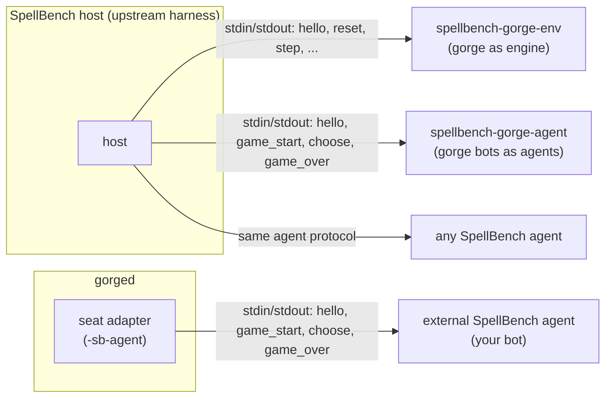
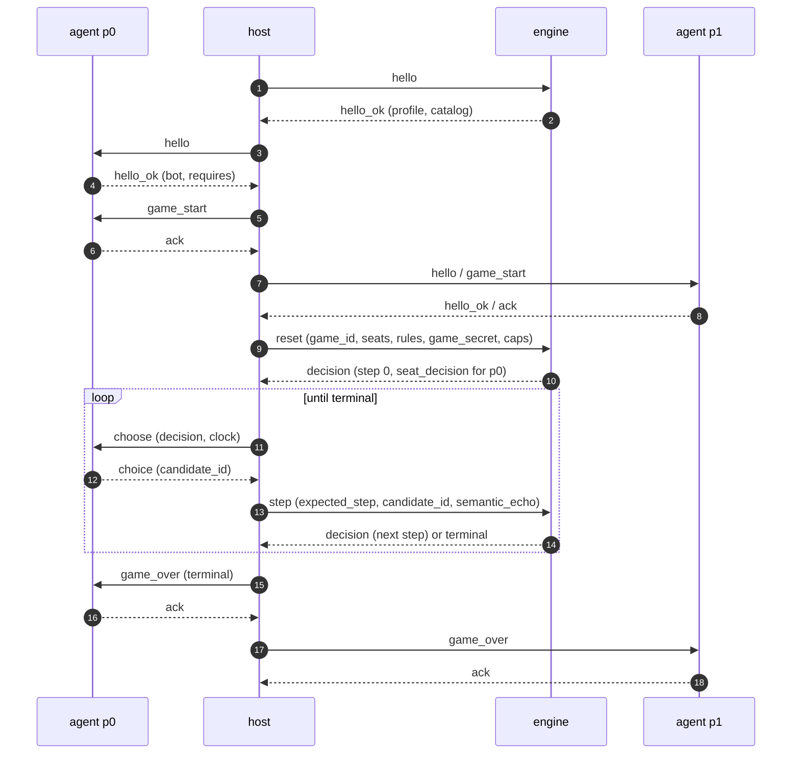

# SpellBench v2 protocol

[SpellBench](https://github.com/jackmaiorino/spellbench) is a public, MIT-licensed
benchmark for Magic: The Gathering agents. Its v2 protocol is newline-delimited JSON over
stdio between a **host** (the harness that runs games), an **engine** (the rules engine that
plays them) and two **agents** (the players). gorge speaks every side of it: it can be the
engine for a SpellBench host, it can serve its own bots as SpellBench agents, and its server
`gorged` can seat an external SpellBench agent at an ordinary gorge table. This page is the
wire reference for people plugging a SpellBench agent or harness into gorge: framing, strict
JSON, the digests, every message with a real example, the candidate kinds, the vocabularies and
the error codes, all as gorge implements them.

*Everything here was read from the code at commit `ad3777023` (2026-10-20) and checked
against the goldens in
[`server/spellbench/testdata/goldens`](https://github.com/adams-shaun/gorge/blob/main/server/spellbench/testdata/goldens).
The `-h` outputs and the smoke test were re-run at `513a2a0c3` (2026-10-21).*

!!! note "Where this comes from"
    gorge's SpellBench packages are ported from the SpellBench repository's gorge adapter
    (`engines/gorge`, revision `1beea4c104911bba77a5672c644e570ed9afe28a`, MIT). The code
    cites the upstream specification by section ("Section 9.2"); this page repeats those
    citations so you can cross-check them in the
    [upstream repository](https://github.com/jackmaiorino/spellbench). Where this page and
    the upstream specification disagree, the specification governs SpellBench and this page
    describes what gorge actually does.

## Who talks to whom

gorge takes three roles. Each is a separate process boundary with the same framing.

| Role | gorge piece | Started by | Speaks |
|---|---|---|---|
| Engine | [`cmd/spellbench-gorge-env`](https://github.com/adams-shaun/gorge/blob/main/cmd/spellbench-gorge-env/main.go) ([`server/spellbench/env`](https://github.com/adams-shaun/gorge/blob/main/server/spellbench/env/server.go)) | a SpellBench host, as a child process | answers `hello`, `reset`, `step`, `validate_deck`, `probe_resample` |
| Agent | [`cmd/spellbench-gorge-agent`](https://github.com/adams-shaun/gorge/blob/main/cmd/spellbench-gorge-agent/main.go) ([`server/spellbench/agent`](https://github.com/adams-shaun/gorge/blob/main/server/spellbench/agent/agent.go)) | a SpellBench host, one process per seat | answers `hello`, `game_start`, `choose`, `game_over` with one of gorge's registered bot policies |
| Host (agent side only) | `gorged -sb-agent name=/path` ([`server/spellbench/seat`](https://github.com/adams-shaun/gorge/blob/main/server/spellbench/seat/seat.go)) | you, on the `gorged` command line | sends `hello`, `game_start`, `choose`, `game_over` to an external agent; gorge's own rules engine plays the game, so no engine process exists |



The host sits between engine and agents. It relays each engine `decision` to the acting seat's
agent as a `choose`, and turns the agent's `choice` into the next `step`. Engine and agent never
see each other, which is why the engine's messages carry everything an agent needs and nothing
it should not see.

### Running the binaries

Both commands need the compiled Forge card corpus (`make fetch-cards`; see
[Getting started](../getting-started.md)). `-h` prints, at `513a2a0c3`:

```text
$ go build -o bin/ ./cmd/spellbench-gorge-env ./cmd/spellbench-gorge-agent
$ bin/spellbench-gorge-env -h
  -auto-pay
    	pay mana with the engine planner (the default; accepted for compatibility) (default true)
  -corpus string
    	compiled Forge corpus directory (never shipped)
  -manual-mana
    	offer interactive mana taps instead of engine auto-pay
  -registry string
    	frozen registry file (reproducible input binding)
  -registry-sha256 string
    	expected SHA-256 of the frozen registry
  -source-revision string
    	adapter source revision reported in hello_ok
$ bin/spellbench-gorge-agent -h
  -audit-dir string
    	optional directory for aggregate policy coverage after the process closes
  -corpus string
    	pinned corpus directory (neutral world)
  -list-policies
    	list registered policies and exit
  -policy string
    	registered bot policy key (default "bot")
  -registry string
    	frozen registry file (neutral world)
  -registry-sha256 string
    	expected SHA-256 of the frozen registry
  -world string
    	gorge (read x_gorge_view_v1 from gorge's engine) or neutral (translate the v2 observation and candidates of any engine; needs the registry) (default "gorge")
```

`-corpus` defaults to `$GORGE_CARDS`. Pass either `-corpus` or the pair `-registry` +
`-registry-sha256`; the env exits 2 when neither is given or the catalog decks do not resolve.
A quick smoke test of the engine role:

```text
$ printf '%s\n' '{"request_type":"validate_deck","protocol":"spellbench/v2","request_id":"v-1","format":"pauper-bo1","deck":{"catalog_id":"Burn"}}' \
    | bin/spellbench-gorge-env -corpus .cards
{"protocol":"spellbench/v2","request_id":"v-1","response_type":"deck_ok"}
```

The agent's two worlds matter when you pair it with an engine:

- `-world gorge` (default) reads the `x_gorge_view_v1` extension, gorge's own view of the
  decision, so it only plays against `spellbench-gorge-env` with that extension enabled in
  `reset.rules.extensions`. Its `hello_ok` says so: `"requires":{"extensions":["x_gorge_view_v1"]}`.
- `-world neutral` rebuilds gorge's view from the plain v2 observation and candidates, so it
  can play against any engine. It needs the card registry and requires the `keywords`
  observation flag.

To seat an external agent in `gorged`, register it as a bot policy:

```text
gorged -sb-agent mybot=/path/to/mybot
```

The name must match `^[a-z0-9-]+$` and must not collide with a built-in policy; the path must
be executable. `gorged` execs the path directly, with no shell and no arguments (put
arguments in a wrapper script), starts one process per seat per match and stops it at match
end. The policy is two-seat only, constructed format, and needs engine auto-pay. See
[Bot-vs-bot games](../guide/bot-games.md) for running matches with a policy.

## Transport and framing

*Section 2; [`wire/frame.go`](https://github.com/adams-shaun/gorge/blob/main/server/spellbench/wire/frame.go).*

- One JSON object per line, UTF-8, on the child's stdin (requests) and stdout (responses).
  A line ends with `\n` or `\r\n`; only that terminator is stripped, so a stray `\r` before it
  is content.
- A line may hold at most **8 MiB** (8 388 608 bytes) excluding the terminator. A longer line is
  read through to its newline, answered with a `malformed_json` error whose `request_id` is
  `""`, and reading resumes on the next line.
- Every request line gets exactly one response line, in order. gorge writes compact JSON
  without HTML escaping and flushes after every line.
- Diagnostics go to stderr. End of input ends the process with exit status 0.
- Requests are not pipelined by gorge's own host code: it waits for each answer.

A whole game, as the reference host in the goldens orders it (the specification does not fix
the order of the two seats' starts against `reset`):



`reset` and `step` are answered with the next pending `decision`, or with `terminal` when the
game is over. Each `decision` addresses one seat (`seat_decision.acting_seat`); the host sends
it to that seat's agent only.

### Request ids and retransmission

*Section 4.1; [`env/server.go`](https://github.com/adams-shaun/gorge/blob/main/server/spellbench/env/server.go) `Handle`.*

`request_id` is any nonempty string. The engine caches every answered request since the last
accepted `reset`, keyed by `request_id`. Sending the **same bytes** again returns the cached
answer byte for byte, without re-running anything. Sending a **different** line with a used
id is `request_id_reuse_mismatch`. The cache is cleared when a `reset` starts a new game, and a
request the decoder refused (any `malformed_*` or `protocol_mismatch`) is never cached.

## Strict JSON

*Section 2; [`wire/strict.go`](https://github.com/adams-shaun/gorge/blob/main/server/spellbench/wire/strict.go),
[`protocol/requests.go`](https://github.com/adams-shaun/gorge/blob/main/server/spellbench/protocol/requests.go).*

The engine role checks every request line before decoding it. A line breaking any of these
rules is `malformed_json` (with `request_id` `""`):

| Rule | Example that fails |
|---|---|
| valid UTF-8, nothing after the value | `{"a":1} x` |
| no duplicate keys, at any depth | `{"request_type":"hello","request_type":"hello",...}` |
| integers only: no fraction, no exponent | `"protocol_minor":1.0` |
| integers of absolute value at most 2^53-1 | `9007199254740992` |
| no leading zeros | `007` |
| nesting at most 64 levels | 65 nested arrays |
| no raw control characters in strings, valid escapes, no unpaired surrogate escapes | `"\ud800"` |

A strict-JSON value that is not an object at the top level is `malformed_request`. After
that, the decoder holds each request to an **exact field set**: a missing or extra field, a
wrong type (including `null` where a string, boolean or array is expected), an out-of-range
integer, an empty `request_id` or `game_id`, or a card name that is not in Unicode NFC is
`malformed_request`. Recorded on the env binary:

```text
{"request_type":"hello","protocol":"spellbench/v2","request_id":"h-2","protocol_minor":1.0}
{"error":{"code":"malformed_json","message":"malformed_json: number with a fraction or an exponent at 87"},"protocol":"spellbench/v2","request_id":"","response_type":"error"}
{"request_type":"hello","protocol":"spellbench/v2","request_id":"h-1","protocol_minor":4294967296}
{"error":{"code":"malformed_request","message":"protocol_minor is not a u32"},"protocol":"spellbench/v2","request_id":"h-1","response_type":"error"}
```

Integer widths follow Section 4.4: a `u32` is `0..4294967295`, an `i32` is
`-2147483648..2147483647`, and the 64-bit counters (`expected_step`, `max_steps`, ...) are
bounded by the strict-JSON limit `2^53-1`. `-0` reads as `0`.

!!! warning "Only the engine role is strict"
    `spellbench-gorge-agent` and `gorged`'s seat adapter read lines with Go's
    `encoding/json`, which tolerates duplicate keys and fractional numbers. Send strict JSON
    anyway: the upstream host and engines are strict, and the 8 MiB bound still applies to
    the agent binary.

## Canonical JSON, ids and digests

### Canonical JSON

*Section 4.3; [`wire/canonical.go`](https://github.com/adams-shaun/gorge/blob/main/server/spellbench/wire/canonical.go).*
Every hash in the protocol is taken over **canonical JSON**: RFC 8785 restricted to
integer-only data.

- No whitespace. Object keys sorted by their **UTF-16 code units** (so U+1F600 sorts before
  U+FFFD), arrays in order.
- Integers in plain decimal. A number with a fraction is an error.
- Strings: `\"` and `\\`, the short escapes `\b \f \n \r \t`, every other control character
  below U+0020 as lowercase `\u00xx`, and everything else as raw UTF-8 (including DEL and
  U+2028).

Test vector (`test_vectors.json`, `canonical_sha256`): `{"b":"Chainer's Edict","a":"Lim-Dûl's Vault","c":"tab\there"}`
canonicalizes to `{"a":"Lim-Dûl's Vault","b":"Chainer's Edict","c":"tab\there"}`, whose
SHA-256 is `041575311eb1deb02f63f70361e14159034faf0d2a31e57edf8b4cf037680377`.

### deck_id and domain_id

*Section 4.3 and 12.1; `DeckID` and `DomainID` in
[`wire/canonical.go`](https://github.com/adams-shaun/gorge/blob/main/server/spellbench/wire/canonical.go).*

- **`deck_id`**: sort the decklist rows by `name` in Unicode code point order (UTF-8 byte
  order), write them as the canonical array `[{"count":N,"name":"..."},...]`, and take
  `"sha256:" + hex(SHA-256(bytes))`. Note the sort: rows by code point, keys inside each row by
  UTF-16, which is why `count` comes before `name`.
- **`domain_id`** (`rules.card_name_domain.domain_id`): sort the names in code point order,
  write the canonical array of strings, and hash the same way.

| Input | Result |
|---|---|
| deck `[{"name":"Mountain","count":18},{"name":"Lightning Bolt","count":4}]` | `sha256:0df0a001e3c4b74b1061b21e319a645f32fbe3173120e432864e14d6d6f2f5d2` |
| names `["Mountain","Lightning Bolt"]` | `sha256:74f7f4b39eecbed1c039cf4b229fa533069d2cdd8caf3bb6380b832eb40fb697` |

gorge's engine checks both: a `reset` whose `deck_id` does not hash the named catalog deck is
`deck_id_mismatch`, and one whose `domain_id` does not hash its `names` is `malformed_request`.

### Secrets, game ids and object ids

*Sections 5.3 and 11.6; [`secrets/secrets.go`](https://github.com/adams-shaun/gorge/blob/main/server/spellbench/secrets/secrets.go),
[`identity/tracker.go`](https://github.com/adams-shaun/gorge/blob/main/server/spellbench/identity/tracker.go).*

The host draws one run secret and derives everything else with HMAC-SHA-256
(`HMAC(key, message)`, game index `i` in decimal):

| Value | Construction |
|---|---|
| `game_secret` (64 lowercase hex, sent in `reset`) | `HMAC(run, "spellbench/v2/game:" + i)` |
| `game_id` | `"g-" + hex(HMAC(run, "spellbench/v2/game-id:" + i)[:8])` |
| `agent_seed` (sent in `game_start`) | first 8 bytes of `HMAC(run, "spellbench/v2/agent-seed:" + i + ":" + seat)`, big-endian, masked to 53 bits |
| object id key (engine-internal) | `HMAC(game_secret, "spellbench/v2/object-id")` |
| `object_id` | `"o-" + hex(HMAC(id_key, M)[:8])` |
| random stream seed (engine-internal) | `HMAC(game_secret, "spellbench/v2/rng:<owner>:<purpose>:<n>")`, a ChaCha8 key |

gorge mints object ids **per viewer**: each seat sees its own id for the same card, and a card
gets a fresh id on every zone change and on every look into a hidden zone, so an id never
links a card across a shuffle. A reference whose object has since changed zones is sent as
`null`. The engine keeps a shadow copy of the game to count zone changes and halts
(`engine_contract_failure:identity_shadow_diverged`) if it ever disagrees.

### Game digest

*Section 11.8; [`wire/digest.go`](https://github.com/adams-shaun/gorge/blob/main/server/spellbench/wire/digest.go).*

The game digest is a hash chain over the engine channel of one game, so two parties can
confirm they saw the same game without exchanging it. Let `C(m)` be the canonical JSON of
message `m` with its top-level `request_id` removed:

```text
d0     = SHA-256( "spellbench/v2/game-digest" || C(reset) )
d(k+1) = SHA-256( d(k) || C(next message) )        # d(k) is the 32 raw bytes
digest = "sha256:" + hex(d_last)
```

The chain starts at `reset` (the `hello` exchange is not part of it) and takes every later
line on the engine channel in order: the engine's `decision` and `terminal` answers and the
host's `step` requests. `test_vectors.json` pins `d0` for its sample reset at
`a328e304e4dcacdde5d8abe089c93a8bedd108e9985d3bdab6ede3b8e8f093a3`. A stdlib Python version,
checked against all five gorge game goldens (`digests.json`) and the four upstream game
goldens that end in an engine `terminal`:

```python
import hashlib, json

def canon(v):
    if isinstance(v, dict):
        keys = sorted(v, key=lambda k: k.encode("utf-16-be"))
        return "{" + ",".join(canon(k) + ":" + canon(v[k]) for k in keys) + "}"
    if isinstance(v, list):
        return "[" + ",".join(canon(e) for e in v) + "]"
    if isinstance(v, str):
        short = {'"': '\\"', "\\": "\\\\", "\b": "\\b", "\f": "\\f", "\n": "\\n", "\r": "\\r", "\t": "\\t"}
        return '"' + "".join(short.get(c) or ("\\u%04x" % ord(c) if ord(c) < 0x20 else c) for c in v) + '"'
    return json.dumps(v)  # null, true, false, integers

def game_digest(engine_channel):          # dicts, starting with the reset
    d = None
    for m in engine_channel:
        c = canon({k: x for k, x in m.items() if k != "request_id"}).encode()
        d = hashlib.sha256((b"spellbench/v2/game-digest" if d is None else d) + c).digest()
    return "sha256:" + d.hex()
```

The four upstream goldens where the host itself ends the game (a forfeit, a cap, a validator
halt) carry digests that also cover a host record the transcript does not contain; gorge
implements only the engine-terminated chain.

## Engine role: requests and responses

Schemas: [requests.schema.json](schemas/spellbench-v2/requests.schema.json) (`$defs/engine_request`),
[responses.schema.json](schemas/spellbench-v2/responses.schema.json) (`$defs/engine_response`).
Every request carries `request_type`, `protocol` (`"spellbench/v2"`) and `request_id`; every
response carries `response_type`, `protocol` and the request's `request_id`. gorge does not
require `hello` before `reset`.

### hello → hello_ok

The handshake: the host names the protocol, the engine answers with its profile.

| Field | Type | Notes |
|---|---|---|
| `protocol_minor` | u32 | any value is accepted; gorge always answers `0` |

```json
{"request_type":"hello","protocol":"spellbench/v2","request_id":"h-1","protocol_minor":0}
```

`hello_ok` ([`$defs/engine_hello_ok`](schemas/spellbench-v2/responses.schema.json)):

| Field | gorge's value | Meaning |
|---|---|---|
| `protocol_minor` | `0` | the minor version gorge speaks |
| `engine` | `name` `gorge`; `version` `gorge-<rev>/spellbench-adapter-0.1.0` (`/autopay` appended under auto-pay); `rules_snapshot_id` `gorge/<rev>/ir-<compiler fingerprint>`; `card_pool_identity` `forge-<corpus ref>/corpus-<corpus hash>/catalog-<catalog hash>`; `source_revision` from `-source-revision`, else `null` | identifies the engine build, rules and card pool ([`env/identity.go`](https://github.com/adams-shaun/gorge/blob/main/server/spellbench/env/identity.go)) |
| `formats` | `["pauper-bo1"]` | the only format `reset` accepts |
| `deck_sources` | `["catalog"]` | gorge plays catalog decks only, never a pasted decklist |
| `catalog` | five decks: Wildfire, Rally, Spy, Burn, CawGates | `catalog_id`, `name`, `decklist` |
| `rules_supported` | `mulligan: [london, none]`, `starting_player: [host_assigned]` | |
| `observation` | `day_night`, `designations`, `keywords`, `pending_triggers`, `permanent_details`, `player_counters` and `poison` true; `exiled_by`, `full_name`, `known_cards`, `passed_seats`, `player_progress`, `stack_text` false | Section 6.9 flags: a field behind a false flag is `null` |
| `decision_kinds` | 24 of the 30 kinds (see [Candidate kinds](#candidate-kinds)) | |
| `engine_defaults` | `combat_damage_assignment: "engine_order"`; `mana_payment: "engine_autopay"` under auto-pay, else `null`; `trigger_order` and `replacement_order` `null` | Section 7.6: choices the engine makes itself |
| `rewind` | `false` | gorge never rewinds a decision |
| `fairness` | `noninterference_probe: false` | no probe |
| `extensions` | `[{"name":"x_gorge_view_v1","native_ids":false}]` | the one extension `reset` may enable |

Example from `hello.transcript.jsonl.gz` (catalog cut to one deck; the golden is generated
without auto-pay, so `mana_payment` is `null` and the version has no `/autopay`):

```json
{
  "catalog": [{"catalog_id": "Burn", "name": "Burn", "decklist": [
      {"count": 4, "name": "Sneaky Snacker"}, {"count": 2, "name": "Faithless Looting"},
      {"count": 4, "name": "Highway Robbery"}, {"count": 4, "name": "Masked Meower"},
      {"count": 4, "name": "Lightning Bolt"}, {"count": 18, "name": "Mountain"},
      {"count": 4, "name": "Grab the Prize"}, {"count": 4, "name": "Fireblast"},
      {"count": 4, "name": "Guttersnipe"}, {"count": 4, "name": "Fiery Temper"},
      {"count": 4, "name": "Voldaren Epicure"}, {"count": 4, "name": "Lava Dart"}]}],
  "decision_kinds": ["pass", "play_land", "cast_spell", "activate_mana_ability", "activate_ability",
    "special_action", "choose_target", "finish_target_selection", "choose_cost_target",
    "choose_spell_mode", "choose_color", "choose_number", "choose_boolean", "choose_name",
    "select_object", "finish_selection", "optional_cost", "optional_cast", "mulligan",
    "order_pick", "arrange_card", "choose_replacement", "declare_attack", "declare_block"],
  "deck_sources": ["catalog"],
  "engine": {"card_pool_identity": "forge-unknown/corpus-796399f30625f372/catalog-ddaa89bf514cd72d",
    "name": "gorge", "rules_snapshot_id": "gorge/devel/ir-cf30b57c2e8789ca6998139416be78e8",
    "source_revision": null, "version": "gorge-devel/spellbench-adapter-0.1.0"},
  "engine_defaults": {"combat_damage_assignment": "engine_order", "mana_payment": null,
    "replacement_order": null, "trigger_order": null},
  "extensions": [{"name": "x_gorge_view_v1", "native_ids": false}],
  "fairness": {"noninterference_probe": false},
  "formats": ["pauper-bo1"],
  "observation": {"day_night": true, "designations": true, "exiled_by": false, "full_name": false,
    "keywords": true, "known_cards": false, "passed_seats": false, "pending_triggers": true,
    "permanent_details": true, "player_counters": true, "player_progress": false,
    "poison": true, "stack_text": false},
  "protocol": "spellbench/v2", "protocol_minor": 0, "request_id": "h-1",
  "response_type": "hello_ok", "rewind": false,
  "rules_supported": {"mulligan": ["london", "none"], "starting_player": ["host_assigned"]}
}
```

### reset → decision | terminal

Starts a game. Schema: [`$defs/reset`](schemas/spellbench-v2/requests.schema.json).

| Field | Type | gorge accepts |
|---|---|---|
| `game_id` | nonempty string | any id not used before by this process (a reused id is `malformed_request`) |
| `format` | string | `pauper-bo1` only, else `unsupported_format` |
| `seats` | exactly `[{"seat":"p0","deck":D},{"seat":"p1","deck":D}]` | `D` is `{deck_id, catalog_id}` or `{deck_id, decklist}`; gorge plays catalog decks only (`unsupported_deck`) and checks `deck_id` (`deck_id_mismatch`) |
| `rules.opponent_decklist` | `visible` or `hidden` | both |
| `rules.mulligan` | `london` or `none` | both |
| `rules.starting_player` | `host_assigned` or `toss_winner_chooses` | `host_assigned` only (`unsupported_rule`) |
| `rules.starting_seat` | `p0`, `p1` or null | a seat exactly when `host_assigned` |
| `rules.card_name_domain` | `{domain_id, names}` | names nonempty, NFC, distinct; `domain_id` must hash them |
| `rules.extensions` | array of distinct `x_[a-z0-9_]+` names | `[]` or `["x_gorge_view_v1"]`; another is `unsupported_rule` |
| `rules.probe` | boolean | `false` only (`unsupported_rule`) |
| `game_secret` | 64 lowercase hex characters | |
| `max_decisions`, `max_steps` | u64 | caps: the engine ends the game `truncated` at a group start when `decisions >= max_decisions` or when the group would pass `max_steps`, so a cap never splits a group |

A `reset` while a game is still running is `game_already_active`; after a `terminal` it starts
the next game. Example from `reset_first_decision_burn.transcript.jsonl.gz` (the golden's
domain lists 83 names; three shown):

```json
{
  "request_type": "reset", "protocol": "spellbench/v2", "request_id": "r-1",
  "game_id": "g-1", "format": "pauper-bo1",
  "seats": [
    {"seat": "p0", "deck": {"deck_id": "sha256:20e44003dba8100a83d84878c55f6736f1cb033ec76596a740cdbeb558b580c9", "catalog_id": "Burn"}},
    {"seat": "p1", "deck": {"deck_id": "sha256:20e44003dba8100a83d84878c55f6736f1cb033ec76596a740cdbeb558b580c9", "catalog_id": "Burn"}}
  ],
  "rules": {
    "opponent_decklist": "visible", "mulligan": "london",
    "starting_player": "host_assigned", "starting_seat": "p0",
    "card_name_domain": {
      "domain_id": "sha256:ab186e0272634f91dad9dd7b5765f33b69b3dc91bdfb1f6e43879be6ea49ba5b",
      "names": ["Azorius Guildgate", "Balustrade Spy", "Basilisk Gate"]
    },
    "extensions": [], "probe": false
  },
  "game_secret": "abababababababababababababababababababababababababababababababab",
  "max_decisions": 10000, "max_steps": 100000
}
```

### decision

The engine's question to one seat. Schema: [`$defs/decision`](schemas/spellbench-v2/responses.schema.json),
`seat_decision` in [common.schema.json](schemas/spellbench-v2/common.schema.json) (`$defs/SeatDecision`),
`observation` in [observation.schema.json](schemas/spellbench-v2/observation.schema.json).

| Field | Type | Meaning |
|---|---|---|
| `game_id` | string | the game |
| `step` | u64 | the game's step counter: one per answered `step`, both seats together; the next `step` must echo it as `expected_step` |
| `seat_decision.acting_seat` | seat | who must answer |
| `seat_decision.seat_step` | u64 | this seat's own step counter |
| `seat_decision.group` | `{group_id, substep_index, substep_count}` | Section 8: one gorge decision can be asked as several substeps (picking three cards one at a time, say). `group_id` counts this seat's groups; while a group is open the engine asks the other seat nothing |
| `seat_decision.context` | `{kind, source, purpose, text, rewind}` | `kind` is `priority` or `choice`; `source` the object asking (or null); `purpose` a snake_case word such as `mulligan_bottom`, `scry` or `mana_payment` (or null); `rewind` is always `false` from gorge |
| `seat_decision.observation` | object | what this seat can see ([below](#the-observation)) |
| `seat_decision.candidates` | array, at least one | `{candidate_id, semantic, display_text}`; ids count from 0; `display_text` is `null` from gorge |
| `seat_decision.extensions` | object | `x_` keys only, `{}` when none (Section 9.3, 14); `x_gorge_view_v1` when the reset enabled it |
| `provenance` | `{engine_name, engine_version, rules_snapshot_id, card_pool_identity}` | the `hello_ok.engine` identity |

The answer to the Burn reset above, from `uniform_game_burn.transcript.jsonl.gz`
(p0's hand cut from seven cards to one; p1's hand is `null` because p0 cannot see it):

```json
{
  "game_id": "g-5ce239156f76995d", "protocol": "spellbench/v2",
  "provenance": {"card_pool_identity": "forge-unknown/corpus-796399f30625f372/catalog-ddaa89bf514cd72d",
    "engine_name": "gorge", "engine_version": "gorge-devel/spellbench-adapter-0.1.0",
    "rules_snapshot_id": "gorge/devel/ir-cf30b57c2e8789ca6998139416be78e8"},
  "request_id": "h-1", "response_type": "decision", "step": 0,
  "seat_decision": {
    "acting_seat": "p0", "seat_step": 0,
    "candidates": [
      {"candidate_id": 0, "display_text": null,
       "semantic": {"hand_size": 7, "keep": true, "kind": "mulligan", "mulligans_taken": 0}},
      {"candidate_id": 1, "display_text": null,
       "semantic": {"hand_size": 7, "keep": false, "kind": "mulligan", "mulligans_taken": 0}}
    ],
    "context": {"kind": "choice", "purpose": null, "rewind": false, "source": null, "text": null},
    "extensions": {},
    "group": {"group_id": 0, "substep_count": 1, "substep_index": 0},
    "observation": {
      "active_seat": "p0", "day_night": null, "known": [], "passed_seats": null,
      "pending_triggers": [], "phase_step": "pregame", "priority_seat": null,
      "stack": [], "turn": 0, "viewer": "p0",
      "players": [
        {"seat": "p0", "life": 20, "poison": null, "counters": null, "designations": null,
         "progress": null, "hand_count": 7, "library_count": 53, "lands_played_this_turn": 0,
         "mulligans_taken": 0, "mana_pool": {"B": 0, "C": 0, "G": 0, "R": 0, "U": 0, "W": 0},
         "battlefield": [], "command": [], "exile": [], "graveyard": [],
         "hand": [
           {"object_id": "o-9f7495a19fb8eb70", "card_name": "Sneaky Snacker",
            "owner_seat": "p0", "controller_seat": "p0", "zone": "hand",
            "copy": false, "exiled_by": null, "face_down": false, "full_name": null,
            "permanent": null, "token": false,
            "characteristics": {"colors": ["blue", "black"], "keywords": ["flying"],
              "mana_value": 2, "power": 2, "subtypes": ["faerie", "rogue"],
              "supertypes": [], "toughness": 1, "types": ["creature"]}}
         ]},
        {"seat": "p1", "life": 20, "poison": null, "counters": null, "designations": null,
         "progress": null, "hand_count": 7, "library_count": 53, "lands_played_this_turn": 0,
         "mulligans_taken": 0, "mana_pool": {"B": 0, "C": 0, "G": 0, "R": 0, "U": 0, "W": 0},
         "battlefield": [], "command": [], "exile": [], "graveyard": [], "hand": null}
      ]
    }
  }
}
```

### step → decision | terminal

Answers the pending decision. Schema: [`$defs/step`](schemas/spellbench-v2/requests.schema.json).

| Field | Type | Rule |
|---|---|---|
| `game_id` | string | the running game, else `game_id_mismatch` (`step_before_reset` if none was ever reset) |
| `expected_step` | u64 | the pending decision's `step`, else `expected_step_mismatch` |
| `selection.candidate_id` | u32 | an offered id, else `candidate_id_out_of_range` |
| `selection.semantic_echo` | object | that candidate's `semantic`, copied back; compared as decoded JSON (key order does not matter), else `semantic_echo_mismatch` |

The echo exists so a confused host fails loudly instead of playing the wrong move. A `step`
after the game ended is `game_already_terminal`. The host's answer to the decision above:

```json
{"request_type": "step", "protocol": "spellbench/v2", "request_id": "h-3",
 "game_id": "g-5ce239156f76995d", "expected_step": 0,
 "selection": {"candidate_id": 1,
   "semantic_echo": {"hand_size": 7, "keep": false, "kind": "mulligan", "mulligans_taken": 0}}}
```

### terminal

The game is over. Schema: [`$defs/terminal`](schemas/spellbench-v2/responses.schema.json).

| Field | gorge's values |
|---|---|
| `outcome` | `p0_win`, `p1_win`, `draw`, `truncated`, `halted` |
| `classification` | `natural` (the rules ended it), `truncated` (a cap), `halted` (the engine could not continue) |
| `winner` | the winning seat, else `null` |
| `reason` | natural: `draw`, or the **loser's** cause, `<seat>_life_zero`, `<seat>_decked`, `<seat>_poison`, `<seat>_lost`; truncated: `max_decisions` or `max_steps`; halted: `engine_contract_failure:<cause>` (for example `unmapped_decision`, `dead_end`, `livelock`, `panic`, `identity_shadow_diverged`) |
| `step_count`, `decision_count` | answered steps, and completed decision groups |
| `provenance` | as in `decision` |
| `x_gorge` | `{"autopay_fallbacks": N}`, only under auto-pay: how many payment asks (mana windows, mana colour picks, triggered-cost elections) the engine answered itself instead of forwarding |

From `game_already_terminal.transcript.jsonl.gz` (a reset with `max_steps: 0`):

```json
{"classification":"truncated","decision_count":0,"game_id":"g-1","outcome":"truncated","protocol":"spellbench/v2","provenance":{"card_pool_identity":"forge-unknown/corpus-796399f30625f372/catalog-ddaa89bf514cd72d","engine_name":"gorge","engine_version":"gorge-devel/spellbench-adapter-0.1.0","rules_snapshot_id":"gorge/devel/ir-cf30b57c2e8789ca6998139416be78e8"},"reason":"max_steps","request_id":"r-1","response_type":"terminal","step_count":0,"winner":null}
```

### validate_deck → deck_ok | error

*Section 9.6 (optional in the specification).* Asks whether the engine would play a deck,
without starting a game. Schema: [`$defs/validate_deck`](schemas/spellbench-v2/requests.schema.json).
`deck` is `{catalog_id}` or `{decklist}`. gorge answers `deck_ok` for its five catalog ids
in `pauper-bo1`, `unsupported_format` for another format, and `unsupported_deck` for any
`decklist`. Recorded on the env binary:

```text
{"request_type":"validate_deck","protocol":"spellbench/v2","request_id":"v-1","format":"pauper-bo1","deck":{"catalog_id":"Burn"}}
{"protocol":"spellbench/v2","request_id":"v-1","response_type":"deck_ok"}
{"request_type":"validate_deck","protocol":"spellbench/v2","request_id":"v-2","format":"pauper-bo1","deck":{"decklist":[{"name":"Lightning Bolt","count":4},{"name":"Mountain","count":18}]}}
{"error":{"code":"unsupported_deck","message":"only the engine catalog decks are playable"},"protocol":"spellbench/v2","request_id":"v-2","response_type":"error"}
```

### probe_resample → error

*Section 9.7.* The non-interference probe. gorge decodes it strictly (`game_id`, `samples`
as a u32) and then refuses it: it has no probe, declares `noninterference_probe: false`, and
refuses `rules.probe: true` at reset. From `unsupported_request.transcript.jsonl.gz`:

```text
{"request_type":"probe_resample","protocol":"spellbench/v2","request_id":"p-1","game_id":"g-1","samples":4}
{"error":{"code":"unsupported_request","message":"probe_resample is not implemented"},"protocol":"spellbench/v2","request_id":"p-1","response_type":"error"}
```

`probe_refused` (an engine with a probe refusing a game reset without one) is defined in
[`errors.go`](https://github.com/adams-shaun/gorge/blob/main/server/spellbench/protocol/errors.go)
but gorge never sends it.

### error

Schema: [`$defs/engine_error`](schemas/spellbench-v2/responses.schema.json).
`{"response_type":"error","protocol":"spellbench/v2","request_id":R,"error":{"code":C,"message":M}}`.
`request_id` is the request's id when it could be read, else `""`. **Compare `code`, never
`message`**: messages are human-facing (Section 9.8). An error leaves the game as it was, so
the host can resend a corrected request. From `unsupported_rule.transcript.jsonl.gz`:

```json
{"error":{"code":"unsupported_rule","message":"probe"},"protocol":"spellbench/v2","request_id":"r-1","response_type":"error"}
```

## Agent role: requests and responses

Schemas: [requests.schema.json](schemas/spellbench-v2/requests.schema.json) (`$defs/agent_request`),
[responses.schema.json](schemas/spellbench-v2/responses.schema.json) (`$defs/agent_response`).
The host sends; the agent answers each line with one line. An agent may add fields to its
answers: `gorged`'s seat ignores them. The smallest agent that works is the
[minimal bot](https://github.com/adams-shaun/gorge/blob/main/server/spellbench/seat/testdata/minimal_bot.py)
(Section 10.6), which always picks candidate 0:

```python
import json, sys

for line in sys.stdin.buffer:
    request = json.loads(line)
    reply = {"protocol": "spellbench/v2", "request_id": request["request_id"]}
    if request["request_type"] == "hello":
        reply.update(response_type="hello_ok", bot={"name": "minimal", "version": "1.0.0"})
    elif request["request_type"] == "choose":
        reply.update(response_type="choice", selection={"candidate_id": 0})
    else:
        reply.update(response_type="ack")
    sys.stdout.write(json.dumps(reply) + "\n")
    sys.stdout.flush()
```

### hello → hello_ok

The same `hello` as the engine role. The agent answers with who it is and what it needs.

| Field | Type | Meaning |
|---|---|---|
| `bot` | `{name, version}` | both nonempty; `gorged` refuses the agent otherwise |
| `requires.observation` | array of flag names | observation flags the agent cannot play without |
| `requires.extensions` | array of `x_` names | extensions it cannot play without |
| `extensions_accepted` | array of `x_` names | extensions it can read |

`requires` and `extensions_accepted` may be omitted. `gorged`'s seat refuses a match (the seat
cannot attach) when `requires.observation` names a flag gorge does not know or
`requires.extensions` is nonempty, because it offers no extensions to external agents.
`spellbench-gorge-agent`'s own answer, recorded on the binary:

```json
{"bot":{"name":"gorge-bot","version":"f316d20d93bd4e1f09e3f5be515f525d2fdd45a4"},"extensions_accepted":["x_gorge_view_v1"],"protocol":"spellbench/v2","request_id":"r-0","requires":{"extensions":["x_gorge_view_v1"],"observation":[]},"response_type":"hello_ok"}
```

### game_start → ack

Introduces one game to one seat. Schema: [`$defs/game_start`](schemas/spellbench-v2/requests.schema.json).

| Field | Meaning |
|---|---|
| `game_id`, `seat` | the game, and which seat this agent plays |
| `agent_seed` | u53 seed for the agent's own randomness |
| `engine`, `engine_profile` | the engine's `hello_ok` identity and profile (`decision_kinds`, `engine_defaults`, `extensions`, `fairness`, `observation`, `rewind`, `rules_supported`) |
| `format`, `rules` | as in `reset`; `rules` has `card_name_domain`, `extensions`, `mulligan`, `opponent_decklist`, `probe`, `starting_player`, `starting_seat` |
| `own_deck`, `opponent_deck` | `{deck_id, decklist, name}`; `opponent_deck` only when `rules.opponent_decklist` is `visible` |
| `limits` | `max_decisions`, `max_seat_decisions_per_game`, `max_seat_decisions_per_turn`, `max_seat_steps_per_game`, `max_steps` (Section 11.4) |
| `resources` | `cpus`, `engine_cpus`, `gpu`, `memory_mb` |
| `time_control` | `bank_ms`, `engine_step_ms`, `game_start_ms`, `increment_ms`, `max_decision_ms`, `startup_ms` |

An example from the upstream golden `game_kinds_tour.transcript.jsonl` (decklists, names and
`decision_kinds` cut to their first entries):

```json
{
  "request_type": "game_start", "protocol": "spellbench/v2", "request_id": "r-1",
  "agent_seed": 8103969398531465, "game_id": "g-f67d7fe78c792984", "seat": "p0",
  "format": "pauper-bo1",
  "engine": {"card_pool_identity": "fake-v2-cards", "name": "fake-v2-engine",
    "rules_snapshot_id": "fake-v2-rules", "source_revision": null, "version": "0.2.0"},
  "engine_profile": {
    "decision_kinds": ["pass", "play_land", "cast_spell"],
    "engine_defaults": {"combat_damage_assignment": null, "mana_payment": null,
      "replacement_order": null, "trigger_order": null},
    "extensions": [], "fairness": {"noninterference_probe": false},
    "observation": {"day_night": false, "designations": false, "exiled_by": false,
      "full_name": false, "keywords": false, "known_cards": false, "passed_seats": false,
      "pending_triggers": false, "permanent_details": false, "player_counters": false,
      "player_progress": false, "poison": false, "stack_text": false},
    "rewind": true,
    "rules_supported": {"mulligan": ["london", "none"],
      "starting_player": ["host_assigned", "toss_winner_chooses"]}},
  "limits": {"max_decisions": 10000, "max_seat_decisions_per_game": 4999,
    "max_seat_decisions_per_turn": 500, "max_seat_steps_per_game": 49999, "max_steps": 100000},
  "own_deck": {"deck_id": "sha256:a42c2239e7c70dc82a878a237fd82329ca952ca29dbe36fe5c9404cd1443b1fa",
    "name": "Scenario:kinds",
    "decklist": [{"count": 1, "name": "Borrowed Hostility"}, {"count": 4, "name": "Brainstorm"}]},
  "opponent_deck": {"deck_id": "sha256:a42c2239e7c70dc82a878a237fd82329ca952ca29dbe36fe5c9404cd1443b1fa",
    "name": "Scenario:kinds",
    "decklist": [{"count": 1, "name": "Borrowed Hostility"}, {"count": 4, "name": "Brainstorm"}]},
  "resources": {"cpus": 1, "engine_cpus": 1, "gpu": false, "memory_mb": 4096},
  "rules": {"card_name_domain": {"domain_id": "sha256:f01544ae7acb3b1a5964116f1167497925145e0c335d7bd087bc371b5bdfee2b",
      "names": ["Borrowed Hostility", "Brainstorm"]},
    "extensions": [], "mulligan": "london", "opponent_decklist": "visible", "probe": false,
    "starting_player": "toss_winner_chooses", "starting_seat": null},
  "time_control": {"bank_ms": 600000, "engine_step_ms": 120000, "game_start_ms": 60000,
    "increment_ms": 2000, "max_decision_ms": 60000, "startup_ms": 300000}
}
```

`gorged`'s seat sends the same field set
([`seat/wire.go`](https://github.com/adams-shaun/gorge/blob/main/server/spellbench/seat/wire.go)) with its
own values: `format` is the table's format (`constructed`), `opponent_decklist` is `hidden`
unless the table shows decklists, `rules.extensions` is `[]`, `engine_defaults` declares
`engine_order` combat damage and `engine_autopay` mana, the limits and resources are the
values above, and `max_decision_ms` is the table's decision budget. The whole `hello` +
`game_start` handshake must finish within `startup_ms` (300 000 ms).

!!! note "The gorge goldens' game_start is abbreviated"
    The game goldens in `server/spellbench/testdata/goldens/*.jsonl.gz` were recorded by
    gorge's in-process test host ([`minihost`](https://github.com/adams-shaun/gorge/blob/main/server/spellbench/minihost/host.go)),
    which sends agents only `game_id`, `seat`, `agent_seed`, the two decks, `rules.mulligan`
    and `engine_profile.engine_defaults`. Those ten lines do not validate against the
    `game_start` schema by design; every other line in those files does.

### choose → choice

Asks the agent to pick. Schema: [`$defs/choose`](schemas/spellbench-v2/requests.schema.json).

| Field | Meaning |
|---|---|
| `game_id` | the game |
| `decision` | the engine's `seat_decision`, forwarded unchanged (the host re-serializes it canonically, Section 11.2) |
| `clock` | `{max_decision_ms, remaining_ms}`; `gorged` always sends `remaining_ms: 600000` |

The answer is `{"response_type":"choice", ..., "selection":{"candidate_id":N}}` with `N` one
of the offered ids. From `uniform_game_burn.transcript.jsonl.gz`, answering the mulligan
decision shown earlier:

```json
{"response_type":"choice","protocol":"spellbench/v2","request_id":"r-1","selection":{"candidate_id":1}}
```

When `gorged` hosts the agent, an answer that is late, malformed, out of range, an `error`,
or a dead process **forfeits** the seat (`timeout`, `agent_error`, `invalid_selection`,
`transport_error`): gorge plays out non-priority decisions with its heuristic bot and
concedes at the seat's next priority decision.

### game_over → ack

Tells the agent the game ended. Schema: [`$defs/game_over`](schemas/spellbench-v2/requests.schema.json).
`terminal` is `{classification, outcome, reason, seat_step_count, winner}`; a forfeit has
classification `forfeit` and reason `forfeit:<cause>`. From the upstream golden
`game_forfeit_invalid_selection.transcript.jsonl`:

```json
{"game_id": "g-f67d7fe78c792984", "protocol": "spellbench/v2", "request_id": "r-3", "request_type": "game_over",
 "terminal": {"classification": "forfeit", "outcome": "p1_win", "reason": "forfeit:invalid_selection",
   "seat_step_count": 0, "winner": "p1"}}
```

!!! note "gorged's outcome for halted and forfeited games"
    Like the upstream host, `gorged`'s seat writes `"outcome":"halted"` for a match that ended
    without a result and the winner's `pN_win` for a forfeit
    ([`seat.go`](https://github.com/adams-shaun/gorge/blob/main/server/spellbench/seat/seat.go) `EndMatch`;
    rechecked at `25d71cadc`). Earlier builds wrote `"outcome":""`, which the schema still
    admits.

### Agent errors

An agent may answer any request with an `error`
([`$defs/agent_error`](schemas/spellbench-v2/responses.schema.json), Section 10.5). The upstream
goldens use `malformed_json`, `malformed_request`, `protocol_mismatch`, `decision_pending`,
`game_already_active`, `unknown_game` and `internal_error`. `spellbench-gorge-agent` sends
three of them: `malformed_json` (an undecodable line, `request_id` `""`), `malformed_request`
(a `choose` before `game_start`, or a `game_start` its policy cannot play) and
`internal_error` (the policy failed). It answers any request type it does not know with `ack`.
From `agent_error_internal_error.transcript.jsonl`:

```json
{"error": {"code": "internal_error", "message": "choose returned a candidate_id that was not offered"}, "protocol": "spellbench/v2", "request_id": "r-2", "response_type": "error"}
```

## The observation

*Section 6; [`protocol/observation.go`](https://github.com/adams-shaun/gorge/blob/main/server/spellbench/protocol/observation.go),
[`observe`](https://github.com/adams-shaun/gorge/blob/main/server/spellbench/observe/project.go);
schema [observation.schema.json](schemas/spellbench-v2/observation.schema.json).*
The observation is what the acting seat may know, never more. Fields behind an observation
flag gorge declares `false` are `null`; with gorge's profile that is player `progress`,
`passed_seats`, and in object records `full_name` and `exiled_by`. Gorge declares `poison`,
player `counters`, `designations`, `day_night` and `permanent_details` true and fills them
from its view: a player's poison counters and other counters, the monarch and initiative
designations, CR 731's day/night state, and a permanent's `counters`, `statuses`, `chosen`
and `class_level`. A positive poison count rides `poison` only; a poison counter the engine
still keeps at zero also appears in `counters` as its presence marker, because `poison` has
no separate presence bit. `player_progress` stays false; the dungeon, ring and speed
projection is outside this profile.

| Field | Type | Notes |
|---|---|---|
| `viewer` | seat | the acting seat |
| `turn` | u32 | `0` before the first turn |
| `phase_step` | string | `pregame`, `untap`, `upkeep`, `draw`, `precombat_main`, `beginning_of_combat`, `declare_attackers`, `declare_blockers`, `combat_damage`, `end_of_combat`, `postcombat_main`, `end_step`, `cleanup` |
| `active_seat`, `priority_seat` | seat or null | |
| `players` | exactly two player records, p0 then p1 | life, mana pool, counts, and zone arrays `hand` (`null` for the other seat), `battlefield`, `graveyard`, `exile`, `command` |
| `stack` | array | each entry an object reference plus `stack_kind` (`spell`, `activated_ability`, `triggered_ability`), `source`, `targets`, `modes`, `x_value`, ... |
| `pending_triggers` | array (gorge declares the flag) | triggers waiting to be put on the stack |
| `known` | array | hidden-zone cards the seat has seen: `owner_seat`, `zone`, `card_name`, `object_id` or null, positions, `how` (`revealed`, `looked_at`, ...) |

An **object reference** (Section 5.1) is
`{object_id, card_name, owner_seat, controller_seat, zone}`, `card_name` `null` for a face-down
card. A **target reference** (Section 5.2) is exactly one of `{"player": seat}` and
`{"object": reference}`. Candidates that reference cards in hidden zones come, among
themselves, in `(card_name, object_id)` order (Section 7.1), so their order leaks nothing.

## Candidate kinds

*Sections 7.2-7.5; `kindTable` in [`protocol/kinds.go`](https://github.com/adams-shaun/gorge/blob/main/server/spellbench/protocol/kinds.go);
schema [semantic.schema.json](schemas/spellbench-v2/semantic.schema.json).*
A candidate's `semantic` is `{"kind": K, ...}` with exactly the fields listed for `K`, all
required, no others. The six marked *(priority)* are the moves offered when a seat holds
priority. gorge's engine emits 24 kinds; the other six are valid protocol, but gorge's engine
never asks them (combat damage, for example, follows the declared
`engine_order` default instead of a `distribute` ask). `gorged`'s seat also emits
`choose_starting_player`.

The **neutral world** still answers the kinds only another engine poses:
`choose_cast_method`, `choose_option` and `choose_cost_option` reuse gorge's cast and
mode asks; `distribute` follows the engine-order split (lethal to each creature in
substep order, the remainder on the last recipient) and spreads counters, mana and
life evenly; `choose_pile` takes the first pile as a counted approximation. A
decision the neutral world cannot map is counted in `Session.Counts`, the audit the
0.5% untranslated budget holds.

Field types: **ObjectRef** and **TargetRef** as above; **OrderItem** is `{"object": ObjectRef}`
or `{"trigger": {source, source_name, ability_index, event_objects, instance, label}}`;
**u32**/**i32** as in Section 4.4; **seat** is `p0` or `p1`; **snake** is an open
`^[a-z][a-z0-9_]*$` word; a linked name is a closed [vocabulary](#vocabularies).

<!-- BEGIN KINDS -->
| Kind | Fields (all required, in this order) | gorge's engine emits it | Constraint |
|---|---|---|---|
| <span id="kind-pass"></span>`pass` (priority) | (none) | yes |  |
| <span id="kind-play_land"></span>`play_land` (priority) | `source`: ObjectRef<br>`face`: u32 | yes |  |
| <span id="kind-cast_spell"></span>`cast_spell` (priority) | `source`: ObjectRef<br>`method`: [`method`](#vocab-method) or null | yes |  |
| <span id="kind-activate_mana_ability"></span>`activate_mana_ability` (priority) | `source`: ObjectRef<br>`ability_index`: u32<br>`mana_choice`: [`mana_symbol`](#vocab-mana_symbol) or null<br>`cost_target`: TargetRef or null | yes |  |
| <span id="kind-activate_ability"></span>`activate_ability` (priority) | `source`: ObjectRef<br>`ability_index`: u32 | yes |  |
| <span id="kind-special_action"></span>`special_action` (priority) | `source`: ObjectRef<br>`action`: [`special_action.action`](#vocab-special_action-action) | yes |  |
| <span id="kind-choose_target"></span>`choose_target` | `source`: ObjectRef<br>`slot`: u32<br>`target`: TargetRef<br>`selected_count`: u32<br>`minimum`: u32<br>`maximum`: u32 | yes | `minimum <= maximum`, `selected_count < maximum` |
| <span id="kind-finish_target_selection"></span>`finish_target_selection` | `source`: ObjectRef<br>`slot`: u32<br>`selected_count`: u32 | yes |  |
| <span id="kind-choose_cost_target"></span>`choose_cost_target` | `source`: ObjectRef<br>`cost_kind`: [`choose_cost_target.cost_kind`](#vocab-choose_cost_target-cost_kind)<br>`candidate`: ObjectRef<br>`selected_count`: u32<br>`minimum`: u32<br>`maximum`: u32 | yes | `minimum <= maximum`, `selected_count < maximum` |
| <span id="kind-choose_cast_method"></span>`choose_cast_method` | `source`: ObjectRef<br>`method`: [`method`](#vocab-method) | no |  |
| <span id="kind-choose_spell_mode"></span>`choose_spell_mode` | `source`: ObjectRef<br>`mode_index`: u32<br>`mode_count`: u32<br>`selected_count`: u32<br>`minimum`: u32<br>`maximum`: u32 | yes | `mode_index < mode_count`, `minimum <= maximum <= mode_count`, `selected_count < maximum` |
| <span id="kind-choose_option"></span>`choose_option` | `source`: ObjectRef or null<br>`purpose`: [`choose_option.purpose`](#vocab-choose_option-purpose)<br>`option_index`: u32<br>`option_count`: u32<br>`option_label`: string or null | no | `option_index < option_count` |
| <span id="kind-choose_color"></span>`choose_color` | `source`: ObjectRef or null<br>`purpose`: [`choose_color.purpose`](#vocab-choose_color-purpose)<br>`color`: [`color`](#vocab-color) | yes |  |
| <span id="kind-choose_number"></span>`choose_number` | `source`: ObjectRef or null<br>`purpose`: [`choose_number.purpose`](#vocab-choose_number-purpose)<br>`value`: i32<br>`minimum`: i32<br>`maximum`: i32 | yes | `minimum <= value <= maximum` |
| <span id="kind-choose_boolean"></span>`choose_boolean` | `source`: ObjectRef or null<br>`purpose`: [`choose_boolean.purpose`](#vocab-choose_boolean-purpose)<br>`value`: bool | yes |  |
| <span id="kind-choose_name"></span>`choose_name` | `source`: ObjectRef or null<br>`purpose`: [`choose_name.purpose`](#vocab-choose_name-purpose)<br>`value`: string | yes | with purpose `card_type`, value is a [`card_type`](#vocab-card_type) word |
| <span id="kind-select_object"></span>`select_object` | `source`: ObjectRef or null<br>`purpose`: [`select_object.purpose`](#vocab-select_object-purpose)<br>`choice`: TargetRef<br>`selected_count`: u32<br>`minimum`: u32<br>`maximum`: u32 | yes | `minimum <= maximum`, `selected_count < maximum` |
| <span id="kind-finish_selection"></span>`finish_selection` | `source`: ObjectRef or null<br>`purpose`: [`finish_selection.purpose`](#vocab-finish_selection-purpose)<br>`selected_count`: u32 | yes |  |
| <span id="kind-optional_cost"></span>`optional_cost` | `source`: ObjectRef<br>`cost`: [`optional_cost.cost`](#vocab-optional_cost-cost)<br>`pay`: bool | yes |  |
| <span id="kind-choose_cost_option"></span>`choose_cost_option` | `source`: ObjectRef<br>`choice`: snake | no |  |
| <span id="kind-optional_cast"></span>`optional_cast` | `card`: ObjectRef<br>`method`: [`method`](#vocab-method)<br>`cast_it`: bool | yes |  |
| <span id="kind-mulligan"></span>`mulligan` | `hand_size`: u32<br>`mulligans_taken`: u32<br>`keep`: bool | yes |  |
| <span id="kind-order_pick"></span>`order_pick` | `source`: ObjectRef or null<br>`purpose`: [`order_pick.purpose`](#vocab-order_pick-purpose)<br>`item`: OrderItem<br>`position`: u32<br>`count`: u32 | yes | `position < count` |
| <span id="kind-arrange_card"></span>`arrange_card` | `source`: ObjectRef or null<br>`purpose`: [`arrange_card.purpose`](#vocab-arrange_card-purpose)<br>`card`: ObjectRef<br>`card_index`: u32<br>`card_count`: u32<br>`destination`: [`arrange_card.destination`](#vocab-arrange_card-destination) | yes | `card_index < card_count` |
| <span id="kind-choose_replacement"></span>`choose_replacement` | `affected`: TargetRef<br>`event`: [`choose_replacement.event`](#vocab-choose_replacement-event)<br>`replacement_source`: ObjectRef or null<br>`replacement_index`: u32<br>`replacement_count`: u32 | yes | `2 <= replacement_count`, `replacement_index < replacement_count` |
| <span id="kind-choose_starting_player"></span>`choose_starting_player` | `player`: seat | no |  |
| <span id="kind-declare_attack"></span>`declare_attack` | `attacker`: ObjectRef<br>`defender`: TargetRef or null | yes |  |
| <span id="kind-declare_block"></span>`declare_block` | `blocker`: ObjectRef<br>`attacker`: ObjectRef or null | yes |  |
| <span id="kind-distribute"></span>`distribute` | `source`: ObjectRef or null<br>`purpose`: [`distribute.purpose`](#vocab-distribute-purpose)<br>`recipient`: TargetRef<br>`amount`: u32<br>`remaining`: u32 | no | `amount <= remaining` |
| <span id="kind-choose_pile"></span>`choose_pile` | `source`: ObjectRef or null<br>`purpose`: [`choose_pile.purpose`](#vocab-choose_pile-purpose)<br>`pile_index`: u32<br>`piles`: array of array of ObjectRef | no | `pile_index <= 1`, exactly 2 piles |
<!-- END KINDS -->

## Vocabularies

*Sections 5.1, 6.10 and 7.4; `Vocab` in [`protocol/kinds.go`](https://github.com/adams-shaun/gorge/blob/main/server/spellbench/protocol/kinds.go).*
Each is a closed list; any other word is invalid. Open words in observations (subtypes,
keywords, counter names, statuses) follow Section 6.10's normalisation instead: lowercase,
apostrophes removed, spaces and hyphens to `_`.

<!-- BEGIN VOCAB -->
| Vocabulary | Words |
|---|---|
| <span id="vocab-zone"></span>`zone` | `library`, `hand`, `battlefield`, `graveyard`, `stack`, `exile`, `command` |
| <span id="vocab-select_object-purpose"></span>`select_object.purpose` | `discard`, `sacrifice`, `exile`, `destroy`, `return_to_hand`, `search`, `reveal`, `put_onto_battlefield`, `put_into_hand`, `put_into_graveyard`, `legend_rule`, `tap`, `untap`, `delve`, `convoke`, `attach`, `keep`, `vote`, `modes`, `other` |
| <span id="vocab-finish_selection-purpose"></span>`finish_selection.purpose` | `discard`, `sacrifice`, `exile`, `destroy`, `return_to_hand`, `search`, `reveal`, `put_onto_battlefield`, `put_into_hand`, `put_into_graveyard`, `legend_rule`, `tap`, `untap`, `delve`, `convoke`, `attach`, `keep`, `vote`, `modes`, `other` |
| <span id="vocab-choose_boolean-purpose"></span>`choose_boolean.purpose` | `may_ability`, `optional_trigger`, `may_cast`, `change_copy_targets`, `optional_replacement`, `reveal`, `other` |
| <span id="vocab-choose_number-purpose"></span>`choose_number.purpose` | `x_value`, `amount`, `life_payment`, `cost_repetitions`, `vote`, `other` |
| <span id="vocab-choose_option-purpose"></span>`choose_option.purpose` | `effect_option`, `top_or_bottom`, `odd_or_even`, `vote`, `other` |
| <span id="vocab-choose_color-purpose"></span>`choose_color.purpose` | `mana`, `protection`, `effect`, `other` |
| <span id="vocab-choose_name-purpose"></span>`choose_name.purpose` | `card_name`, `creature_type`, `card_type`, `land_type`, `basic_land_type`, `other` |
| <span id="vocab-order_pick-purpose"></span>`order_pick.purpose` | `triggers`, `library_top`, `library_bottom`, `mulligan_bottom`, `arrangement`, `other` |
| <span id="vocab-arrange_card-purpose"></span>`arrange_card.purpose` | `scry`, `surveil`, `dig`, `look_at_top`, `pile_split`, `other` |
| <span id="vocab-arrange_card-destination"></span>`arrange_card.destination` | `top`, `bottom`, `graveyard`, `exile`, `hand`, `battlefield`, `pile_0`, `pile_1` |
| <span id="vocab-distribute-purpose"></span>`distribute.purpose` | `damage`, `combat_damage`, `counters`, `mana`, `life`, `other` |
| <span id="vocab-choose_pile-purpose"></span>`choose_pile.purpose` | `effect`, `other` |
| <span id="vocab-method"></span>`method` | `normal`, `alternative`, `flashback`, `escape`, `evoke`, `overload`, `adventure`, `disturb`, `foretell`, `plot`, `mdfc_back`, `split_left`, `split_right`, `fuse`, `prototype`, `morph`, `disguise`, `madness`, `miracle`, `cascade`, `discover`, `rebound`, `suspend`, `free`, `other` |
| <span id="vocab-optional_cost-cost"></span>`optional_cost.cost` | `kicker`, `buyback`, `entwine`, `conspire`, `casualty`, `bargain`, `gift`, `offspring`, `copy`, `unless_payment`, `additional`, `other` |
| <span id="vocab-choose_cost_target-cost_kind"></span>`choose_cost_target.cost_kind` | `sacrifice`, `discard`, `exile`, `tap`, `untap`, `return_to_hand`, `reveal`, `remove_counter`, `other` |
| <span id="vocab-special_action-action"></span>`special_action.action` | `turn_face_up`, `plot`, `foretell`, `suspend`, `unlock_door`, `other` |
| <span id="vocab-choose_replacement-event"></span>`choose_replacement.event` | `zone_change`, `damage`, `draw`, `enter_battlefield`, `counters`, `life`, `other` |
| <span id="vocab-color"></span>`color` | `white`, `blue`, `black`, `red`, `green` |
| <span id="vocab-mana_symbol"></span>`mana_symbol` | `W`, `U`, `B`, `R`, `G`, `C` |
| <span id="vocab-card_type"></span>`card_type` | `artifact`, `battle`, `conspiracy`, `creature`, `dungeon`, `enchantment`, `instant`, `kindred`, `land`, `phenomenon`, `plane`, `planeswalker`, `scheme`, `sorcery`, `vanguard` |
<!-- END VOCAB -->

## Error codes

*[`protocol/errors.go`](https://github.com/adams-shaun/gorge/blob/main/server/spellbench/protocol/errors.go);
`$defs/engine_error_code` in [responses.schema.json](schemas/spellbench-v2/responses.schema.json).*
The engine checks a request in this order: strict JSON, the request shape, the request-id
cache, then the request's own checks. Each golden named below records gorge's answer and is
replayed byte for byte by `TestGoldensProtocolV2Unchanged`
([`env/golden_test.go`](https://github.com/adams-shaun/gorge/blob/main/server/spellbench/env/golden_test.go)).

| Code | When gorge sends it | Golden (`*.transcript.jsonl.gz`) |
|---|---|---|
| `malformed_json` | the line breaks a strict-JSON rule or exceeds 8 MiB; `request_id` is `""` | `malformed_json` |
| `malformed_request` | not an object; missing, extra or mistyped field; empty `request_id`/`game_id`; unknown `request_type`; non-NFC or repeated name; `reset` with a used `game_id`, a `domain_id` that does not hash its names, or a bad `game_secret` | `malformed_request` |
| `protocol_mismatch` | `protocol` is a string other than `spellbench/v2` | `protocol_mismatch` |
| `request_id_reuse_mismatch` | a used `request_id` (since the last accepted reset) with a different line | `request_id_reuse_mismatch` |
| `step_before_reset` | `step` before any game was reset | `step_before_reset` |
| `game_already_active` | `reset` while a game is still running | `game_already_active` |
| `game_id_mismatch` | `step` naming another game | `game_id_mismatch` |
| `expected_step_mismatch` | `expected_step` is not the pending step | `expected_step_mismatch` |
| `candidate_id_out_of_range` | `candidate_id` is not an offered id | `candidate_id_out_of_range` |
| `semantic_echo_mismatch` | `semantic_echo` differs from that candidate's semantic | `semantic_echo_mismatch` |
| `unsupported_format` | a format other than `pauper-bo1` (`reset`, `validate_deck`) | `unsupported_format` |
| `unsupported_deck` | a decklist deck, an unknown `catalog_id`, a deck that does not resolve, or a game the engine cannot start | `unsupported_deck` |
| `deck_id_mismatch` | `deck_id` does not hash the named catalog deck | `deck_id_mismatch` |
| `unsupported_rule` | `starting_player: toss_winner_chooses`, `probe: true`, or an extension other than `x_gorge_view_v1` | `unsupported_rule` |
| `unsupported_request` | `probe_resample` | `unsupported_request` |
| `probe_refused` | never sent by gorge (it has no probe) | upstream `engine_error_probe_refused` |
| `game_already_terminal` | `step` after the game's `terminal` | `game_already_terminal` |

The upstream conformance corpus in
[`goldens/protocol_v2`](https://github.com/adams-shaun/gorge/blob/main/server/spellbench/testdata/goldens/protocol_v2)
exercises every code against the reference fake engine, and the agent codes against the
reference bot server. gorge vendors it byte for byte (pinned by SHA-256 in
[`env/protocol_v2_test.go`](https://github.com/adams-shaun/gorge/blob/main/server/spellbench/env/protocol_v2_test.go))
but cannot replay it: its rows surround a fake engine with a different catalog.

## Extensions on the HTTP human seat

`/api/sbv2/v1/tables/<table>/matches/<match>` is gorge's opt-in HTTP transport for a human
seat. Its `state` and `stream` responses carry the usual SpellBench v2 `choose` request plus
two `seat_decision.extensions` entries. They are emitted only on these human routes, always
both, and never to a bot agent: the stdio bot-agent wire (`server/spellbench/env` and
`server/spellbench/seat`) is byte-unchanged and still offers no extensions.

`x_gorge_view_v1` is gorge's render plane. It is the seat's own `view.View` plus the engine
`decision.Decision` behind the v2 candidates, with object ids re-keyed to the small integers
the seat sees (`version`, `native_index`, `view`, `decision`, `policy_facts`, `followups`,
`ops`). Every other reference is `0`, the payload's null. The projection omits the seat's
library order and own-deck manifest, and another seat's hand, library and face-down identities
are never present.

`x_gorge_human_v1` carries what plain v2 does not:

| field | meaning |
|---|---|
| `log` | transcript lines appended since the previous request, redacted and described for this seat with the same rules as the native seat transcript. An undo truncates the log; the cursor moves to the new head without replaying lines the seat already saw. |
| `labels` | `candidate_id` -> the native option label the candidate stands for. Payment-only candidates use the payment action's label; a cast uses the option it covers. |
| `plans` | every payment plan offered for a plan-bearing candidate: `{candidate_id, action_id, plan}`. Plain v2 exposes only the candidate's first plan through `ops[].payment`; this is where the alternatives are visible. `plan` is a `decision.PaymentPlan`. |
| `can_undo` | the seat has at least one own intent in the log, so the undo queue can attempt a rewind; the host still refuses undo on a table with a second human seat. |
| `native_only` | `true` on a synthetic candidate-less request: the decision has no v2 mapping. The request still carries `x_gorge_view_v1` with the native view and decision (native object ids, because the client answers on the native routes); `POST .../send` is `409 stale` for it. The next v2 decision supersedes it. |

`POST .../send` accepts the usual `{"request_id", "candidate_id"}` and the two write actions:

```json
{"request_id":"7","x_gorge_human_v1":{"concede":true}}
{"request_id":"7","x_gorge_human_v1":{"undo":true}}
```

Concede submits the same `concede` intent the native route does (a `PlayerLost` with text
`conceded`); undo calls the host's undo queue and rewinds to the seat's previous intent. Both
return `204`, or `409 stale` when the request is no longer open. At most one action may be set;
an absent or stale `request_id` is `409 stale`.

`gorged -sbv2` mounts these routes at `/api/sbv2/v1/tables/`; without the flag nothing is
registered under the prefix and the native wire is byte-identical. The package's wire fixture,
[`server/host/sbv2http/testdata/golden/2seat.ndjson.gz`](https://github.com/adams-shaun/gorge/blob/main/server/host/sbv2http/testdata/golden/2seat.ndjson.gz),
pins one fixed-seed two-seat game: after a leading meta line, each NDJSON line is a `state`
response, a `stream` frame, a `send` body, or the native fallback answer for a decision the
wire could not pose, captured byte for byte (`TestSBV2Golden`; regenerate only with operator
sign-off via `SBV2_GOLDEN_REGEN=1`). `TestSBV2ParityLegacyDecks` plays 20 fixed seeds over the two-seat
Legacy deck pairs and requires the scripted v2 client and the native table to end on the same
chain head, and `TestSBV2NativeOnlyCensus` ratchets the server-signalled `native_only`
decisions by kind in `testdata/native_only.tsv`, which may only shrink.

## Versioning

- The protocol string is exactly `spellbench/v2`. Any other string in a request is
  `protocol_mismatch`; a missing or non-string `protocol` is `malformed_request`.
- `protocol_minor` is a u32 in `hello`. gorge's engine accepts any value and answers
  `protocol_minor: 0`: it speaks minor 0 and leaves it to the host to decide whether that is
  enough. `gorged`'s seat sends `protocol_minor: 0` to agents.
- New features arrive as `x_` extensions (Section 14), declared in `hello_ok.extensions` and
  enabled per game in `rules.extensions`. gorge's one extension, `x_gorge_view_v1`, carries
  gorge's own seat view and native decision for gorge's bots; its payload is gorge-internal
  and not part of this reference.

## The schemas, and how they are kept honest

The five JSON Schema (2020-12) files in [`schemas/spellbench-v2/`](schemas/spellbench-v2/common.schema.json)
describe the protocol as gorge implements it:

| File | Holds |
|---|---|
| [common.schema.json](schemas/spellbench-v2/common.schema.json) | shared definitions: integers, seat, references, decklists, engine identity, `SeatDecision` |
| [requests.schema.json](schemas/spellbench-v2/requests.schema.json) | `hello`, `reset`, `step`, `validate_deck`, `probe_resample`, `game_start`, `choose`, `game_over` |
| [responses.schema.json](schemas/spellbench-v2/responses.schema.json) | engine `hello_ok`, `decision`, `terminal`, `deck_ok`, `error`; agent `hello_ok`, `ack`, `choice`, `error` |
| [observation.schema.json](schemas/spellbench-v2/observation.schema.json) | the observation |
| [semantic.schema.json](schemas/spellbench-v2/semantic.schema.json) | one `$defs/kind_*` per candidate kind and one `$defs/vocab_*` per vocabulary |

Two things the schemas cannot say are enforced by the code instead: the per-kind field
constraints in the table above (`Semantic.Check`), and cross-field rules such as a hash
matching its input or a decklist naming a card twice.

[`protocol/schema_doc_test.go`](https://github.com/adams-shaun/gorge/blob/main/server/spellbench/protocol/schema_doc_test.go)
fails the build when `semantic.schema.json` and `kindTable`/`Vocab` disagree in either
direction (a kind, a field, its order, its type or nullability, a vocabulary word), and when
`responses.schema.json`'s error codes differ from `errors.go`:

```text
go test -run 'TestSemanticSchemaMatchesKindTable|TestSchemaErrorCodesMatchErrorsGo' ./server/spellbench/protocol
```

On 2026-10-20 every message in the goldens was validated against these schemas with a
stdlib JSON Schema walker: of 4 378 lines in gorge's 27 golden files, 4 364 validate and 14
are rejected, and of 698 lines in the 34 upstream transcripts, 691 validate and 7 are
rejected. Every rejected line is one the wire also refuses (a `malformed_*` or
`protocol_mismatch` golden), one of the ten abbreviated `game_start` lines described above,
or the `semantic_echo_mismatch` golden's `{"kind":"nonsense"}` echo, which gorge's decoder
accepts as an object and the engine then refuses.
