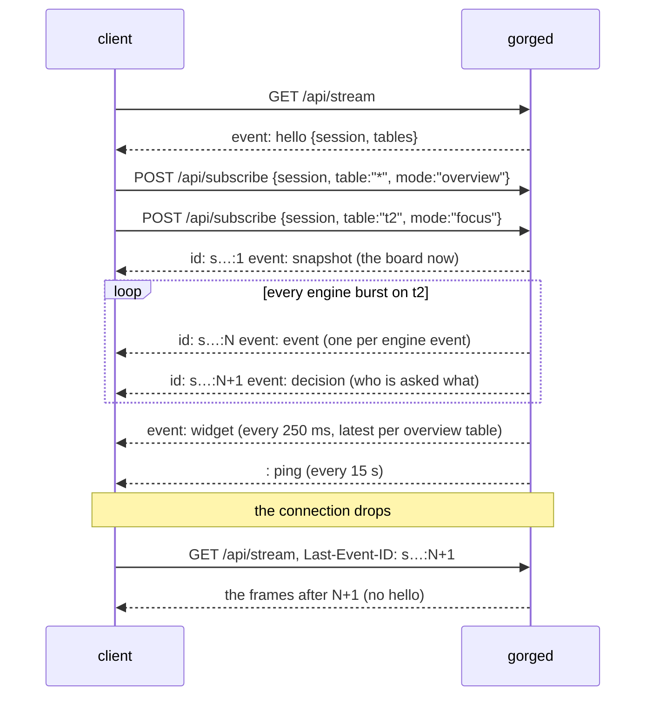

# The event stream (SSE)

A gorged client watches games through one long-lived
[Server-Sent Events](https://html.spec.whatwg.org/multipage/server-sent-events.html)
connection, `GET /api/stream`, and chooses what that connection carries with two POSTs. This
page covers the frame format, the session lifecycle, what each subscription mode sends,
resumption after a disconnect, and overflow. It is for anyone writing a live viewer or a bot
that would rather wait on the stream than poll. Each frame's body is specified in
[the wire protocol](protocol.md); the request and response schemas are in
[`openapi.json`](openapi.json) (`StreamFrame` and its variants).

Every behaviour on this page is read from
[`server/host/httpapi/sse.go`](https://github.com/adams-shaun/gorge/blob/main/server/host/httpapi/sse.go),
[`server/host/session.go`](https://github.com/adams-shaun/gorge/blob/main/server/host/session.go)
and [`server/host/fanout.go`](https://github.com/adams-shaun/gorge/blob/main/server/host/fanout.go).
The excerpts are real frames, captured on 2026-10-20 from a live server at commit `ad3777023`.

## Why a stream and two POSTs

The stream is one-way, server to client, because the engine must never wait on a client. Every
frame goes into a bounded per-session buffer without blocking. A client that cannot keep up
loses its session; it never slows the game. A client tells the server what it wants with
ordinary POSTs, which carry the session id the stream handed out. One connection can watch
every table in overview and a few tables in full detail, and it can change its mind without
reconnecting.

## Lifecycle



1. **Open.** A connection without a usable `Last-Event-ID` gets a new session. Its first frame
   is `hello`, carrying the session id (an unguessable `s` + 32 hex digits) and the lobby's
   tables. A private play-vs-bot table is omitted unless the request's seat token claims it;
   event tables are public and stay watchable. The session id is the capability that
   subscribing needs, so do not share it.
2. **Subscribe.** `POST /api/subscribe {"session", "table", "mode"}` answers 204. Subscribing
   again to the same table replaces its mode. `POST /api/unsubscribe {"session", "table"}`
   removes it; unsubscribing a table you never subscribed is a 404.
3. **Receive** frames until you disconnect.
4. **Disconnect.** The session survives for **30 seconds** (the `ResumeGrace` option). A
   reconnect with `Last-Event-ID` within that window resumes it. After that it is closed and
   its subscriptions are gone.

## Wire format

Each frame is one SSE message. The `data:` line is one `protocol.Frame` serialised as a single
line of JSON:

```text
id: <session>:<frame id>
event: <frame type, the same as data.t>
data: {"v":1,"t":"…","id":…,"table":"…","match":…,"seq":…,"body":{…}}

```

- **`id:`** is `<session id>:<frame id>`. The frame id counts up from 1 per session. `hello`,
  `widget` and `overflow` frames carry no id. They are not resumable, so they have no `id:`
  line and no `id` field.
- **`event:`** equals the frame's `t`, so `EventSource.addEventListener("snapshot", …)` works.
- **`: ping`** is a comment line sent every **15 s** (the `KeepAlive` option) to keep proxies
  from timing the connection out.
- **Headers:** `Content-Type: text/event-stream`, `Cache-Control: no-cache, no-transform`,
  `Connection: keep-alive` and `X-Accel-Buffering: no` (this last one keeps nginx from
  buffering the stream).

Real frames from one session, with long `data` lines cut at `...`:

```text
event: hello
data: {"v":1,"t":"hello","seq":0,"body":{"session":"s00cc29e285fc2d3aab2b299e97fab509","tables":[{"id":"t1","name":"Table 1","seats":2,"spectator":"omniscient","state":"live","match":1,"perpetual":false,"format":"constructed","bot_policy":"lethal-pressure","seat_...

id: s00cc29e285fc2d3aab2b299e97fab509:1
event: match_start
data: {"v":1,"t":"match_start","id":1,"table":"t2","match":5,"seq":0,"body":{"seats":[{"name":"Player 1","deck":"mono-blue-tempo","colour":"#e5484d","deck_id":"mono-blue-tempo"},{"name":"Player 2","deck":"mono-green-stompy","colour":"#3b82f6","deck_id":"mono-gree...

id: s00cc29e285fc2d3aab2b299e97fab509:2
event: snapshot
data: {"v":1,"t":"snapshot","id":2,"table":"t2","match":5,"seq":18,"body":{"view":{"viewer":255,"visibility":"omniscient","turn":0,"round":1,"step":"untap","phase":"beginning","active":0,"priority":0,"over":false,"draw":false,"winner":null,"players":[{"seat":0,"n...

id: s00cc29e285fc2d3aab2b299e97fab509:3
event: event
data: {"v":1,"t":"event","id":3,"table":"t2","match":5,"seq":19,"body":{"event":{"seq":19,"kind":"decision_made","player":0,"text":"starting_player:[0]"},"line":"Player 1 answers starting_player:[0]"}}

id: s00cc29e285fc2d3aab2b299e97fab509:5
event: decision
data: {"v":1,"t":"decision","id":5,"table":"t2","match":5,"seq":20,"body":{"player":0,"kind":"mulligan","prompt":"Player 1 plays first. Keep your hand (put 0 cards on the bottom of your library) or take a mulligan?"}}

event: widget
data: {"v":1,"t":"widget","table":"t1","match":1,"seq":48,"body":{"turn":1,"step":"main1","phase":"main1","active":1,"priority":1,"life":[20,20],"lost":[false,false],"stack_depth":1,"last":"Player 2 is asked: target","state":"live"}}

id: s00cc29e285fc2d3aab2b299e97fab509:2085
event: match_end
data: {"v":1,"t":"match_end","id":2085,"table":"t2","match":5,"seq":1788,"body":{"result":"win","winner":0,"head":"5cdc95d2fe1f2a8a"}}

: ping
```

## What each mode sends

| Frame | `overview` | `focus` | When |
|---|---|---|---|
| `hello` | (once per session, before any subscription) | | A fresh connection |
| `widget` | yes | | The latest cell per table, coalesced and flushed every **250 ms**. Never buffered for resume. |
| `match_start` | yes | yes | A match begins on the table |
| `snapshot` | | yes | At once on a focus subscribe, when the table has a live match; at every match start |
| `event` | | yes | One per engine event, in seq order |
| `decision` | | yes | When a match first parks on a decision, then after each burst when a decision is pending, for any seat, bot or human. It names the seat, kind and prompt only. |
| `rewind` | | yes | An undo rolled the live match back (see below) |
| `match_end` | yes | yes | A match ends: `result`, `winner`, chain `head` |
| `table_state` | yes | yes | A **series** table's lifecycle state changed (`idle`, `live`, `between_games`); ordinary tables never send it |
| `table_halted` | yes | yes | The table crashed and stopped, with the reason |
| `overflow` | yes | yes | The last frame of a session whose buffer filled |

`table` `*` subscribes every public table, present and future, in overview mode. Private
play-vs-bot tables are included only for a session whose seat token claims them; a client
without a claim must subscribe to one explicitly (which the server refuses with a 404).
Focus on `*` is a 400: a client must pick which games it wants in full.

A focus subscriber that joins mid-match never sees that match's `match_start`. The `snapshot`
it receives carries the seat list (`seats`) for exactly that reason. Engine events from
before the snapshot's `head` are inside the snapshot, and the first `event` frame after it is
`head + 1`.

### Following a match

To keep a board current, apply the `snapshot`, then each `event` in seq order. The `decision`
frame tells a seat it is being asked. A seat then reads the full option list from
`GET /api/tables/{t}/matches/{k}/pending?seat=N`, because the stream carries only the kind and
prompt. The stream is shared with spectators, so it never carries a seat's options or hidden
cards. The views it sends use the table's spectator visibility. A seat's private view comes
from `GET .../view?seat=N` with its token.

### Rewind

When a seat undoes (`POST .../undo`), focus subscribers receive a `rewind` frame. Its body is
a full snapshot at the new head, and the envelope's `seq` is that head. Discard everything you
hold past `body.head` (events, transcript lines, a pending decision), then apply the body like
a snapshot. After the rewind, the same seq numbers are reused for different events. From a
real undo on table `g4`:

```text
id: sed430cb561daa394d2c819485abdf6bd:311
event: decision
data: {"v":1,"t":"decision","id":311,"table":"g4","match":1,"seq":282,"body":{"player":0,"kind":"priority","prompt":"turn 3, draw — You has priority"}}

id: sed430cb561daa394d2c819485abdf6bd:312
event: rewind
data: {"v":1,"t":"rewind","id":312,"table":"g4","match":1,"seq":272,"body":{"view":{"viewer":255,"visibility":"public","turn":3,"round":2,"step":"upkeep",...

id: sed430cb561daa394d2c819485abdf6bd:313
event: decision
data: {"v":1,"t":"decision","id":313,"table":"g4","match":1,"seq":272,"body":{"player":0,"kind":"priority","prompt":"turn 3, upkeep — You has priority"}}
```

## Resuming

Reconnect with the last `id:` you saw:

```sh
curl -sN -H 'Last-Event-ID: s00cc29e285fc2d3aab2b299e97fab509:2085' $GORGE/api/stream
```

- If the session is still alive and its ring still holds every frame after that id, the
  server replays those frames and then continues live. There is **no** `hello`, and your
  subscriptions are intact. When this was captured, a resume a few seconds after a disconnect
  replayed `match_start`, `snapshot`, `event`… straight away.
- Otherwise the server starts a **fresh** session with a new `hello`, and you must subscribe
  again. That happens when the session is unknown or expired (the 30 s grace has passed), the
  header is malformed, or the id is older than the ring. A stale session that cannot be served
  is closed.

The ring holds the session's most recent frames. Its size is `host.Options.Ring`, 256 frames
by default. The ring and the outbound buffer have the same size.

## Overflow

When a session's outbound buffer is full, the server stops sending to it rather than wait. It
writes one final `overflow` frame with the number of frames dropped (`{"dropped": 17}`) and
closes the stream. A resume cannot help, because the frames are gone. Reconnect **without**
`Last-Event-ID`, subscribe again, and rebuild from the new snapshot.

## A minimal client

```js
const es = new EventSource("/api/stream");
es.addEventListener("hello", async (e) => {
  const { body } = JSON.parse(e.data);
  await fetch("/api/subscribe", { method: "POST", headers: { "Content-Type": "application/json" },
    body: JSON.stringify({ session: body.session, table: "t1", mode: "focus" }) });
});
es.addEventListener("snapshot", (e) => render(JSON.parse(e.data).body.view));
es.addEventListener("event", (e) => apply(JSON.parse(e.data).body));
es.addEventListener("rewind", (e) => resetTo(JSON.parse(e.data).body));
```

The browser's `EventSource` sends `Last-Event-ID` on its own automatic reconnects. A session
that resumes gets no `hello`, so this handler does not run again and the subscriptions stay as
they were. The snippet shows the shape of the protocol; the web client in `web/` is the full
implementation.
