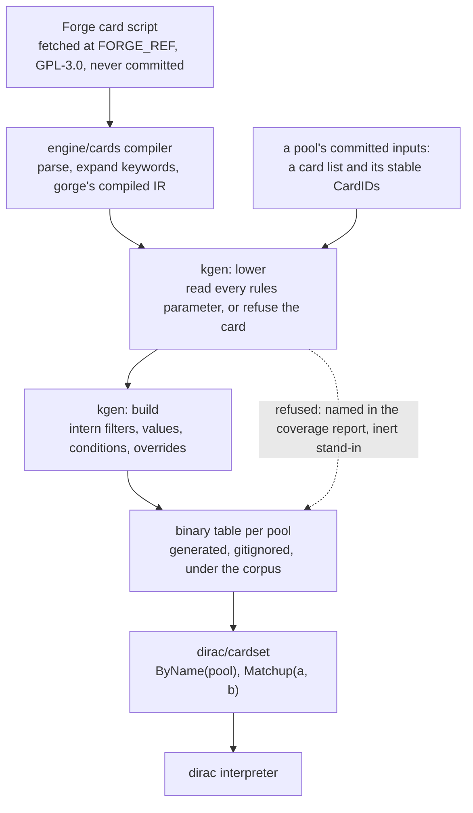

# Cards

dirac doesn't read card scripts. A generator, `dirac/kgen`, lowers gorge's compiled card IR into binary tables of
integer ops, and a hand-written interpreter runs them. This page is for readers who want to know how a card gets into
dirac, what a refusal means and why a lowered card isn't yet a supported one.

## The pipeline



**kgen lowers gorge's compiled IR, not the script.** dirac therefore inherits gorge's reading of every card: keyword
expansion, SVar resolution, what each parameter means. That is what lets lockstep demand equal behaviour, and it avoids
a second script parser. It also means a misreading in gorge is a misreading in dirac
([what lockstep doesn't prove](oracle.md#what-lockstep-proves-and-what-it-doesnt)).

## Binary tables

Tables are generated and never committed, because they are mechanical translations of GPL-3.0 scripts. They live in a
gitignored directory under the corpus, one subdirectory per key:

```text
<corpus>/<tables dir>/<key>/manifest.tsv         pool, card and token counts, payload digest
<corpus>/<tables dir>/<key>/<pool>.ktab          one table
<corpus>/<tables dir>/<key>/<pool>.coverage.md   kgen's refusal report
```

The key is 16 hex digits of the corpus lock's digest and 16 of a hash over kgen, kop, the pool lists and the gorge
packages kgen builds against, so a key's bytes never change. The binary embeds its half of the key. A tree with stale
tables fails with an error naming the command to rebuild them, and there is no fallback. Building every pool's table takes
about ten seconds. `DIRAC_TABLES` points a deployed binary at a copy of the tables and needs no corpus. Without a corpus or
tables, the hand-written `dirac/vanilla` table (basic lands, vanilla creatures and simple spells) still plays a game.

## The op vocabulary

A `kop.Table` holds what's printed: per card a `CardDef` (cost, types, P/T, keyword bits, abilities), and per ability a
program of `Instr` values. An `Instr` is an op and fixed integer operands, with no strings or closures. Shared
filters, values and conditions are interned in the table and named by index. Every enum is append-only, so a recorded
table or a stored ability index keeps its meaning.

An ability's program runs front to back against the stack entry's source, controller, targets, modes and X.

- An op naming a target that has become illegal does nothing, and if every target of a targeted ability is illegal the
  whole program is skipped (CR 608.2b).
- Branch ops (`OpCharm`, `OpIfKicked`, `OpSkipIf`, `OpRepeat`) are structured: their counts name the instructions right
  after them.
- An op that raises a decision suspends the resolution. dirac poses the `Decision` and resumes at the same instruction.
- An op the interpreter doesn't implement panics naming itself. It is never a silent no-op.

`kgen -ops <pool>` writes the interpreter contract: every op kgen uses, its exact semantics, the decisions it implies and
the cards that use it. `kgen -show <pool> <card>` prints one card's `CardDef`.

## Lowering: read every parameter or refuse

kgen walks each card's IR: abilities and their sub-ability chains, triggers, statics, replacement effects, keywords and
SVars. Each node's `$` parameters sit in a tracker that records what lowering read. When a node is done, any rules
parameter left unread **refuses the card**, naming the node and the reason. Only descriptive and AI-hint parameters are
ignored, by name.

The same rule holds inside a value. A filter property, a value head, a modifier such as `/Plus.Y` or a cost token kgen
can't parse is a refusal. It never lowers an unparsed amount as 0 or an unknown property as "anything", because a silent
mis-lowering plays games that agree with gorge until the amount matters.

A refused card still has a row in the table, as an **inert stand-in**: printed cost, types, colours and P/T with no
abilities. `Matchup` refuses a deck holding one, so a game never plays such a card as vanilla by accident. The
whole-pool table keeps the row, so a search world dealing hidden cards from a pool can still deal it.

Two ratchets pin acceptance: a per-set count over each set's card list and a corpus-wide count. A fall fails, and a rise
is re-pinned in the same commit. `kgen -census-std` prints the per-set table and ranks refusal classes by how many
Standard cards each one blocks.

## Lowered, refused, evidenced

kgen computes one status per pool entry when it builds a table:

| Status | Meaning | A game can deal it? |
|---|---|---|
| supported | lowered, not refused, evidenced | yes |
| unverified | lowered, in no evidence list | yes, until evidence is enforced at setup |
| refused | named in the committed refused list, with a reason and a game that shows the difference | no |
| not lowered | kgen can't represent it | no |

**Refused** is for a card that lowers and plays wrongly. `kgen -refuse <card> -why <text> -repro <repro>` writes the entry,
with the kind of difference and the game (pool, surface, pair, policy) that shows it.

**Evidence** is earned in lockstep. `kfuzz -evidence` writes the cards that clean games played at least three times with
every ability the card has used. A token earns no evidence of its own, since it is played through the card that makes it.
A card no human deck holds earns it through **synthetic evidence pools**: tables built from a set's list or from the
lowered corpus outside the Standard lists, which exist only to be played in lockstep.

**A pair can be refused when neither card is.** A few interactions are refused at matchup time because the game would
stall at its start, or because the two cards' effects need an order dirac doesn't model. `kfuzz` counts these as
`refused-pair`. Either card plays without the other.

**CardIDs are stable.** A pool's committed `ids.tsv` holds every `CardID` it has assigned. A new card takes the next free ID,
and a card that leaves the pool keeps its ID as an inert placeholder, so recorded games and caches stay valid.

## Layers

dirac derives a permanent's characteristics with a fixed-size version of gorge's CR 613 layer system.

**The effect pool.** A resolved ability records its continuous effect as a small record in a fixed pool in `State`, naming
its object, because the affected set is fixed at resolution (CR 611.2c). Records are appended with a monotonic stamp, so
pool order is timestamp order and nothing is sorted. Cleanup drops the until-end-of-turn records. A full pool stalls.

**Statics stay live.** Battlefield statics aren't copied into the pool. The walk reads them in place and stamps each with
its source's layer timestamp, and an Aura or Equipment is restamped when it becomes attached (CR 613.7e). Commutative effects
keep cheap accumulators: pumps, counters and anthems add in any order (layer 7c).

**The walk.** `chars` builds a stack-local result one layer at a time: the card or its copy-of (1), control (2), text and
type changes in gorge's dependency order (3, 4), colour (5), abilities (6), then characteristic-defining and base P/T (7a, 7b)
and the accumulators (7c). A permanent with at most one order-sensitive effect takes a fixed-order fast path with the same
result. Where a pair of effects would need an order the walk doesn't model, the matchup is refused rather than played.
