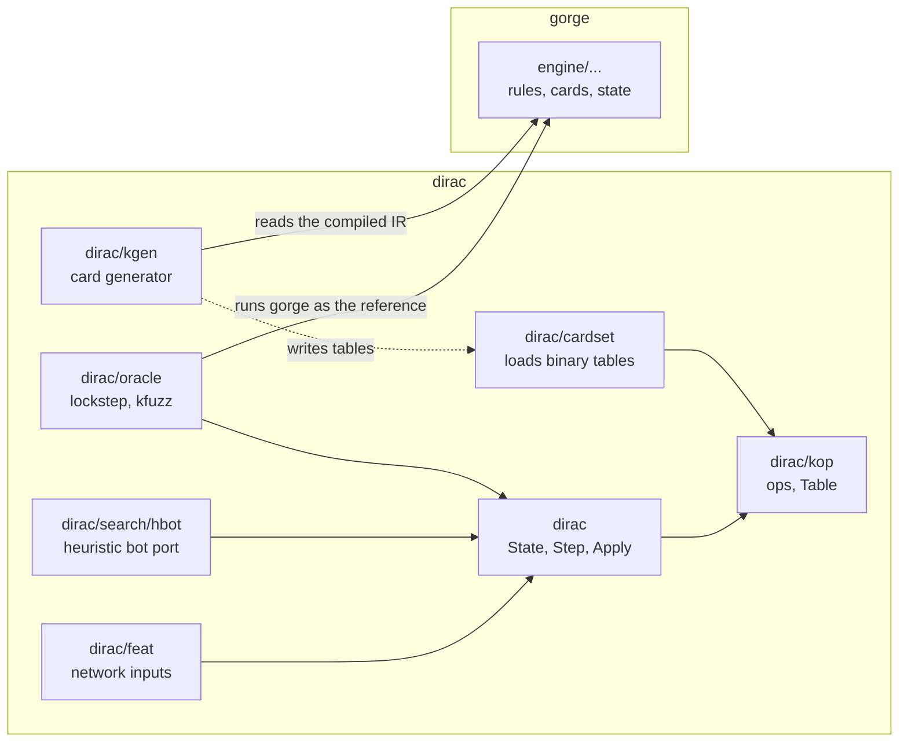

# dirac

dirac is a second Magic rules engine, written so that tree search and self-play can copy and step a game
millions of times. This section is for engine and ML readers, and for bot authors who want to know what a
dirac game is, what it supports, how it is checked and where the speed comes from.

!!! note "The source isn't here yet"
    dirac's source is not in this repository, so these pages describe it and don't link into it. Package
    names on these pages are `dirac`, `dirac/kop`, `dirac/kgen`, `dirac/oracle` and so on. Commands on
    these pages can't be run from a clone of gorge.

Figures on these pages were read from the code on 2026-10-31, with Go 1.26.3 on linux/amd64, against gorge
`7438d92b6` and the corpus pin in the Makefile's `FORGE_REF`. Each one says how it was measured.

## Why a second engine

gorge is built to be right for every card it can play, at up to eight seats, with a hash-chained event log
([Events and replay](../gorge/events.md)). That shape costs time: a `state.Game` is an arena of objects
with slices and maps, so a clone is a deep copy, and every state change goes through an event.

A search wants the opposite trade. Each simulation copies a position, plays a few dozen decisions and
throws the copy away. If everything variable-length about the cards lives in a read-only table, the game
itself can be mostly one fixed-size value:

```go
set, _ := cardset.ByName("fdn")
tbl, deckA, deckB, _ := set.Matchup(listA, listB)
s := dirac.NewConfig(tbl, deckA, deckB, seed, dirac.Config{Mulligans: 2})
for {
    d := s.Step()               // run to the next question
    if d.Kind == dirac.DkNone { // the game is over
        break
    }
    s.Apply(d.Options[0])       // answer with any of d.Options[:d.N]
}
over, winner := s.Terminal()
```

Copying a mid-game FDN position takes about 41 ns and allocates nothing, and a transition takes about
2.8 µs, also allocating nothing ([Performance](../../performance/index.md#transitions-and-copies)).

## What it supports

A card moves through three states. Only the last one is a claim about play.

| State | Meaning | How to ask |
|---|---|---|
| **Lowered** | `dirac/kgen` read every rules parameter of the card's compiled IR and turned it into `dirac/kop` ops | the build ratchet: 20,730 of 34,072 corpus card names on 2026-10-31 |
| **Not refused** | the card isn't on the short list of cards named as playing wrongly, each with a reason and a game that shows it | the list is committed with the source |
| **Evidenced** | clean lockstep games played the card at least three times and used every ability it has | the evidence lists, committed with the source |

A **supported** card is `lowered && !refused && evidenced`. `kgen -supported <pool>` prints one line per
pool entry with that answer: on 2026-10-31 it says true for all 310 entries of the `fdn` pool and 260 of the
288 of the `blb` pool, tokens included. Per-set lowering counts are on
[Card support by set](../../support/sets.md#per-set-support).

Evidence isn't enforced at game setup yet. A lowered card with no evidence is reported as *unverified*, not
supported, and it can still be dealt into a game, which is how a lockstep sweep reaches it. A card that
didn't lower or is refused can't: `Matchup` refuses the deck and names the card.

### How far lockstep agrees

gorge is the engine dirac is checked against ([Verification](oracle.md)). The state of that check on
2026-10-31, on `-surface autopay` with random answers:

| Run | Games | Clean | Divergent | Unmodelled stalls | Capacity stalls | Refused pairs |
|---|--:|--:|--:|--:|--:|--:|
| FDN, the committed slice (first 1,500 pairs of its pool, seed 1) | 1,500 | 1,500 | 0 | 0 | 0 | 0 |
| BLB, the committed slice (first 1,500 pairs of its pool, seed 1) | 1,500 | 1,500 | 0 | 0 | 0 | 0 |
| 20 Standard sets, 500 pairs each, deck pools | 9,067 | 8,635 | 404 | 15 | 13 | 933 |

A refused pair holds a card dirac doesn't support, so it never starts a game. dirac is at zero divergence on
FDN and BLB over those slices and is not at zero on the wider pool: 404 of 9,067 games found a difference from
gorge. Those differences are open work, on one engine or the other.

## Scope

dirac does less than gorge on purpose.

| Limit | Value | Past it |
|---|---|---|
| Players | exactly 2 | not representable |
| Deck size | 60 cards a seat | rejected at setup |
| Card instances, both decks plus tokens and copies | 192 | the game stalls (`board`) |
| Battlefield | 112 permanents | stalls (`board`) |
| Stack | 24 entries | stalls (`stack`) |
| Triggered abilities waiting | 24 | stalls (`pending`) |
| Delayed triggers | 16 | stalls (`delayed`) |
| Attack or block options in one declaration | 384 | stalls (`options`) |
| Triggers resolved in one turn | 2,000 | stalls (`loop`, an endless mandatory loop, CR 104.4b) |

**Stalls are named.** A game dirac can't continue correctly ends as a draw, `Terminal` reports `(true, -1)`
and `StallReason` gives one of about a hundred named reasons. The names fall into two classes, and every
reason must be in one or a test fails:

- **Capacity:** a fixed array or budget ran out, and gorge has no such limit. The game was right up to there.
  These are declared limits, so they count as limits and not as failures.
- **Unmodelled:** gorge does something at this point that dirac doesn't. These are rule gaps, and a strict
  lockstep run fails on them.

Nothing is dropped silently: a full pool stalls by name, and an op the interpreter lacks panics by name.

dirac has no event log, no per-seat view, no host, no Commander, no concede and no manual mana. A cast is
offered when untapped sources and the pool can pay, and it is paid by a planner that mirrors gorge's auto-pay
planner. Those other jobs belong to gorge.

## How it relates to gorge

**dirac is not a second source of rules truth.** Its cards are generated from gorge's compiled card IR, its
rules code follows gorge's (including gorge's decision grammar and random numbers), and a lockstep harness
plays the same game through both engines. When they disagree, the question is which one is wrong under the
Comprehensive Rules (CR). If gorge looks wrong, the evidence is checked against XMage and Forge and the fix
lands in gorge. Several differences so far were gorge's bugs.

The rules engine imports nothing from gorge. Only the tools that meet gorge do:



| | gorge | dirac |
|---|---|---|
| **State** | `state.Game`: an object arena with slices and maps | one `State` of 14,896 bytes plus one small table-sized buffer ([State](state.md)) |
| **Mutation** | events folded by `events.Apply` into a hash chain | `Apply(action)` writes the value directly, with no log |
| **Clone** | `Engine.Clone`, about 22 µs and 200 KB | `CopyFrom`, about 41 ns and no allocation |
| **Players** | up to 8 | exactly 2 |
| **Cards** | every Forge script is compiled; a card is playable when every primitive it names is implemented ([Card support](../../support/sets.md)) | the cards its generator lowers with no refusal; supported sets are verified in lockstep ([What it supports](#what-it-supports)) |
| **Comparing two games** | the chain head: the same head means the same history | its `Projection` (fixed arrays): equal positions project `==`; two States in the same position may differ in bookkeeping |
| **Decisions** | 13 kinds, multi-select answers | 8 kinds, every answer a single pick ([Step and Apply](step-apply.md)) |
| **Checked by** | golden replays, census ratchets, XMage, Forge and Oracle-text scenarios | lockstep against gorge at every decision ([Verification](oracle.md)) |
| **Used for** | hosting games, every card, the reference | search and self-play |

dirac can also be served as a SpellBench v2 engine: `dirac/cmd/sbv2dirac` plays the game with dirac as the
authority and a gorge engine following in lockstep, which builds the observations and candidates. A
disagreement ends that game as `engine_contract_failure:divergence`. See
[SpellBench v2](../../api/spellbench-v2.md).

## Pages in this section

| Page | What it covers |
|---|---|
| [State](state.md) | the hot, core and cold layout, object identity, change marks, the size bar, the `Projection` |
| [Step and Apply](step-apply.md) | the control-state machine, `Decision` and `Action`, decision kinds against gorge's, the RNG |
| [Cards](cards.md) | the op vocabulary, how `kgen` lowers gorge's IR, refusals, binary tables, evidence, layers |
| [Verification](oracle.md) | the lockstep oracle, what it proves and what it doesn't |
| [Search and bots](search.md) | what dirac offers a search, the heuristic bot and mulligan ports, the network input encoder |
