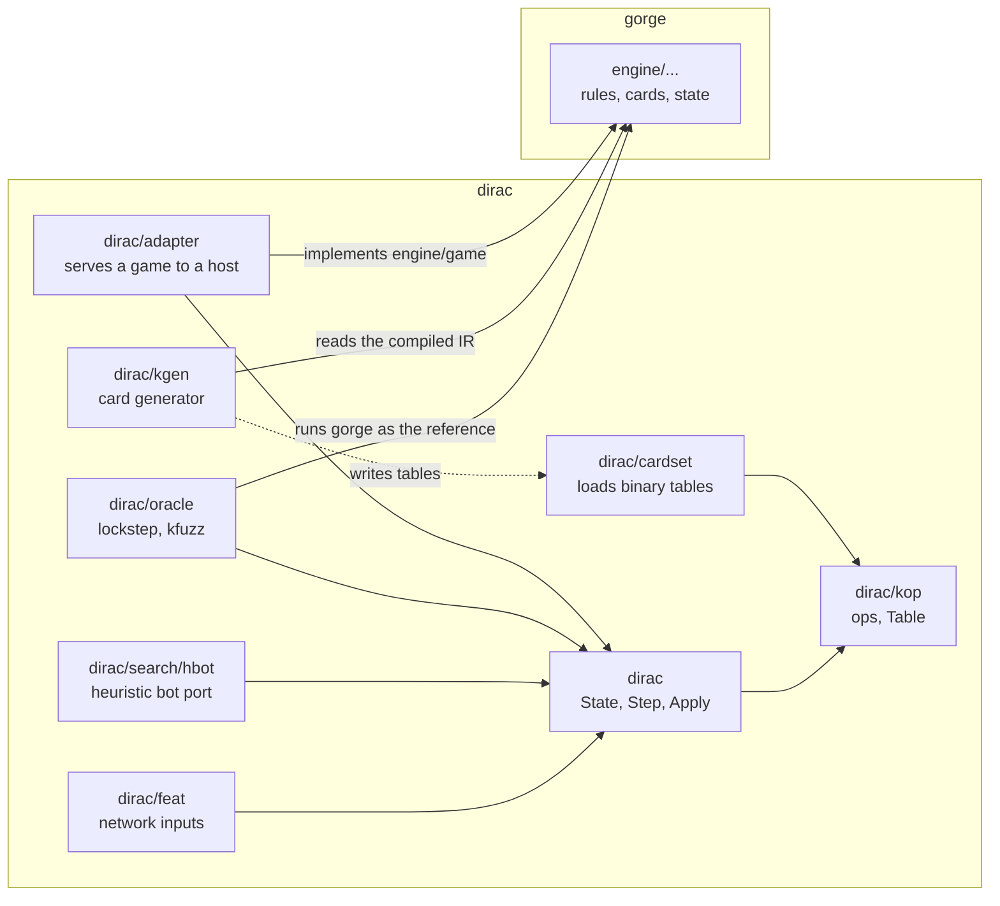

# dirac

dirac is a second Magic rules engine, written so that tree search and self-play can copy and step a game millions of
times. This section is for engine and ML readers and bot authors: what a dirac game is, what it supports, how it is
checked and where the speed comes from.

The source is in [`dirac/`](https://github.com/adams-shaun/gorge/tree/main/dirac), and
[`dirac/README.md`](https://github.com/adams-shaun/gorge/blob/main/dirac/README.md) is the guide for driving it from Go.
The commands below need the card corpus and `make dirac-tables` ([Install and build](../../guide/install.md#build-diracs-card-tables-if-you-want-them)).

## Why a second engine

gorge is built to be right for every card it can play, at up to eight seats, with a hash-chained event log
([Events and replay](../gorge/events.md)). That costs time: a `state.Game` is an arena of objects with slices and maps,
so a clone is a deep copy, and every state change goes through an event.

A search wants the opposite trade. Each simulation copies a position, plays a few dozen decisions and throws the copy
away. If everything variable-length about the cards lives in a read-only table, the game itself can be one flat value
and one buffer sized to that table:

```go
set, _ := cardset.ByName("fdn")
tbl, deckA, deckB, _ := set.Matchup(listA, listB)
s := dirac.NewConfig(tbl, deckA, deckB, seed, dirac.Config{Mulligans: 2})
for {
    d := s.Step()               // run to the next question
    if d.Kind == dirac.DkNone { // the game is over
        break
    }
    s.Apply(d.Options[0])       // answer with any of d.Options[:d.N]
}
over, winner := s.Terminal()
```

Copying a position and taking a transition allocate nothing. Measured cost, with date and commit, is on
[Performance](../../performance/index.md#transitions-and-copies).

`NewConfig` starts two seats. `InitN` starts a pod of up to four (`MaxSeats`) from the decks `cardset`'s `MatchupN`
builds; the same `Step` and `Apply` loop plays it.

## What it supports

A card moves through three states; only all three together are a claim about play.

| State | Meaning | Where it is recorded |
|---|---|---|
| **Lowered** | `dirac/kgen` read every rules parameter of the card's compiled IR and turned it into `dirac/kop` ops | the build ratchet, and the *lowered* column of [`dirac/docs/support.md`](https://github.com/adams-shaun/gorge/blob/main/dirac/docs/support.md) |
| **Not refused** | the card isn't on the short list of cards named as playing wrongly, each with a reason and a game that shows it | [`dirac/support/refused`](https://github.com/adams-shaun/gorge/tree/main/dirac/support/refused) |
| **Evidenced** | clean lockstep games of the evidence corpus played the card at least three times and used every ability it has | [`dirac/support/evidence`](https://github.com/adams-shaun/gorge/tree/main/dirac/support/evidence) |

A **supported** card is all three. [`dirac/docs/support.md`](https://github.com/adams-shaun/gorge/blob/main/dirac/docs/support.md)
is generated from the same lists (`TestSupportDocIsCurrent`) and gives the counts corpus-wide and per Standard set, and
[Card support by set](../../support/sets.md#per-set-support) renders it. `kgen -supported <pool>` answers for one pool:

```sh
make dirac-tables
go run ./dirac/cmd/kgen -supported fdn
```

```text
Abrade	true
Abyssal Harvester	true
```

A game plays supported cards only. `Matchup` refuses a deck holding any other card and names it, so a lowered card
with no evidence (*unverified*) isn't dealt. Only a run that asks plays unverified cards: the lockstep runs that earn
evidence, or a Go caller through `cardset.AllowUnverified`.

"Supported" says what the evidence games saw, and no more. It doesn't say a card is right, because dirac shares gorge's
bugs ([what lockstep proves](oracle.md#what-lockstep-proves-and-what-it-doesnt)), and it doesn't cover a pair of cards no
evidence game put together.

### How far lockstep agrees

gorge is the engine dirac is checked against ([Verification](oracle.md)). `make dirac-slices` plays the FDN and BLB
slices (the first 1,500 pairs of a pool at seed 1) on both surfaces with random answers. Any clone with a corpus can run
it, and the CI job `dirac-slices` runs it on every Mergify queue batch. A divergence, an unmodelled stall or a hang fails
the job. Its verdict lines (one per slice and surface) hold the live counts of games, clean games, capacity stalls and
refused pairs, and `make dirac-pods` adds the four-seat Commander pods; both change with every merge, so no count is
written here.

Pods of three and four seats, Commander pods included, play under the same check
([Four-seat pods](oracle.md#four-seat-pods)).

A refused pair holds a card dirac doesn't support, so it never starts a game. A capacity stall is a declared limit,
reached with no disagreement up to that point; it isn't clean. Games on pairs the evidence corpus never put together can
still diverge, and each that does is open work on one engine or the other.

## Scope

dirac does less than gorge on purpose.

| Limit | Constant | Past it |
|---|---|---|
| Players | `MaxSeats` (`dirac/seats.go`) | `InitN` panics; a card that only plays two seats refuses a larger game (`StallTwoSeat`) |
| Deck size, sideboard | `MaxDeck` (a Commander deck's 100), `MaxSide` (`dirac/state.go`) | rejected at setup |
| Card instances, every deck plus tokens and copies | `MaxObj` (`dirac/seats.go`, sized for a four-seat Commander pod) | the game stalls (`board`) |
| Battlefield | `MaxPerm` | stalls (`board`) |
| Stack | `MaxStack` | stalls (`stack`) |
| Triggered abilities waiting | `MaxPending` | stalls (`pending`) |
| Delayed triggers | `MaxDelayed` | stalls (`delayed`) |
| Options in one decision | `MaxOptions` (`dirac/types.go`) | stalls (`options`) |
| Triggers resolved in one turn | `maxTrigTurn` (`dirac/gen.go`) | stalls (`loop`, an endless mandatory loop, CR 104.4b) |

Limits are raised as play reaches them, so no value is written here; read the constants.

**Stalls are named.** A game dirac can't continue correctly ends as a draw: `Terminal` reports `(true, -1)` and
`StallReason` gives a named reason (`StallName`). Every reason is in one of two classes (`StallClassOf`), or a test fails:

- **Capacity:** a fixed array or budget ran out, and gorge has no such limit. The game was right up to there. A
  declared limit, counted, not a failure.
- **Unmodelled:** gorge does something here that dirac doesn't. A rule gap; a strict lockstep run fails on it.

Nothing is dropped silently: a full pool stalls by name, and an op the interpreter lacks panics by name.

The engine has no event log, no per-seat view, no concede and no manual mana. A cast is offered when untapped sources
and the pool can pay, and a planner mirroring gorge's auto-pay planner pays it. A server reaches dirac through
`dirac/adapter`, which derives the log and views from positions ([Serving dirac](../../guide/dirac.md)).

## How it relates to gorge

**dirac is not a second source of rules truth.** Its cards are generated from gorge's compiled card IR, its rules code
follows gorge's (decision grammar and random numbers included), and a lockstep harness plays the same game through
both engines. When they disagree, the question is which is wrong under the Comprehensive Rules (CR). If gorge looks
wrong, the evidence is checked against XMage and Forge and the fix lands in gorge.

The engine imports nothing from gorge. Only the tools that meet gorge do, and the adapter, which reads gorge's view and
decision types and never its rules engine
([import boundary](https://github.com/adams-shaun/gorge/blob/main/dirac/README.md#import-boundary)):



| | gorge | dirac |
|---|---|---|
| **State** | `state.Game`: an object arena with slices and maps | one `State` under the bar `TestStateSize` holds, plus one small table-sized buffer ([State](state.md)) |
| **Mutation** | events folded by `events.Apply` into a hash chain | `Apply(action)` writes the value directly, with no log |
| **Clone** | `Engine.Clone`, [tens of µs and hundreds of KB](../../performance/index.md#transitions-and-copies) | `CopyFrom`, [tens of ns and no allocation](../../performance/index.md#transitions-and-copies) |
| **Players** | up to 8 | 2 to 4 |
| **Cards** | every Forge script is compiled; a card is playable when every primitive it names is implemented ([Card support](../../support/sets.md)) | supported cards only ([What it supports](#what-it-supports)) |
| **Comparing two games** | the chain head: the same head means the same history | its `Projection` (fixed arrays): equal positions project `==`; two States in the same position may differ in bookkeeping |
| **Decisions** | 13 kinds, multi-select answers | 8 kinds, every answer a single pick ([Step and Apply](step-apply.md)) |
| **Checked by** | golden replays, census ratchets, XMage, Forge and Oracle-text scenarios | lockstep against gorge at every decision ([Verification](oracle.md)) |
| **Used for** | hosting games, every card, the reference | search and self-play at two to four seats; hosted two-seat tables ([Serving dirac](../../guide/dirac.md)) |

dirac also runs as a stdio SpellBench v2 engine: `dirac/cmd/sbv2dirac` plays with dirac as the authority and a gorge
engine following in lockstep to build observations and candidates. A disagreement ends that game as
`engine_contract_failure:divergence` ([SpellBench v2](../../api/spellbench-v2.md)).

## Pages in this section

| Page | What it covers |
|---|---|
| [State](state.md) | the hot, core and cold layout, object identity, change marks, the size bar, the `Projection` |
| [Step and Apply](step-apply.md) | the control-state machine, `Decision` and `Action`, decision kinds against gorge's, the RNG |
| [Cards](cards.md) | the op vocabulary, how `kgen` lowers gorge's IR, refusals, binary tables, evidence, layers |
| [Verification](oracle.md) | the lockstep oracle, what it proves and what it doesn't |
| [Search and bots](search.md) | what dirac offers a search, the bot and mulligan ports, the network input encoder |
| [Shadow](shadow.md) | staging a dirac state from a seat's observation, and the rollout driver |
