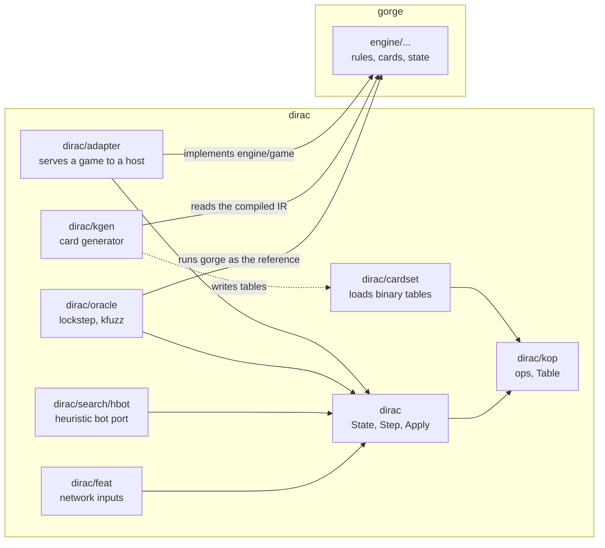

# dirac

dirac is a second Magic rules engine, written so that tree search and self-play can copy and step a game
millions of times. This section is for engine and ML readers, and for bot authors who want to know what a
dirac game is, what it supports, how it is checked and where the speed comes from.

The source is in [`dirac/`](https://github.com/adams-shaun/gorge/tree/main/dirac), and
[`dirac/README.md`](https://github.com/adams-shaun/gorge/blob/main/dirac/README.md) is the guide for driving it from Go.
The commands below need the card corpus and `make dirac-tables` ([Install and build](../../guide/install.md#build-diracs-card-tables-if-you-want-them)).

## Why a second engine

gorge is built to be right for every card it can play, at up to eight seats, with a hash-chained event log
([Events and replay](../gorge/events.md)). That shape costs time: a `state.Game` is an arena of objects
with slices and maps, so a clone is a deep copy, and every state change goes through an event.

A search wants the opposite trade. Each simulation copies a position, plays a few dozen decisions and
throws the copy away. If everything variable-length about the cards lives in a read-only table, the game
itself can be one flat value and one buffer sized to that table:

```go
set, _ := cardset.ByName("fdn")
tbl, deckA, deckB, _ := set.Matchup(listA, listB)
s := dirac.NewConfig(tbl, deckA, deckB, seed, dirac.Config{Mulligans: 2})
for {
    d := s.Step()               // run to the next question
    if d.Kind == dirac.DkNone { // the game is over
        break
    }
    s.Apply(d.Options[0])       // answer with any of d.Options[:d.N]
}
over, winner := s.Terminal()
```

Copying a mid-game FDN position takes about 76 ns and allocates nothing, and a transition takes
about 3.1 µs, also allocating nothing, measured 2026-11-11
([Performance](../../performance/index.md#transitions-and-copies)).

## What it supports

A card moves through three states. Only all three together are a claim about play.

| State | Meaning | Where it is recorded |
|---|---|---|
| **Lowered** | `dirac/kgen` read every rules parameter of the card's compiled IR and turned it into `dirac/kop` ops | the build ratchet, and the *lowered* column of [`dirac/docs/support.md`](https://github.com/adams-shaun/gorge/blob/main/dirac/docs/support.md) |
| **Not refused** | the card isn't on the short list of cards named as playing wrongly, each with a reason and a game that shows it | [`dirac/support/refused`](https://github.com/adams-shaun/gorge/tree/main/dirac/support/refused) |
| **Evidenced** | clean lockstep games of the evidence corpus played the card at least three times and used every ability it has | [`dirac/support/evidence`](https://github.com/adams-shaun/gorge/tree/main/dirac/support/evidence) |

A **supported** card is all three: lowered, not refused by name, and clean in the lockstep games of the evidence
corpus. [`dirac/docs/support.md`](https://github.com/adams-shaun/gorge/blob/main/dirac/docs/support.md) is generated from the
same lists and gives the count corpus-wide and per Standard set, with the games behind each pool, and [Card support by set](../../support/sets.md#per-set-support)
renders it. `kgen -supported <pool>` answers for each card of one pool:

```sh
make dirac-tables
go run ./dirac/cmd/kgen -supported fdn
```

```text
Abrade	true
Abyssal Harvester	true
```

A game plays supported cards only. `Matchup` refuses a deck holding any other card and names the card, so a lowered
card with no evidence, reported as *unverified*, isn't dealt. Only a run that asks for them plays unverified cards:
the lockstep runs that earn evidence, or a Go caller through `cardset.AllowUnverified`.

"Supported" says what the evidence games saw, and no more. It doesn't say a card is right, because dirac shares
gorge's bugs: lockstep can't see a mistake both engines make ([what lockstep proves](oracle.md#what-lockstep-proves-and-what-it-doesnt)).
It doesn't cover a pair of cards no evidence game put together, so sweeps and census pairs outside the evidence corpus
can still find a difference on a supported card.

### How far lockstep agrees

gorge is the engine dirac is checked against ([Verification](oracle.md)). The state of that check on
2026-11-08 at `fc2be1aabe`, with random answers. The rows are `make dirac-slices`, which any clone
with a corpus can run, and CI runs on every change. A slice is the first 1,500 pairs of a pool at seed 1.

| Run | Games | Clean | Divergent | Unmodelled stalls | Capacity stalls | Refused pairs |
|---|--:|--:|--:|--:|--:|--:|
| FDN slice, `-surface autopay` | 1,494 | 1,492 | 0 | 0 | 2 | 6 |
| FDN slice, `-surface full` | 1,494 | 1,491 | 0 | 0 | 3 | 6 |
| BLB slice, `-surface autopay` | 1,500 | 1,500 | 0 | 0 | 0 | 0 |
| BLB slice, `-surface full` | 1,500 | 1,500 | 0 | 0 | 0 | 0 |

A refused pair holds a card dirac doesn't support, so it never starts a game. A capacity stall is a declared limit,
reached with no disagreement up to that point; it counts against the run and isn't clean. Games beyond these slices,
on pairs the evidence corpus never put together, can still diverge, and each that does is open work on one engine or
the other.

## Scope

dirac does less than gorge on purpose.

| Limit | Value | Past it |
|---|---|---|
| Players | exactly 2 | not representable |
| Deck size | 100 cards a seat (`MaxDeck`, a Commander deck's size), and a sideboard of 15 (`MaxSide`) | rejected at setup |
| Card instances, both decks plus tokens and copies | 224 | the game stalls (`board`) |
| Battlefield | 112 permanents | stalls (`board`) |
| Stack | 48 entries | stalls (`stack`) |
| Triggered abilities waiting | 48 | stalls (`pending`) |
| Delayed triggers | 32 | stalls (`delayed`) |
| Attack or block options in one declaration | 512 | stalls (`options`) |
| Triggers resolved in one turn | 2,000 | stalls (`loop`, an endless mandatory loop, CR 104.4b) |

**Stalls are named.** A game dirac can't continue correctly ends as a draw, `Terminal` reports `(true, -1)`
and `StallReason` gives one of about a hundred named reasons. The names fall into two classes, and every
reason must be in one or a test fails:

- **Capacity:** a fixed array or budget ran out, and gorge has no such limit. The game was right up to there.
  These are declared limits, so they count as limits and not as failures.
- **Unmodelled:** gorge does something at this point that dirac doesn't. These are rule gaps, and a strict
  lockstep run fails on them.

Nothing is dropped silently: a full pool stalls by name, and an op the interpreter lacks panics by name.

The engine has no event log, no per-seat view, no concede and no manual mana. A cast is offered when
untapped sources and the pool can pay, and it is paid by a planner that mirrors gorge's auto-pay planner. A server
reaches it through `dirac/adapter`, which derives a game's log and views from its positions
([Serving dirac](../../guide/dirac.md)).

## How it relates to gorge

**dirac is not a second source of rules truth.** Its cards are generated from gorge's compiled card IR, its
rules code follows gorge's (including gorge's decision grammar and random numbers), and a lockstep harness
plays the same game through both engines. When they disagree, the question is which one is wrong under the
Comprehensive Rules (CR). If gorge looks wrong, the evidence is checked against XMage and Forge and the fix
lands in gorge. Several differences so far were gorge's bugs.

The engine imports nothing from gorge. Only the tools that meet gorge do, and the adapter, which reads gorge's
view and decision types and never its rules engine:



| | gorge | dirac |
|---|---|---|
| **State** | `state.Game`: an object arena with slices and maps | one `State` of under 24 KiB plus one small table-sized buffer ([State](state.md)) |
| **Mutation** | events folded by `events.Apply` into a hash chain | `Apply(action)` writes the value directly, with no log |
| **Clone** | `Engine.Clone`, [tens of µs and hundreds of KB](../../performance/index.md#transitions-and-copies) | `CopyFrom`, [tens of ns and no allocation](../../performance/index.md#transitions-and-copies) |
| **Players** | up to 8 | exactly 2 |
| **Cards** | every Forge script is compiled; a card is playable when every primitive it names is implemented ([Card support](../../support/sets.md)) | supported cards only ([What it supports](#what-it-supports)) |
| **Comparing two games** | the chain head: the same head means the same history | its `Projection` (fixed arrays): equal positions project `==`; two States in the same position may differ in bookkeeping |
| **Decisions** | 13 kinds, multi-select answers | 8 kinds, every answer a single pick ([Step and Apply](step-apply.md)) |
| **Checked by** | golden replays, census ratchets, XMage, Forge and Oracle-text scenarios | lockstep against gorge at every decision ([Verification](oracle.md)) |
| **Used for** | hosting games, every card, the reference | search and self-play; two-seat tables on FDN and BLB limited decks |

dirac can also run as a stdio SpellBench v2 engine: `dirac/cmd/sbv2dirac` plays the game with dirac as the
authority and a gorge engine following in lockstep, which builds the observations and candidates. A
disagreement ends that game as `engine_contract_failure:divergence`. See
[SpellBench v2](../../api/spellbench-v2.md).

## Pages in this section

| Page | What it covers |
|---|---|
| [State](state.md) | the hot, core and cold layout, object identity, change marks, the size bar, the `Projection` |
| [Step and Apply](step-apply.md) | the control-state machine, `Decision` and `Action`, decision kinds against gorge's, the RNG |
| [Cards](cards.md) | the op vocabulary, how `kgen` lowers gorge's IR, refusals, binary tables, evidence, layers |
| [Verification](oracle.md) | the lockstep oracle, what it proves and what it doesn't |
| [Search and bots](search.md) | what dirac offers a search, the heuristic bot and mulligan ports, the network input encoder |
