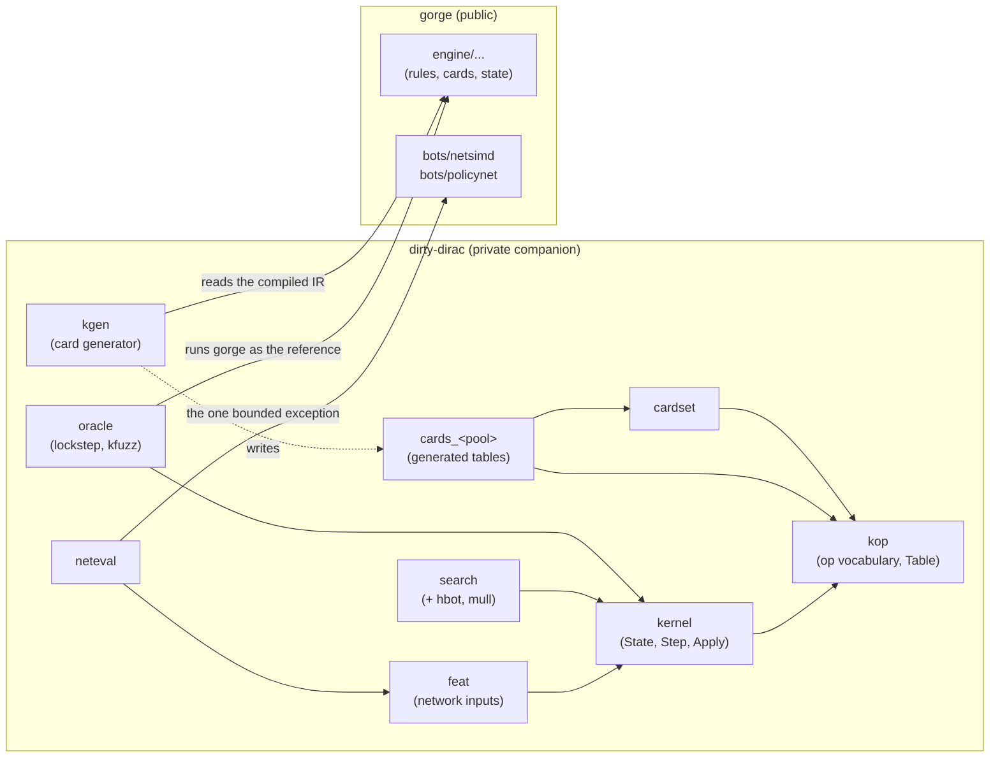

# dirty-dirac

dirty-dirac is gorge's second rules kernel: a two-player implementation of
Magic built so that tree search and self-play can copy and step a game
millions of times. It began as a microkernel for two fixed card pools. It is
now a kernel whose card compiler lowers cards from the whole Forge corpus,
and it is being grown, one rules family at a time, toward a full engine. This
page says what it is, how it relates to gorge, what it covers today and where
it is going. It is for contributors who want to understand the two-kernel
design and for bot authors who want to know what a "kernel game" is.

!!! warning "In development"
    dirty-dirac is under active development toward a full engine and is not
    finished: its card support is still growing, and gorge is the reference
    engine it is checked against.

!!! info "Snapshot"
    Figures in this section were read from the dirty-dirac source of
    2026-10-25, which pins gorge
    [`bb026728d`](https://github.com/adams-shaun/gorge/commit/bb026728d).
    Each page says how its figures were produced.

!!! note "Where the code lives"
    dirty-dirac lives in the maintainers' **private companion
    module** (see [The three repositories](../../repos/index.md)). Its Go
    package is `kernel`, with sub-packages `kop`, `cardset`, `feat`,
    `search`, `neteval`, `oracle`, `vanilla` (a hand-written test table) and
    one generated `cards_<pool>` package per card pool, and the commands `kgen` (the card generator), `kfuzz` (the
    lockstep fuzzer) and `kplay` (the game runner). The source is not public;
    these pages describe its design, what it supports and how it is
    verified. Its speed is on the [Performance](../../performance/index.md)
    pages.

## Why a second kernel

gorge is built to be right for every card in the Forge corpus, at up to eight
seats, with a replayable, hash-chained event log
([Events and replay](../gorge/events.md)). That generality has a shape: a
`state.Game` is an arena of objects linked by IDs, plus slices for zones and
maps for continuous effects, card text and memo tables. Copying one is a deep
copy; stepping one walks open-ended data.

A search such as Monte Carlo tree search (MCTS) wants the opposite trade. Each
simulation starts by copying the root position, plays forward a few dozen
decisions, and throws the copy away. If everything variable-length about the
cards lives in a read-only table, the game itself can be laid out as **one
fixed-size Go value**:

- no pointers, maps, slices, strings or interfaces anywhere inside it;
- every zone, the battlefield, the stack and the pending triggers are
  fixed-capacity arrays;
- a card's behaviour is a short program of integer opcodes in a table the
  game names by a 16-bit index, not by a pointer.

Then **cloning a game is a plain assignment** (`w := *root`, one copy of
15,240 bytes), the garbage collector never scans game state, and two equal
positions compare equal with `==`. That is the whole idea; the rest of these
pages are the details that make it hold up.

```go
s := kernel.NewConfig(tbl, deckA, deckB, seed, kernel.Config{Mulligans: 2})
for {
    d := s.Step()               // run to the next decision
    if d.Kind == kernel.DkNone { // the game is over
        break
    }
    s.Apply(d.Options[i])       // answer it with one of d.Options[:d.N]
}
over, winner := s.Terminal()
```

The API is that loop: `Step` runs the game to its next question, `Apply`
answers it with one packed 32-bit `Action`. See
[Step and Apply](step-apply.md).

## What it covers

dirty-dirac covers cards in three steps, and each one is a stronger claim than
the one before:

| Step | What it means | Today |
|---|---|---|
| **Lowered** | the generator, `kgen`, reads every rules parameter of the card's compiled IR and lowers it to kernel ops with no refusal | **17,126 of 34,072** corpus cards (50.3 %) |
| **Generated** | the card is in a generated `cards_<pool>` package, so a kernel game can deal it | the registered pools: FDN, BLB and a set of small constructed verification pools |
| **Verified** | games over the pool have been played in lockstep with gorge, decision by decision, with no disagreement | FDN and BLB, plus the constructed pools ([Verification](oracle.md#agreement-today)) |

Per-set lowering counts are on [Card support by set](../../support/sets.md#per-set-support).
A lowered card that is not yet in a verified pool is a claim about the
generator, not about play: the [Cards](cards.md) page explains the refusal
contract that makes the claim mean something.

## Scope

dirty-dirac deliberately does much less than gorge.

| Limit | Value | What happens past it |
|---|---|---|
| Players | exactly 2 | not representable in this build |
| Cards | cards in a generated pool; a matchup is built from one pool | a deck with a refused card is refused when the matchup table is built |
| Deck size | 60 cards per seat (`MaxDeck`) | rejected when the game is set up |
| Card instances | 192: both decks plus tokens and copies (`MaxObj`) | the game ends as a draw, reason `board` |
| Battlefield | 128 permanents (`MaxPerm`) | draw, `board` |
| Stack | 24 entries (`MaxStack`) | draw, `stack` |
| Waiting triggers | 24 (`MaxPending`) | draw, `pending` |
| Triggers resolved in one turn | 2,000 | draw, `loop` (an endless mandatory loop, CR 104.4b) |
| Every other bounded pool | delayed triggers 16, remembered objects 12, continuous-effect records 16, last-known-information records 16, general counter kinds per permanent 3, ... | draw, with that pool's own reason |

A game that outgrows a fixed capacity is a *capacity stall*: it ends as a draw
and `State.StallReason` names the pool. There are 46 reasons. Most name a
bounded pool, so no insert is ever dropped silently. The rest are not about
capacity: they mark a combination of cards whose interaction the kernel knows
it does not yet handle the way gorge does (two replacement effects gorge would
ask about, for example), and the game stalls at that point rather than play
on with a known difference. gorge has no such caps, so the oracle counts a
stall as a stall, never as a rules disagreement.

There is also no event log, no per-seat view, no host, no Commander, no
concede and no manual mana: every cast is paid automatically by a planner that
mirrors gorge's own auto-pay planner. Those are gorge's jobs.

## Relationship to gorge

**gorge is dirty-dirac's oracle.** dirty-dirac is not a second source of rules
truth. Its cards are generated from gorge's compiled card IR, its rules code
follows gorge's rules code (including gorge's decision grammar and RNG), and a
lockstep harness plays the same game through both engines and stops at the
first difference. When the two disagree, the question is "which one is wrong
by the Comprehensive Rules (CR)?". When gorge looks wrong, the evidence is
checked against XMage and Forge, the fix lands in gorge, and the kernel keeps
gorge's behaviour until its gorge pin moves past the fix. Several findings so
far were bugs in gorge (for example gorge commits
[`b95cf24c0`](https://github.com/adams-shaun/gorge/commit/b95cf24c0) and
[`ff5b00f5e`](https://github.com/adams-shaun/gorge/commit/ff5b00f5e)), which
is one reason the harness exists. See [Verification](oracle.md).

**The import boundary.** The kernel itself imports nothing from gorge. Only
three places may:



- `kernel`, `kop`, `cardset`, the generated `cards_<pool>` packages, `feat`
  and `search` have no gorge package among their dependencies
  (`go list -deps`, 2026-10-25).
- `neteval` is the one bounded exception in the run-time path: its only
  gorge imports are
  [`bots/netsimd`](https://github.com/adams-shaun/gorge/tree/main/bots/netsimd)
  (the network's forward pass) and
  [`bots/policynet`](https://github.com/adams-shaun/gorge/tree/main/bots/policynet)
  (its input types). `policynet` links gorge's engine types in turn, so the
  rule is about what `neteval` calls, not what the binary links: it never
  calls gorge's engine. See [Search](search.md).
- `oracle` and `kgen` are tools, not the kernel, and may import any of gorge.

The rule is stated in the kernel's package documentation; it is a review rule,
not a test.

## gorge and dirty-dirac compared

| | gorge | dirty-dirac |
|---|---|---|
| **State model** | `state.Game`: an object arena addressed by `ObjID`, with slices for zones and maps for effects and memos | one `State` struct of 15,240 bytes: fixed arrays only; no pointers, maps, slices, strings or interfaces ([State](state.md)) |
| **Mutation** | the engine proposes `events.Event`s; `events.Apply` folds each into the state and appends it to a SHA-256 hash chain | `Apply(action)` writes the value directly; no log |
| **Clone cost** | `Engine.Clone`: a deep copy of the game plus a shared log prefix | assignment: one 15,240-byte copy, nothing for the garbage collector |
| **Players** | up to 8 | exactly 2 |
| **Card coverage** | the whole Forge corpus: 32,337 of 34,074 scripts (94.9 %) playable ([Card support](../../support/sets.md)) | 50 % of the corpus lowers; play is per generated pool ([What it covers](#what-it-covers)) |
| **Rules source** | Forge scripts compiled to gorge's IR, plus gorge's hand-written primitives and rules core | the same IR lowered by `kgen` into integer op programs, plus a hand-written interpreter that mirrors gorge's rules code ([Cards](cards.md)) |
| **Decisions** | 13 decision kinds, multi-select answers | 8 decision kinds, every answer a single pick ([Step and Apply](step-apply.md)) |
| **Verification** | golden replays and chain heads, census ratchets, the XMage and Forge compliance oracles | lockstep against gorge on every decision and every position ([Verification](oracle.md)) |
| **Intended use** | hosting real games, the reference implementation, every card | search and self-play on the verified pools |

## Where it is going

The kernel is a work in progress. Its growth is organised so that a new set
costs data, not a redesign:

- **Close the shared card grammar, corpus-wide.** What blocks a card is
  overwhelmingly shared grammar (filter properties, `Defined$` forms,
  parameters, value heads, common effects and trigger modes), not the set's
  named mechanics. The generator classifies every refusal, and the refusal
  classes are closed in order of how many corpus cards each one unlocks.
  Acceptance ratchets, one for the whole corpus and one per set, can only
  rise ([Cards](cards.md#growing-the-card-grammar)).
- **Complete the rules families.** Every recent set's mechanics compose from
  a small catalogue of kernel blocks: costs and cast-time choices, trigger
  events, counters and threshold gates, per-turn history, permissions,
  continuous effects (the CR 613 layers), copies and faces, simultaneous-event
  batches and last known information, choice points, and capacities. `State`
  grows only when a block is built, and each block is measured against the
  size budget ([State](state.md#the-size-budget)). Once the catalogue is
  complete, a named mechanic is one generator entry that composes existing
  blocks.
- **Verify more sets in lockstep.** A lowered card is only accepted; a set is
  trusted once a pool of its decks plays in lockstep with gorge and joins the
  regression gate.
- **Multiplayer.** The 2-player build bakes the seat count into array sizes,
  the 8-bit object index and the 32-bit action. The design keeps one source
  and makes the seat count a build-time size class: the 2-player build keeps
  today's constants and costs nothing extra, while a multiplayer build widens
  object and action fields, sizes per-player arrays by the seat count, and
  adds the Commander state, with its own size budget.

## Pages in this section

| Page | What it covers |
|---|---|
| [State](state.md) | the fixed-size `State` value and its memory layout, the 128-slot battlefield and its slot masks, object identity and versioning (CR 400.7), the size budget, the canonical `Projection` |
| [Step and Apply](step-apply.md) | the control-state machine, the `Decision` and `Action` encodings, decision kinds against gorge's, mulligans, and why the RNG is bit-compatible with gorge's |
| [Cards](cards.md) | the `kop` op vocabulary, how `kgen` lowers gorge's compiled IR, the refusal contract, the acceptance ratchets, the layer system, what is generated and what is hand-written |
| [Verification](oracle.md) | the lockstep oracle against gorge, the canonical vocabulary and projection, how a divergence is found, shrunk and classified, the verified pools, and what lockstep cannot see |
| [Search](search.md) | how featurisation, the search and network evaluation sit on the kernel, and the import boundary |

New terms on these pages are collected in the
[Glossary](../../contributing/glossary.md).
