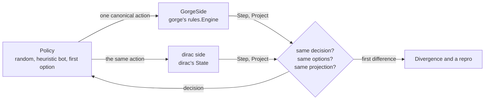

# Verification: the lockstep oracle

dirac is trusted only as far as it agrees with gorge. `dirac/oracle` plays the same decks, seed and answers through both
engines at once and stops at the first difference. This page says what is compared, how a difference is reported and
reproduced, and what lockstep proves and doesn't.

## What lockstep proves, and what it doesn't

**Lockstep shows that the two engines agree. It does not show that they are right.**

dirac is an independent implementation of a reading of the rules that gorge also implements, not an independent reading.
Its cards are lowered from gorge's compiled IR of the same Forge scripts, and its rules code follows gorge's. A bug in
that shared reading (a script that encodes a card wrongly, a parameter meaning both engines inherit, a shortcut copied
from gorge) behaves identically on both sides, and lockstep reports agreement however many games it plays.

A clean run therefore means *dirac played the same game gorge played*, on the cards and lines those games reached. It
says nothing about a card or line no game reached, or whether gorge's answer was correct. gorge is checked separately by
readings that don't share its source:

- [gorge-compliance](https://github.com/adams-shaun/gorge-compliance) compares gorge with **XMage** (hand-written Java card
  implementations) and with **Forge's own engine**, adjudicated by the Comprehensive Rules.
- Hand-written **Oracle-text scenarios** play a card's printed text through gorge
  ([Testing](../../contributing/testing.md)).

Those checks cover dirac only indirectly, for behaviour lockstep exercises, because dirac matches gorge there. They are
not run against dirac itself, so dirac shares gorge's bugs on the cards it supports.

## What is compared



Both engines sit behind one interface, `Side` (`dirac/oracle/canon.go`: `Step`, `Apply`, `Terminal`, `Decided`,
`Project`, `Dirty`, `Turn`, `Err`). Comparing results alone would hide almost every bug, so lockstep compares, in order:

1. **The options at every decision.** Options are sorted `Canon` values, packed `kind<<26 | src<<17 | tgt<<8 | mode` (`dirac/canon/canon_default.go`) over the
   oracle's own kinds, so the comparison ignores order and catches a missing, extra or differently priced play. A
   card object is a canonical instance: deck *s*'s *i*-th card, then tokens and copies in creation order.
2. **The decision's kind and player.** A priority decision must not become a declaration, and the wrong seat must not act.
3. **The canonical projection after every action gorge commits.** Per instance: card, owner, controller, zone, position,
   flags, damage, counters and attachments. Then life, poison, speed, the stack, turn, step, active player, priority holder, RNG
   draw count, lands played, mana pools and the result. It is fixed arrays, so equality is a value comparison.
4. **The result** when both sides stop.

`-surface` picks the options compared. On `autopay`, neither engine offers a plain cast that gorge's payment planner never
prices. `full`, the default, offers those too, and is the stricter surface.

The network input encoder is held to gorge here too: with `FeatCheck` on, each decision compares `dirac/feat`'s output
with `bots/policynet`'s, byte for byte. `khbot` runs gorge's heuristic bot and its dirac port on the same decisions and
prints agreement per kind; `ksbt` does the same for sb-tactical through a view built from the dirac position.

## Running it

`kfuzz` is the driver. With the card tables built (`make dirac-tables`), a pool run plays seeded pairs of decks:

```sh
go build -trimpath -o bin/kfuzz ./dirac/oracle/cmd/kfuzz
bin/kfuzz -kernel fdn -first-pair 0 -pairs 2 -seed 1 -keep-going -surface autopay -shrink 0
```

Among its output is this summary line:

```text
fdn: 2 games (0 refused-card, 0 refused-pair, 0 error), 2 clean, 0 divergent, 0 unmodelled [], 0 capacity [], 0 hang (lead gorge, surface autopay)
```

Every pair that started a game is one of these. A pair that couldn't be built is outside the count, in the bracket.
`make dirac-slices` plays both slices on both surfaces with `-absolute`.

| Verdict | Meaning | Exit, plain | Exit, `-absolute` |
|---|---|---|---|
| clean | agreed until the game ended or hit a turn or decision cap | 0 | 0 |
| capacity | dirac hit a declared limit; agreed up to there | 0 | 0 |
| `refused-card`, `refused-pair` | not played: a card or a pair dirac doesn't support | 0 | 0 |
| divergent | the engines differed; a panic in a game counts as one | 1 | 1 |
| hang | no result inside `-game-timeout` (default 30 s) | 1 | 1 |
| unmodelled | dirac stopped at something gorge does and it doesn't | 0 | 1 |

`-absolute` also fails on an `error` skip and on a run that played no game. `-coverage` and `-evidence` count a game with no
divergence and no unmodelled stall, so a capacity-stalled game earns coverage up to where it stopped.

A clone plays committed slices of the deck pools (the first 1,500 pairs of `fdn` and `blb` at seed 1,
`dirac/oracle/testdata/slices`) and synthetic decks, which `kfuzz -synth <pool>` deals from a card list. The full deck
pools aren't published, so everything CI runs needs only the slices and synthetic decks. Latest results are on
[What it supports](index.md#how-far-lockstep-agrees).

Random answers are a strength: they reach corners (declining every optional trigger, chump-blocking with everything,
casting into a counterspell) that a sensible bot never visits.

## Finding and reproducing a difference

A `Divergence` records the decision number, what disagreed (`options`, `projection`, `decision`, `terminal`, `gorge` or
`kernel`), the first mismatching field, every mismatching field with both values, and both option lists. It also lists
the cards it implicates, ranked: the card in an option only one side offers, else the first differing card field. That's
an upper bound, since a shared mechanism blames its victims.

- **Reproducing.** Both engines are deterministic, so the same `-seed`, `-first-pair` and `-pairs` replay the same games
  byte for byte. `-v` adds the last actions and the field diff.
- **Shrinking.** `-shrink N` (default 200) shortens the action prefix while it still diverges.
- **A portable repro.** `-out DIR` writes `oracle.Repro`: the two decks by card name, the seed, the run knobs and the canonical
  action prefix. `-repro FILE` replays it with no deck files.
- **A game dirac played alone.** `-replay FILE` re-executes one in gorge with its chance draws forced, and verifies gorge's log.

When the two disagree, the engine that's wrong under the CR gets the fix. If gorge looks wrong, the evidence is checked
against XMage and Forge first and the fix lands in gorge; dirac then follows in the same change, or kgen refuses the card
by name until it does ([Cards](cards.md#lowered-refused-evidenced)).

## Four-seat pods

dirac plays pods of three or four seats (`MaxSeats`) in lockstep with gorge, under the same comparison as a two-seat game.
A Commander pod is four seats. `kfuzz -seats 3` or `-seats 4` plays pods of distinct decks (`oracle.PodAt`), `-pods N`
of them, on `-kernel vanilla`, a `-synth` pool, or a Commander pool cut with `-cmd-mini`:

```sh
bin/kfuzz -kernel cmd5 -seats 4 -cmd-mini 60 -pods 100 -seed 1 -keep-going -shrink 0
```

The `TestFourSeat*` tests in `dirac/oracle` hold pod play in lockstep, one mechanic at a time.

A card whose lowering reads the one opponent of a two-seat game (`kop.CardTwoSeat`) plays in a two-seat game, and dirac
refuses a game of three or more seats holding it at its start, under the reason `StallTwoSeat`. That is a declared limit,
counted, not a divergence. `TestCommanderPodTwoSeatCensus` counts the full Commander precons such cards hold to two seats,
by class, against the goldens in `dirac/oracle/testdata/twoseat-census/`. Its log line ranks the classes by the pods each
blocks, and the `4-seat` column of [`dirac/docs/support.md`](https://github.com/adams-shaun/gorge/blob/main/dirac/docs/support.md)
counts the supported cards free of the limit.

## Where this runs

- `make dirac-slices` is the `dirac-slices` job in `.github/workflows/ci.yml`: every Mergify queue batch, `main`, the
  nightly run and on demand, never a pull request's own checks.
- The whole of `dirac/oracle` is the `oracle` workflow (`.github/workflows/oracle.yml`): ten parts
  (`scripts/ci-oracle-shard.sh`), started from an hourly cron only when no run began in the last 5h30m, so about every 6
  hours on `main`, and on demand.
- `scripts/dirac-gate.sh <base>` holds a change to gorge and dirac together: gorge leads, and a change that alters
  behaviour on a supported card fixes dirac in the same change or refuses the card by name.

## CR coverage

`dirac/crcoverage` keeps a rule-by-rule table against the Comprehensive Rules, one file per chapter, with the code that
decides each rule. `TestCRCoverageIsCurrent` fails when a row stops matching the code, and
[its README](https://github.com/adams-shaun/gorge/blob/main/dirac/crcoverage/README.md) has the current count of each
status. A row marked `inherits gorge` copies gorge's behaviour, so
[gorge's table](https://github.com/adams-shaun/gorge/tree/main/engine/rules/crcoverage) decides it.
