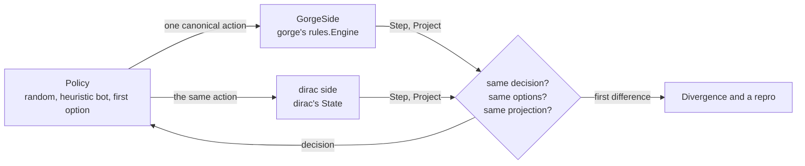

# Verification: the lockstep oracle

dirac is trusted only as far as it agrees with gorge. `dirac/oracle` plays the same decks, seed and answers through both
engines at once and stops at the first difference. This page says what is compared, how a difference is reported and
reproduced, and exactly what lockstep proves and doesn't. It is for readers deciding how far a dirac game can be trusted.

## What lockstep proves, and what it doesn't

**Lockstep shows that the two engines agree. It does not show that they are right.**

dirac is an independent implementation of a reading of the rules that gorge also implements, not an independent reading.
Its cards are lowered from gorge's compiled IR of the same Forge scripts, and its rules code was written to follow
gorge's. A bug in that shared reading (a script that encodes a card wrongly, a parameter meaning both engines inherit, a
shortcut copied from gorge) behaves identically on both sides, and lockstep reports agreement however many games it plays.

So a clean run means *dirac played the same game gorge played*, on the cards and the lines those games reached. It says
nothing about a card or a line no game reached, and nothing about whether gorge's answer was correct.

That is why gorge is checked separately by readings that don't share its source:

- [gorge-compliance](https://github.com/adams-shaun/gorge-compliance) compares gorge with **XMage** (hand-written Java card
  implementations) and with **Forge's own engine**, adjudicated by the Comprehensive Rules.
- Hand-written **Oracle-text scenarios** play a card's printed text through gorge
  ([Testing](../../contributing/testing.md)).

dirac is covered by those checks only indirectly, for behaviour lockstep exercises, because it matches gorge there. They
are not run against dirac itself.

## What is compared



Both engines sit behind one interface, `Side`, over a canonical vocabulary (`Step`, `Apply`, `Terminal`, `Decided`,
`Project`, `Dirty`, `Turn`, `Err`). Comparing results alone would hide almost every bug: two engines can disagree about a
trigger on turn 3 and still reach the same winner. Lockstep compares, in order:

1. **The options at every decision.** Options are sorted `Canon` values, packed `kind<<24 | src<<16 | tgt<<8 | mode` over the
   oracle's own kinds, so the comparison ignores order and catches a missing, extra or differently priced play. A
   card object is a canonical instance: deck *s*'s *i*-th card, then tokens and copies in creation order.
2. **The decision's kind and player.** A priority decision must not become a declaration, and the wrong seat must not act.
3. **The canonical projection after every action gorge commits.** Per instance: card, owner, controller, zone, position,
   flags, damage, counters and attachments. Then life, poison, speed, the stack, turn, step, active player, priority holder, RNG
   draw count, lands played, mana pools and the result. It is fixed arrays, so equality is a value comparison.
4. **The result** when both sides stop.

`-surface` picks the options compared. On `autopay`, neither engine offers a plain cast that gorge's payment planner never
prices. `full`, the default, offers those too, and is the stricter surface.

The network input encoder is also held to gorge here: with a check on, each decision compares `dirac/feat`'s output
with `bots/policynet`'s, byte for byte. `khbot` runs gorge's heuristic bot and its dirac port on the same decisions and prints
agreement per kind. `ksbt` does the same for sb-tactical, through a view built from the dirac position.

## Running it

`kfuzz` is the driver. A pool run plays seeded pairs of decks:

```sh
kfuzz -kernel fdn -first-pair 0 -pairs 2 -seed 1 -keep-going -surface autopay -shrink 0
```

```text
fdn: 2 games (0 refused-card, 0 refused-pair, 0 error), 2 clean, 0 divergent, 0 unmodelled [], 0 capacity [], 0 hang (lead gorge, surface autopay)
```

Every pair that started a game is one of these. A pair that couldn't be built is outside the count, in the bracket.

| Verdict | Meaning | Exit, plain | Exit, `-absolute` |
|---|---|---|---|
| clean | agreed until the game ended or hit a turn or decision cap | 0 | 0 |
| capacity | dirac hit a declared limit; agreed up to there | 0 | 0 |
| `refused-card`, `refused-pair` | not played: a card or a pair dirac doesn't support | 0 | 0 |
| divergent | the engines differed; a panic in a game counts as one | 1 | 1 |
| hang | no result inside `-game-timeout` (default 30 s) | 1 | 1 |
| unmodelled | dirac stopped at something gorge does and it doesn't | 0 | 1 |

`-absolute` also fails on an `error` skip and on a run that played no game. `-coverage` and `-evidence` count a game with no
divergence and no unmodelled stall, so a capacity-stalled game earns coverage up to where it stopped.

dirac commits slices of its deck pools, the first 1,500 pairs of the `fdn` and `blb` pools at seed 1, so a checkout can
play them without the pools themselves. The pools are 17Lands-derived, and `kfuzz -synth <pool>` plays a card list instead of a
deck list. Latest results are on [What it supports](index.md#how-far-lockstep-agrees). On `-surface full`, the same slices
gave 1,499 clean games and one capacity stall on FDN and 1,500 clean games on BLB (2026-10-31).

Random answers are a strength here: they reach corners (declining every optional trigger, chump-blocking with everything,
casting into a counterspell) that a sensible bot never visits.

## Finding and reproducing a difference

A `Divergence` records the decision number, what disagreed (`options`, `projection`, `decision`, `terminal`, `gorge` or the
dirac side), the first mismatching field, every mismatching field with both values, and both option lists. It also lists the
cards it implicates, ranked: the card in an option only one side offers, else the first differing card field. That's an
upper bound, since a shared mechanism blames its victims.

- **Reproducing.** Both engines are deterministic, so the same `-seed`, `-first-pair` and `-pairs` replay the same games
  byte for byte. `-v` adds the last actions and the field diff.
- **Shrinking.** `-shrink N` (default 200) shortens the action prefix while it still diverges.
- **A portable repro.** `-out DIR` writes `oracle.Repro`: the two decks by card name, the seed, the run knobs and the canonical
  action prefix. `-repro FILE` replays it with no deck files.
- **A game dirac played alone.** `-replay FILE` re-executes one in gorge with its chance draws forced, and verifies gorge's log.

When the two disagree, the engine that's wrong under the CR gets the fix. If gorge looks wrong, the evidence is checked
against XMage and Forge first, the fix lands in gorge, and dirac keeps gorge's behaviour until its gorge pin moves past the
fix. A card that lowers and still plays wrong can be refused by name until it's fixed
([Cards](cards.md#lowered-refused-evidenced)).

## CR coverage

dirac keeps a rule-by-rule table of where it stands against the Comprehensive Rules, one file per chapter, with the code
that decides each rule. `TestCRCoverageIsCurrent` fails when a row stops matching the code, so the table changes in the same
commit as the behaviour. Rows on 2026-10-31: 1,621 in all, of which 695 follow, 107 are partial, 14 deviate, 4 are not
implemented, 20 are definitions, 733 don't apply (multiplayer, for example) and 48 aren't established yet. A row marked
`inherits gorge` copies gorge's behaviour, so [gorge's table](https://github.com/adams-shaun/gorge/tree/main/engine/rules/crcoverage) decides it.
