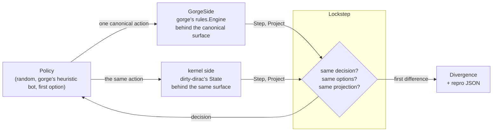
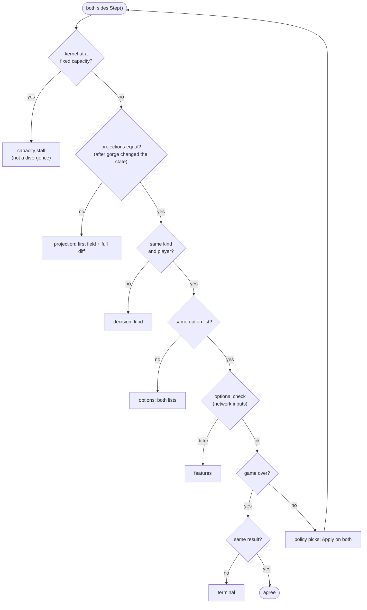

# Verification: the lockstep oracle

dirty-dirac is trusted only as far as it agrees with gorge. Its `oracle`
package plays the same decks, seed and answers through both engines at once
and stops at the first decision or position where they differ. This page
explains the canonical vocabulary both engines are translated into, the
canonical projection they are compared on, how a divergence is found, shrunk,
classified and fixed, what the agreement rate is today, and, just as
important, what this kind of check cannot see. It is for contributors who want
to know how much a kernel game can be trusted.

## Why lockstep

Comparing only results (who won, in how many turns) would hide almost every
bug: two engines can disagree about a trigger on turn 3 and still reach the
same winner. Comparing complete logs is impossible, because the engines have
no common log format. Lockstep compares the two things both engines must agree
on at every moment:

1. **The question.** At every decision both sides must pose the same kind of
   decision to the same player with the same list of options.
2. **The position.** After every action gorge commits, both sides' canonical
   projections must be equal.

The first difference is reported with both sides' options or a field-by-field
diff of the two projections, at the exact decision where it happened.

## The pieces



Both engines sit behind one interface over the canonical vocabulary. Its
core is four methods (the others report a decided result, the turn number,
an internal error, and whether a side has changed since it was last
projected):

```go
type Side interface {
    Step() CDecision              // the next decision: kind, player, options sorted ascending
    Apply(c Canon)                // apply one canonical action
    Terminal() (over bool, winner int8)
    Project(p *Projection)        // the canonical projection
}
```

- **GorgeSide** builds the match exactly as the game runner does (`rules.New`
  then `Advance`, the same `rules.Config`) and translates each gorge decision
  into canonical options.
- **The kernel side** wraps a `kernel.State` (with every decision posed, no
  elision) and translates its `Action`s and `Projection`.
- Two self-check sides run gorge against a second copy of gorge, directly and
  through the kernel-shaped interface, so the harness itself can be tested
  with no kernel involved.

Either side can lead a run: the leader poses the decision the policy answers,
and the follower mirrors it.

The **policy** answers each decision for both sides; it sees only the
canonical decision. The oracle's policies are a seeded uniform-random one
(the default for fuzzing), gorge's heuristic bot translated into canonical
picks, and "always the first option" (used to finish a shrunk repro).

## The canonical vocabulary

A canonical action, `Canon`, is packed exactly like a kernel `Action`
(`kind<<24 | source<<16 | target<<8 | mode`; see
[Step and Apply](step-apply.md#action-the-bit-packing)), but over the oracle's
own kinds, which are shaped by gorge's 13 decision kinds rather than the
kernel's 8. The bytes in `source` and `target` are **canonical references**:

| Ref | Meaning |
|---|---|
| `0x00`..`0xDF` | a card instance: seat 0's deck in deck order, then seat 1's, then tokens and copies in creation order (gorge's genesis order, which is also the kernel's `Obj` order) |
| `0xE0 + i` | the *i*-th object on the stack from the bottom (an ability, which is not a card) |
| `0xF0 + p` | seat *p* |
| `0xFF` | none |

There are 22 action kinds (pass, land, cast, activate, attack, block, done,
target, mode, keep, mulligan, bottom, order, yes, no, arrange, replacement,
special, starting player, commander zone, cast a face, casualty cast) and one
more kind per `choose` option kind (`ActChoose + k` over a table of 70
kinds: x, sacrifice, discard, search, dig, colour, division, pile, tapcost,
gift, forage, proliferate, station, casualty, ...). A label-valued pick, such
as a creature type, carries a 16-bit value: the label's index in gorge's
creature-type vocabulary. Each decision's options are **sorted ascending**,
and the kernel sorts its own options into the same order, so comparing two
option lists is comparing two sorted integer slices.

Three translations do the heavy lifting:

- **Auto-pay.** The kernel has no manual mana. gorge's mana abilities and its
  concede option are never canonical options. Each play is paid the way
  gorge's own auto-pay surface pays it: a planned cast with the payment
  planner's first witness; a potential play by lowering its witness (tap each
  source at priority, answer the colour asks, then pick the play); a play that
  needs a scripted prefix only when the script completes on a clone of the
  engine. Plays gorge's planner cannot price are not options, and are counted.
- **Multi-pick.** gorge asks for attackers, blockers, discards, bottoming,
  arrangements and target sets as one multi-select. The oracle poses each as a
  sequence of single picks, offering only picks after which the answer can
  still be completed into a valid one (an exact search over the remaining
  picks; a lone blocker for a menace attacker is not offered when no second
  blocker could join), plus Done once the answer so far is valid. That is the
  kernel's grammar, so the two lists can be equal.
- **Elision.** With elision on, a decision with one option is answered in
  place on both sides; the default fuzzing run poses everything.

Where canonicalisation is not a pure function of the position, the oracle
counts it rather than hiding it: repeated identical tuples distinguished by
occurrence, tuples that still collided and were dropped, option kinds outside
the tables, plays the auto-pay vocabulary leaves out, and decisions with more
options than the kernel's limit.

## The canonical projection

The canonical `Projection` is built independently from each engine (from
gorge's `state.Game` and derived characteristics; from the kernel's own
`Projection`) and compared with `==`, then diffed field by field when it
differs.

| Part | Fields |
|---|---|
| per card instance (up to 224) | name hash, deck table index, the face up, zone (with a "ceased" code for a token or copy that left), owner, controller, position (library from the top, battlefield in the controller's entry order, graveyard in arrival order), flags (tapped, summoning sick, attacking, blocking, face down, token, copy, phased out, monstrous), damage, counters (+1/+1, -1/-1, loyalty, each named kind, and the sum of the rest), layer-applied power and toughness of battlefield creatures, attached-to, the attacker it blocks |
| derived characteristics, per battlefield instance | types, subtypes, colours and keywords after the layer system, so a layer-ordering difference shows up as a projection difference, not only through its effects |
| per seat | life, poison, speed, lands played (active player), mana pool WUBRGC, hand and library sizes |
| the stack, bottom first (up to 32) | kind, source, ability index (gorge's face ability index, or `0x80` + trigger index), controller, up to 4 targets |
| the rest | turn, step (gorge's numbering), active player, RNG draw count, game over, winner |

The priority holder is in the struct but not compared: the decision's player
is compared instead, and outside a priority decision neither engine's holder is
game state. A finished game compares by result only. Including the **RNG draw
count** means any extra or missing random draw is caught at the decision where
it happens (see
[RNG compatibility](step-apply.md#rng-compatibility-with-gorge)).

## The Divergence comparator

At each canonical decision the harness checks, in order:



A `Divergence` records `At` (the canonical decision number: the actions before
it were applied), `What` (`projection`, `decision`, `options`, `terminal`,
`features`, or `gorge` / `kernel` / `policy` for a panic or error on that
side), `Field` (the first differing field, such as `Cards[12].Zone` or
`Life[1]`), `Diff` (every differing field with both values) and both sides'
option lists. A panic inside the kernel is caught and reported as a `kernel`
divergence with its stack, so a crash is a finding, not a lost run.

One case is deliberately not a divergence: a **capacity stall**. A kernel
game that outgrows its fixed arrays ends as a draw
([Scope](index.md#scope)); gorge has no such limit, so the run is counted as a
stall, separately from both agreement and divergence.

## Finding, shrinking and classifying a divergence

The fuzzer, `kfuzz`, plays many games in lockstep. Deck pairs and per-game
seeds are drawn from a deck pool by the same rule the game runners use (pair
*p*'s decks and seed are a pure function of the base seed and *p*), so any
game can be named and replayed by its pair index alone.

When a game diverges:

1. **Repro.** The game is written as a JSON repro: the matchup by card names,
   the seed, the run's switches and the canonical action prefix that reached
   the divergence. Re-running it plays the scripted prefix through both
   engines again.
2. **Shrink.** The shrinker drops chunks of the action prefix, in halving
   sizes, keeping a smaller prefix whenever the game still diverges in the
   *same class*, within a bounded number of reruns. Actions a decision no
   longer offers are skipped; after the prefix, "always the first option"
   plays on.
3. **Classify.** A divergence's class is `What` plus its field with the
   indices stripped (`projection Cards[].Zone`, `options options`), and a run
   reports its divergences by class. A class that suddenly grows points at one
   cause.
4. **Adjudicate.** Someone reads the diff against the Comprehensive Rules and
   decides which engine is wrong. The fix goes to that engine, and several
   findings so far were gorge's (gorge
   [`b95cf24c0`](https://github.com/adams-shaun/gorge/commit/b95cf24c0), "a
   Play election never offers a spell whose mandatory target cannot be
   chosen", came from a kernel pair; gorge
   [`ff5b00f5e`](https://github.com/adams-shaun/gorge/commit/ff5b00f5e) added
   the state-based check after cleanup's CR 514.2 actions).
5. **Pin.** The pair is added to a committed list of regression pairs,
   each with a one-line reason. A test replays them. Most were
   re-verified by reverting the fix and watching the pair diverge again; a few
   are coverage pairs that only show a card plays to the end.

The kernel keeps no switch for older gorge behaviour: when gorge fixes a rule,
the kernel follows it, so lockstep compares one configuration of each engine.

## Replaying a kernel game in gorge

Lockstep needs both engines running together. A kernel game played on its own
(for example inside a search world whose hidden cards were re-dealt and whose
RNG was re-seeded) can be checked afterwards:

1. The kernel records the game: matchup, seed, canonical actions, a hash of
   its projection at every decision and, with `Config.RecordChance`, the bound
   of every random draw.
2. The oracle re-executes it in gorge, forcing gorge's RNG to produce the
   recorded outcomes, and compares the projection hash at every decision.
3. gorge's own log of the re-executed game must then verify as any gorge
   replay does ([Events and replay](../gorge/events.md#replay)).

This is how games the kernel plays at scale are sampled and audited without
running gorge on every one.

## Network-input parity

A search on the kernel evaluates positions with a network trained on gorge's
inputs ([Search](search.md)). The lockstep harness can also assert, at every
decision both engines agree on, that the kernel's encoding of the position and
of each option is byte for byte what gorge's `bots/policynet` produces from
gorge's redacted view of the same seat. A difference is a `features`
divergence. The kernel's incremental encoder is checked against its full
encoder at the same points.

## Agreement today

Measured 2026-10-25 with `kfuzz` against gorge
[`bb026728d`](https://github.com/adams-shaun/gorge/commit/bb026728d) (the gorge
revision dirty-dirac pinned on that date). Settings: uniformly random answers seeded per
game, every decision posed (no elision), base seed 1, one London mulligan
allowed, `-autopay-surface` (neither side offers a plain cast that gorge's
payment planner never prices), the 100-turn and
20,000-decision caps. FDN pairs are drawn from a pool of FDN limited deck
lists; the BLB pool is BLB limited decks in which the few cards the generator
still refuses were replaced by basic lands.

| Pool | Games | Agreed to the end | Capacity stalls | Diverged |
|---|--:|--:|--:|--:|
| FDN, pairs 0 – 1,499 | 1,500 | 1,500 | 0 | 0 |
| FDN, pairs 0 – 3,999 | 4,000 | 3,999 | 1 (last-known-information records) | 0 |
| BLB, pairs 0 – 1,499 | 1,500 | 1,500 | 0 | 0 |

"Agreed to the end" means every decision, option list and projection matched
until the game ended or reached a cap. These counts are a regression gate: a
kernel change may not turn a clean pair into a divergence, and each move of
the gorge pin is measured on its own so a change in the counts names the gorge
commit that caused it.

Beside FDN and BLB, a set of small **constructed pools** is played in
lockstep. Each is a handful of hand-picked decks whose cards exercise a piece
of newly accepted grammar (aggregate tap costs such as Crew and Saddle,
multi-face cards, pay-life costs, multi-target unions, ...). Each test counts
on the gorge side how often the new card behaviour actually came up in play
and asserts it, so the pool proves its own coverage rather than passing by
never reaching the new code.

Random answers are a strength here, not a weakness: they reach odd corners
(declining every optional trigger, chump-blocking with everything, casting
into a counterspell) that a sensible bot never visits.

The kernel also keeps a rule-by-rule table of how it stands against the
Comprehensive Rules (follows, partial, deviates, not implemented, not
applicable), with a pointer to the code that decides each rule. A test fails
the build when a row stops matching the code, so the table changes in the
same commit as the behaviour.

## What lockstep cannot see

!!! warning "The independence caveat"
    dirty-dirac is an independent **implementation** of a rules reading that
    gorge also implements, not an independent **reading**. Its cards are
    lowered from gorge's compiled IR of the same Forge scripts, and its rules
    code was written to follow gorge's. A bug in that shared reading (a Forge
    script that encodes a card wrongly, a gorge parameter meaning that both
    engines inherit, a rules shortcut the kernel copied from gorge) produces
    **identical** behaviour on both sides, and lockstep reports agreement
    however many games it plays.

So lockstep agreement means "dirty-dirac plays the same game gorge plays",
not "dirty-dirac plays Magic correctly". It is a conformance harness. Its
findings are differences of implementation, some of them gorge's bugs; that
says the harness is good at what it does, and nothing about the bugs both
engines share.

The remedy is a different reading. gorge is already checked against two:
[gorge-compliance](https://github.com/adams-shaun/gorge-compliance) compares
gorge with XMage (hand-written Java card implementations) and with Forge's own
engine, adjudicated by the CR. Because dirty-dirac agrees with gorge, those
checks cover it indirectly for the behaviour lockstep exercises. Running
dirty-dirac directly against an independent engine on the same scenarios
would cover it directly; that is not done yet. Requiring a CR citation in every
divergence's adjudication is the other cheap safeguard, since an independent
engine's disagreements are only useful once someone decides which reading the
CR supports.
