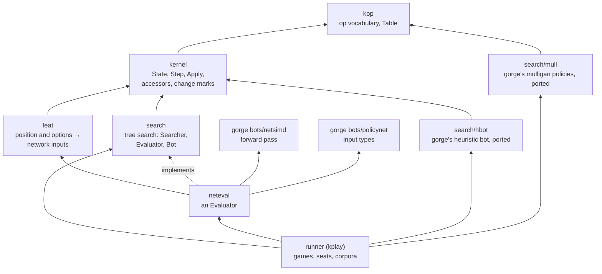
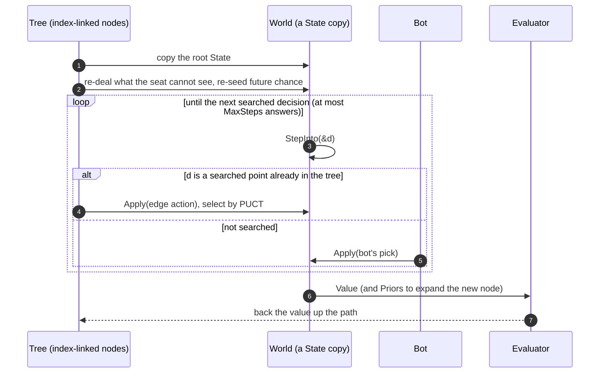
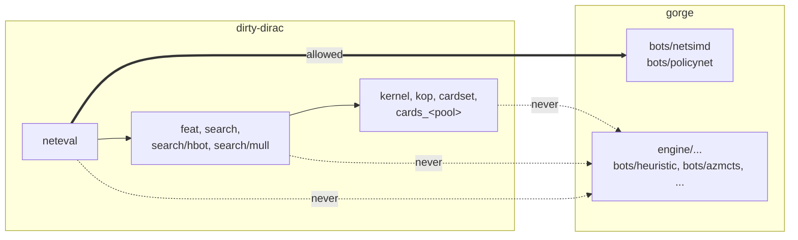

# Search on the kernel

dirty-dirac exists so that searches and self-play can step games cheaply.
This page describes, at the level of interfaces, how the pieces that do that
sit on the kernel: `search` (a tree search over kernel states), `feat` (the
encoder that turns a kernel position into network inputs), `neteval` (network
evaluation through gorge's `bots/netsimd`), and the native bot and mulligan
ports. It is for bot authors and contributors who want to know what the kernel
offers a search and where the import boundary runs. It reports no results;
for speed see [Performance](../../performance/index.md).

## The stack



Everything below `neteval` is pure kernel: no gorge import, no strings on the
hot path, no allocation per step. `neteval` is the single bounded exception,
and it reaches only gorge's network code, never gorge's engine. The runner is a
tool, not part of the kernel, and may import more of gorge (to load decks and
build per-card tables at start-up).

## What the kernel offers a search

A search needs four things from a game engine, and each is cheap here:

| Need | Kernel operation | Cost |
|---|---|---|
| copy a position | `w := *root` | one fixed-size copy ([State](state.md)) |
| enumerate a decision | `StepInto(&d)`: a `Decision` of packed `Action`s in canonical order | no allocation |
| apply a move | `Apply(a)` | no allocation |
| hide what the seat cannot see | `Hidden(o, seat)`, `HiddenCards`, `DealHidden` (re-deal the opponent's hidden cards from a pool), `RedealOwnLibrary`, `ReseedChance` | in place on the copy |

Read-only accessors (`ObjCard`, `ObjZone`, `Controller`, `PowerToughness`,
`HandSize`, `LibrarySize`, `StepNow`, ...) let a bot or an encoder read the
position without touching unexported fields, and the change marks
([Change marks](state.md#change-marks-and-incremental-readers)) let a reader
recompute only what a move changed.

## The search interface

The search is a port of gorge's
[`bots/azmcts`](https://github.com/adams-shaun/gorge/tree/main/bots/azmcts)
(an AlphaZero-style PUCT tree search over information sets) onto kernel
states. Its surface is three types:

```go
type Evaluator interface {
    Value(s *kernel.State, d *kernel.Decision, seat uint8) float32       // win probability for seat
    Priors(s *kernel.State, d *kernel.Decision, bot []bool, out []float32) // one logit per option
}

type Bot interface {
    Pick(s *kernel.State, d *kernel.Decision) int // answers every decision the tree does not search
}

sr := search.NewSearcher(opts, eval, bot) // the only allocation: node, edge and world arrays
res := sr.Search(&state, seatSeed)        // the seat's answer, visit counts, Q values, priors
```

Evaluators available: `Uniform` (value 0.5, uniform priors, the zero-cost
stub), `HeuristicLeaf` (a hand-written position value), and `neteval.Net` (a
trained network). Bots: a small built-in heuristic, and `hbot`, a native port
of gorge's auto-pay heuristic bot from
[`bots/heuristic`](https://github.com/adams-shaun/gorge/tree/main/bots/heuristic)
that reads the kernel state through fixed arrays. `mull` ports gorge's named
mulligan policies (`coin`, `lands`, `never`, `constructed`, `forge`) the same way.

### One simulation



- **One tree per searched decision**, over the searching seat's decisions
  (optionally the opponent's too), with one perspective: every value is the
  seat's win probability.
- **Information sets.** Each simulation re-deals the hidden cards (the seat's
  own library order, the opponent's hand and library, optionally from a list of
  the decks the opponent might be playing) from a per-decision seed, so the tree
  averages over the worlds the seat cannot tell apart. A child's availability
  counts the simulations in which it was legal.
- **Candidates.** Not every option becomes an edge. Priority decisions offer
  pass, casts and activations; attack and block declarations are whole
  candidate sets (the bot's, none, all-in, each option toggled); the bot's own
  answer is always candidate 0 and wins ties.
- **No rollouts.** A leaf is evaluated once by the Evaluator and the value is
  backed up undiscounted; the move is the most-visited root child.
- **Deterministic.** Seeds come from the seat's seed and the decision's
  sequence number, so the same position, seed and options give the same
  search.
- **No allocation.** Nodes and edges are preallocated arrays linked by index,
  not by pointer, and `Search` allocates nothing.

Where the port differs from `azmcts` is mostly the decision grammar: gorge
poses attackers, blockers and target sets as one multi-select, the kernel asks
one pick at a time, so a declaration is scored as a set at its first pick and
replayed pick by pick.

## Featurisation: `feat`

A network trained on gorge's inputs can only be used on the kernel if the
kernel produces **the same inputs**. `feat` encodes a kernel position, for the
deciding seat, into exactly what gorge's
[`bots/policynet`](https://github.com/adams-shaun/gorge/tree/main/bots/policynet)
produces from gorge's redacted view of the same seat: the dense scalars, the
sorted hashed sparse bag, one entity row per visible card, and one encoding per
option. The oracle checks this byte for byte at every lockstep decision
([Network-input parity](oracle.md#network-input-parity)).

Two problems had to be solved to get there:

- **No strings.** `policynet` hashes card names, type lines, mana costs and
  keyword spellings. The kernel holds none of those. Every string-derived fact
  is precomputed once per card ID into a feature pool when the card set is
  loaded; the hot path streams FNV-1a over those precomputed rows and the
  kernel's own numbers. `feat`'s output types are layout-compatible with
  `policynet`'s, with fixed-capacity storage, and an encode allocates nothing.
- **A different option list.** The network was trained on gorge's decisions,
  whose option lists differ from the kernel's in order, in count (gorge lists
  mana taps, concede and synthetic plain casts) and in shape (multi-selects). The
  encoder places every kernel option at the position gorge's list would give
  it, synthesising gorge's list from kernel state, so the option index feature
  matches. Options gorge has no entry for (the kernel's `Done`) are encoded
  but never scored.

An incremental encoder regenerates only the cards whose inputs changed since
the base position; it is asserted equal to the full encoder.

## Network evaluation: `neteval`

`neteval.Net` implements `search.Evaluator` by feeding `feat`'s encoding to
gorge's `bots/netsimd`: a forward pass for gorge's multilayer perceptron
(MLP) weight format, with whole-layer AVX-512 kernels and a scalar fallback
of identical semantics.

- **Value** is the value head through a sigmoid; **Priors** are the option
  logits over the kernel decision's options, with the bot's answer marked as
  gorge's search marks it; `search` composes candidate priors from them
  (a set's log-likelihood for a declaration) and applies a softmax.
- **Sharing.** Weights are loaded once and shared read-only; each goroutine
  owns a `Net` with its own encoder and scratch.
- **Caching.** An optional direct-mapped cache keyed by a content hash of what
  the seat can see (built from the per-object hashes) answers repeated
  positions exactly, including across search worlds that hold the same
  objects.
- **No allocation** per evaluation once the scratch has grown.
- **Shapes.** Any trunk depth and head depth the trainer exports (`layers`,
  `policy_layers`, `value_layers`), at any width that is a multiple of 32.
  The production shape (d = head width = 64) takes dedicated 64-lane kernels;
  every other width takes width-generic AVX-512 kernels that are bit-identical
  to their scalar twins.

## The import boundary



The kernel packages (`kernel`, `kop`, `cardset`, the generated `cards_*`,
`feat`, `search`, `search/hbot`, `search/mull`) have no gorge package among
their dependencies; `neteval`'s only gorge imports are `bots/netsimd` and
`bots/policynet` (which itself links gorge's engine types; `neteval` calls
none of the engine). Checked with `go list` on 2026-10-25. The behaviours ported from gorge (the search, the
heuristic bot, the mulligan policies, the input encoding) are re-implemented on
kernel types, not called, because a gorge `decision.Decision` or `view.View`
does not exist on the kernel's hot path. Their agreement with gorge is
measured by parity checks against the originals, in the same spirit as the
lockstep oracle.
