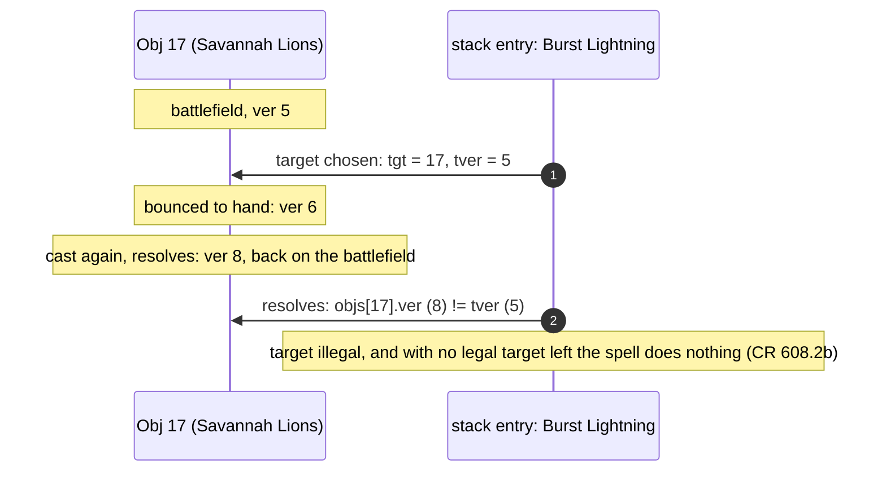

# State

A dirty-dirac game is one Go value, `kernel.State`. This page shows what is
inside it and why it is laid out that way: the memory map, the battlefield and
its slot masks, how an object keeps its identity across zones, the change marks
that let readers work incrementally, the size budget that governs growth, and
the canonical `Projection` the oracle compares. It is for readers who want to
know what "clone = assignment" costs and what it rules out.

*Sizes on this page were read on 2026-10-25 from the dirty-dirac source of
that day, with Go 1.26.3 on linux/amd64, by a scratch program that walks
`reflect.TypeOf(kernel.State{})` and prints each field's offset and size
(`reflect.Type.Size` is `unsafe.Sizeof`).*

## The rule: a value, not a graph

The `State` type's own doc comment is the contract: *"a whole game: a
fixed-size value with no pointers, maps, slices, strings or interfaces. Clone
= assignment."* Every field is a number, a bool, a fixed array or a struct of
those. Three things follow, and each one is why the kernel exists:

1. **A clone is `w := *root`.** One 15,240-byte copy, no allocation, no
   pointer fix-up. A search can afford one per simulation.
2. **The garbage collector never looks inside.** A `State` contains no
   pointers, so a heap of them is not scanned.
3. **Equal positions compare equal.** `Projection` (below) is a plain struct,
   so two positions are compared with `==`.

The cost is that every collection has a fixed capacity
([Scope](index.md#scope)) and that anything variable-length lives outside the
state: card definitions, filters and op programs are in the card table
(`kop.Table`, see [Cards](cards.md)), which a `State` names by a 16-bit index
into a process-wide table registry rather than by a pointer.

## Memory map

<figure markdown>
<svg viewBox="0 0 760 430" width="100%" role="img" aria-label="Memory map of kernel.State: thirteen regions in offset order with bars proportional to their size; the battlefield (7,452 bytes), the generated-table extension (3,344 bytes) and the object table (1,540 bytes) are the largest; 15,240 bytes in total">
  <text x="12" y="22" class="dg-text-bold">kernel.State: 15,240 bytes, in offset order</text>
  <text x="262" y="22" text-anchor="end" class="dg-text-muted">offset</text>
  <text x="276" y="22" class="dg-text-muted">size (bar to scale)</text>
  <g>
    <text x="12" y="48" class="dg-text">header: turn, step, active, priority, config</text>
    <text x="262" y="48" text-anchor="end" class="dg-text-muted">0</text>
    <rect x="270" y="36" width="2" height="16" class="dg-box-solid"/>
    <text x="278" y="48" class="dg-text-mono">16 B</text>

    <text x="12" y="74" class="dg-text">RNG: PCG, draw count, chance record</text>
    <text x="262" y="74" text-anchor="end" class="dg-text-muted">16</text>
    <rect x="270" y="62" width="9" height="16" class="dg-box-solid"/>
    <text x="285" y="74" class="dg-text-mono">168 B</text>

    <text x="12" y="100" class="dg-text">players [2]: life, zones, mana pool</text>
    <text x="262" y="100" text-anchor="end" class="dg-text-muted">184</text>
    <rect x="270" y="88" width="29.2" height="16" class="dg-box-solid"/>
    <text x="305" y="100" class="dg-text-mono">544 B (272 each)</text>

    <text x="12" y="126" class="dg-text">objects [192]: card, owner, zone, version</text>
    <text x="262" y="126" text-anchor="end" class="dg-text-muted">728</text>
    <rect x="270" y="114" width="82.7" height="16" class="dg-box-solid"/>
    <text x="359" y="126" class="dg-text-mono">1,540 B (8 each)</text>

    <text x="12" y="152" class="dg-text">battlefield perms [128], layer stamps</text>
    <text x="262" y="152" text-anchor="end" class="dg-text-muted">2,268</text>
    <rect x="270" y="140" width="400" height="16" class="dg-box-solid"/>
    <text x="676" y="152" class="dg-text-mono">7,452 B</text>

    <text x="12" y="178" class="dg-text">slot masks: occupied, by controller, per event</text>
    <text x="262" y="178" text-anchor="end" class="dg-text-muted">9,720</text>
    <rect x="270" y="166" width="25.8" height="16" class="dg-box-solid"/>
    <text x="302" y="178" class="dg-text-mono">480 B</text>

    <text x="12" y="204" class="dg-text">stack [24]</text>
    <text x="262" y="204" text-anchor="end" class="dg-text-muted">10,200</text>
    <rect x="270" y="192" width="33.6" height="16" class="dg-box-solid"/>
    <text x="310" y="204" class="dg-text-mono">626 B (26 per entry)</text>

    <text x="12" y="230" class="dg-text">pending triggers [24], order, delayed [16]</text>
    <text x="262" y="230" text-anchor="end" class="dg-text-muted">10,826</text>
    <rect x="270" y="218" width="23.9" height="16" class="dg-box-solid"/>
    <text x="300" y="230" class="dg-text-mono">446 B</text>

    <text x="12" y="256" class="dg-text">cast in progress + resolution in progress</text>
    <text x="262" y="256" text-anchor="end" class="dg-text-muted">11,272</text>
    <rect x="270" y="244" width="10" height="16" class="dg-box-solid"/>
    <text x="286" y="256" class="dg-text-mono">186 B</text>

    <text x="12" y="282" class="dg-text">mulligan, combat, damage division</text>
    <text x="262" y="282" text-anchor="end" class="dg-text-muted">11,458</text>
    <rect x="270" y="270" width="9.3" height="16" class="dg-box-solid"/>
    <text x="285" y="282" class="dg-text-mono">174 B</text>

    <text x="12" y="308" class="dg-text">change marks, stamps, undo, counters</text>
    <text x="262" y="308" text-anchor="end" class="dg-text-muted">11,632</text>
    <rect x="270" y="296" width="13.7" height="16" class="dg-box-solid"/>
    <text x="290" y="308" class="dg-text-mono">256 B</text>

    <text x="12" y="334" class="dg-text">generated-table extension (genState)</text>
    <text x="262" y="334" text-anchor="end" class="dg-text-muted">11,888</text>
    <rect x="270" y="322" width="179.5" height="16" class="dg-box-accent"/>
    <text x="456" y="334" class="dg-text-mono">3,344 B</text>

    <text x="12" y="360" class="dg-text">decision counter</text>
    <text x="262" y="360" text-anchor="end" class="dg-text-muted">15,232</text>
    <rect x="270" y="348" width="2" height="16" class="dg-box-solid"/>
    <text x="278" y="360" class="dg-text-mono">8 B</text>
  </g>
  <line x1="12" y1="380" x2="748" y2="380" class="dg-line"/>
  <text x="12" y="402" class="dg-text-muted">Sizes include alignment padding. Scale: the battlefield bar is 7,452 bytes.</text>
  <text x="12" y="420" class="dg-text-muted">For comparison: Decision 1,544 B, Projection 24,864 B, Action 4 B.</text>
</svg>
<figcaption>Every region of <code>kernel.State</code>, measured 2026-10-25. The
accented region is the extension only a generated card table uses; a
hand-written test table never touches it.</figcaption>
</figure>

What each region holds, and the design choice behind it:

| Region | Holds | Why it looks like this |
|---|---|---|
| Header | turn (`uint16`), step, active player, priority holder and pass count, starting player, config bits, a timestamp counter | config is folded into bits so that a `Config` struct never has to be carried |
| RNG | `math/rand/v2`'s PCG state (two `uint64`s), the draw count, the seed, and an optional record of every draw's bound | a `rand.Rand` holds an interface, so the kernel keeps the bare PCG and reimplements `IntN` ([Step and Apply](step-apply.md#rng-compatibility-with-gorge)) |
| Players | per seat: life, the library (68 slots read as a `[lo, hi)` window, so putting a card on top or bottom is O(1) most of the time), hand, graveyard and exile (60 each, in arrival order), mana pool by colour, lands played, per-turn life gained and lost, extra turns | zones are arrays of `Obj` indices, not of cards: a card's data lives once, in the object table |
| Objects | 192 records of 8 bytes: card ID, owner, zone, battlefield slot, version, activations this turn, flags (token, copy, ...) | every card instance has a fixed index for the whole game ([Object identity](#object-identity-and-versioning)) |
| Battlefield | 128 `perm` records of 56 bytes, a 16-bit layer timestamp per slot, and up to 8 records counting keyword grants past the third | a permanent's mutable state (tapped, damage, counters, until-end-of-turn pumps and grants, attachments, combat role, override record) is a slot, separate from the object |
| Slot masks | one 128-bit set (two words) per question the rules ask often | see [The battlefield and its slot masks](#the-battlefield-and-its-slot-masks) |
| Stack | 24 entries of 26 bytes: kind, source object and its version, card, ability, controller, modes, X, flags, up to 3 targets each with its version, the triggering object, player and amount, the triggering spell's mana value, and one-byte indexes into the last-known-information pool and the extra-target pool | a stack entry is small enough to copy; it refers to objects by index and version, and to anything larger by a pool index |
| Pending triggers | 24 triggers of 14 bytes waiting to be put on the stack (APNAP), the order picks so far, 16 delayed triggers ("at the next end step" and the like) | triggers are queued, then ordered by the controller, then pushed |
| In progress | the cast or activation being built (stage, targets so far, cost picks) and the resolution being executed (program counter, the ask it is suspended on, looked-at cards, loop counters) | `Step` can stop in the middle of a cast or a resolution and `Apply` resumes it, with no Go stack to save |
| Mulligan, combat | mulligan round state; attackers declared, first-strike step, block order, the damage division in progress | |
| Change marks | a 192-bit set of objects written since an epoch, a touch counter, a per-object stamp, undo bookkeeping, per-seat counts of elided decisions | see [Change marks](#change-marks-and-incremental-readers) |
| Generated-table extension | the continuous-effect pool (16 records), the last-known-information pool (16 records), remembered and chosen objects, damage maps, play permissions, delayed programs, emblems, once-per-turn records, per-turn history counters (spells cast, abilities activated, zone entries), poison, energy and speed, as-enters asks, exile-until-leaves links, replacement-order state | the state the generated card tables need; zero and unused on a hand-written table |

Two layout decisions are visible in the map:

- **Counters are sparse.** A permanent keeps a dedicated +1/+1 count and
  three general slots, each a (kind, count) pair kept sorted so that equal
  counter states are equal bytes. A fourth distinct kind on one permanent
  stalls the game. Dense per-kind arrays would cost 2 bytes per kind on
  every slot; the sparse layout keeps that cost fixed and lets the number of
  counter kinds grow at no cost to `State`.
- **Last known information is pooled.** A stack entry or pending trigger that
  must remember an object as it last existed (CR 608.2h: a dies trigger
  reading the creature's power) holds a one-byte index into a shared,
  reference-counted pool of 16 snapshots keyed by object and version, instead
  of carrying its own copy.

## The battlefield and its slot masks

The battlefield is `perms [128]perm`. A permanent occupies a **slot**
(`Slot`, a `uint8`; 255 is "none") for as long as it stays on the battlefield,
and its object record points at the slot. Because there are at most 128
slots, every set of permanents the rules ask about is one 128-bit mask, two
`uint64` words:

<figure markdown>
<svg viewBox="0 0 760 300" width="100%" role="img" aria-label="The first sixty-four of the 128 battlefield slots with six slot masks beneath them: occupied, controlled by seat 0, controlled by seat 1, subscribers to the dies event, has a static ability, legendary. A query such as seat 1's permanents with a dies trigger is one AND of three masks.">
  <text x="12" y="22" class="dg-text-bold">perms [128] and the masks over them (example position, slots 0 to 63)</text>
  <text x="150" y="44" class="dg-text-muted">0</text>
  <text x="214" y="44" class="dg-text-muted">8</text>
  <text x="278" y="44" class="dg-text-muted">16</text>
  <text x="342" y="44" class="dg-text-muted">24</text>
  <text x="406" y="44" class="dg-text-muted">32</text>
  <text x="470" y="44" class="dg-text-muted">40</text>
  <text x="534" y="44" class="dg-text-muted">48</text>
  <text x="598" y="44" class="dg-text-muted">56</text>
  <text x="654" y="44" class="dg-text-muted">63</text>

  <text x="12" y="64" class="dg-text-mono">perms</text>
  <rect x="150" y="52" width="512" height="16" class="dg-box-muted"/>
  <rect x="150" y="52" width="8" height="16" class="dg-box"/><rect x="158" y="52" width="8" height="16" class="dg-box"/><rect x="166" y="52" width="8" height="16" class="dg-box"/><rect x="174" y="52" width="8" height="16" class="dg-box"/><rect x="190" y="52" width="8" height="16" class="dg-box"/><rect x="214" y="52" width="8" height="16" class="dg-box"/><rect x="222" y="52" width="8" height="16" class="dg-box"/>
  <text x="672" y="64" class="dg-text-muted">56 B each</text>

  <text x="12" y="94" class="dg-text-mono">occ</text>
  <rect x="150" y="82" width="512" height="14" class="dg-box"/>
  <rect x="150" y="82" width="8" height="14" class="dg-box-solid"/><rect x="158" y="82" width="8" height="14" class="dg-box-solid"/><rect x="166" y="82" width="8" height="14" class="dg-box-solid"/><rect x="174" y="82" width="8" height="14" class="dg-box-solid"/><rect x="190" y="82" width="8" height="14" class="dg-box-solid"/><rect x="214" y="82" width="8" height="14" class="dg-box-solid"/><rect x="222" y="82" width="8" height="14" class="dg-box-solid"/>
  <text x="672" y="94" class="dg-text-muted">occupied</text>

  <text x="12" y="118" class="dg-text-mono">ctrlM[0]</text>
  <rect x="150" y="106" width="512" height="14" class="dg-box"/>
  <rect x="150" y="106" width="8" height="14" class="dg-box-solid"/><rect x="166" y="106" width="8" height="14" class="dg-box-solid"/><rect x="190" y="106" width="8" height="14" class="dg-box-solid"/><rect x="214" y="106" width="8" height="14" class="dg-box-solid"/>
  <text x="672" y="118" class="dg-text-muted">seat 0 controls</text>

  <text x="12" y="142" class="dg-text-mono">ctrlM[1]</text>
  <rect x="150" y="130" width="512" height="14" class="dg-box"/>
  <rect x="158" y="130" width="8" height="14" class="dg-box-solid"/><rect x="174" y="130" width="8" height="14" class="dg-box-solid"/><rect x="222" y="130" width="8" height="14" class="dg-box-solid"/>
  <text x="672" y="142" class="dg-text-muted">seat 1 controls</text>

  <text x="12" y="166" class="dg-text-mono">subs[TrigDies]</text>
  <rect x="150" y="154" width="512" height="14" class="dg-box"/>
  <rect x="166" y="154" width="8" height="14" class="dg-box-solid"/><rect x="222" y="154" width="8" height="14" class="dg-box-solid"/>
  <text x="672" y="166" class="dg-text-muted">1 of 22 events</text>

  <text x="12" y="190" class="dg-text-mono">statM</text>
  <rect x="150" y="178" width="512" height="14" class="dg-box"/>
  <rect x="190" y="178" width="8" height="14" class="dg-box-solid"/>
  <text x="672" y="190" class="dg-text-muted">has a static</text>

  <text x="12" y="214" class="dg-text-mono">legM</text>
  <rect x="150" y="202" width="512" height="14" class="dg-box"/>
  <rect x="214" y="202" width="8" height="14" class="dg-box-solid"/>
  <text x="672" y="214" class="dg-text-muted">legendary</text>

  <line x1="12" y1="232" x2="748" y2="232" class="dg-line"/>
  <text x="12" y="254" class="dg-text">"Seat 1's permanents with a dies trigger" is one AND per mask word:</text>
  <text x="12" y="276" class="dg-text-mono">ctrlM[1].and(occ).and(subs[TrigDies])   →   slot 9</text>
  <rect x="492" y="264" width="8" height="14" class="dg-box-solid"/>
</svg>
<figcaption>An illustrative position: seven permanents, four controlled by seat
0 and three by seat 1. Each mask is two <code>uint64</code> words; only the low
word (slots 0 to 63) is drawn. A lit cell is a set bit.</figcaption>
</figure>

The masks the `State` keeps up to date as permanents enter, leave and change
control:

| Mask | Set when |
|---|---|
| `occ` | the slot holds a permanent |
| `ctrlM[p]` | seat `p` controls it |
| `subs[e]`, one per slot-subscribed trigger event (22 events: enters, dies, leaves, attacks, spell cast, life gained, damage dealt, becomes target, sacrificed, taps, ...) | the permanent's card has a triggered ability listening for event `e`, so an event scans only its subscribers |
| `statM` | the card has a static ability |
| `fxM` | the permanent has a record in the continuous-effect pool |
| `grantM` | the card's static can grant an ability |
| `legM` | the card is legendary (legend-rule candidates) |

Eight rarer trigger events (a gift given, a proliferate, a token created, a
permanent becoming monstrous, turned face up or transformed, a crime
committed, a door unlocked) keep no mask: the kernel scans the battlefield
when one happens. The
generated-table extension adds more slot masks of the same kind (cast this
turn, kicked, sacrifice order, damage-sequence order, ...).

Iterating a mask is the usual lowest-set-bit loop, in ascending slot order:

```go
for m := x; m.any(); m = m.rest() { // rest clears the lowest bit
    sl := m.first()                 // TrailingZeros64
    // ...
}
```

`slotMask` is a struct of two `uint64` fields, `lo` and `hi`, not a
`[2]uint64`. Go keeps no array of more than one element in registers, so the
array form lived on the stack and a 128-slot build measured markedly
slower per transition; a two-field struct is split into two registers, so mask
loops stay in registers. Every helper tests the low word first, since a
normal board never leaves it. A compile-time assertion pins `MaxPerm` at 128:
a wider board needs a third word, not a re-sized array.

The battlefield's *order* (gorge lists each controller's permanents in entry
order) is not the slot order: slots are reused. Each `perm` carries an entry
timestamp, and the projection sorts by it when it needs the list.

## Object identity and versioning

Every card instance is an **object**, `Obj` (a `uint8`), with a fixed index
for the whole game:

- objects `0 .. len(deckA)-1` are seat 0's deck in deck-list order;
- the next `len(deckB)` are seat 1's deck;
- tokens and copies take the following indices in creation order.

That is exactly the relative order of gorge's `ObjID`s (gorge's genesis adds
each seat's deck in deck order and mints tokens later), so the oracle can map
one engine's objects to the other's by index. Target bytes reserve `0xF0` and
`0xF1` for the two players and `0xFF` for "none", which is why `MaxObj` may be
at most 240; a compile-time constant conversion fails the build if it grows
past that.

An object keeps its index when it changes zones, but the CR says it becomes a
**new object** (CR 400.7): a spell targeting a creature that was bounced and
recast must not find it again. The kernel models this with an 8-bit
**version** on each object, bumped on every zone change. A stack entry stores,
for each target, the target's version at the moment it was chosen; at
resolution (CR 608.2b) a target whose version moved is illegal.



The same check applies to an ability's source (`srcVer`): an activated or
triggered ability whose source left and came back no longer reads the new
object's characteristics. Abilities that need to see a creature as it last
existed snapshot it into the last-known-information pool when the trigger is
queued or the cost is paid.

## Change marks and incremental readers

A search clones the root thousands of times, and most objects in a clone are
unchanged from the root. Two readers exploit that: the network-input encoder
and the evaluation cache (see [Search](search.md)). The state supports them
with **change marks**:

- `chg` is a 192-bit set; every write to an object or to its battlefield slot
  goes through `touch(o)`, which sets the object's bit, bumps a touch counter
  and stamps the object with it;
- `SetEpoch` clears the marks and names the current state as a base. A clone
  carries the base's epoch and marks, so an unmarked object in any clone is
  field for field the base's;
- `ObjHash` is an object's content hash, a pure function of its fields, so two
  worlds holding the same object hash the same.

Marks are allowed to over-report (an extra recomputation) but never to miss.
The kernel's tests check, after every action of a long soak, that each unmarked
object still hashes as it did.

## The size budget

`State` is the kernel's one scarce resource: every byte is copied on every
clone, so its size is treated as a budget.

- **Today: 15,240 bytes.** A size test fails the build above 16 KiB. The
  limit was 12 KiB until the battlefield doubled from 64 to 128 slots; padding
  `State` to 12,288 and 16,384 bytes had left the transition, whole-game and
  search benchmarks within about 2 % of the unpadded size.
- **The table holds what is printed; `State` holds what changes.** No field
  in `State` is specific to a card. A rule that only some cards need is a
  pool of records sized for the worst case seen in play, not a per-object
  field.
- **Per-slot bytes are expensive.** One byte on `perm` costs 128 bytes of
  `State`, one byte on `object` 192. A new mechanism brings its own block,
  with its byte cost measured before it lands.
- **A feature that is off costs one branch.** Each block is gated by a flag
  computed once per card table (does this table contain any card that uses
  it?). A table that never needs a block pays one predictable branch at its
  sites, and the code behind the gate is kept out of line so it does not
  disturb the hot loop's layout.

The current layout added the continuous-effect pool, per-slot layer timestamps and
turn history while keeping `State` under 10 KB: sparse counters and the
shared last-known-information pool paid for the additions. Doubling the
battlefield to 128 slots then took it to 15,240 bytes, most of that in the
per-slot `perm` records.

## The Projection

`Project` writes a `kernel.Projection` (24,864 bytes): the comparable view of
a position, used by the oracle and by tests.

| Part | Contents |
|---|---|
| per object, in `Obj` order (192 × 94 B) | card, owner, controller, zone, position in its zone (library from the top; hand, graveyard and exile in arrival order; battlefield in its controller's entry order), token bit, tapped / attacking / blocking / summoning-sick / copy / monstrous / face-down flags, damage, counters by kind, derived power and toughness (battlefield creatures), attached-to, the attacker it blocks, the defender it attacks |
| derived characteristics, per object (192 × 32 B) | the types, subtypes, colours and keywords after the layer system, for battlefield objects |
| per seat | life, lands played, mana pool, library / hand / graveyard / exile sizes |
| the stack, bottom to top (24 × 26 B) | kind (spell, activated, triggered), source, card, ability index (255 for a permanent spell), controller, targets including the extra objects of a multi-object target slot, modes, X |
| the rest | turn, step, active player, priority holder, RNG draw count, game over, winner |

Every field is a fixed array, and **equal positions project equal**, so a
comparison is `==`. Two details matter for lockstep with gorge:

- **When something is on the stack.** A spell is on the stack from the moment
  gorge pushes it (after its X and cost picks, before modes and targets); an
  activated ability only after its targets and costs; a triggered ability
  before its targets. The kernel pushes at the same points so the stacks
  project the same mid-cast.
- **Steps.** The kernel splits gorge's combat-damage step into a first-strike
  damage step and a regular damage step (`kop.Step`); the oracle maps them
  back.

The counter array keeps the kinds the network inputs read in a fixed layout;
counter kinds added later sit in a separate array, so the input layout that
trained networks consume does not move when the kernel learns a new counter.

`ProjectDelta` and `ProjectSince` update an existing projection from the change
marks instead of rebuilding it, for readers that project every node of a
search.

The oracle compares not this struct but its own canonical projection, built
from both engines; see [Verification](oracle.md#the-canonical-projection).
