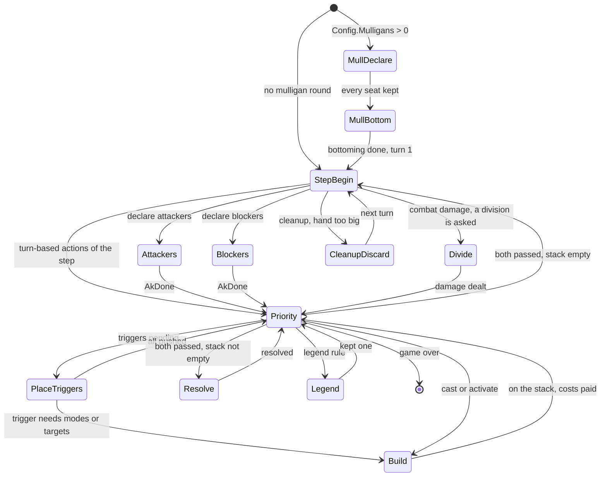

# Step and Apply

dirac has no event loop and no host. A game is driven by two methods on the `State` value: `Step` runs the game
forward to its next question, and `Apply` answers it. This page is for anyone who wants to know what a driver, a
bot or a search would write against dirac, and how its decisions compare with gorge's
[Game loop and decisions](../gorge/game-loop.md).

## The loop

```go
var d dirac.Decision
s := dirac.NewConfig(tbl, deckA, deckB, seed, dirac.Config{Mulligans: 2})
for {
    s.StepInto(&d)               // Step() returns a copy; StepInto fills d in place
    if d.Kind == dirac.DkNone {
        break                    // game over
    }
    s.Apply(d.Options[pick(&d)]) // must be one of d.Options[:d.N]
}
over, winner := s.Terminal()     // winner -1 is a draw
```

| | gorge | dirac |
|---|---|---|
| Run to the next question | `Advance()` emits events until a decision is pending | `Step()` or `StepInto(&d)` writes the value until a decision has options |
| The question | `decision.Decision`: kind, player, labelled options, `Min`/`Max` | `Decision`: kind, sub-kind, player, `N` options, each a 32-bit `Action` |
| The answer | an `Intent` of option indices, validated against the decision | one `Action`, not re-validated: the caller is trusted |
| Answers per decision | a subset | exactly one pick; a multi-select becomes a sequence of picks |
| Recorded | the intent is appended to the log | nothing; `Decisions` counts the answers |

`StepInto` does two things to each decision before returning it. It sorts the options into a canonical order,
so a policy's choice doesn't depend on storage order. By default it also answers a decision with one option in
place and counts it in `State.Skipped`, chiefly the priority rounds where passing is the only legal action.
`Config.NoElide` turns that off, as the oracle does.

## The control-state machine

`Step` and `Apply` both dispatch on one byte, `State.ctl`, which says where the game is waiting. `Step` does the
rules work for the current state (turn-based actions, state-based actions, triggers, resolving the top of the
stack) until a state produces a decision. `Apply` performs the answer and moves on. Everything needed to resume is
in the value (the entry being built, a suspended program's position), so a game can stop in the middle of a cast
or a resolution with no Go stack to save.



The turn structure follows gorge's `engine/rules` exactly, because lockstep compares every priority decision. Untap
and cleanup pose no priority. Every other step runs a full priority round even when nothing can happen. The starting
player skips the turn-1 draw. With no attackers declared the game jumps from declare attackers to end of combat.
State-based actions run after each combat-damage pass.

## Decision and Action

A `Decision` is a kind, a sub-kind, a player and up to 384 options (`MaxOptions`), 1,544 bytes in all, which is why
`StepInto` exists. An `Action` is one packed `uint32`:

```text
kind << 24 | source << 16 | target << 8 | mode
```

`source` and `target` are `Obj` indices. Bytes `0xF0` and up in a target are the two players and "none", which is why
`MaxObj` can't pass 240. `MakeAction`, `Kind()`, `Source()`, `Target()` and `Mode()` encode and decode it. Each of the
20 action kinds says which fields it uses: `AkCast`'s mode bits name the cast route, for example kicked, flashback or
a play permission. A granted activated ability is `AkActivate` with the creature as source, the granting permanent
as target and `0x80 | index` as mode.

## Decision kinds against gorge's

gorge has 13 decision kinds ([The 13 decision kinds](../gorge/game-loop.md#the-13-decision-kinds)), and dirac has 8
plus `DkNone`. gorge's multi-selects and several small kinds become `DkChoose` with a `Sub`, and every answer is one
pick.

| gorge kind | dirac | How it is posed |
|---|---|---|
| `priority` | `DkPriority` | pass, land plays, casts, activations, special actions. No mana abilities (costs are paid by the planner) and no concede |
| `target` | `DkTarget` | one pick per target; a multi-object slot is one pick per object, closed by `AkDone` once its minimum is met |
| `attackers` | `DkAttackers` | one `AkAttack` per attacker and defender, closed by `AkDone`; only picks that leave the declaration completable are offered |
| `blockers` | `DkBlockers` | one `AkBlock` per blocker and attacker, closed by `AkDone`; a menace attacker that fewer than two creatures could block is never offered |
| `modes` | `DkModes` | the mode pick; gorge's effect discards, posed as modes, become `DkChoose`/`ChDiscard` |
| `choose` | `DkChoose` + `Sub` | X, cost picks, the legend rule, combat damage division and the other generic asks |
| `trigger_order` | `DkTriggerOrder` | one `AkOrder` per trigger, every one posed; the group is pushed in pick order |
| `trigger_optional` | `DkChoose`/`ChOptional` | mode 1 yes, 0 no |
| `mulligan` | `DkMulligan`, then `DkChoose`/`ChBottom` | keep or mulligan, then one bottoming pick per card |
| `arrange` | `DkChoose`/`ChArrange` | scry and surveil: each pick is the next card from the top, closed by `AkDone` |
| `replacement` | `DkChoose`/`ChGenReplOrder` | the CR 616.1 order among competing replacement effects |
| `starting_player` | not posed | the toss winner takes the first turn, as with gorge's plain `rules.New` |
| `commander_zone` | not applicable | no Commander |

Generated card tables raise further `Sub` values (a hybrid pip's colour, a pile split, a card to cast free). A bot
that only understands the common ones can still answer the rest, because every option is a complete `Action`.

## RNG

gorge's engine RNG is `math/rand/v2`'s PCG seeded with `(seed, seed ^ 0x9e3779b97f4a7c15)`, drawn through
`rand.Rand.IntN`, with a counter of every draw. A `rand.Rand` holds an interface, which the core of `State` may not
contain, so dirac keeps the bare PCG in the value and reimplements `IntN` with the same reduction. The draw order
also matches: the coin toss first, then each seat's Fisher-Yates shuffle of its whole library in seat order, then seven
cards. A London mulligan puts the hand on the library, shuffles and draws seven, then bottoms one pick per card.

That is what makes lockstep possible:

- **Same seed, same game.** With the same decks, seed and answers, both engines deal the same hands and resolve every
  random effect alike, so they can be compared position by position.
- **An early alarm.** The draw count is in both projections. If one engine draws a random number the other doesn't, the
  next comparison fails on that field instead of many turns later when a different card shows up.
- **Replay across engines.** With `Config.RecordChance`, dirac records the bound of every draw and `ChanceTranscript`
  recomputes the values. The oracle forces those outcomes on gorge, so a game dirac played alone can be re-executed in
  gorge and checked ([Verification](oracle.md#finding-and-reproducing-a-difference)).

A search re-seeds a simulated world with `ReseedChance` and re-deals what the searching seat can't see. Those are
deliberate departures from the real game's stream, made only on copies.

## Configuration that changes behaviour

The defaults are what a search wants. The `Gorge*` switches exist so that the oracle can match gorge's option surface.

| Switch | Off (default) | On |
|---|---|---|
| `Mulligans` | 0: no round | the London mulligan limit |
| `NoElide` | a single option is answered in place | every decision is posed |
| `AutoDivide` | damage division among blockers is asked | divided automatically (lethal in block order, the rest to the last), which cuts branching |
| `ArrangeRestOrder` | the rest of a scry or surveil goes in library order | the answerer orders them too, for a host whose wire carries that order |
| `GorgeAutopaySurface`, `GorgeUnpriced`, `GorgeLowering` | every castable spell is offered and paid | casts gorge's payment planner doesn't price are offered only the way gorge reaches them |
| `GorgeAltAdd`, `GorgeMustAttack` | payable parts only; must-attack creatures are declared up front | posed the way gorge poses them |
| `RecordChance` | no record | every random draw is recorded for cross-engine replay |
