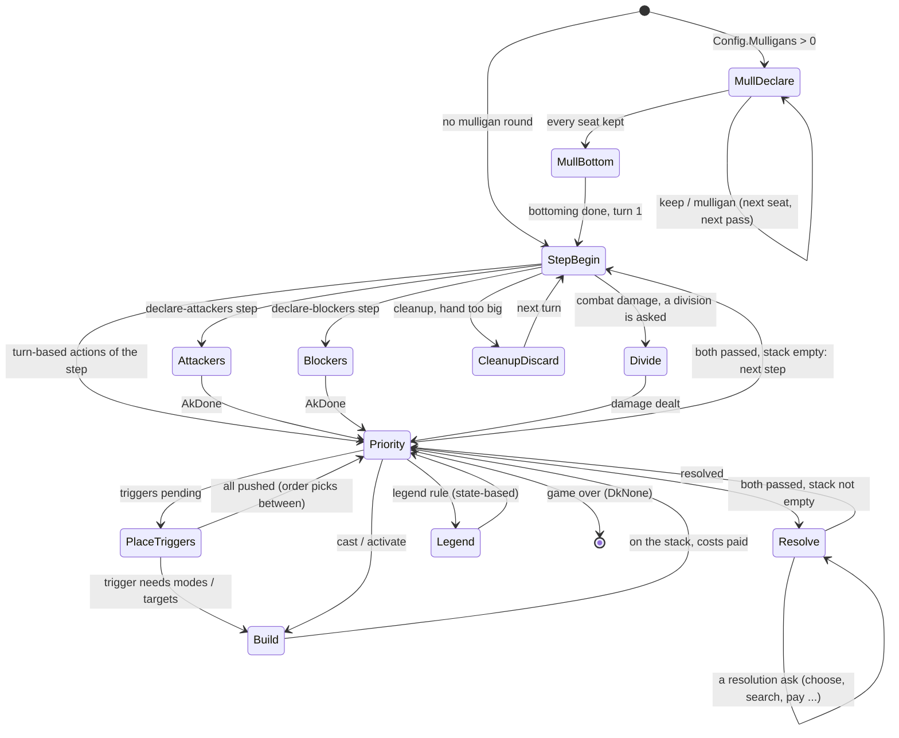

# Step and Apply

dirty-dirac has no event loop and no host. A game is driven by two methods on
the `State` value: `Step` runs the game forward to the next question and
returns it as a `Decision`; `Apply` answers it with one packed `Action`. This
page covers the control-state machine behind those two calls, the bit layout
of decisions and actions, how dirty-dirac's decision kinds line up with
gorge's, mulligans and the opening, and why its random number generator is
bit-for-bit gorge's. It is for anyone writing a driver, a bot or a search
against the kernel, and for readers comparing it with gorge's
[Game loop and decisions](../gorge/game-loop.md).

## The loop

```go
var d kernel.Decision
s := kernel.NewConfig(tbl, deckA, deckB, seed, kernel.Config{Mulligans: 2})
for {
    s.StepInto(&d)              // Step() returns a copy; StepInto fills d in place
    if d.Kind == kernel.DkNone {
        break                   // game over
    }
    s.Apply(d.Options[pick(&d)]) // must be one of d.Options[:d.N]
}
over, winner := s.Terminal()    // winner -1 is a draw
```

Compared with gorge's `Advance` / `Pending` / `Submit` contract:

| | gorge | dirty-dirac |
|---|---|---|
| Run to the next question | `Advance()` emits events until a decision is pending | `Step()` / `StepInto(&d)` mutates the value until a decision has options |
| The question | `decision.Decision`: kind, player, options with labels, `Min`/`Max` | `Decision`: kind, sub-kind, player, `N` options, each a 32-bit `Action` |
| The answer | an `Intent` of option indices, validated against the posed decision | one `Action`, which must be one of the options (not re-validated: the caller is trusted) |
| Answers per decision | a subset (`Min`..`Max`) | exactly one pick; multi-selects become a sequence of picks |
| Recorded | the intent is appended to the log | nothing is recorded; `Decisions` counts answers |

Two behaviours of `Step` matter to every caller:

- **Canonical order.** Before a decision is returned its options are sorted
  into the oracle's canonical order (a stable insertion sort; the lists are
  short). The same position always lists the same options in the same order.
- **Elision.** By default a decision with exactly one option (most often a
  priority decision where passing is the only legal play) is answered in place
  and counted in `State.Skipped[player]` instead of being returned.
  `Config.NoElide` poses every decision; the oracle sets it, because gorge
  poses them too.

## The control-state machine

`Step` and `Apply` both dispatch on one byte, `State.ctl`: where the game is
waiting. `Step` loops, doing the rules work for the current control state
(turn-based actions, state-based actions, putting triggers on the stack,
resolving the top of the stack) until a state produces a decision with at
least one option. `Apply` performs the answer for the current control state
and moves to the next. Because everything the machine needs to resume lives in
the value (the cast being built, the resolution's program counter, the
pending ask), the game can stop in the middle of a cast or a resolution with
no Go stack to save.



The real states are `ctlMullDeclare`, `ctlMullBottom`, `ctlStepBegin`,
`ctlPriority`, `ctlPlaceTriggers`, `ctlBuild`, `ctlAttackers`, `ctlBlockers`,
`ctlResolve`, `ctlLegend`, `ctlDivide`, `ctlCleanupDiscard` and `ctlOver`,
plus `ctlGenAsk` for the questions only a generated card table raises (an
as-enters colour or creature-type choice, a Leyline in the opening hand, a
replacement-effect order, a spell copy's new targets). Every state that can be
current when `Apply` is called has an `Apply` case; calling `Apply` in any
other state panics.

The turn structure follows gorge's `engine/rules` exactly, because lockstep
compares every priority decision: untap and cleanup pose no priority; every
other step runs a full priority round even when nothing can happen; the
starting player skips the turn-1 draw; with no attackers declared the game
jumps from declare attackers to end of combat; state-based actions run after
each combat-damage pass; drawing from an empty library loses at the next
state-based check.

## Decision

```go
type Decision struct {
    Kind    DecisionKind     // what is asked (DkNone: the game is over)
    Sub     ChoiceKind       // for DkChoose: what is being chosen
    Player  uint8            // who answers
    N       uint16           // number of options
    Options [384]Action      // MaxOptions
}
```

A `Decision` is 1,544 bytes. `MaxOptions = 384` is sized for the two largest
lists a game can produce: an any-target choice over a full board,
and a creature-type choice over gorge's 362-word creature-type vocabulary. Like
the state, a decision holds no slice, so a search can keep one per tree node
without allocating.

## Action: the bit packing

Every answer is one `uint32`:

<figure markdown>
<svg viewBox="0 0 760 300" width="100%" role="img" aria-label="The 32-bit Action word: bits 31 to 24 kind, 23 to 16 source, 15 to 8 target, 7 to 0 mode, with three worked examples">
  <text x="12" y="22" class="dg-text-bold">Action = kind&lt;&lt;24 | source&lt;&lt;16 | target&lt;&lt;8 | mode</text>
  <text x="40" y="48" class="dg-text-muted">31</text><text x="188" y="48" class="dg-text-muted">24</text>
  <text x="210" y="48" class="dg-text-muted">23</text><text x="358" y="48" class="dg-text-muted">16</text>
  <text x="380" y="48" class="dg-text-muted">15</text><text x="535" y="48" class="dg-text-muted">8</text>
  <text x="550" y="48" class="dg-text-muted">7</text><text x="705" y="48" class="dg-text-muted">0</text>
  <rect x="40" y="54" width="170" height="44" class="dg-box-accent"/>
  <rect x="210" y="54" width="170" height="44" class="dg-box"/>
  <rect x="380" y="54" width="170" height="44" class="dg-box"/>
  <rect x="550" y="54" width="170" height="44" class="dg-box"/>
  <text x="125" y="74" text-anchor="middle" class="dg-text-bold">kind</text>
  <text x="125" y="90" text-anchor="middle" class="dg-text-muted">ActionKind, 18 values</text>
  <text x="295" y="74" text-anchor="middle" class="dg-text-bold">source</text>
  <text x="295" y="90" text-anchor="middle" class="dg-text-muted">an Obj (the actor)</text>
  <text x="465" y="74" text-anchor="middle" class="dg-text-bold">target</text>
  <text x="465" y="90" text-anchor="middle" class="dg-text-muted">Obj, 0xF0/0xF1 player, 0xFF none</text>
  <text x="635" y="74" text-anchor="middle" class="dg-text-bold">mode</text>
  <text x="635" y="90" text-anchor="middle" class="dg-text-muted">kind-specific value</text>

  <text x="12" y="134" class="dg-text-bold">Examples</text>
  <text x="12" y="160" class="dg-text">cast a card kicked</text>
  <rect x="210" y="146" width="510" height="22" class="dg-box-muted"/>
  <text x="220" y="162" class="dg-text-mono">AkCast(2)   src=card 41   tgt=0      mode=0b00001 (bit 0 kicked)</text>
  <text x="12" y="192" class="dg-text">attack the opponent</text>
  <rect x="210" y="178" width="510" height="22" class="dg-box-muted"/>
  <text x="220" y="194" class="dg-text-mono">AkAttack(4) src=creature 7 tgt=0xF1 (seat 1)  mode=0</text>
  <text x="12" y="224" class="dg-text">choose X = 3</text>
  <rect x="210" y="210" width="510" height="22" class="dg-box-muted"/>
  <text x="220" y="226" class="dg-text-mono">AkChoose(9) src=0      tgt=0      mode=3   (Decision.Sub = ChX)</text>
  <text x="12" y="256" class="dg-text">a granted Equip ability</text>
  <rect x="210" y="242" width="510" height="22" class="dg-box-muted"/>
  <text x="220" y="258" class="dg-text-mono">AkActivate(3) src=creature tgt=equipment mode=0x80|ability</text>
  <text x="12" y="290" class="dg-text-muted">Object indices are below 0xF0 by construction (MaxObj = 192), so a target byte is never ambiguous.</text>
</svg>
<figcaption>The <code>Action</code> word. gorge's canonical option form in the
oracle uses the same four-byte layout over its own kinds, so the two can be
compared field by field.</figcaption>
</figure>

| Kind | Fields |
|---|---|
| `AkPass` | pass priority |
| `AkPlayLand` | source = the land in hand |
| `AkCast` | source = the card (hand, graveyard for flashback, another zone with a permission); mode bit 0 kicked (also an Offspring cast), bit 1 flashback, bit 2 a face of a multi-face card (target = the face), bit 3 cast through a play permission, bit 4 without paying its mana cost, bits 5 and 6 a warp cast from hand or a warped card recast from exile, bit 7 face down (morph, megamorph, disguise) |
| `AkActivate` | source = the permanent (or the graveyard card); mode = ability index, or `0x80` with target = the granting permanent for a granted ability |
| `AkAttack` | source = an attacker, target = the defending player or a planeswalker |
| `AkBlock` | source = a blocker, target = the attacker it blocks |
| `AkDone` | close a multi-pick declaration (attackers, blockers, an up-to target set, an arrange) |
| `AkTarget` | target = the chosen object or player, `NoTarget` for "none" in an up-to slot |
| `AkMode` | mode = the chosen mode of a modal spell |
| `AkChoose` | an answer to a `DkChoose`; `Decision.Sub` says which fields carry it |
| `AkKeep`, `AkMulligan` | the mulligan answer |
| `AkOrder` | trigger order: source = the trigger's source, target = its pending index, mode = its occurrence among triggers from that source |
| `AkTurnFaceUp`, `AkPlot`, `AkUnlock` | special actions: turn a face-down permanent face up, plot a card from hand, unlock a Room's door (mode = the door) |
| `AkCastCasualty`, `AkSneak` | source = a hand card cast with its casualty sacrifice, or for its sneak cost |

Packing everything into one word has two payoffs. A search tree's edges are
just `Action`s, so expanding a node never allocates. And because the oracle's
canonical form of a gorge option is packed the same way, comparing the two
engines' option lists is comparing two sorted `[]uint32`.

## Decision kinds against gorge's

gorge has 13 decision kinds ([The 13 decision kinds](../gorge/game-loop.md#the-13-decision-kinds)).
dirty-dirac has 8 plus `DkNone`. The difference is mostly that gorge's
multi-selects and several small kinds become `DkChoose` with a sub-kind, and
every answer is one pick.

| gorge kind | dirty-dirac | How it is posed |
|---|---|---|
| `priority` | `DkPriority` | pass, land plays, casts, activations, special actions. No mana abilities (every cast is paid by the auto-pay planner) and no concede |
| `target` | `DkTarget` | one pick per target; a multi-object slot is one pick per object, closed by `AkDone` once its minimum is met |
| `attackers` | `DkAttackers` | one `AkAttack` per (attacker, defender), in any order, closed by `AkDone`; only picks after which the declaration can still be completed are offered |
| `blockers` | `DkBlockers` | one `AkBlock` per (blocker, attacker), closed by `AkDone`; a menace attacker that fewer than two blockers could block is never offered |
| `modes` | `DkModes` | the mode pick; gorge's effect discards (posed as `modes`) become `DkChoose` / `ChDiscard` |
| `choose` | `DkChoose` + `Sub` | X (`ChX`), cost picks (tap, sacrifice, discard, remove counters), the legend rule, combat damage division (one pick among every split, in gorge's order), and the generated-table asks (`ChGen*`: pay or not, search, dig, pile splits, colour, creature type, cast for free, ...) |
| `trigger_order` | `DkTriggerOrder` | one `AkOrder` per trigger, every one posed; the group is pushed in pick order |
| `trigger_optional` | `DkChoose` / `ChOptional` | mode 1 yes, 0 no |
| `mulligan` | `DkMulligan` + `DkChoose` / `ChBottom` | keep or mulligan, then one bottoming pick per card |
| `arrange` | `DkChoose` / `ChArrange` | scry and surveil: pick the cards to keep on top, first pick on top, closed by `AkDone` |
| `replacement` | `DkChoose` / `ChGenReplOrder` | the CR 616.1 order among competing replacement effects |
| `starting_player` | not posed | the toss winner takes the first turn, as with gorge's plain `rules.New` |
| `commander_zone` | not applicable | no Commander |

There are 18 base choice kinds and 45 more (two of them reserved or retired)
that only a generated card table raises (a gift promise, a hybrid pip's colour, a proliferate pick, ...). A search or a bot that only understands the base kinds can still answer
the generated ones generically, since every option is a complete `Action`.

## Mulligans and the opening

The opening follows gorge's genesis and London mulligan exactly, because the
oracle compares the positions it produces:

1. **Genesis.** `New` registers both decks as objects 0..n-1 in deck order,
   draws the coin toss (`IntN(2)`) as the game's first random number, then for
   seat 0 and then seat 1 shuffles the whole library (Fisher-Yates) and draws
   seven. The toss winner is the starting player.
2. **Mulligan round** (`Config.Mulligans` is the limit, as gorge's
   `Config.Mulligans`; 0 skips the round). Seats are asked in turn order from
   the starting player, one pass at a time. Once a seat has reached the limit
   it is offered keep only. At the end of a pass, every seat that mulliganed
   puts its hand on the bottom of its library in hand order, shuffles and
   draws seven.
3. **Bottoming.** Each seat that mulliganed `n` times then picks `n` cards to
   put on the bottom, one `ChBottom` pick per card, in bottom order.
4. **Leylines** (CR 103.6a). If the table is a generated one, each Leyline in
   an opening hand is offered (starting player first, hand order) to begin the
   game on the battlefield.
5. Turn 1 begins for the starting player.

## RNG compatibility with gorge

gorge's engine RNG is `math/rand/v2`'s PCG seeded with
`(seed, seed ^ 0x9e3779b97f4a7c15)`, drawn through `rand.Rand.IntN`, with a
counter of every draw
([`engine/rules/rng.go`](https://github.com/adams-shaun/gorge/blob/main/engine/rules/rng.go)).
A `rand.Rand` holds its source as an interface, which a `State` may not
contain, so dirty-dirac keeps the bare `rand.PCG` (two `uint64`s) in the value
and reimplements `IntN` with the same reduction `rand.Rand` uses (Lemire's
multiply-shift with rejection; a power of two is a mask). Its `Draws` counter
counts exactly the calls gorge's `rng.Draws` counts.

The order of draws matches too: the toss first
([`engine/rules/genesis.go`](https://github.com/adams-shaun/gorge/blob/main/engine/rules/genesis.go)),
then each seat's full-library Fisher-Yates shuffle in seat order, each shuffle
drawing `IntN(n)`, `IntN(n-1)`, ..., `IntN(2)`.

This is what makes lockstep possible at all:

- **Same seed, same game.** With identical decks, seed and answers, both
  engines deal the same opening hands, shuffle the same libraries the same way
  and resolve every random effect (a random discard, a random order) alike, so
  the oracle can compare them position by position.
- **A cheap early alarm.** The draw count is part of both projections. If one
  engine shuffles or draws a random number the other does not, the very next
  comparison fails on `RNGDraws`, at the decision where it happened, instead of
  many turns later when a different card is drawn.
- **Replay across engines.** With `Config.RecordChance` the kernel records the
  bound of every draw, and `ChanceTranscript` recomputes the values from the
  seed. The oracle forces those outcomes on gorge, so a kernel game played in
  a search world with re-dealt hidden cards and a re-seeded RNG can still be
  re-executed in gorge and checked ([Verification](oracle.md#replaying-a-kernel-game-in-gorge)).

A search re-seeds a simulated world's future with `ReseedChance` and re-deals
what the searching seat cannot see; that is a deliberate departure from the
real game's stream, made only on copies.

## Configuration that changes behaviour

`Config` holds a handful of switches. The defaults are the correct rules and
what a search wants; the others exist so the oracle can match gorge's surface
exactly.

| Switch | Default | When set |
|---|---|---|
| `Mulligans` | 0 (no round) | the London mulligan limit |
| `NoElide` | off: single-option decisions are answered in place | every decision is posed (the oracle) |
| `AutoDivide` | off: damage division among blockers is asked | divided automatically (lethal in block order, the rest to the last), which a search may use to cut branching |
| `GorgeAutopaySurface`, `GorgeUnpriced`, `GorgeLowering` | off: every castable spell is offered and paid | casts gorge's payment planner does not price are offered only the way gorge offers them |
| `GorgeAltAdd`, `GorgeMustAttack` | off | either-or additional costs and must-attack creatures are posed gorge's way |
| `RecordChance` | off | record every random draw for cross-engine replay |
