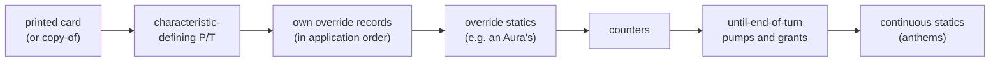

# Cards

dirty-dirac does not parse card text and does not hand-write cards. Each
supported set is a Go package generated from **gorge's** compiled card IR by
a generator, `kgen`, into programs over a small integer op vocabulary, `kop`.
This page explains that vocabulary, the lowering, what is generated and what
is written by hand, how a card is refused, and how per-set packages are found
at run time. It is for readers who know gorge's
[card pipeline](../../contributing/card-pipeline.md) and want to see how the
same cards reach the fast kernel.

*Counts on this page come from the generated packages of 2026-10-19 (their
coverage reports) and from a scratch program run on 2026-10-20 that loads both
sets through the `cardset` registry and counts each pool table.*

## The pipeline

<figure markdown>
<svg viewBox="0 0 760 420" width="100%" role="img" aria-label="Card pipeline: a Forge card script is compiled by gorge into IR; kgen loads a set's cards from the registry, lowers each one, refusing any unread parameter, builds side tables and emits a Go package per set; the cardset registry and a matchup builder turn that into a kop.Table the hand-written kernel interpreter runs">
  <defs>
    <marker id="cp-a" viewBox="0 0 10 10" refX="9" refY="5" markerWidth="7" markerHeight="7" orient="auto-start-reverse"><path d="M0,0 L10,5 L0,10 z" class="dg-arrow"/></marker>
    <marker id="cp-b" viewBox="0 0 10 10" refX="9" refY="5" markerWidth="7" markerHeight="7" orient="auto-start-reverse"><path d="M0,0 L10,5 L0,10 z" class="dg-arrow-accent"/></marker>
  </defs>
  <text x="12" y="20" class="dg-text-muted">gorge (public)</text>
  <rect x="10" y="28" width="220" height="70" rx="8" class="dg-box"/>
  <text x="120" y="50" text-anchor="middle" class="dg-text-bold">Forge card script</text>
  <text x="120" y="68" text-anchor="middle" class="dg-text-muted">.cards/, fetched at FORGE_REF</text>
  <text x="120" y="84" text-anchor="middle" class="dg-text-muted">GPL-3.0, never committed</text>
  <line x1="232" y1="63" x2="266" y2="63" class="dg-line" marker-end="url(#cp-a)"/>
  <rect x="270" y="28" width="220" height="70" rx="8" class="dg-box"/>
  <text x="380" y="50" text-anchor="middle" class="dg-text-bold">engine/cards compiler</text>
  <text x="380" y="68" text-anchor="middle" class="dg-text-muted">parse, expand keywords,</text>
  <text x="380" y="84" text-anchor="middle" class="dg-text-muted">IR cache</text>
  <line x1="492" y1="63" x2="526" y2="63" class="dg-line" marker-end="url(#cp-a)"/>
  <rect x="530" y="28" width="220" height="70" rx="8" class="dg-box"/>
  <text x="640" y="50" text-anchor="middle" class="dg-text-bold">cards.Registry</text>
  <text x="640" y="68" text-anchor="middle" class="dg-text-muted">faces, abilities, triggers,</text>
  <text x="640" y="84" text-anchor="middle" class="dg-text-muted">statics, SVars, $ params</text>

  <rect x="10" y="118" width="740" height="132" rx="10" class="dg-box-muted"/>
  <text x="22" y="136" class="dg-text-muted">kgen (dirty-dirac's generator, run by hand; output checked in)</text>
  <line x1="640" y1="100" x2="640" y2="144" class="dg-line-accent" marker-end="url(#cp-b)"/>
  <rect x="575" y="148" width="165" height="62" rx="8" class="dg-box-accent"/>
  <text x="657" y="170" text-anchor="middle" class="dg-text-bold">load the set</text>
  <text x="657" y="188" text-anchor="middle" class="dg-text-muted">a deck pool or a</text>
  <text x="657" y="202" text-anchor="middle" class="dg-text-muted">card list</text>
  <line x1="573" y1="179" x2="537" y2="179" class="dg-line-accent" marker-end="url(#cp-b)"/>
  <rect x="390" y="148" width="145" height="62" rx="8" class="dg-box-accent"/>
  <text x="462" y="170" text-anchor="middle" class="dg-text-bold">lower</text>
  <text x="462" y="188" text-anchor="middle" class="dg-text-muted">every $ param read,</text>
  <text x="462" y="202" text-anchor="middle" class="dg-text-muted">or the card is refused</text>
  <line x1="388" y1="179" x2="352" y2="179" class="dg-line-accent" marker-end="url(#cp-b)"/>
  <rect x="205" y="148" width="145" height="62" rx="8" class="dg-box-accent"/>
  <text x="277" y="170" text-anchor="middle" class="dg-text-bold">build</text>
  <text x="277" y="188" text-anchor="middle" class="dg-text-muted">intern filters, values,</text>
  <text x="277" y="202" text-anchor="middle" class="dg-text-muted">conditions, overrides</text>
  <line x1="203" y1="179" x2="167" y2="179" class="dg-line-accent" marker-end="url(#cp-b)"/>
  <rect x="20" y="148" width="145" height="62" rx="8" class="dg-box-accent"/>
  <text x="92" y="170" text-anchor="middle" class="dg-text-bold">emit</text>
  <text x="92" y="188" text-anchor="middle" class="dg-text-muted">gofmt'd Go, one file</text>
  <text x="92" y="202" text-anchor="middle" class="dg-text-muted">per card and token</text>
  <line x1="462" y1="212" x2="462" y2="230" class="dg-line-dashed"/>
  <text x="472" y="242" class="dg-text-muted">refused: listed in the coverage report, kept as an inert fallback</text>

  <line x1="92" y1="212" x2="92" y2="276" class="dg-line-accent" marker-end="url(#cp-b)"/>
  <rect x="10" y="280" width="230" height="96" rx="8" class="dg-box"/>
  <text x="125" y="302" text-anchor="middle" class="dg-text-bold">cards_&lt;set&gt; package</text>
  <text x="22" y="322" class="dg-text-mono">card_*.go, token_*.go</text>
  <text x="22" y="338" class="dg-text-mono">pool.go, matchup.go</text>
  <text x="22" y="354" class="dg-text-mono">ids.tsv  (stable CardIDs)</text>
  <text x="22" y="370" class="dg-text-mono">coverage.md, OPS.md</text>
  <line x1="242" y1="328" x2="268" y2="328" class="dg-line" marker-end="url(#cp-a)"/>
  <rect x="272" y="296" width="140" height="64" rx="8" class="dg-box"/>
  <text x="342" y="320" text-anchor="middle" class="dg-text-bold">cardset</text>
  <text x="342" y="338" text-anchor="middle" class="dg-text-muted">registry by set name</text>
  <line x1="414" y1="328" x2="440" y2="328" class="dg-line" marker-end="url(#cp-a)"/>
  <rect x="444" y="296" width="140" height="64" rx="8" class="dg-box"/>
  <text x="514" y="320" text-anchor="middle" class="dg-text-bold">Matchup(a, b)</text>
  <text x="514" y="338" text-anchor="middle" class="dg-text-muted">→ *kop.Table + decks</text>
  <line x1="586" y1="328" x2="612" y2="328" class="dg-line" marker-end="url(#cp-a)"/>
  <rect x="616" y="296" width="134" height="64" rx="8" class="dg-box-accent"/>
  <text x="683" y="320" text-anchor="middle" class="dg-text-bold">kernel</text>
  <text x="683" y="338" text-anchor="middle" class="dg-text-muted">hand-written</text>
  <text x="683" y="352" text-anchor="middle" class="dg-text-muted">interpreter</text>
  <text x="12" y="404" class="dg-text-muted">Only kgen reads gorge. The generated packages and the kernel import nothing from gorge.</text>
</svg>
<figcaption>From Forge script to a playable table. The top row is gorge's own
pipeline; the accented boxes are dirty-dirac's.</figcaption>
</figure>

The key decision is the second step's input: **kgen lowers gorge's compiled
IR, not the Forge script**. The kernel therefore inherits gorge's reading of
every card: keyword expansion, SVar resolution and parameter meaning are
gorge's. That keeps the two engines comparable (the oracle can demand equal
behaviour) and avoids a second script parser. It also means a misreading in
gorge is a misreading in dirty-dirac; see the
[independence caveat](oracle.md#what-lockstep-cannot-see).

## The kop vocabulary

A card is a `kop.CardDef`: printed cost, types, subtypes, keywords, colours,
power and toughness, a few native fields (kicker and flashback costs, ward,
equip cost, the Aura's enchant target) and a list of `kop.Ability`. An ability
is one of seven kinds (spell, activated, mana, triggered, static, replacement,
alternative cost) and carries its cost, its trigger subscription or static
record, up to three target slots, modes, and a **program**: a flat slice of
instructions.

```go
type Instr struct {
    Op  Op        // one of 99 ops
    Obj Ref       // who or what it acts on: a target slot, the source, the controller, each opponent, ...
    A   ValueRef  // an amount: a constant, X, a count of a filter, last damage, a power, a side-table expression
    B   ValueRef  // a second amount
    C   int16     // an op-specific constant: a keyword mask, a counter kind, a token, a zone, a skip count
    F   FilterID  // a filter in the table, for the "all", search and choice ops
}
```

Two cards as kgen emits them, abridged:

```go
var shivanDragon = kop.CardDef{               // {4}{R}{R}, 5/5 flying
    Cost: kop.ManaCost{Generic: 4, Pips: [6]uint8{0, 0, 0, 2}},
    Types: kop.TCreature, Keywords: kop.KwFlying, Power: 5, Toughness: 5,
    Abilities: []kop.Ability{{
        Kind: kop.AbActivated,                   // {R}: +1/+0 until end of turn
        Cost: kop.Cost{Mana: kop.ManaCost{Pips: [6]uint8{0, 0, 0, 1}}},
        Prog: []kop.Instr{{Op: kop.OpPumpUntilEOT, Obj: kop.RefSelf, A: kop.Const(1)}},
    }},
}

var burstLightning = kop.CardDef{             // {R} instant, kicker {4}
    Types: kop.TInstant, Keywords: kop.KwKicker, Kicker: kop.ManaCost{Generic: 4},
    Abilities: []kop.Ability{{
        Targets: [3]kop.TargetSpec{{Kind: kop.TgtAny}}, NTargets: 1,
        // 2 damage, or 4 if kicked: an expression in the table's side tables
        Prog: []kop.Instr{{Op: kop.OpDealDamage, Obj: kop.RefTarget0, A: kop.ValueRef{K: kop.VExpr, N: 3}}},
    }},
}
```

What is in the vocabulary, counted on 2026-10-20:

| Enum | Values | Examples |
|---|---|---|
| `Op` | 99 (61 in the original vocabulary, 38 appended by kgen) | `DealDamage`, `Draw`, `Destroy`, `CreateToken`, `Scry`, `Fight`, `Counter`, `Charm`; kgen's `SkipUnless`, `UnlessPaid`, `SearchEx`, `DigEx`, `Override`, `CopySpell`, `RepeatWhile` |
| `TrigEvent` | 20 | enters, dies, leaves, to graveyard, attacks, phase, spell cast, life gained, damage dealt, becomes target, drawn, discarded, counters added, blocks |
| `StaticKind` | 16 | continuous P/T and keywords, cost changes, can't block, may play from a zone, override, player hexproof |
| `ReplKind` | 15 | enters tapped, enters with counters, as-enters choice, double damage, prevent noncombat damage, double tokens, double counters, graveyard-to-library |

Every enum is **append-only**: generated tables encode ops by ordinal, so a new
op goes immediately above the count constant, never in the middle. The
interpreter contract is in `kop`'s package doc:

- A resolving ability runs its program front to back against the stack entry's
  source, controller, targets, modes, X and kicked flag.
- An instruction whose target has become illegal is a no-op; if every target is
  illegal the whole program is skipped (CR 608.2b).
- Branch ops (`Charm`, `IfKicked`, `SkipIf`, `Repeat`, ...) are structured: they
  skip or loop over the instructions immediately following them.
- Decision-raising ops (choose a colour, a card, scry, search, dig, ...)
  suspend the resolution; the kernel poses a decision and resumes at the same
  instruction ([Step and Apply](step-apply.md)).
- **An op the interpreter does not implement panics, naming itself. It is
  never a silent no-op.**

The variable-length parts live in the table, not in the state: a
`kop.Table` holds the cards, the filters, the subtype names, and four side
tables kgen fills (value expressions, conditions, override records, emblems),
plus the mapping from gorge's 362-word creature-type vocabulary to the table's
subtypes.

| Pool table (2026-10-20) | Cards (incl. tokens) | Filters | Expressions | Conditions | Override records | Emblems | Subtypes | Abilities | Instructions | Distinct ops |
|---|---|---|---|---|---|---|---|---|---|---|
| FDN | 310 | 127 | 27 | 23 | 9 | 2 | 95 | 404 | 435 | 74 |
| BLB | 284 | 74 | 4 | 15 | 2 | 0 | 62 | 154 | 168 | 38 |

(BLB's counts are low because a refused card contributes no abilities; see
below.)

## Lowering: read every parameter or refuse

kgen walks each card's IR: its abilities and their `SubAbility` chains, its
triggers, statics and replacement effects, its keywords and SVars. Each node's
`$` parameters are wrapped in a tracker that records which ones the lowering
read. When a node is done, any rules parameter left unread **refuses the
card**, with the node and the reason. Only descriptive and AI-hint parameters
(`SpellDescription`, `AILogic`, `TgtPrompt`, ...) are ignored by name. So a
parameter is either implemented or it refuses; it is never dropped silently.
This is the same principle as gorge's unread-parameter census, applied at
generation time.

Typical refusals, from the BLB coverage report: a keyword with no lowering
(`Class`, `Gift`, `Offspring`), a trigger mode with none (`ManaExpend`), a cost
token (`Forage`), a filter property kgen does not know, a value head it cannot
evaluate, or an unread parameter.

A refused card is not dropped from the package. It is emitted as an **inert
fallback**: printed cost, types, subtypes, colours and P/T, no abilities. Two
consequences:

- `Matchup` refuses a deck that contains one, so a kernel game never plays a
  card as vanilla by accident.
- The whole-pool table (`Pool`) still has a row for it, so a search world
  that deals hidden cards from a belief over the set can deal it, as a
  placeholder.

The generator also writes `OPS.md`, the interpreter contract for every op,
enum value and field it appended, with the cards that use each one, and a test
fails if an appended op has no entry. Another test regenerates every set into
a temporary directory and diffs it against the checked-in package, so the
checked-in tables can never drift from the generator.

**Stable card IDs.** `ids.tsv` is a checked-in index of every `CardID` ever
assigned in the set. An ID never moves: a new card takes the next free ID, and
a card that leaves the set keeps its ID as an inert placeholder. Recorded games
and caches keyed by `CardID` stay valid across regenerations.

## Generated and hand-written

| Part | Generated by kgen | Written by hand |
|---|---|---|
| Card definitions, ability programs, filters, expressions, conditions, override records | yes, one Go file per card and token | |
| Pool index, name table, `Matchup` and `Pool` builders, set registration | yes (`pool.go`, `matchup.go`) | |
| `ids.tsv`, coverage report, `OPS.md` | yes | |
| The `kop` types and enums | kgen appends values and fields (append-only) | the original vocabulary and the types |
| The interpreter and every rule (turns, priority, casting, combat, state-based actions, layers stand-in) | | yes, in `kernel` |
| The generated-table extension: the code behind kgen's ops, statics, replacements and filter predicates | | yes, in `kernel`'s `*_gen.go` files (named for the tables they serve, not generated) |
| A tiny test table (basic lands, vanilla and keyword creatures, a few spells) | | yes, package `vanilla` |

The `*_gen.go` files are worth naming because the suffix misleads: they are
hand-written kernel code that only runs on a generated table. Examples:

- **Characteristics** (`chars_gen.go`): computing a permanent's types,
  keywords and P/T in a fixed order (below).
- **Spell copies** (`copy_gen.go`): a copy is a new card object on the stack
  with the original's targets, modes, X and kicked status; it is not cast, and
  it ceases to exist when it leaves the stack (CR 707.10, CR 704.5e).
- Replacement effects (`repl_gen.go`), triggers, statics, legality of plays,
  target slots taking several objects.

On a hand-written table every one of those hooks is skipped.

## The override record: a fixed-order stand-in for layers

gorge implements the CR 613 layer system. dirty-dirac does not. Effects that
change what a permanent *is* are lowered to an **override record**: a small
record that can set types, subtypes and colours, remove abilities, add types,
subtypes and keywords, set base P/T, and grant an ability. A permanent's
characteristics are then computed in one fixed order:



That collapses layers 4 to 7b into a fixed sequence, and it is correct only as
far as the supported sets go: for every card in them the fixed order gives the
same result as gorge's layer system, and the oracle compares every
battlefield creature's derived power and toughness at every position. FDN's
users are Fake Your Own Death, Kellan, Mild-Mannered Librarian, Soulstone
Sanctuary, Infernal Vessel, Valkyrie's Call, Witness Protection and Imprisoned
in the Moon. A new set whose result depends on layer dependencies or
timestamps has to extend this or refuse the card.

Cards that need behaviour no generic op expresses get it in one of three ways,
in order of preference: a new append-only op or enum value with its contract in
`OPS.md`; an override record; or kernel-native code keyed by a `kop` kind (ward
and granted prowess are kernel-native triggers; Twinflame Tyrant, Crystal
Barricade, Doubling Season and Progenitus are fixed replacement kinds). No
kernel code path branches on a card's name; a card's name is in its
`CardDef` for reports only.

## Per-set packages and the cardset registry

Each supported set is its own generated package, `cards_<set>` (today
`cards_fdn` and `cards_blb`). A set is generated either from a deck pool (every
distinct card in a directory of deck lists; FDN) or from a card list (BLB has no
deck corpus, so its list is every distinct card name on the set's booster
sheets).

Each package implements `cardset.Set` and registers itself under its set name
in `init`:

| Method | Returns |
|---|---|
| `Name()` | the set name, the registry key |
| `Lookup(name)` | a card's pool index |
| `Supported()` | per pool index (cards, then tokens), whether the generated table implements it |
| `Matchup(a, b)` | a `kop.Table` for two decks plus each deck as `CardID`s; fails on an unsupported card |
| `Pool()`, `PoolID(i)`, `InertID(id)`, `NumIDs()` | the whole-set table and its stable IDs |
| `AbilityOrigin(i, ab)` | which gorge ability (face ability or trigger index) a kop ability came from, for the oracle |
| `Names()`, `Subtypes()` | the name and subtype vocabularies |

The registry is a slice, not a map, so nothing can depend on map order. Tools
select a set by name (`-set fdn`). Support per set is published on
[Card support by set](../../support/sets.md).

## Sizing the vocabulary: gorge's kcensus

Before the vocabulary existed, gorge's
[`cmd/kcensus`](https://github.com/adams-shaun/gorge/blob/main/cmd/kcensus/main.go)
measured what it would need. It loads a deck pool, resolves every card through
the compiled corpus, lists the mechanics each card reaches (API codes along
every sub-ability, trigger and SVar chain; trigger, static and replacement
modes; keyword heads; cost tokens), and prints the smallest mechanic set that
fully covers 50, 80, 95 and 100 % of the decks, plus how many decks need
general layer, replacement, copy or control machinery. Its labels use the same
spelling as gorge's coverage ratchet (`api:`, `trig:`, `stat:`, `repl:`, `kw:`),
so its output lines up with gorge's own support reports.
