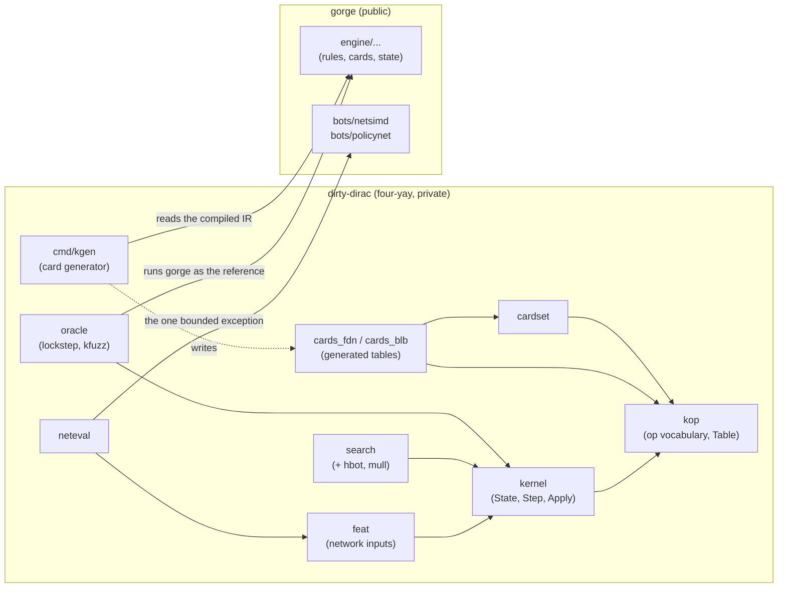

# dirty-dirac

dirty-dirac is gorge's second rules kernel: a small, fast, two-player
implementation of Magic for a fixed set of card pools, built so that tree
search and self-play can copy and step a game millions of times. This page
says what it is, why it exists, how it relates to gorge, and where to read
next. It is for contributors who want to understand the two-kernel design
and for bot authors who want to know what a "kernel game" is.

*Figures on this page were measured 2026-10-20 against the dirty-dirac source
of 2026-10-19 and gorge `aa421da93` (the gorge revision dirty-dirac pins). Each
names how it was produced.*

!!! note "Where the code lives"
    dirty-dirac lives in **four-yay**, the maintainers' private companion
    module (see [The three repositories](../../repos/index.md)). Its Go
    package is `kernel`, with sub-packages `kop`, `cardset`, `cards_fdn`,
    `cards_blb`, `feat`, `search`, `neteval` and `oracle`, and the commands
    `kgen` (the card generator), `kfuzz` (the lockstep fuzzer) and `kplay`
    (the game runner). The source is not public; these pages describe its
    design, the card sets it supports and how it is verified. Its speed is on
    the [Performance](../../performance/index.md) pages.

## Why a second kernel

gorge is built to be right for every card in the Forge corpus, at up to eight
seats, with a replayable, hash-chained event log
([Events and replay](../gorge/events.md)). That generality has a shape: a
`state.Game` is an arena of objects linked by IDs, plus slices for zones and
maps for continuous effects, card text and memo tables. Copying one is a deep
copy; stepping one walks open-ended data.

A search such as Monte Carlo tree search (MCTS) wants the opposite trade. Each
simulation starts by copying the root position, plays forward a few dozen
decisions, and throws the copy away. If the card pool is known in advance, the
whole game can be laid out as **one fixed-size Go value**:

- no pointers, maps, slices, strings or interfaces anywhere inside it;
- every zone, the battlefield, the stack and the pending triggers are
  fixed-capacity arrays;
- a card's behaviour is a short program of integer opcodes in a table the
  game names by a 16-bit index, not by a pointer.

Then **cloning a game is a plain assignment** (`w := *root`, one `memcpy` of
10,224 bytes), the garbage collector never scans game state, and two equal
positions compare equal with `==`. That is the whole idea; the rest of these
pages are the details that make it hold up.

```go
s := kernel.NewConfig(tbl, deckA, deckB, seed, kernel.Config{Mulligans: 2})
for {
    d := s.Step()               // run to the next decision
    if d.Kind == kernel.DkNone { // the game is over
        break
    }
    s.Apply(d.Options[i])       // answer it with one of d.Options[:d.N]
}
over, winner := s.Terminal()
```

The API is that loop: `Step` runs the game to its next question, `Apply`
answers it with one packed 32-bit `Action`. See
[Step and Apply](step-apply.md).

## Scope

dirty-dirac deliberately does much less than gorge.

| Limit | Value | What happens past it |
|---|---|---|
| Players | exactly 2 | not representable |
| Cards | the supported sets only ([Card support by set](../../support/sets.md)) | a deck with an unsupported card is refused when the matchup table is built |
| Deck size | 60 cards per seat (`MaxDeck`) | rejected when the game is set up |
| Card instances | 192: both decks plus tokens and copies (`MaxObj`) | the game ends as a draw with a capacity reason |
| Battlefield | 64 permanents (`MaxPerm`) | draw, "board" |
| Stack | 24 entries (`MaxStack`) | draw, "stack" |
| Waiting triggers | 24 (`MaxPending`) | draw, "pending" |
| Triggers in one turn | 2,000 | draw, "loop" (an endless mandatory loop, CR 104.4b) |

A game that outgrows a fixed capacity is a *capacity stall*: it ends as a draw
and `State.StallReason` says which limit it hit. gorge has no such caps, so
the oracle counts a capacity stall as a stall, never as a rules disagreement.

There is also no event log, no per-seat view, no host, no Commander, no
concede and no manual mana: every cast is paid automatically by a planner that
mirrors gorge's own auto-pay planner. Those are gorge's jobs.

## Relationship to gorge

**gorge is dirty-dirac's oracle.** dirty-dirac is not a second source of rules
truth. Its cards are generated from gorge's compiled card IR, its rules code
follows gorge's rules code (including gorge's decision grammar and RNG), and a
lockstep harness plays the same game through both engines and stops at the
first difference. When the two disagree, the question is "which one is wrong
by the Comprehensive Rules (CR)?", and the answer is fixed on the side that is
wrong. Several of the disagreements found so far were bugs in gorge
(for example gorge commits
[`b95cf24c0`](https://github.com/adams-shaun/gorge/commit/b95cf24c0) and
[`ff5b00f5e`](https://github.com/adams-shaun/gorge/commit/ff5b00f5e)), which
is one reason the harness exists. See [Verification](oracle.md).

**The import boundary.** The kernel itself imports nothing from gorge. Only
three places may:



- `kernel`, `kop`, `cardset`, the generated card packages, `feat` and
  `search` import nothing from gorge (checked with `go list` on 2026-10-20).
- `neteval` is the one bounded exception in the run-time path: it may import
  gorge's [`bots/netsimd`](https://github.com/adams-shaun/gorge/tree/main/bots/netsimd)
  (the network's forward pass) and
  [`bots/policynet`](https://github.com/adams-shaun/gorge/tree/main/bots/policynet)
  (its input types), never gorge's engine. See [Search](search.md).
- `oracle` and `kgen` are tools, not the kernel, and may import any of gorge.

The rule is stated in the kernel's package documentation; it is a review rule,
not a test.

## gorge and dirty-dirac compared

| | gorge | dirty-dirac |
|---|---|---|
| **State model** | `state.Game`: an object arena addressed by `ObjID`, with slices for zones and maps for effects and memos | one `State` struct of 10,224 bytes: fixed arrays only; no pointers, maps, slices, strings or interfaces ([State](state.md)) |
| **Mutation** | the engine proposes `events.Event`s; `events.Apply` folds each into the state and appends it to a SHA-256 hash chain | `Apply(action)` writes the value directly; no log |
| **Clone cost** | `Engine.Clone`: a deep copy of the game plus a shared log prefix | assignment: one 10,224-byte copy, nothing for the garbage collector |
| **Players** | up to 8 | exactly 2 |
| **Card coverage** | the whole Forge corpus, 94.2 % playable ([Card support](../../support/sets.md)) | FDN 286 of 286 cards, BLB 104 of 276 (the generator's coverage report, 2026-10-19) |
| **Rules source** | Forge scripts compiled to gorge's IR, plus gorge's hand-written primitives and rules core | the same IR lowered by `kgen` into integer op programs, plus a hand-written interpreter that mirrors gorge's rules code ([Cards](cards.md)) |
| **Decisions** | 13 decision kinds, multi-select answers | 8 decision kinds, every answer a single pick ([Step and Apply](step-apply.md)) |
| **Verification** | golden replays and chain heads, census ratchets, the XMage and Forge compliance oracles | lockstep against gorge on every decision and every position ([Verification](oracle.md)) |
| **Intended use** | hosting real games, the reference implementation, every card | search and self-play on the supported sets |

## Pages in this section

| Page | What it covers |
|---|---|
| [State](state.md) | the fixed-size `State` value and its memory layout, the 64-slot battlefield and its slot masks, object identity and versioning (CR 400.7), the canonical `Projection` |
| [Step and Apply](step-apply.md) | the control-state machine, the `Decision` and `Action` encodings, decision kinds against gorge's, mulligans, and why the RNG is bit-compatible with gorge's |
| [Cards](cards.md) | the `kop` op vocabulary, how `kgen` lowers gorge's compiled IR into per-set tables, what is generated and what is hand-written, refusals |
| [Verification](oracle.md) | the lockstep oracle against gorge, the canonical vocabulary and projection, how a divergence is found, shrunk and classified, and what lockstep cannot see |
| [Search](search.md) | how featurisation, the search and network evaluation sit on the kernel, and the import boundary |

New terms on these pages are collected in the
[Glossary](../../contributing/glossary.md).
