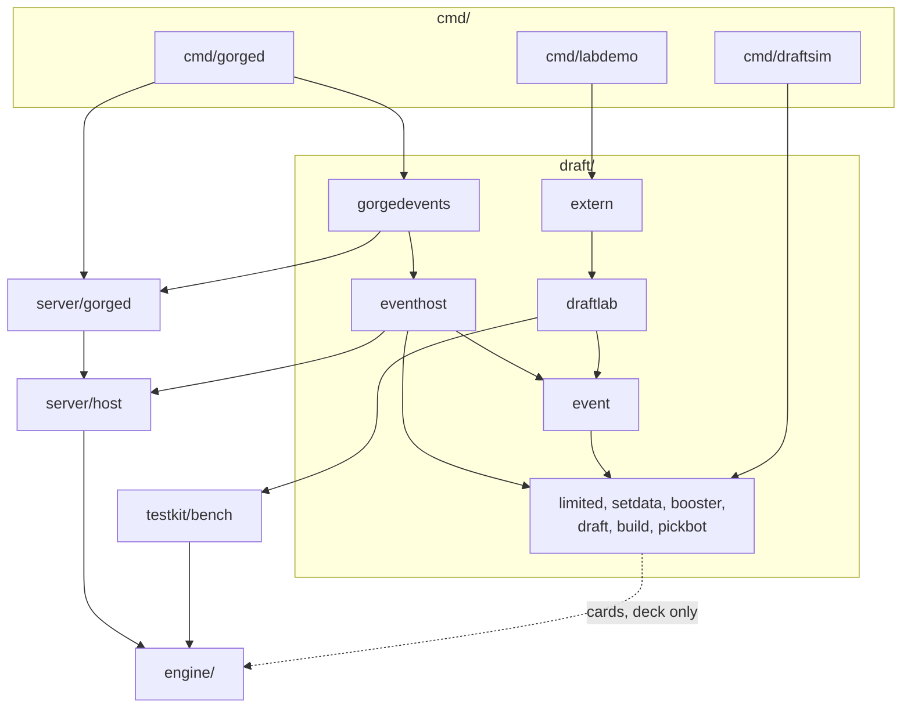
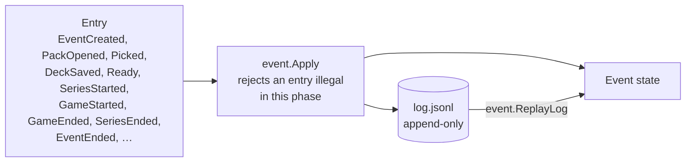
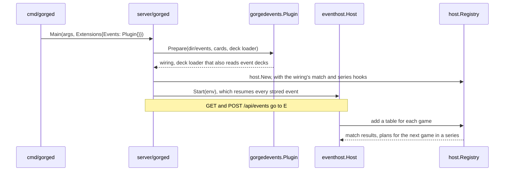

# Draft events

This page explains how the limited stack in `draft/` is built, for someone changing
it or reusing its parts. To run it, see the [user guide](../guide/draft.md).

The stack sits **on top of** the engine. It decides who plays what deck against whom,
and plays the games through the same `server/host` tables and engine as every other
game. No draft concept reaches the rules core, and an engine or server build that does
not ask for draft events links none of this code.

## Packages

| Package | Role | Imports from gorge |
|---|---|---|
| `draft/limited` | shared vocabulary: `CardRef`, rarity | nothing |
| `draft/limited/setdata` | per-set booster specs, embedded and generated from trimmed MTGJSON | `limited` |
| `draft/limited/booster` | opens packs from a seed: slots, sheets, colour balance | `limited`, `setdata` |
| `draft/limited/draft` | the pod: pack queues, passing, picks | `limited` |
| `draft/limited/build` | deck rules, automatic lands, conversion to a deck file | `limited`, `engine/deck` |
| `draft/limited/pickbot` | the drafter and builder, with the embedded 17Lands ratings | `limited`, `build`, `draft`, `engine/cards` |
| `draft/event` | event lifecycle: the log, `Apply`, pairings, standings, CSV export | `limited`, `build`, `draft` |
| `draft/eventhost` | the runtime inside a server: store, seat tokens, timers, series on host tables | the above, `bots`, `server/host`, `server/protocol` |
| `draft/gorgedevents` | adapts `eventhost` to `server/gorged`'s plugin interface | `eventhost`, `server/gorged` |
| `draft/draftlab` | the Go composition API: drafts, builds, games, gauntlets, manifests, tapes | the pure packages, the engine, `bots`, `testkit/bench` |
| `draft/draftlab/extern` | out-of-process agents as `draftlab` drafters, builders and players | `draftlab`, `wire` |
| `draft/draftlab/extern/wire` | the [gorge-agent/1](../api/gorge-agent.md) messages and framing | `engine/decision`, `engine/view`, `server/protocol` |
| `draft/draftlab/extern/refagent` | the reference agent | `wire` |

The commands stay in the root `cmd/`: `draftsim`, `labdemo` and `extagent`. Sizes and
importers for every package are on [Packages](packages.md).

## Which way the imports run

Four rules hold this shape, and each is a test:

| Rule | Enforced by |
|---|---|
| Nothing outside `draft/` imports it, except `cmd/gorged`, `cmd/draftsim`, `cmd/labdemo` and `cmd/extagent`. Test files are not counted | `TestDraftTreeStaysAbove` in `internal/archtest`. It also fails if `draft/` goes missing, so it cannot pass vacuously |
| `server/gorged` does not import `draft/`, because `gorgedevents` imports `server/gorged` and the reverse would be a cycle | The same test. `cmd/gorged` passes `gorgedevents.Plugin{}` in `gorged.Extensions.Events`, and a library caller with the zero `Extensions` gets a refusal on `-events` (`TestEventsNeedAPlugin`) |
| `draft/limited/*` and `draft/event` are pure: no clock, files, network, engine state, host or bots | An `imports_test.go` in each package |
| Of the event stack, only `eventhost` may read the clock, for lobby, idle and pick timers, through `Options.Now` and `Options.Clock` | `TestTimeIsImportedOnlyByTheHost` |

Wire types the client generates from stay in `server/protocol/draftevent.go`, which
imports nothing from `draft/`. So `web/src/protocol.ts` and the
[OpenAPI document](../api/http.md) do not depend on the runtime.

## An event is its log

An event follows the same idea as a game. State changes only through `event.Apply`,
one log entry at a time. `event.ReplayLog` folds a log back into exactly the same event:

What that gives you:

- **Packs are logged in full when opened**, so an old log still means the same thing
  after set data changes. Swiss pairings are logged for the same reason.
- **A pick does not depend on interleaving.** A pack visits seats in a fixed order and a
  seat's pick depends only on its own earlier picks, so any order of picks that respects
  the queues produces the same pools and log. A test drives one seeded draft in two
  orders and compares them.
- **Randomness is seeded.** Packs, bot picks and game seeds all derive from the event
  seed, with `math/rand/v2` PCG streams and no map iteration that can reach output. The
  server mints a hosted event's seed; no client field can choose it.
- **The clock only appends.** A timeout appends a `LobbyTimeout` or `IdleTimeout` entry
  and then the ordinary entries of the action it took. Replay never reads the clock.
- **Games are referenced, not embedded.** `event` never imports the engine. It asks for
  pending series, and the caller plays them and reports each result as a `GameEnded`
  entry with the game's chain head. `draftsim -verify` re-runs the event and compares
  both the event log and every head.

On disk a hosted event is `<dir>/events/<id>/event.json` (the seats, the set, the seed
and only the sha256 of each seat token), `log.jsonl`, and `decks/<seat>-<rev>.json`. Its
games are ordinary matches in table directories named
`<event>-r<round>-s<seats>-g<game>-a<attempt>`, for example `e1-r1-s03-g1-a2`.

Hidden information follows the same server-side rule as a game. `Event.LogFor` redacts
other seats' picks and decks until the event is COMPLETE, and a seat is identified by its
token, never by a field the client sends.

## How a hosted event plugs in

With `-events` off, none of this runs. The server keeps its plain deck loader and options,
and never creates `<dir>/events`.
