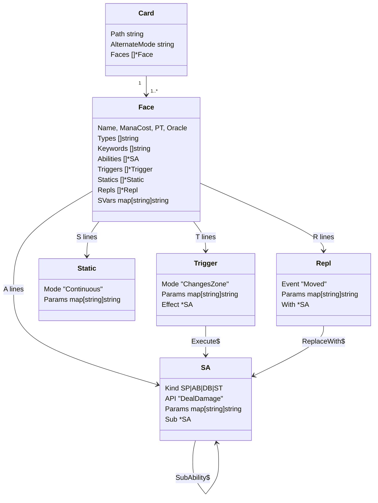
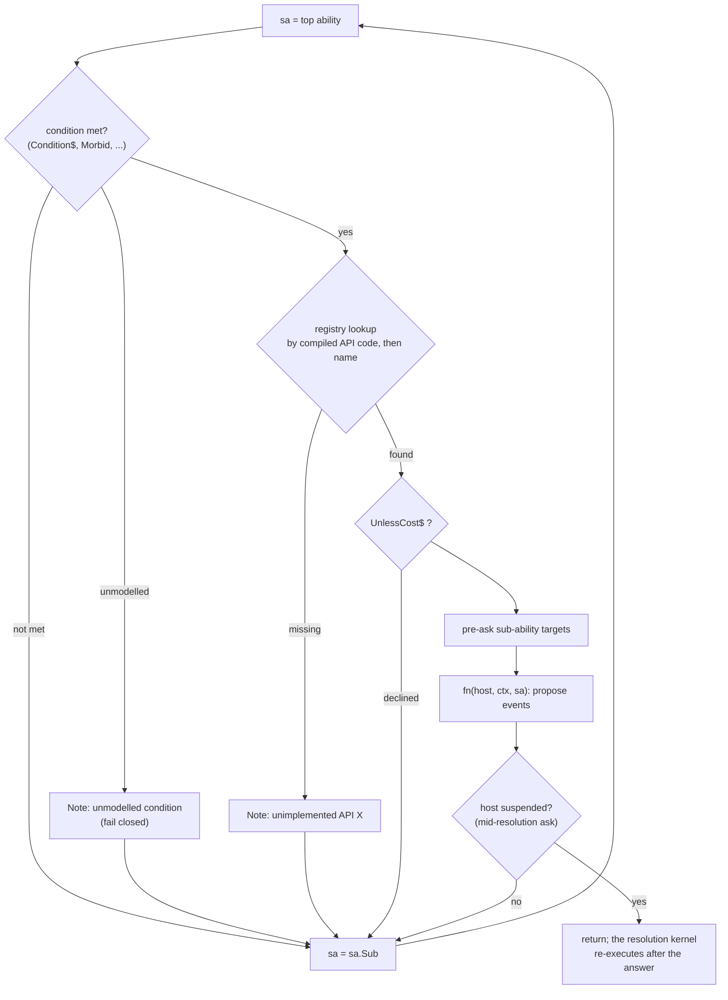

# Cards and primitives

gorge implements no card by hand. It compiles Forge's card scripts into an
intermediate representation (IR) and implements the named **primitives** the
IR refers to. This page explains the runtime side of that pipeline: the IR's
shape, keyword expansion, the IR cache, how primitives are registered and
dispatched, how an unsupported one is caught, and how costs are parsed and
paid. For the step-by-step contributor workflow (fetch, compile, find a
missing primitive, fix a card), see [The card pipeline](../../contributing/card-pipeline.md)
and [Your first card fix](../../contributing/first-card-fix.md).


## From script to running effect

<figure markdown>
<svg viewBox="0 0 780 260" width="100%" role="img" aria-label="The card pipeline: Forge scripts are fetched, parsed and linked into the IR, cached by compiler fingerprint, loaded into a registry, checked for coverage, and dispatched at run time to registered primitives">
  <defs>
    <marker id="cp-a" viewBox="0 0 10 10" refX="9" refY="5" markerWidth="7" markerHeight="7" orient="auto"><path d="M0,0 L10,5 L0,10 z" class="dg-arrow"/></marker>
  </defs>
  <rect x="10" y="20" width="130" height="90" rx="8" class="dg-box-muted"/>
  <text x="75" y="46" text-anchor="middle" class="dg-text-bold">Forge scripts</text>
  <text x="75" y="66" text-anchor="middle" class="dg-text-muted">.cards/cardsfolder</text>
  <text x="75" y="82" text-anchor="middle" class="dg-text-muted">GPL-3.0, fetched,</text>
  <text x="75" y="98" text-anchor="middle" class="dg-text-muted">never committed</text>
  <rect x="170" y="20" width="140" height="90" rx="8" class="dg-box"/>
  <text x="240" y="46" text-anchor="middle" class="dg-text-bold">parse + link</text>
  <text x="240" y="66" text-anchor="middle" class="dg-text-mono">ParseBytes, Link</text>
  <text x="240" y="82" text-anchor="middle" class="dg-text-muted">keyword expansion,</text>
  <text x="240" y="98" text-anchor="middle" class="dg-text-muted">SVar resolution</text>
  <rect x="340" y="20" width="140" height="90" rx="8" class="dg-box"/>
  <text x="410" y="46" text-anchor="middle" class="dg-text-bold">IR cache</text>
  <text x="410" y="66" text-anchor="middle" class="dg-text-mono">ir-&lt;fp&gt;.gob.gz</text>
  <text x="410" y="82" text-anchor="middle" class="dg-text-muted">keyed by compiler</text>
  <text x="410" y="98" text-anchor="middle" class="dg-text-muted">fingerprint</text>
  <rect x="510" y="20" width="120" height="90" rx="8" class="dg-box"/>
  <text x="570" y="46" text-anchor="middle" class="dg-text-bold">Registry</text>
  <text x="570" y="66" text-anchor="middle" class="dg-text-mono">Lookup(name)</text>
  <text x="570" y="82" text-anchor="middle" class="dg-text-muted">cards + tokens,</text>
  <text x="570" y="98" text-anchor="middle" class="dg-text-muted">lazily materialised</text>
  <rect x="660" y="20" width="110" height="90" rx="8" class="dg-box"/>
  <text x="715" y="46" text-anchor="middle" class="dg-text-bold">deck</text>
  <text x="715" y="66" text-anchor="middle" class="dg-text-mono">rules.Config</text>
  <text x="715" y="82" text-anchor="middle" class="dg-text-muted">Decks, Tokens</text>
  <line x1="140" y1="65" x2="168" y2="65" class="dg-line" marker-end="url(#cp-a)"/>
  <line x1="310" y1="65" x2="338" y2="65" class="dg-line" marker-end="url(#cp-a)"/>
  <line x1="480" y1="65" x2="508" y2="65" class="dg-line" marker-end="url(#cp-a)"/>
  <line x1="630" y1="65" x2="658" y2="65" class="dg-line" marker-end="url(#cp-a)"/>
  <rect x="170" y="150" width="300" height="90" rx="8" class="dg-box-accent"/>
  <text x="320" y="176" text-anchor="middle" class="dg-text-bold">coverage: Face.Primitives() vs Supported()</text>
  <text x="320" y="198" text-anchor="middle" class="dg-text-mono">api:  trig:  stat:  repl:  kw:  count:</text>
  <text x="320" y="220" text-anchor="middle" class="dg-text-muted">playable iff nothing is missing</text>
  <rect x="510" y="150" width="260" height="90" rx="8" class="dg-box-accent"/>
  <text x="640" y="176" text-anchor="middle" class="dg-text-bold">run time: effects.Resolve</text>
  <text x="640" y="198" text-anchor="middle" class="dg-text-mono">fn := registry lookup of sa.API</text>
  <text x="640" y="220" text-anchor="middle" class="dg-text-muted">proposes events through Host</text>
  <line x1="570" y1="110" x2="400" y2="148" class="dg-line-dashed" marker-end="url(#cp-a)"/>
  <line x1="715" y1="110" x2="660" y2="148" class="dg-line" marker-end="url(#cp-a)"/>
</svg>
<figcaption>Compile once, cache by parser fingerprint, look cards up by name,
measure coverage statically, dispatch at run time.</figcaption>
</figure>

## Fetching and compiling

`cmd/forgec` has four subcommands, and the Makefile wraps them:

```sh
make fetch-cards     # forgec fetch -dir .cards -repo $(FORGE_REPO) -ref $(FORGE_REF)
make compile-cards   # forgec compile -dir .cards
make report          # forgec report -dir .cards
make coverage        # forgec coverage -dir .cards -out .coverage
```

`fetch` does a sparse clone of the card and token folders from gorge's Forge
fork at the pinned commit (`FORGE_REF` in the Makefile) and writes `.cards/cards.lock`.
Pinning matters: the corpus is input to every golden replay, so a corpus bump
is a deliberate change, never a side effect of upstream moving.

`make report` on 2026-10-31 printed:

```text
corpus: 91402ac511046c0b7ed0bb691a8a446ca7dfc873 @ 91402ac511046c0b7ed0bb691a8a446ca7dfc873 (GPL-3.0, 34074 files)
cards: 34074  playable: 32390 (95.1%)
tokens: 854

top missing primitives (cards unlocked):
  1. api:MakeCard                        186
  2. trig:ChaosEnsues                    158
  3. trig:SetInMotion                     84
  ...
```

The "cards unlocked" column is how many cards would become playable if that
one primitive were implemented, which is how the project picks what to build
next.

## The IR

A Forge script is a text file of `Key:Value` lines. Ability lines are
`|`-separated lists of `Key$ Value` parameters. An illustrative script in
Forge's syntax (written for this page, not copied from the corpus):

```text
Name:Ember Courier
ManaCost:1 R
Types:Creature Goblin
PT:1/1
K:Haste
T:Mode$ ChangesZone | Origin$ Any | Destination$ Battlefield | ValidCard$ Card.Self | Execute$ TrigDamage | TriggerDescription$ When CARDNAME enters, it deals 1 damage to any target.
SVar:TrigDamage:DB$ DealDamage | ValidTgts$ Any | NumDmg$ 1
```

`cards.ParseBytes` ([`engine/cards/parse.go`](https://github.com/adams-shaun/gorge/blob/main/engine/cards/parse.go))
turns those lines into the types in
[`engine/cards/ir.go`](https://github.com/adams-shaun/gorge/blob/main/engine/cards/ir.go):



| Script line | IR |
|---|---|
| `A:SP$ X \| ...`, `AB$`, `DB$` | `SA{Kind, API: "X", Params}` in `Face.Abilities` |
| `T:Mode$ M \| ...` | `Trigger{Mode: "M", Params}` |
| `S:Mode$ M1,M2 \| ...` | one `Static` per comma-separated mode, sharing `Params` |
| `R:Event$ E \| ...` | `Repl{Event: "E", Params}` |
| `K:Keyword` | appended to `Face.Keywords` (canonicalised) |
| `SVar:Name:body` | `Face.SVars["Name"] = body` |
| `ALTERNATE` | starts the next face (split, adventure, double-faced cards) |

**Linking** (`Face.link`, [`engine/cards/link.go`](https://github.com/adams-shaun/gorge/blob/main/engine/cards/link.go))
then resolves the references between lines: an ability's `SubAbility$`, a
trigger's `Execute$` and a replacement's `ReplaceWith$` name SVars, whose
bodies are parsed as abilities and hung on `Sub`, `Effect` and `With`. Chains
are capped at depth 32, and an unresolvable name is a compile diagnostic.

**SVars** hold either a sub-ability or a value expression (`Count$...`). At
run time `cards.ResolveSVar(svars, name)` parses a body through a cache keyed
by body text and returns a fresh copy, so parameters that name SVars directly
(a charm's `Choices$`, `RepeatSubAbility$`) never re-parse. A numeric
parameter is either a literal or the name of an SVar whose body is a value
expression; `effects.Num` evaluates it, and an expression the build does not
model evaluates to zero rather than to the default.

### Keyword expansion

Many keywords are just abbreviations for an ordinary ability. Linking first
runs `expandKeywords` ([`engine/cards/keywords.go`](https://github.com/adams-shaun/gorge/blob/main/engine/cards/keywords.go)),
which rewrites each such keyword into the trigger, replacement or activated
ability Forge itself would build, so nothing downstream needs to know it was
ever a keyword. Prowess, in full
([`engine/cards/kw_prowess.go`](https://github.com/adams-shaun/gorge/blob/main/engine/cards/kw_prowess.go)):

```go
func kwProwess(f *Face, i int, k, head, param string, has func(kind, line string) bool) {
	f.addKeywordTrigger(head, k, "Mode$ SpellCast | ValidCard$ Card.nonCreature | ValidActivatingPlayer$ You | TriggerDescription$ Prowess",
		"DB$ Pump | Defined$ Self | NumAtt$ +1 | NumDef$ +1", has)
}

func init() { registerKeyword(kwProwess, "Prowess") }
```

There are 70 non-test `kw_*.go` files in `engine/cards`, one or two
expanders each (`ls engine/cards/kw_*.go | grep -v _test | wc -l`). The
expansion is keyed per keyword *line instance*, so a card printing the same
keyword twice gets two triggers (CR 702.108b), while running `Link` again adds
nothing. Keywords that mean a casting option (Kicker, Flashback, Delve,
Flash) or a static property (Protection, Indestructible) are not expanded;
the rules core reads them directly.

### The IR cache

Compiling the corpus takes a while, and every test binary needs it, so the
result is cached at `.cards/ir-<fingerprint>.gob.gz`, with a binary image of the
same corpus beside it, `.cards/ir-<fingerprint>.seg`:

- **The fingerprint** (`cards.CompilerFingerprint`,
  [`engine/cards/fingerprint.go`](https://github.com/adams-shaun/gorge/blob/main/engine/cards/fingerprint.go))
  is a SHA-256 over the source of every IR-affecting file in `engine/cards`,
  embedded at build time. Change the parser and you get a different file
  name, so a build can never read IR produced by a different parser, and
  several worktrees can share one `.cards` directory without clobbering each
  other. A census test forces every new file in the package to be classified
  as IR-affecting or not.
- **The schema version** (`cacheVersion`) separately guards the gob format.
- **Freshness**: a cache older than the card folders or `cards.lock` is
  rebuilt. An exclusive advisory lock beside the cache stops dozens of test
  binaries from recompiling at once; the write is temp-file-plus-rename
  either way.
- **Loading** keeps the immutable, pointer-free image resident (rebuilt in memory
  when `.cards` is read-only) and materialises a `*cards.Card` only when something first looks it up. The
  garbage collector then scans the cards in play, not the whole corpus.

## Primitives

A **primitive** is one named capability a card needs. `Face.Primitives()`
([`engine/cards/primitive.go`](https://github.com/adams-shaun/gorge/blob/main/engine/cards/primitive.go))
walks a face's abilities, sub-ability chains, SVars, triggers, statics,
replacements and keywords and lists them as prefixed labels. The Ember
Courier above needs `kw:Haste`, `trig:ChangesZone` and `api:DealDamage`.

`effects.Supported()` returns what this build implements, in the same form:

| Prefix | From | Implemented where |
|---|---|---|
| `api:` | `SP$`/`AB$`/`DB$ <Name>` | an `effects.Effect` function, `effects.Register` |
| `trig:` | `T:Mode$ <Mode>` | `engine/rules` and `rules/trigmatch`, declared with `RegisterNonAPI` |
| `stat:` | `S:Mode$ <Mode>` | `engine/rules` (statics, layers), `RegisterNonAPI` |
| `repl:` | `R:Event$ <Event>` | `engine/rules` replacement code, `RegisterNonAPI` |
| `kw:` | `K:<Keyword>` | `engine/rules`, or an expander in `engine/cards` |
| `count:` | a `Count$<Head>` value an SVar reads | the evaluator in `engine/effects/count*.go` |

A few `api:` labels are replacement helpers in `engine/rules` declared with
`RegisterNonAPI`. `forgec report` also checks `shape:` labels: a script
*shape* whose body the engine deliberately declines at run time.

### Registering an effect

An effect is a plain function, registered by name from an `init`:

```go
type Effect func(h Host, c *Ctx, sa *cards.SA)

func init() {
	Register("GainLife", effGainLife)
	// ...
}

func effGainLife(h Host, c *Ctx, sa *cards.SA) {
	n := Num(h, c, sa, "LifeAmount", 1)
	if n < 0 {
		n = 0
	}
	for _, t := range actingPlayers(h, c, sa) {
		h.Emit(events.Event{Kind: events.LifeChange, Player: t, Amount: n})
	}
}
```

([`engine/effects/life.go`](https://github.com/adams-shaun/gorge/blob/main/engine/effects/life.go)).
Note what the function does *not* do: it never writes `Players[t].Life`. It
reads the parameter, then proposes a `LifeChange` event. Replacement effects
("if you would gain life, ..."), triggers ("whenever you gain life") and the
log all see it because it goes through `Host.Emit`.

### The Host interface

`effects` never imports `rules`. It reaches the engine only through
`effects.Host`, which is the union of small role interfaces
([`engine/effects/host_roles.go`](https://github.com/adams-shaun/gorge/blob/main/engine/effects/host_roles.go)),
so each effect's needs are visible:

| Role | Examples |
|---|---|
| `HostRead` | `Game()`, `Chars(id)`, `Power`, `Toughness`, `HasKeyword` |
| `HostEmit` | `Emit(events.Event)`, `EmitDamage`, `EmitTokenCreate`, `EmitTap` |
| `HostBatch` | begin/end damage and zone-change batches |
| `HostRNG` | `Rand`, `ShuffleLibrary` (the result is emitted as a `Shuffle` event) |
| `HostContinuous` | `AddContinuous`, `RegisterControl`, `EndEffect` |
| `HostRestrictions` | `SacrificeBlocked`, `ExileBlocked`, `CounterAllowed` |
| `HostReplacements` | `ActionReplaced`, `Scry`, `ReplaceEvent` |
| `HostTargeting` | `LegalTargets`, `LegalSubTargets`, `ChooserFor` |
| `HostTriggers` | `TriggerModeSupported`, `QueueReflexiveTrigger` |
| `HostCastLedger`, `HostTurnLedger` | what was cast, life lost, cards drawn this turn |
| `HostConditions` | revolt, delirium, metalcraft |
| `HostAsk` | `Ask(*decision.Decision)`, `Suspended()` |

`*rules.Engine` implements all of it. If an effect needs something `Host`
does not offer, the effect is doing rules work, and the right fix is in
`engine/rules`.

### Resolution: walking the chain

When a spell or ability resolves, `rules` calls `effects.Resolve(h, ctx, sa)`
([`engine/effects/registry.go`](https://github.com/adams-shaun/gorge/blob/main/engine/effects/registry.go)),
which walks the ability and its `SubAbility$` chain (at most 32 links):



`Ctx` carries what an effect needs that is not in its parameters: the source
and controller, chosen targets, remembered and sacrificed objects, the paid
costs, the value of X, the chosen modes and last-known-information snapshots
taken before the chain began.

## Catching an unsupported primitive

There are two lines of defence, one static and one at run time.

**Statically**, `cards.Registry.Unsupported(card, effects.Supported())`
lists every label the card needs that the build does not implement, and a
card is playable only if that list is empty. The server's deck import uses
it, and two ratchets in `engine/rules` hold the repository's own decks to it:

- `TestEveryRepoDeckIsFullySupported` compares every repo deck card's gap
  with a per-card file in `engine/rules/testdata/known-unsupported/` **in
  both directions**: a newly unsupported card fails, and so does a stale entry
  for a card that is now supported.
- `TestEveryRepoDeckParamsAreRead` (the *param census*) catches the subtler
  gap: a primitive that is registered but ignores one of the card's
  parameters. It parses the `engine/effects` and `engine/rules` sources,
  derives every `Params["Key"]` read, attributes it to a primitive, and
  reports `param:<Primitive>.<Key>` for a key nothing reads, plus `cost:` for
  a cost token the parser does not model. Its baseline is one file per card under
  `engine/rules/testdata/paramcensus/`, a directory that doesn't exist while nothing is
  outstanding, and is also checked both ways.

**At run time**, an unregistered API is "loud but harmless":

```go
if fn == nil {
	// Unimplemented primitives must be loud but harmless: deck-build
	// validation is supposed to have caught this already.
	h.Emit(events.Event{Kind: events.Note, Obj: c.Source,
		Text: "unimplemented API " + sa.API})
	continue
}
```

The card does nothing for that link of the chain, and the replay-visible
`Note` says why. The same fail-closed stance applies to filters (an unknown
predicate token matches nothing, never everything) and to conditions.

## Filters and values

Card scripts describe sets of objects and players with a small filter
language (`ValidTgts$ Creature.OppCtrl+nonArtifact`, `Defined$ Self`,
`Affected$ Creature.YouCtrl`): a base type, `.`-separated `+`-joined
predicates, alternatives ORed with `,`, and a `non` prefix for negation.
`effects.MatchesSpec` and `MatchesSpecFrom`
([`engine/effects/filter.go`](https://github.com/adams-shaun/gorge/blob/main/engine/effects/filter.go))
evaluate it. Value expressions (`Count$CardsInYourHand`, with an optional
`/Op` suffix) are evaluated by `effects.EvalCount`
([`engine/effects/count.go`](https://github.com/adams-shaun/gorge/blob/main/engine/effects/count.go));
the heads it models are the `count:` primitives.

## Costs and payment

**Parsing.** `cost.ParseCost`
([`engine/rules/cost/parse.go`](https://github.com/adams-shaun/gorge/blob/main/engine/rules/cost/parse.go))
accepts both Forge's `2 U U` and `{2}{U}{U}` spellings and produces a `Cost`:
coloured and generic mana, X, hybrid, Phyrexian and snow pips, tap and untap,
life, and a list of non-mana `CostPart`s (sacrifice, discard, exile, remove
counters, reveal, tap untapped creatures, and so on). A token the parser does
not model lands in `Cost.Unknown`, which the param census reports. Package
`rules/cost` is a leaf: it imports only `state`.

**Planning.** Package `rules/pay`
([`engine/rules/pay/doc.go`](https://github.com/adams-shaun/gorge/blob/main/engine/rules/pay/doc.go))
is the payment planner: given the mana sources a player could tap and what
each would cost or consume, a bounded search finds the best plan under a
lexicographic `Rank` (total cost first, then creatures tapped, sources used,
surplus, flexibility, cards held in hand, and so on). It is pure: no events,
no RNG, no clock (`TestPayStaysDeterministic`). The chosen plan's `Witness`
becomes a `decision.PaymentPlan` that a seat can pick.

**Paying.** In a cast, the cost is determined after targets are chosen and
before anything is paid (CR 601.2f-h). There are two payment windows:

- A **planned** payment: the priority decision's `PaymentActions` carry
  ready-made plans, and the seat picks one along with the cast. Bots do this
  by default (`seat.PaymentPlanConsumer`).
- An **announced** payment (`Intent.Announce`): the seat announces the cast,
  and the engine poses a CR 601.2g "select mana" window offering one option
  per (source, ability, colour), Auto-fill, Undo last tap and Cancel. The
  undo is a `ManaUndo` event, so even a retracted tap is in the log.

Either way, the mana is produced by real mana-ability activations (`ManaAdd`
events) and the commit happens only once the whole cost is covered. See
[The rules core](rules.md#casting-cr-601) for where payment sits in the cast.
