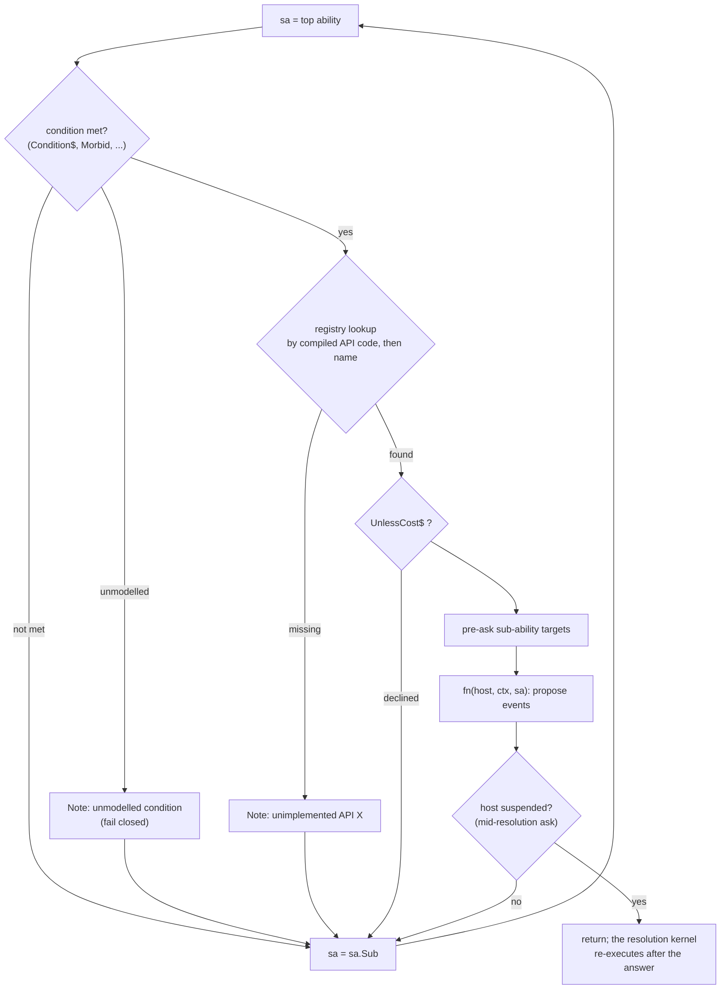

# Cards and primitives

gorge implements no card by hand. It compiles Forge card scripts into an
intermediate representation (IR) and implements the named **primitives** the IR
refers to. This page covers the runtime side: the IR, keyword expansion, the IR
cache, primitive registration and dispatch, unsupported-primitive detection, and
cost parsing and payment. The contributor workflow is in
[The card pipeline](../../contributing/card-pipeline.md) and
[Your first card fix](../../contributing/first-card-fix.md).

## From script to running effect

<figure markdown>
<svg viewBox="0 0 780 260" width="100%" role="img" aria-label="The card pipeline: Forge scripts are fetched, parsed and linked into the IR, cached by compiler fingerprint, loaded into a registry, checked for coverage, and dispatched at run time to registered primitives">
  <defs>
    <marker id="cp-a" viewBox="0 0 10 10" refX="9" refY="5" markerWidth="7" markerHeight="7" orient="auto"><path d="M0,0 L10,5 L0,10 z" class="dg-arrow"/></marker>
  </defs>
  <rect x="10" y="20" width="130" height="90" rx="8" class="dg-box-muted"/>
  <text x="75" y="46" text-anchor="middle" class="dg-text-bold">Forge scripts</text>
  <text x="75" y="66" text-anchor="middle" class="dg-text-muted">.cards/cardsfolder</text>
  <text x="75" y="82" text-anchor="middle" class="dg-text-muted">GPL-3.0, fetched,</text>
  <text x="75" y="98" text-anchor="middle" class="dg-text-muted">never committed</text>
  <rect x="170" y="20" width="140" height="90" rx="8" class="dg-box"/>
  <text x="240" y="46" text-anchor="middle" class="dg-text-bold">parse + link</text>
  <text x="240" y="66" text-anchor="middle" class="dg-text-mono">ParseBytes, Link</text>
  <text x="240" y="82" text-anchor="middle" class="dg-text-muted">keyword expansion,</text>
  <text x="240" y="98" text-anchor="middle" class="dg-text-muted">SVar resolution</text>
  <rect x="340" y="20" width="140" height="90" rx="8" class="dg-box"/>
  <text x="410" y="46" text-anchor="middle" class="dg-text-bold">IR cache</text>
  <text x="410" y="66" text-anchor="middle" class="dg-text-mono">ir-&lt;fp&gt;.gob.gz</text>
  <text x="410" y="82" text-anchor="middle" class="dg-text-muted">keyed by compiler</text>
  <text x="410" y="98" text-anchor="middle" class="dg-text-muted">fingerprint</text>
  <rect x="510" y="20" width="120" height="90" rx="8" class="dg-box"/>
  <text x="570" y="46" text-anchor="middle" class="dg-text-bold">Registry</text>
  <text x="570" y="66" text-anchor="middle" class="dg-text-mono">Lookup(name)</text>
  <text x="570" y="82" text-anchor="middle" class="dg-text-muted">cards + tokens,</text>
  <text x="570" y="98" text-anchor="middle" class="dg-text-muted">lazily materialised</text>
  <rect x="660" y="20" width="110" height="90" rx="8" class="dg-box"/>
  <text x="715" y="46" text-anchor="middle" class="dg-text-bold">deck</text>
  <text x="715" y="66" text-anchor="middle" class="dg-text-mono">rules.Config</text>
  <text x="715" y="82" text-anchor="middle" class="dg-text-muted">Decks, Tokens</text>
  <line x1="140" y1="65" x2="168" y2="65" class="dg-line" marker-end="url(#cp-a)"/>
  <line x1="310" y1="65" x2="338" y2="65" class="dg-line" marker-end="url(#cp-a)"/>
  <line x1="480" y1="65" x2="508" y2="65" class="dg-line" marker-end="url(#cp-a)"/>
  <line x1="630" y1="65" x2="658" y2="65" class="dg-line" marker-end="url(#cp-a)"/>
  <rect x="170" y="150" width="300" height="90" rx="8" class="dg-box-accent"/>
  <text x="320" y="176" text-anchor="middle" class="dg-text-bold">coverage: Face.Primitives() vs Supported()</text>
  <text x="320" y="198" text-anchor="middle" class="dg-text-mono">api:  trig:  stat:  repl:  kw:  count:</text>
  <text x="320" y="220" text-anchor="middle" class="dg-text-muted">playable iff nothing is missing</text>
  <rect x="510" y="150" width="260" height="90" rx="8" class="dg-box-accent"/>
  <text x="640" y="176" text-anchor="middle" class="dg-text-bold">run time: effects.Resolve</text>
  <text x="640" y="198" text-anchor="middle" class="dg-text-mono">fn := registry lookup of sa.API</text>
  <text x="640" y="220" text-anchor="middle" class="dg-text-muted">proposes events through Host</text>
  <line x1="570" y1="110" x2="400" y2="148" class="dg-line-dashed" marker-end="url(#cp-a)"/>
  <line x1="715" y1="110" x2="660" y2="148" class="dg-line" marker-end="url(#cp-a)"/>
</svg>
<figcaption>Compile once, cache by parser fingerprint, look cards up by name,
measure coverage statically, dispatch at run time.</figcaption>
</figure>
## Fetching and compiling

`cmd/forgec` has four subcommands, wrapped by the Makefile:

```sh
make fetch-cards     # forgec fetch -dir .cards -repo $(FORGE_REPO) -ref $(FORGE_REF)
make compile-cards   # forgec compile -dir .cards
make report          # forgec report -dir .cards
make coverage        # forgec coverage -dir .cards -out .coverage
```

`fetch` sparse-clones the card and token folders from gorge's Forge fork at the
pinned commit (`FORGE_REF` in the Makefile) and writes `.cards/cards.lock`. The
corpus feeds every golden replay, so a bump is a deliberate change.

`make report` prints the corpus pin, card and token counts, playable cards, and
the top missing primitives with the number of cards each would unlock. That list
is how the project picks what to build next. The numbers move with every merge;
re-run the command rather than quoting them.

## The IR

A Forge script is a list of `Key:Value` lines; ability lines are `|`-separated
`Key$ Value` parameters. An illustrative script (written for this page, not
copied from the corpus):

```text
Name:Ember Courier
ManaCost:1 R
Types:Creature Goblin
PT:1/1
K:Haste
T:Mode$ ChangesZone | Origin$ Any | Destination$ Battlefield | ValidCard$ Card.Self | Execute$ TrigEmber | TriggerDescription$ When CARDNAME enters, it deals 2 damage to target creature or planeswalker an opponent controls.
SVar:TrigEmber:DB$ DealDamage | NumDmg$ 2 | ValidTgts$ Creature.OppCtrl,Planeswalker.OppCtrl | TgtPrompt$ Select target creature or planeswalker an opponent controls
```

`cards.ParseBytes` ([`engine/cards/parse.go`](https://github.com/adams-shaun/gorge/blob/main/engine/cards/parse.go))
produces the types in
[`engine/cards/ir.go`](https://github.com/adams-shaun/gorge/blob/main/engine/cards/ir.go):

`Card` holds `Faces []*Face`. A `Face` holds `Abilities []*SA`, `Triggers`,
`Statics`, `Repls`, `Keywords`, `Types` and `SVars map[string]string`. An `SA`
has `Kind` (`SP|AB|DB|ST`), `API`, `Params` and `Sub *SA`; `Trigger.Effect` and
`Repl.With` are `*SA` as well.


| Script line | IR |
|---|---|
| `A:SP$ X \| ...`, `AB$`, `DB$` | `SA{Kind, API: "X", Params}` in `Face.Abilities` |
| `T:Mode$ M \| ...` | `Trigger{Mode: "M", Params}` |
| `S:Mode$ M1,M2 \| ...` | one `Static` per comma-separated mode, sharing `Params` |
| `R:Event$ E \| ...` | `Repl{Event: "E", Params}` |
| `K:Keyword` | appended to `Face.Keywords` (canonicalised) |
| `SVar:Name:body` | `Face.SVars["Name"] = body` |
| `ALTERNATE` | starts the next face (split, adventure, double-faced cards) |

**Linking** (`Face.link`, [`engine/cards/link.go`](https://github.com/adams-shaun/gorge/blob/main/engine/cards/link.go))
resolves references between lines. An ability's `SubAbility$`, a trigger's
`Execute$` and a replacement's `ReplaceWith$` name SVars; their bodies are parsed
as abilities and hung on `Sub`, `Effect` and `With`. Chains are capped at
`maxSVarDepth` (32); an unresolvable name is a compile diagnostic.

**SVars** hold a sub-ability or a value expression (`Count$...`).
`cards.ResolveSVar(svars, name)` parses a body through a cache keyed by body
text and returns a fresh copy. A numeric parameter is a literal or the name of
an SVar holding a value expression; `effects.Num` evaluates it, and an
expression the build does not model evaluates to zero, not to the default.

### Keyword expansion

Many keywords abbreviate an ordinary ability. Linking first runs
`Face.expandKeywords` ([`engine/cards/keywords.go`](https://github.com/adams-shaun/gorge/blob/main/engine/cards/keywords.go)),
which rewrites each such keyword into the trigger, replacement or activated
ability Forge would build, so nothing downstream sees a keyword.
Prowess, for example, is one `registerKeyword(kwProwess, "Prowess")` call whose
expander adds a `Mode$ SpellCast` trigger with a `DB$ Pump` `+1/+1` effect
([`kw_prowess.go`](https://github.com/adams-shaun/gorge/blob/main/engine/cards/kw_prowess.go)).


Expanders live in `engine/cards/kw_*.go` (`registerKeyword` panics on a duplicate
head). Expansion is keyed per keyword *line instance*, so a card printing a
keyword twice gets two triggers (CR 702.108b), while linking again adds nothing.
Casting options (Kicker, Flashback, Delve, Flash) and static properties
(Protection, Indestructible) are not expanded; the rules core reads them directly.

### The IR cache

The compiled corpus is cached at `.cards/ir-<fingerprint>.gob.gz`, with a binary
image beside it, `.cards/ir-<fingerprint>.seg`.

- **Fingerprint.** `cards.CompilerFingerprint`
  ([`engine/cards/fingerprint.go`](https://github.com/adams-shaun/gorge/blob/main/engine/cards/fingerprint.go))
  is a SHA-256 over the source of every IR-affecting file in `engine/cards`,
  embedded at build time. A different parser gets a different file name, so a
  build never reads foreign IR and worktrees can share one `.cards` directory. A
  census test forces every new file in the package to be classified as
  IR-affecting or not.
- **Schema.** `cacheVersion` separately guards the gob format.
- **Freshness.** A cache older than the card folders or `cards.lock` is rebuilt.
  An exclusive advisory lock beside the cache stops many test binaries compiling
  at once; writes are temp-file-plus-rename.
- **Loading.** The immutable, pointer-free image stays resident (rebuilt in
  memory when `.cards` is read-only); a `*cards.Card` is materialised on first
  lookup, so the garbage collector scans the cards in play, not the corpus.

## Primitives

A **primitive** is one named capability a card needs. `Face.Primitives()`
([`engine/cards/primitive.go`](https://github.com/adams-shaun/gorge/blob/main/engine/cards/primitive.go))
walks a face's abilities, sub-ability chains, SVars, triggers, statics,
replacements and keywords and lists them as prefixed labels. Ember Courier above
needs `kw:Haste`, `trig:ChangesZone` and `api:DealDamage`.

`effects.Supported()` returns what this build implements, in the same form:

| Prefix | From | Implemented where |
|---|---|---|
| `api:` | `SP$`/`AB$`/`DB$ <Name>` | an `effects.Effect` function, `effects.Register` |
| `trig:` | `T:Mode$ <Mode>` | `engine/rules` and `rules/trigmatch`, declared with `RegisterNonAPI` |
| `stat:` | `S:Mode$ <Mode>` | `engine/rules` (statics, layers), `RegisterNonAPI` |
| `repl:` | `R:Event$ <Event>` | `engine/rules` replacement code, `RegisterNonAPI` |
| `kw:` | `K:<Keyword>` | `engine/rules`, or an expander in `engine/cards` |
| `count:` | a `Count$<Head>` value an SVar reads | the evaluator in `engine/effects/count*.go` |

A few `api:` labels are replacement helpers in `engine/rules`, also declared with
`RegisterNonAPI`. `forgec report` additionally checks `shape:` labels: script
shapes whose body the engine deliberately declines at run time.

### Registering an effect

An effect is a plain function registered by name from an `init`
([`engine/effects/life.go`](https://github.com/adams-shaun/gorge/blob/main/engine/effects/life.go)):

```go
type Effect func(h Host, c *Ctx, sa *cards.SA)

func init() {
	Register("GainLife", effGainLife)
	// ...
}

func effGainLife(h Host, c *Ctx, sa *cards.SA) {
	n := Num(h, c, sa, "LifeAmount", 1)
	if n < 0 {
		n = 0
	}
	for _, t := range actingPlayers(h, c, sa) {
		h.Emit(events.Event{Kind: events.LifeChange, Player: t, Amount: n})
	}
}
```

The function never writes `Players[t].Life`. It reads the parameter and proposes
a `LifeChange` event, so replacement effects, triggers and the log all see it
through `Host.Emit`.

### The Host interface

`effects` never imports `rules`. It reaches the engine only through
`effects.Host`, the union of small role interfaces in
[`engine/effects/host_roles.go`](https://github.com/adams-shaun/gorge/blob/main/engine/effects/host_roles.go):

| Role | Examples |
|---|---|
| `HostRead` | `Game()`, `Chars(id)`, `Power`, `Toughness`, `HasKeyword` |
| `HostEmit` | `Emit(events.Event)`, `EmitDamage`, `EmitTokenCreate`, `EmitTap` |
| `HostBatch` | begin/end damage and zone-change batches |
| `HostRNG` | `Rand`, `ShuffleLibrary` (the result is emitted as a `Shuffle` event) |
| `HostContinuous` | `AddContinuous`, `RegisterControl`, `EndEffect` |
| `HostRestrictions` | `SacrificeBlocked`, `ExileBlocked`, `CounterAllowed` |
| `HostReplacements` | `ActionReplaced`, `Scry`, `ReplaceEvent` |
| `HostTargeting` | `LegalTargets`, `LegalSubTargets`, `ChooserFor` |
| `HostTriggers` | `TriggerModeSupported`, `QueueReflexiveTrigger` |
| `HostCastLedger`, `HostTurnLedger` | what was cast, life lost, cards drawn this turn |
| `HostConditions` | revolt, delirium, metalcraft |
| `HostAsk` | `Ask(*decision.Decision)`, `Suspended()` |

`*rules.Engine` implements all of it. An effect that needs something `Host` does
not offer is doing rules work; fix it in `engine/rules`.

### Resolution: walking the chain

`rules` calls `effects.Resolve(h, ctx, sa)`
([`engine/effects/registry.go`](https://github.com/adams-shaun/gorge/blob/main/engine/effects/registry.go))
when a spell or ability resolves. It walks the ability and its `SubAbility$`
chain (at most 32 links):



`Ctx` carries what an effect needs beyond its parameters: source and controller,
chosen targets, remembered and sacrificed objects, paid costs, X, chosen modes
and last-known-information snapshots taken before the chain began.

## Catching an unsupported primitive

**Statically**, `cards.Registry.Unsupported(card, effects.Supported())` lists
every label the card needs that the build lacks; a card is playable only if the
list is empty. The server's deck import uses it, and two ratchets in
`engine/rules` hold the repository's own decks to it. Both fail in both
directions (a new gap, and a stale baseline entry):

- `TestEveryRepoDeckIsFullySupported` compares each repo-deck card's gap with
  the per-card files in `engine/rules/testdata/known-unsupported/` (the directory
  is absent while nothing is outstanding).
- `TestEveryRepoDeckParamsAreRead` (the *param census*) catches a primitive that
  is registered but ignores one of the card's parameters. It derives every
  `Params["Key"]` read from the `engine/effects` and `engine/rules` sources,
  attributes it to a primitive, and reports `param:<Primitive>.<Key>` for an
  unread key and `cost:` for a cost token the parser does not model. Its
  baseline is `engine/rules/testdata/paramcensus/`.

**At run time**, an unregistered API is loud but harmless: `effects.Resolve`
finds no function, emits a `Note` (`"unimplemented API " + sa.API`), skips that
link and continues. The `Note` is replay-visible. Filters (an unknown predicate
matches nothing) and conditions fail closed the same way.

## Filters and values

Scripts describe sets of objects and players in a small filter language
(`ValidTgts$ Creature.OppCtrl+nonArtifact`, `Defined$ Self`,
`Affected$ Creature.YouCtrl`): a base type, `.`-separated `+`-joined predicates,
alternatives ORed with `,`, and a `non` prefix for negation.
`effects.MatchesSpec` and `MatchesSpecFrom`
([`engine/effects/filter.go`](https://github.com/adams-shaun/gorge/blob/main/engine/effects/filter.go))
evaluate it. Value expressions (`Count$CardsInYourHand`, optional `/Op` suffix)
go through `effects.EvalCount`
([`engine/effects/count.go`](https://github.com/adams-shaun/gorge/blob/main/engine/effects/count.go));
the heads it models are the `count:` primitives.

## Costs and payment

**Parsing.** `cost.ParseCost`
([`engine/rules/cost/parse.go`](https://github.com/adams-shaun/gorge/blob/main/engine/rules/cost/parse.go))
accepts Forge's `2 U U` and `{2}{U}{U}` and produces a `Cost`: coloured and
generic mana, X, hybrid, Phyrexian and snow pips, tap and untap, life, and
non-mana `CostPart`s (sacrifice, discard, exile, remove counters, reveal, tap
untapped creatures, ...). A token the parser does not model lands in
`Cost.Unknown`, which the param census reports. `rules/cost` is a leaf: it
imports only `state`.

**Planning.** `rules/pay`
([`engine/rules/pay/doc.go`](https://github.com/adams-shaun/gorge/blob/main/engine/rules/pay/doc.go))
is the payment planner. Given the mana sources a player could tap and what each
would cost or consume, a bounded search finds the best plan under a
lexicographic `Rank` (total cost, creatures tapped, sources used, surplus,
flexibility, cards held in hand, ...). It is pure: no events, RNG or clock
(`TestPayStaysDeterministic`). The chosen plan's `Witness` becomes a
`decision.PaymentPlan` a seat can pick.

**Paying.** The cost is determined after targets are chosen and before anything
is paid (CR 601.2f-h). There are two payment windows:

- **Planned.** The priority decision's `PaymentActions` carry ready-made plans
  and the seat picks one with the cast. Bots do this by default
  (`seat.PaymentPlanConsumer`).
- **Announced** (`Intent.Announce`). The seat announces the cast and the engine
  poses a CR 601.2g "select mana" window with one option per (source, ability,
  colour), Auto-fill, Undo last tap and Cancel. Undo is a `ManaUndo` event, so a
  retracted tap is still in the log.

Either way mana comes from real mana-ability activations (`ManaAdd` events) and
the commit happens only once the whole cost is covered. See
[The rules core](rules.md#casting-cr-601) for where payment sits in a cast.
