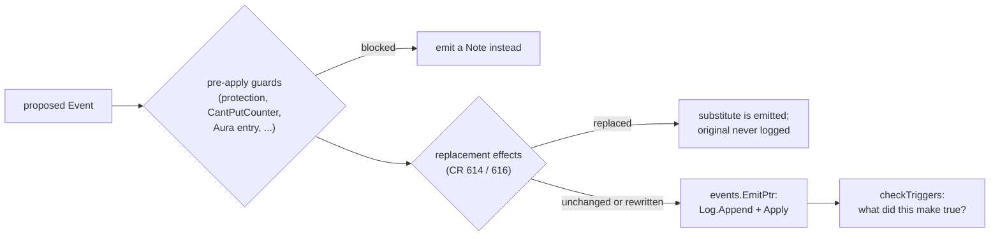
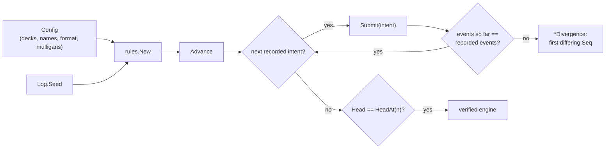

# Events and replay

gorge is event-sourced: every change to a game is an `events.Event`, folded
into state by one function and appended to a hash-chained log. This page
explains that mechanism, the list of event kinds, the hash chain and golden
heads, how replay works, and how clones and the resolution kernel build on it.
Read it before you write engine code that changes anything, because the rules
here are what keep replays, bug reports and search correct.

*Facts on this page are from `develop` @ `25d71cadc` (2026-10-27). Code links
point at `main`.*

## The loop

<figure markdown>
<svg viewBox="0 0 780 370" width="100%" role="img" aria-label="The event loop: an intent enters the engine, the engine proposes events, each event is appended to the hash-chained log and folded into state by events.Apply, and the view projects state for each seat">
  <defs>
    <marker id="ev-a" viewBox="0 0 10 10" refX="9" refY="5" markerWidth="7" markerHeight="7" orient="auto"><path d="M0,0 L10,5 L0,10 z" class="dg-arrow"/></marker>
    <marker id="ev-b" viewBox="0 0 10 10" refX="9" refY="5" markerWidth="7" markerHeight="7" orient="auto"><path d="M0,0 L10,5 L0,10 z" class="dg-arrow-accent"/></marker>
  </defs>
  <!-- seat -->
  <rect x="10" y="130" width="110" height="70" rx="8" class="dg-box"/>
  <text x="65" y="160" text-anchor="middle" class="dg-text-bold">Seat</text>
  <text x="65" y="180" text-anchor="middle" class="dg-text-muted">bot or client</text>
  <!-- engine -->
  <rect x="170" y="110" width="170" height="110" rx="8" class="dg-box"/>
  <text x="255" y="136" text-anchor="middle" class="dg-text-bold">rules.Engine</text>
  <text x="255" y="158" text-anchor="middle" class="dg-text-mono">Submit(intent)</text>
  <text x="255" y="176" text-anchor="middle" class="dg-text-mono">emit(event)</text>
  <text x="255" y="198" text-anchor="middle" class="dg-text-muted">replacements, triggers</text>
  <!-- log -->
  <rect x="400" y="20" width="200" height="90" rx="8" class="dg-box-accent"/>
  <text x="500" y="46" text-anchor="middle" class="dg-text-bold">events.Log</text>
  <text x="500" y="68" text-anchor="middle" class="dg-text-mono">Events, Intents, Seed</text>
  <text x="500" y="90" text-anchor="middle" class="dg-text-muted">chain = sha256(chain || e)</text>
  <!-- apply / state -->
  <rect x="400" y="220" width="200" height="90" rx="8" class="dg-box-accent"/>
  <text x="500" y="246" text-anchor="middle" class="dg-text-bold">events.Apply</text>
  <text x="500" y="268" text-anchor="middle" class="dg-text-mono">state.Game</text>
  <text x="500" y="290" text-anchor="middle" class="dg-text-muted">pure fold of (g, e)</text>
  <!-- view -->
  <rect x="650" y="130" width="120" height="70" rx="8" class="dg-box"/>
  <text x="710" y="160" text-anchor="middle" class="dg-text-bold">view</text>
  <text x="710" y="180" text-anchor="middle" class="dg-text-muted">per-seat projection</text>
  <!-- arrows -->
  <line x1="120" y1="150" x2="168" y2="150" class="dg-line" marker-end="url(#ev-a)"/>
  <text x="144" y="142" text-anchor="middle" class="dg-text-muted">1 intent</text>
  <line x1="340" y1="140" x2="398" y2="80" class="dg-line-accent" marker-end="url(#ev-b)"/>
  <text x="364" y="132" class="dg-text-muted">2 append</text>
  <line x1="340" y1="190" x2="398" y2="250" class="dg-line-accent" marker-end="url(#ev-b)"/>
  <text x="340" y="242" class="dg-text-muted">3 fold</text>
  <line x1="600" y1="250" x2="660" y2="200" class="dg-line" marker-end="url(#ev-a)"/>
  <text x="640" y="246" class="dg-text-muted">4 read</text>
  <line x1="600" y1="80" x2="660" y2="130" class="dg-line-dashed" marker-end="url(#ev-a)"/>
  <text x="636" y="94" class="dg-text-muted">redacted log</text>
  <path d="M710,200 C710,375 65,375 65,202" class="dg-line" marker-end="url(#ev-a)"/>
  <text x="390" y="358" text-anchor="middle" class="dg-text-muted">5 view + next decision</text>
</svg>
<figcaption>One trip round the loop. An intent enters the engine (1). Engine
code proposes events; each is appended to the log and hashed (2), then folded
into <code>state.Game</code> by <code>events.Apply</code> (3). The view reads
state and the redacted log (4) and hands the next seat its projection and
decision (5).</figcaption>
</figure>

## One mutation path

Package [`events`](https://github.com/adams-shaun/gorge/blob/main/engine/events/apply.go)
is the only package allowed to write `state.Game`. The engine's two entry
points both end in the same place:

```go
// Emit is the engine's only mutation path: append to the log, then fold into
// state. Replay calls Apply directly with logged events, so post-replay state
// equals post-play state by construction.
func Emit(g *state.Game, l *Log, e Event) Event {
	EmitPtr(g, l, &e)
	return e
}

func EmitPtr(g *state.Game, l *Log, e *Event) {
	l.AppendPtr(e)
	ApplyPtr(g, e)
}
```

`Apply` "must stay a pure function of (g, e): no randomness, no clock, no
reads outside g". It is one big switch over the event kind, with most cases
delegating to a `foldX` helper in one of the `apply_*.go` files:

```go
func applyKind(g *state.Game, e *Event) {
	switch e.Kind {
	case GameStart, DecisionAsk, DecisionMade, ModeChosen, ManaActivate, RollDice:
		// Markers. ...
	case SetupEntered:
		// ...
	case EndTurn:
		foldEndTurn(g, e)
	// ... one case per kind
	}
}
```

`Apply` returns nothing and has no error path. A malformed event (a missing
object, an unknown counter shape) is a silent no-op by design, the same
"totality" stance in every case, so a damaged log degrades instead of
crashing a match.

Inside the rules engine, code never calls `events.Emit` directly; it calls
`Engine.emit` ([`engine/rules/emit.go`](https://github.com/adams-shaun/gorge/blob/main/engine/rules/emit.go)),
which wraps the fold with the rules that must see every event:



Card effects in `engine/effects` reach the same function through the
`effects.Host` interface (`Host.Emit`, `EmitDamage`, `EmitTokenCreate`, ...),
so an effect can only ever *propose* an event; it never writes a field.

!!! warning "What is not an event"
    Genesis is the one exception. `state.NewGame` and the `AddObject` calls
    that build each player's deck into the object arena run in `rules.New`
    before the log exists, and the commander bookkeeping is set there too.
    The log therefore never contains deck contents or player names. A
    faithful replay needs the original `rules.Config` **and** the log
    ([`engine/rules/doc.go`](https://github.com/adams-shaun/gorge/blob/main/engine/rules/doc.go)).
    From `GameStart` onward, everything is an event.

## The event record

Every event has the same flat shape
([`engine/events/event.go`](https://github.com/adams-shaun/gorge/blob/main/engine/events/event.go)):

```go
type Event struct {
	Seq     uint64           `json:"seq"`
	Kind    Kind             `json:"kind"`
	Player  state.PlayerID   `json:"player,omitempty"`
	Obj     state.ObjID      `json:"obj,omitempty"`
	From    state.Zone       `json:"from,omitempty"`
	To      state.Zone       `json:"to,omitempty"`
	Amount  int32            `json:"amount,omitempty"`
	Step    state.Step       `json:"step,omitempty"`
	Counter string           `json:"counter,omitempty"`
	Text    string           `json:"text,omitempty"`
	IDs     []state.ObjID    `json:"ids,omitempty"`
	Pairs   [][2]state.ObjID `json:"pairs,omitempty"`
	// Secret marks an event whose payload is hidden information. View
	// projection redacts it for everyone but Player.
	Secret bool `json:"secret,omitempty"`
}
```

New kinds reuse these fields rather than adding new ones; each kind's comment
says what `Amount`, `Text` or `IDs` mean for it. A flat record keeps the
encoding, the hash and the wire format one shape for every kind.

Events carry **results, not dice**. A shuffle's `Shuffle` event carries the
resulting order in `IDs` (and is `Secret`); `Apply` installs that order and
never touches the RNG. Randomness happens in the engine, before the event is
proposed.

## Event kinds

`events.Kind` is a `uint8`. There are **145** kinds, ordinals 0 to 144
(`events.NumKinds == 145`, measured by printing the constant from a scratch
program that imports `engine/events`). Each kind has exactly one entry in the
`kindInfo` table in
[`engine/events/kindinfo.go`](https://github.com/adams-shaun/gorge/blob/main/engine/events/kindinfo.go),
which derives its log/wire name, its trigger-interest class (which triggered
abilities could possibly care about it) and its transcript template.
`TestEveryKindHasADescriptor` fails for a kind with no entry.

**The list is append-only.** The ordinal is part of each event's encoding,
and the encoding is hashed, so inserting a kind in the middle would renumber
every later kind and change the hash of every recorded game. A new kind goes
after the last one, above the `NumKinds` line.

<figure markdown>
<svg viewBox="0 0 780 200" width="100%" role="img" aria-label="A timeline of event kind ordinals 0 to 144: the core kinds 0 to 23, then later kinds appended in order, ending at DayNightChange, ordinal 144">
  <rect x="20.0" y="80" width="122.5" height="36" class="dg-box-accent"/>
  <rect x="142.5" y="80" width="25.5" height="36" class="dg-box"/>
  <rect x="168.0" y="80" width="35.7" height="36" class="dg-box-accent"/>
  <rect x="203.7" y="80" width="556.3" height="36" class="dg-box"/>
  <text x="20.0" y="132" text-anchor="middle" class="dg-text-mono">0</text>
  <text x="142.5" y="132" text-anchor="middle" class="dg-text-mono">24</text>
  <text x="168.0" y="132" text-anchor="middle" class="dg-text-mono">29</text>
  <text x="203.7" y="132" text-anchor="middle" class="dg-text-mono">36</text>
  <text x="760.0" y="132" text-anchor="middle" class="dg-text-mono">144</text>
  <text x="81.2" y="103" text-anchor="middle" class="dg-text-mono">core</text>
  <text x="481.9" y="103" text-anchor="middle" class="dg-text-mono">36-144: every later mechanic, appended in landing order</text>
  <line x1="155.3" y1="80" x2="155.3" y2="26" class="dg-line"/>
  <text x="159.3" y="22" class="dg-text-muted">24-28: TargetsChosen, FlipFace, ClockTick, TriggerPush, EndCombatReset</text>
  <line x1="185.9" y1="80" x2="185.9" y2="54" class="dg-line"/>
  <text x="189.9" y="50" class="dg-text-muted">29-35: CastInfo, Choose, TokenCreate, StackCopy, Attach, AbilityPush, ModeChosen</text>
  <text x="20" y="156" class="dg-text-muted">0-23: GameStart, Shuffle, MoveZone, Draw, Damage, Priority, DecisionAsk, Note, LandPlayed ...</text>
  <text x="20" y="174" class="dg-text-muted">36-144: CmdDamage, DelayedRegister, ControlChange, Mutate, Scry, Surveil, Meld, SpellCastReversed ... DayNightChange</text>
  <text x="760" y="194" text-anchor="end" class="dg-text-bold">NumKinds = 145 (Kind is a uint8)</text>
</svg>
<figcaption>Kinds are grouped by when they were appended, never by topic. The
core kinds came first; every later mechanic appended its own kind at the end
so no earlier ordinal, hash or golden replay moved. The scale is
proportional to ordinal.</figcaption>
</figure>

??? details "All 145 kinds by ordinal"
    | Ordinals | Kinds |
    |---|---|
    | 0-9 | GameStart, Shuffle, MoveZone, Draw, LifeChange, Damage, Tap, Untap, StepChange, TurnChange |
    | 10-19 | Priority, PutOnStack, Resolve, ManaAdd, ManaClear, CounterChange, DeclareAttackers, DeclareBlockers, PlayerLost, GameOver |
    | 20-29 | DecisionAsk, DecisionMade, Note, LandPlayed, TargetsChosen, FlipFace, ClockTick, TriggerPush, EndCombatReset, CastInfo |
    | 30-39 | Choose, TokenCreate, StackCopy, Attach, AbilityPush, ModeChosen, CmdDamage, DelayedRegister, DelayedPush, LibraryOrder |
    | 40-49 | ExtraTurn, DoorUnlock, SpeedChange, MonarchChange, ControlChange, CardToken, KeywordTriggerPush, Goad, PlayerCounterChange, Imprint |
    | 50-59 | StartingPlayerChange, Pair, MyriadCopy, MyriadCleanup, GrantTriggerPush, ManaActivate, TokenAttacks, XChange, NoteNumber, ExtraPhase |
    | 60-69 | CopyToken, Exert, PlanarRoll, Explore, CombatRetarget, RingTemptsYou, RingEmblemPush, GrantAbilityPush, Investigate, BlessingChange |
    | 70-79 | ClonePermanent, Mutate, MergedTriggerPush, Discover, Seek, Connive, Enlist, Exploit, AlterAttribute, GainedAbilityPush |
    | 80-89 | GainedTriggerPush, Surveil, Unattached, PlayerNoted, PlayerNoteCleared, DelayedRemove, TurnFaceUp, SearchedLibrary, KeywordAbilityPush, Scry |
    | 90-99 | StoreSVar, TurnFaceDown, CloneStatic, DamageProvenance, EnduringStoryChange, PhaseOut, GiftPromise, GiveGift, RollDice, Proliferate |
    | 100-109 | Evolved, DelayedForget, CardNoted, Cascade, Clash, PlanarDeckShuffle, PlanarReveal, PlanarWalk, Specialize, ChaosEnsues |
    | 110-119 | ManaUndo, EndTurn, DungeonCreate, DungeonRoom, DungeonComplete, DungeonRemove, InitiativeChange, SkipTurn, ControlPlayerChange, Crew |
    | 120-129 | ElementalBend, SetupEntered, DoorLock, Saddle, ClassLevelChange, MillProposal, Meld, ExcessDamage, ForageAction, ManifestDreadAction |
    | 130-139 | CollectEvidenceAction, AbilityTriggered, CastBattlefield, DrawBatchProposal, SpellCastReversed, HiddenIdentity, DrawEmpty, SetupSettled, BlockedByEffect, CopyExcept |
    | 140-144 | GameRestart, ActivationReversed, TextChange, HadToAttack, DayNightChange |

A few kinds deserve a note because they show the design pressure:

- **Markers.** `DecisionAsk`, `DecisionMade` and `ModeChosen` fold nothing.
  They exist so that the questions asked and the answers given are in the
  hashed stream: a replay that asks a different question diverges right
  there.
- **`Note`** is the engine's "tell everyone" channel: a prevented damage, a
  fallback taken by a host that could not answer, an unimplemented primitive.
  Notes are hashed like every other event, so a new Note moves the chain head.
- **`TriggerPush` and `AbilityPush`** create a stack object *and* place it in
  one event. They were added after a live engine minted stack objects with an
  unlogged `AddObject`, which a log-only replay could never reproduce.
- **`ClockTick`** exists because the timestamp clock used to be incremented
  by a direct field write. Every such bug was fixed the same way: turn the
  write into an event.

## The hash chain

The log ([`engine/events/log.go`](https://github.com/adams-shaun/gorge/blob/main/engine/events/log.go))
holds the events, the intents that produced them and the seed:

```go
type Log struct {
	Seed    uint64            `json:"seed"`
	Events  []Event           `json:"events"`
	Intents []decision.Intent `json:"intents"`
	// ... unexported chain state, verify window, capacity bookkeeping
}
```

<figure markdown>
<svg viewBox="0 0 780 170" width="100%" role="img" aria-label="The SHA-256 hash chain: the chain starts from the hash of the seed, and each event's encoding is hashed together with the previous chain value; the head is the first 8 bytes in hex">
  <defs>
    <marker id="hc-a" viewBox="0 0 10 10" refX="9" refY="5" markerWidth="7" markerHeight="7" orient="auto"><path d="M0,0 L10,5 L0,10 z" class="dg-arrow-accent"/></marker>
  </defs>
  <rect x="10" y="50" width="120" height="56" rx="6" class="dg-box"/>
  <text x="70" y="74" text-anchor="middle" class="dg-text-mono">sha256(seed)</text>
  <text x="70" y="94" text-anchor="middle" class="dg-text-muted">chain_0</text>
  <rect x="180" y="50" width="150" height="56" rx="6" class="dg-box-accent"/>
  <text x="255" y="74" text-anchor="middle" class="dg-text-mono">sha256(c0 || e0)</text>
  <text x="255" y="94" text-anchor="middle" class="dg-text-muted">e0 = GameStart</text>
  <rect x="380" y="50" width="150" height="56" rx="6" class="dg-box-accent"/>
  <text x="455" y="74" text-anchor="middle" class="dg-text-mono">sha256(c1 || e1)</text>
  <text x="455" y="94" text-anchor="middle" class="dg-text-muted">e1 = Shuffle</text>
  <text x="565" y="82" class="dg-text-bold">...</text>
  <rect x="600" y="50" width="170" height="56" rx="6" class="dg-box-solid"/>
  <text x="685" y="74" text-anchor="middle" class="dg-text-on">chain_n</text>
  <text x="685" y="94" text-anchor="middle" class="dg-text-on">Head() = hex(first 8 B)</text>
  <line x1="130" y1="78" x2="178" y2="78" class="dg-line-accent" marker-end="url(#hc-a)"/>
  <line x1="330" y1="78" x2="378" y2="78" class="dg-line-accent" marker-end="url(#hc-a)"/>
  <line x1="530" y1="78" x2="558" y2="78" class="dg-line-accent" marker-end="url(#hc-a)"/>
  <line x1="578" y1="78" x2="598" y2="78" class="dg-line-accent" marker-end="url(#hc-a)"/>
  <text x="390" y="140" text-anchor="middle" class="dg-text-muted">e_i = Event.Append(): Seq, Kind, Player, From, To, Step, Obj, Amount, Secret, then length-prefixed Counter, Text, IDs, Pairs</text>
  <text x="390" y="158" text-anchor="middle" class="dg-text-muted">intents are stored in the log but not hashed; every event kind is hashed, Notes included</text>
</svg>
<figcaption>The chain is seeded with <code>sha256(seed)</code> and folds each
event's compact encoding. <code>Head()</code> prints the first 8 bytes as 16
hex digits.</figcaption>
</figure>

The encoding (`Event.Append`) writes every field, length-prefixing the
variable ones, "so two different events can never encode identically". Two
logs with the same head describe the same match, and comparing two games is a
single string comparison. `HeadAt(n)` recomputes the head over the first `n`
events, which is what makes "replay to event N" checkable.

Hashing is lazy: `Append` stores the event and counts it as unhashed, and the
fold runs when something first reads the head or clones the log. A search
clone that plays out a simulation and is thrown away never pays a SHA-256 per
event, and the eventual head is byte-identical to an eager fold. Benchmarks
can set `Log.NoHash` to measure the cost of the audit trail; production never
does.

## Golden heads

The acceptance game plays 12 pinned Legacy decks at 2, 4, 6 and 8 seats
(seed 42, one mulligan allowed). `TestHeads`
([`engine/rules/heads_test.go`](https://github.com/adams-shaun/gorge/blob/main/engine/rules/heads_test.go))
pins each game's chain head in `engine/rules/testdata/heads/<seats>.txt`, one
16-hex-digit line per file (`cat engine/rules/testdata/heads/*.txt` prints
the current four). The files are the authority, and they move whenever a
change alters what those games do, which is often. A moved head is not automatically a bug: it
means "this change altered gameplay", and the commit that moves it names the
first event that diverged. To find that event and re-pin:

```sh
go test ./engine/rules/ -run '^TestHeads$'          # fails and names the seat count
go run ./cmd/headdiff -seats 2 -dump before.jsonl   # on the old commit: write the event stream
go run ./cmd/headdiff -seats 2 -against before.jsonl  # on the new one: print the first divergence
GORGE_UPDATE_HEADS=1 go test ./engine/rules/ -run '^TestHeads$'  # re-pin, once the change is intended
```

On `25d71cadc`, `go run ./cmd/headdiff -seats 2` prints `2 seats: 2558 events,
head 9a22e5122a3d436a (matches the pinned head)`; the 4-seat game is 5,718
events.

`TestRepoDeckGamesReplayExactly` is the companion check: it plays several
seeds, replays each game, and requires the replay's head to equal the
original's.

## Replay

Package [`engine/replay`](https://github.com/adams-shaun/gorge/blob/main/engine/replay/replay.go)
rebuilds a match from `(Config, Log)`:

```go
func Replay(l *events.Log, cfg rules.Config) (*rules.Engine, error)
func ReplayTo(l *events.Log, cfg rules.Config, n int) (*rules.Engine, error)
func Walk(l *events.Log, cfg rules.Config, n int, visit func(e *rules.Engine, i int) error) (*rules.Engine, error)
func FirstDivergence(want, got []events.Event) *Divergence
```

Replay **re-executes** the game: it builds a fresh engine from the config
(with the log's seed), calls `Advance`, then `Submit`s each recorded intent in
order, comparing the rebuilt event stream with the recorded one after every
step. It does not just re-fold the logged events. That choice is what makes
replay a test: an engine that has changed since the game was recorded either
rejects a recorded intent (a plain error) or produces a different event, and
`Divergence` names the first one:

```text
replay diverged at event 1832: recorded MoveZone, replayed Note
```

A full replay also checks the rebuilt head against `l.HeadAt(len(l.Events))`.
(A pure fold of the logged events into a fresh `state.Game` also exists, as a
rules-internal fidelity harness in the tests; it proves that `Apply` alone
reconstructs the state.)



### Why event-sourced

| Need | What the log gives it |
|---|---|
| Regression detection | One golden head per acceptance game catches any change to gameplay, down to the first differing event. |
| Bug reports | A player's feedback report captures the match config and log; `go run ./cmd/repro <dir>` replays it to the report point and verifies the head. See the repository's AGENTS.md section *Reproduce a feedback report*. |
| History and undo | The server rebuilds any past position with `replay.ReplayTo`, and its undo is a rewind in place: rebuild to an earlier intent, truncate the log. It never reseeds, which would fork the chain. |
| Search | A clone at an intent boundary is exact: the same intents produce the same events, head and RNG draw count. |
| Trust | The server, not the client, owns the log. A client's claim about what happened can always be checked against it. |

The server does not resume an in-progress match after a restart: a match that
was live when the process stopped is marked aborted, and finished matches are
served by replay. See [The server tier](server.md).

## Clones

`Engine.Clone` ([`engine/rules/clone.go`](https://github.com/adams-shaun/gorge/blob/main/engine/rules/clone.go))
deep-copies the game, the log (sharing the history prefix), the RNG position,
the pending decision, continuous effects and the trigger bookkeeping. Card
data is shared, since it is immutable. The guarantee is that the same intents
submitted to both produce the same events, chain head and RNG draw count.

Clone only at an **intent boundary**: after `New`, `Advance` or `Submit` has
returned, so either a decision is pending or the game is over. That is the
only moment no engine frame is half-way through writing its own fields. The
host clones at every turn start to serve historical views quickly.

Batch runners avoid allocation with `CloneInto(&spare)` and `Release()`,
which hand the log and object arena back for reuse; capacity is never
observable, so a recycled game is byte-identical to a fresh one. Which engine
fields are copied, and how, is driven by `clone:` struct tags and generated
code, so a new field cannot be forgotten silently.

For search, `NewHypothetical(cfg, prefix)` and `CloneHypothetical(seed)` build
an engine with its own *chance stream*: forced random outcomes followed by a
fresh generator. That is a search world, never a match: nothing from it is
ever logged as a real game.

## The resolution kernel's verify window

The [game-loop page](game-loop.md#questions-asked-in-the-middle-of-a-resolution)
describes how a decision posed mid-resolution is answered by restoring a
checkpoint and re-executing the resolution. The log makes that safe:

- `Log.RewindTo(s0, end)` restores the checkpoint's chain state and opens a
  **verify window** over the events already recorded.
- An append inside the window stores nothing. It encodes the new event,
  compares it byte for byte with the recorded one at that index, and panics
  with `LogDivergence` if they differ.
- `VerifyClose` reports whether the whole recorded prefix was reproduced. The
  window is always closed at an intent boundary.

So re-execution cannot quietly rewrite history: either it reproduces exactly
what was already logged and then continues, or the engine stops.

## Determinism

A log is only a description of a match if the same inputs always produce the
same events. The rules that guarantee it, and the tests that enforce them:

| Rule | Enforced by |
|---|---|
| The engine's only randomness is a seeded PCG (`math/rand/v2`, seeded with `(seed, seed ^ 0x9e3779b97f4a7c15)`) owned by the engine, with a draw counter | `engine/rules/rng.go`; `TestNoLegacyMathRand` forbids `math/rand` v1 |
| No wall clock in the engine | `TestTimeIsImportedOnlyByTheHost`: only the server tier and a few commands may import `time` |
| The payment planner touches no clock, RNG, `sync` or `os` | `TestPayStaysDeterministic` |
| No map iteration whose order reaches an event | by convention and targeted tests (for example `TestActiveStaticsIsDeterministicallyOrdered`); caught after the fact by the golden heads |

The RNG's draw counter (`Engine.RNGDraws()`) is a cheap tripwire: a replay
that consumes a different number of random values has diverged even before
an event differs. [Invariants](../invariants.md) lists these rules with the
legitimate way to change each.
