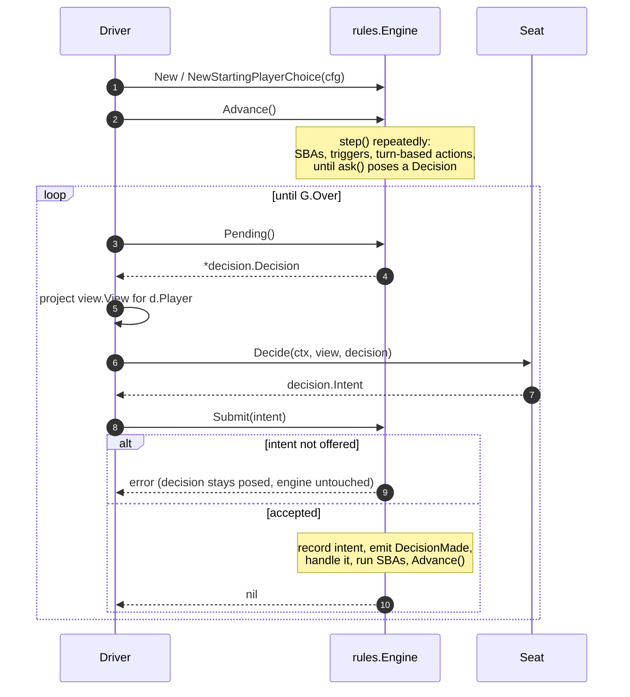
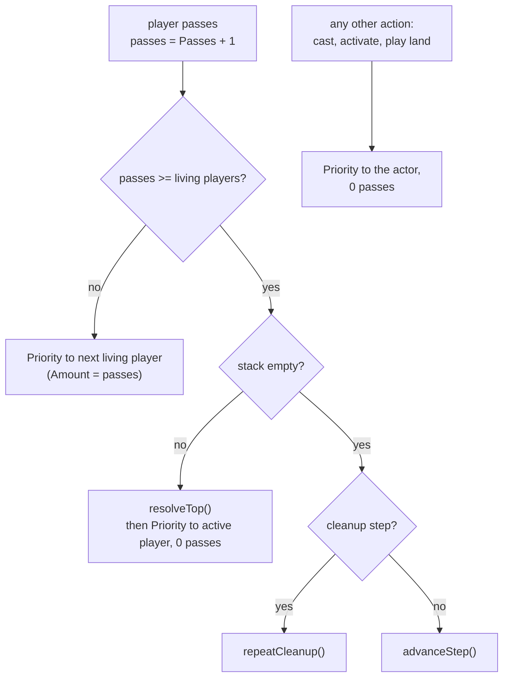
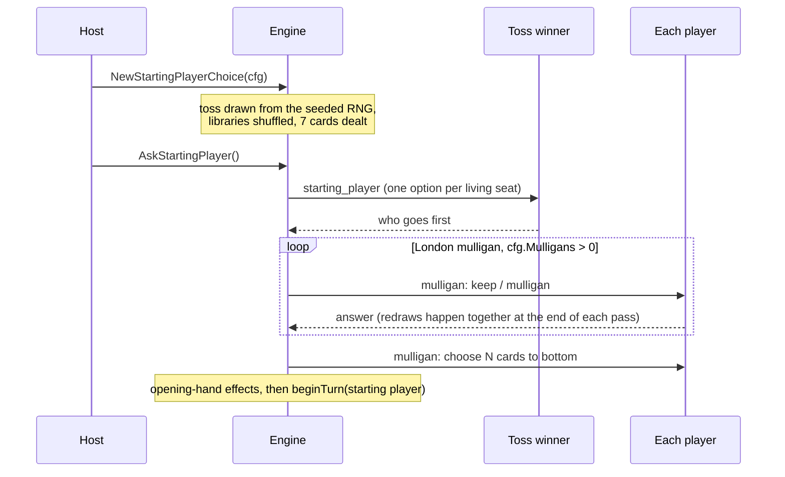
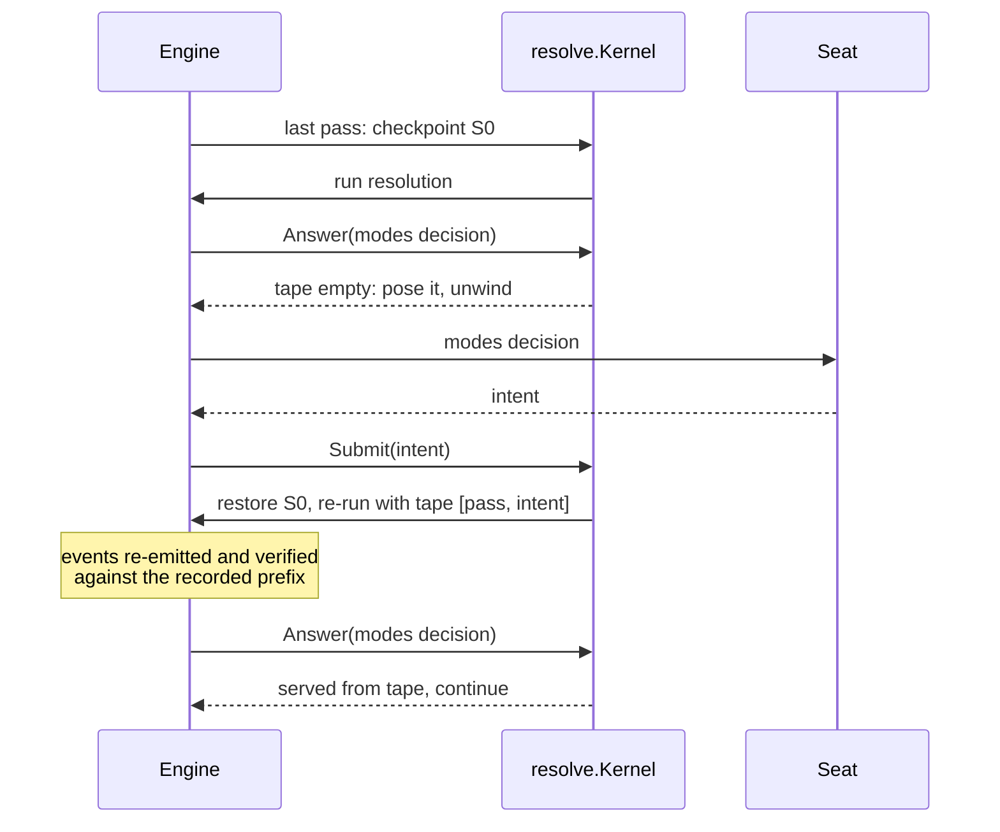

# Game loop and decisions

How a game runs from the opening shuffle to the last pass: how the engine walks
turns, steps and priority, how it stops to ask a player something, and how the
answer comes back. For anyone writing a seat (a bot or client), a driver (a
host, test harness or simulator), or engine code that asks a player a question.

## The driving contract: Advance, Pending, Submit

A host drives a game through the [`engine/game`](../index.md#the-engine-seam)
interfaces; a test or simulator can drive the rules engine directly. A
`rules.Engine` exposes three calls
([`engine/rules/engine.go`](https://github.com/adams-shaun/gorge/blob/main/engine/rules/engine.go),
[`engine_host.go`](https://github.com/adams-shaun/gorge/blob/main/engine/rules/engine_host.go)):

```go
// Advance runs engine work until a decision is required or the game ends.
func (e *Engine) Advance() {
	if e.tossChoice.active && e.pending == nil {
		e.resolveTossChoiceDefault()
	}
	for !e.G.Over && e.pending == nil {
		e.step()
	}
}

func (e *Engine) Pending() *decision.Decision { return e.pending }

// Submit applies a client's answer. Anything the engine did not offer is
// rejected, which is what keeps the client rules-ignorant.
func (e *Engine) Submit(in decision.Intent) error
```

A driver calls `Advance` once after building the engine. After that `Submit`
advances the game itself (`submitCommit` ends in `e.Advance()`), so the driver
loop is *read `Pending`, ask a seat, `Submit`*. `Pending`'s pointer is valid
only until the next `Submit` or `Advance`; keep a decision by cloning it
(`d.Clone()`).



## Turns, steps and priority

A turn walks twelve steps, declared in
[`engine/state/ids.go`](https://github.com/adams-shaun/gorge/blob/main/engine/state/ids.go).
There is one combat damage step: first strike is two damage passes inside it
([`engine/state/phase.go`](https://github.com/adams-shaun/gorge/blob/main/engine/state/phase.go)).

```mermaid
stateDiagram-v2
  direction LR
  [*] --> Untap: beginTurn emits TurnChange
  Untap --> Upkeep: no priority
  Upkeep --> Draw
  Draw --> Main1: first player skips turn-1 draw (CR 103.8a)
  Main1 --> BeginCombat
  BeginCombat --> DeclareAttackers
  DeclareAttackers --> DeclareBlockers: attackers declared
  DeclareAttackers --> EndCombat: no attackers (CR 508.8)
  DeclareBlockers --> CombatDamage
  CombatDamage --> EndCombat: first-strike pass, then regular pass
  EndCombat --> Main2
  Main2 --> End
  End --> Cleanup
  Cleanup --> Cleanup: something happened (CR 514.3b)
  Cleanup --> [*]: next turn, extra turns first (CR 500.7)
```



`step()` ([`engine/rules/turn.go`](https://github.com/adams-shaun/gorge/blob/main/engine/rules/turn.go))
is the smallest unit of automatic engine work. Each call checks state-based
actions, stops if a decision is pending, runs any pre-game round (commander
colour round, mulligans), then dispatches on the current step: declare-attackers
and declare-blockers ask for declarations, combat damage runs `combatStep`, and
every other step runs a priority round.

**A priority round** (`priorityRound`) gives no priority during untap or
(normally) cleanup. Otherwise it puts waiting triggered abilities on the stack
(which may ask the trigger order), then `grantPriority` emits a `Priority` event
and poses a `priority` decision.

**Passing** is in
[`engine/rules/legal_priority.go`](https://github.com/adams-shaun/gorge/blob/main/engine/rules/legal_priority.go),
using the pass counter `Game.Passes`:



`advanceStep` handles step-to-step jumps: an attack step with no attackers skips
to end of combat, cleanup starts the next turn (queued extra turns
most-recent-first), and extra phases from `AddPhase` effects are spliced in at
their boundary.

## Decisions

When the engine needs a player's input it poses a `decision.Decision` listing
**every** legal option; the player answers with a `decision.Intent` naming option
indices
([`engine/decision/decision.go`](https://github.com/adams-shaun/gorge/blob/main/engine/decision/decision.go)):

```go
type Decision struct {
	Seq     uint64         `json:"seq"`
	Player  state.PlayerID `json:"player"`
	Kind    Kind           `json:"kind"`
	Prompt  string         `json:"prompt"`
	Min     int            `json:"min"`
	Max     int            `json:"max"`
	Options []Option       `json:"options"`
	// ... optional budgets, payment plans, diagnostics
}

type Intent struct {
	Seq     uint64         `json:"seq"`
	Player  state.PlayerID `json:"player"`
	Choices []int          `json:"choices"`
	Rest    []int          `json:"rest,omitempty"`
	Payment  *PaymentSelection  `json:"payment,omitempty"`
	Announce *AnnounceSelection `json:"announce,omitempty"`
}
```

The package summary is the design: the engine asks a `Decision` listing every
legal `Option`, and the client answers with an `Intent` naming option indices; no
rules knowledge crosses the wire. A client never has to know what a legal attack
is, and the engine rejects anything that was not on the list.

**Options are selected by position.** `Option.Index` must equal the option's slot;
`decision.New` and `ask` panic otherwise. `Option.Obj` and `Option.Player` are
echoed so a client can highlight the object, not to select it.

**Min and Max** bound how many indices an answer names, and several shapes reuse
that one rule: an ordering is `Min == Max == len(Options)` with distinct indices
(a permutation); a yes/no is `Min == Max == 1` over two options. Optional extras:
`Repeatable` (an index may repeat), `AllowNone` (the empty answer is legal),
`MaxSum`/`MinSum` (a budget over the options' `Value`, for "total mana value 4 or
less"), `GroupLimit` (per-group caps).

### The 13 decision kinds

The set is the `Kinds` slice in `engine/decision`. Every seat client must answer
every kind; adding one is deliberate and guarded by `TestKindsListsEveryKindOnce`
(see [Invariants](../invariants.md)).

| Kind | When it is posed | Answer shape |
|---|---|---|
| `priority` | a player has priority | one option: `pass`, `concede`, `play_land`, `cast`, `activate` (mana ability), `ability` (other activated ability), `granted`, `station`, `unlock`, `specialize`, `turn_face_up` |
| `target` | a spell or ability needs targets | the targets, within Min..Max |
| `attackers` | declare attackers (CR 508.1) | any set of (attacker, defender) pair options |
| `blockers` | declare blockers (CR 509.1) | any set of (blocker, attacker) pair options |
| `mulligan` | the pre-game London mulligan | `keep` or `mulligan`; then which cards go to the bottom |
| `modes` | a modal spell or trigger, or an "unless pays" choice | the mode options, Min..Max |
| `trigger_order` | two or more of one player's triggers fired together (CR 603.3b) | a permutation; index 0 goes on the stack first and resolves last |
| `trigger_optional` | an optional ("you may") trigger, asked as it resolves (CR 603.5); Miracle is the one case asked at placement | `yes` or `no` |
| `commander_zone` | a commander is in a graveyard or exile since the last state-based check (CR 903.9a), or would go to its owner's hand or library (CR 903.9b) | `command_zone` or `leave`; always the owner answers |
| `choose` | a generic list pick; `Option.Kind` says what: `x`, `exile`, `sacrifice`, `discard`, `search`, `dig`, `name`, `type`, `number`, `yes`/`no`, `keep`, `dungeon`, `room` | Min..Max options |
| `replacement` | competing replacement effects (CR 616.1), or an optional one | which applies next; `apply`/`decline` |
| `arrange` | Scry, Surveil, rearranging the top of a library | an ordered subset (pile A, top first); the rest is pile B |
| `starting_player` | the pre-game toss winner chooses who goes first (CR 103.1) | one option per living player |

Two direction rules fail silently if a client reverses them: for `trigger_order`,
`Choices[0]` goes on the stack first and resolves last; for `arrange`, pile A's
index 0 ends up closest to the top of the library, the next card drawn.

### How a decision is posed

All asks go through `Engine.ask`
([`engine/rules/ask.go`](https://github.com/adams-shaun/gorge/blob/main/engine/rules/ask.go)).
It applies control redirects (CR 722: a player controlling another's turn
answers for them), refuses a decision whose only legal answer is empty, checks
every `Option.Index`, stamps `d.Seq` with the current log length, emits a
`DecisionAsk` event and sets `e.pending`. The answer is logged as a
`DecisionMade` event whose text is the kind and chosen indices, for example
`priority:[3]`. Both are markers: `events.Apply` folds nothing for them, but they
are hashed, so a replay that asks a different question diverges there.

### How an answer is checked

`Submit` rejects, in order: a finished game, no pending decision, and anything
`submitValidate` refuses. That starts with `Decision.Validate` (the wire
contract: sequence number, player, choice count, duplicates, groups, budgets)
and adds checks a flat option list cannot express, such as one creature
attacking two players or an over-paid convoke. A rejected intent leaves the
decision posed and the engine untouched, so a client can retry.

## The Seat contract

Package [`engine/seat`](https://github.com/adams-shaun/gorge/blob/main/engine/seat/seat.go)
holds only the interface, so anything can be a seat without importing the engine:

```go
// ctx lets a human seat time out; a bot ignores it and never returns an error.
type Seat interface {
	Decide(ctx context.Context, v view.View, d decision.Decision) (decision.Intent, error)
}
```

`seat` imports only `decision` and `view`. A seat gets a `view.View` (the
redacted projection in [Views](views.md)), never a `*state.Game` or
`*rules.Engine`, so it sees what a remote client would. Two optional interfaces
opt a seat into engine-built extras: `PaymentPlanConsumer` (mana payment plans)
and `TargetHintConsumer` (target hints on priority options).

Implementations include the default heuristic bot (`bots/heuristic`), the search
seats under `bots/`, and `server/host.HumanSeat`, which parks a decision until a
remote client answers over HTTP.

## Before turn 1: the starting player and mulligans



- **Starting player.** `rules.New(cfg)` lets the toss winner start without
  asking, the deterministic fallback for a driver with no one to ask.
  `rules.NewStartingPlayerChoice(cfg)` defers the post-deal setup until
  `AskStartingPlayer` is answered; `gorgegame`, `mtgsim` and `draftsim` use it.
  If nobody asks, `Advance` takes the default at its loop head.
  `Config.StartChooser` names a different chooser (the loser of the previous
  game in a match).
- **Mulligans.** `Config.Mulligans` is how many London mulligans each player may
  take; 0 skips the round. It lives in
  [`engine/rules/mulligan.go`](https://github.com/adams-shaun/gorge/blob/main/engine/rules/mulligan.go):
  keep-or-mulligan is asked round-robin, redraws resolve together, then each
  player who mulliganed picks cards to bottom. With three or more players the
  first mulligan is free (CR 103.5b).

## Concede

Concession is not a decision kind. Every priority decision ends with a `concede`
option, placed **last**, after `pass`: a client that defaults to the last option
would otherwise concede on every decision. Choosing it emits the ordinary
`PlayerLost` event with text `conceded` (CR 104.3a). With three or more players
the match continues and the conceded seat is skipped.

## Questions asked in the middle of a resolution

Some decisions are posed while a spell resolves: a charm's mode, a library
search, a scry. The engine cannot return from the middle of an effect and resume
later, and hand-written continuations were a source of bugs. Package
[`engine/rules/resolve`](https://github.com/adams-shaun/gorge/blob/main/engine/rules/resolve/doc.go)
solves it by re-execution:

1. When the last pass over a non-empty stack begins a resolution, the engine
   takes a checkpoint (a clone, `S0`).
2. An ask inside the resolution goes through `Kernel.Answer`. If the answer is
   already on the *tape* (the intents recorded since the checkpoint), it is
   served and the effect code continues. If not, the decision is posed and the
   run unwinds.
3. When the player answers, the engine restores `S0` in place and re-executes
   the resolution with the longer tape. The log's verify window checks every
   re-executed event against the recorded one byte for byte.



A runner with only bot seats can install a synchronous `resolve.Answerer`
(`rules.SetTapeAnswerer`, used by `cmd/enginebench`), which answers inline and
needs no checkpoint. The kernel is the only resolution path.
[Events and replay](events.md#the-resolution-kernels-verify-window) covers the
log side.

## A host that cannot answer

A fuzzer, a test harness or a departed seat must never wedge the engine. Every
asking primitive therefore has a deterministic fallback that completes the
resolution (one of the
[engine contracts](https://github.com/adams-shaun/gorge/blob/main/docs/design/2026-09-22-engine-contracts.md)):
a charm takes its first mode, Scry keeps every card on top, a quantity-only
library search takes the first cards, and so on. The fallback is recorded as a
`Note` event, so it is visible in the log and replays identically. It does not
stand in for a missing ask: a host that can answer always gets the real question.

Time limits belong to the host; the engine never reads a clock. `server/host`
can give a human seat a think timeout, and on expiry a deterministic caretaker
bot answers with exactly the intent it would have produced, so the recorded game
still replays byte for byte ([The server tier](server.md)).
