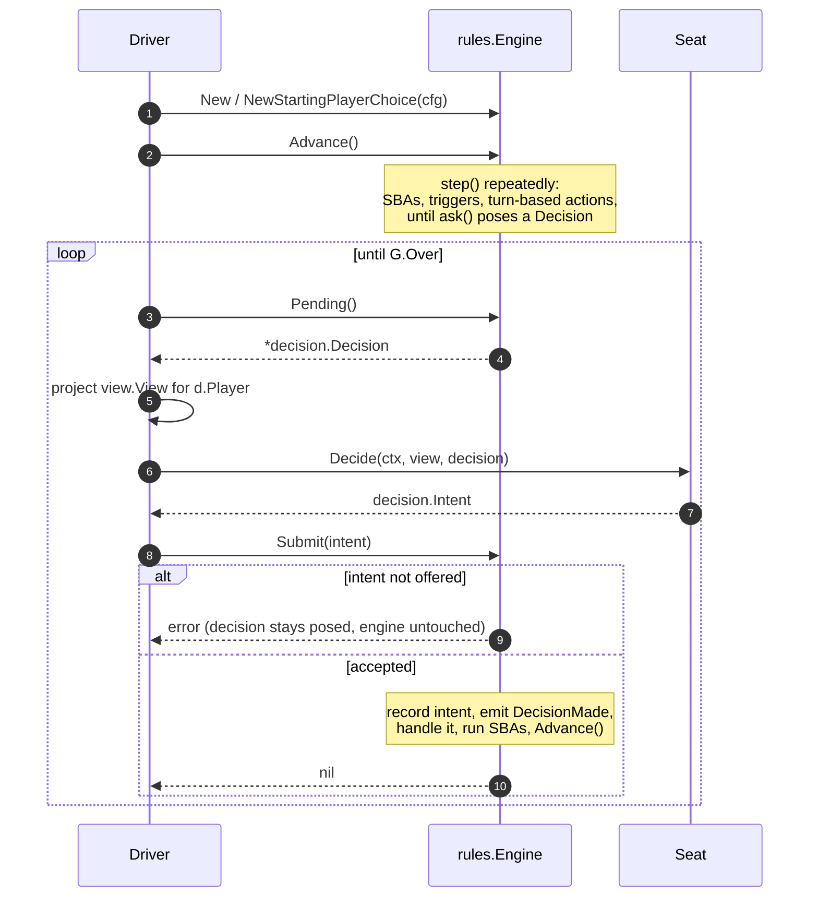
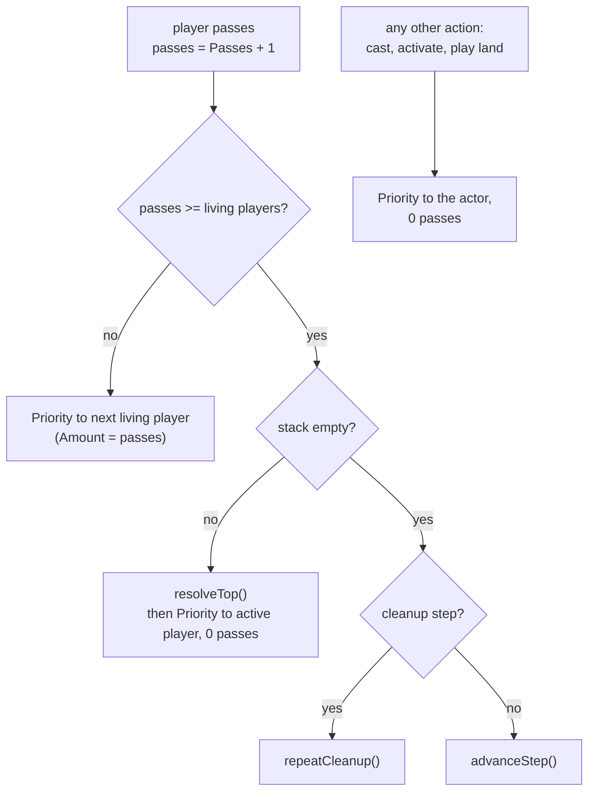
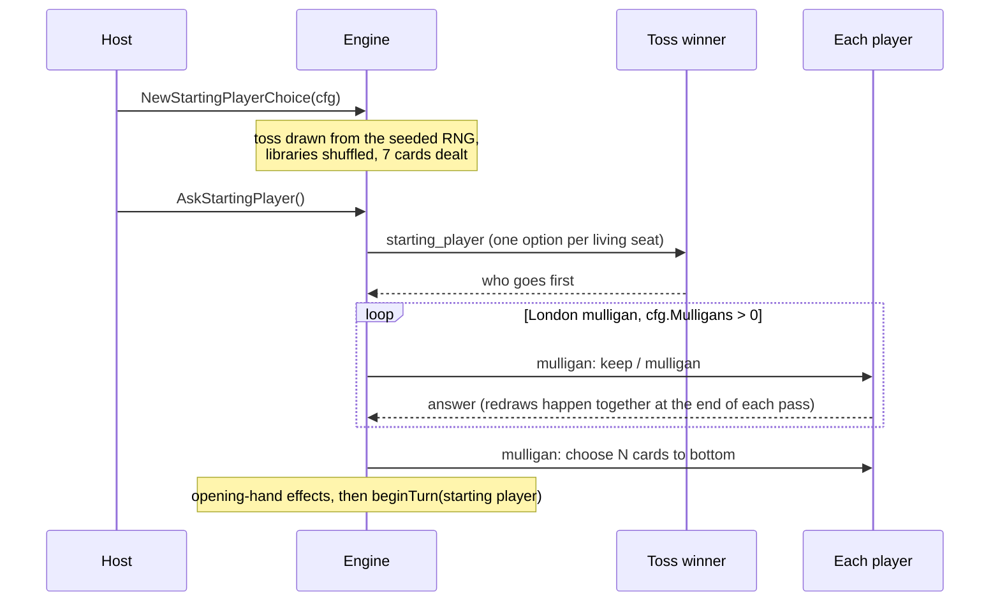
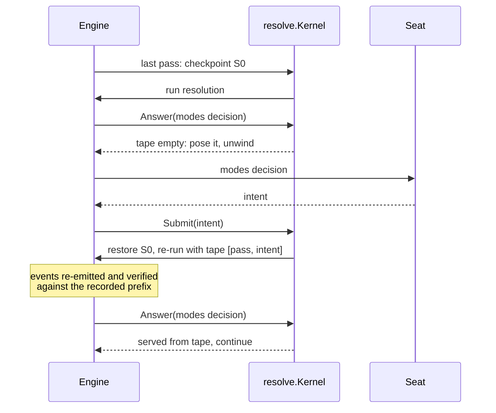

# Game loop and decisions

This page follows a game from the opening shuffle to the last pass: how the
engine walks turns, steps and priority, how it stops to ask a player
something, and how the answer comes back. It is for anyone writing a seat (a
bot or a client), a driver (a host, a test harness, a simulator), or engine
code that needs to ask a player a question.

## The driving contract: Advance, Pending, Submit

A host drives a game through the [`engine/game`](../index.md#the-engine-seam) interfaces,
and a test or simulator can drive the rules engine directly. A `rules.Engine` exposes three
calls to whoever drives it
([`engine/rules/engine.go`](https://github.com/adams-shaun/gorge/blob/main/engine/rules/engine.go),
[`engine_host.go`](https://github.com/adams-shaun/gorge/blob/main/engine/rules/engine_host.go)):

```go
// Advance runs engine work until a decision is required or the game ends.
func (e *Engine) Advance() {
	if e.tossChoice.active && e.pending == nil {
		e.resolveTossChoiceDefault()
	}
	for !e.G.Over && e.pending == nil {
		e.step()
	}
}

func (e *Engine) Pending() *decision.Decision { return e.pending }

// Submit applies a client's answer. Anything the engine did not offer is
// rejected, which is what keeps the client rules-ignorant.
func (e *Engine) Submit(in decision.Intent) error
```

A driver calls `Advance` once after building the engine. From then on,
`Submit` advances the game itself: after it commits an answer it runs the
engine forward to the next decision (`submitCommit` ends in `e.Advance()`), so
the loop a driver runs is just *read `Pending`, ask a seat, `Submit`*.

`Pending`'s pointer is only valid until the next `Submit` or `Advance`; a
caller that keeps a decision clones it first (`d.Clone()`).



## Turns, steps and priority

A turn walks twelve steps, declared in
[`engine/state/ids.go`](https://github.com/adams-shaun/gorge/blob/main/engine/state/ids.go).
There is one combat damage step: first strike is handled as two damage passes
inside it rather than as a separate step
([`engine/state/phase.go`](https://github.com/adams-shaun/gorge/blob/main/engine/state/phase.go)).

```mermaid
stateDiagram-v2
  direction LR
  [*] --> Untap: beginTurn emits TurnChange
  Untap --> Upkeep: no priority
  Upkeep --> Draw
  Draw --> Main1: first player skips turn-1 draw (CR 103.8a)
  Main1 --> BeginCombat
  BeginCombat --> DeclareAttackers
  DeclareAttackers --> DeclareBlockers: attackers declared
  DeclareAttackers --> EndCombat: no attackers (CR 508.8)
  DeclareBlockers --> CombatDamage
  CombatDamage --> EndCombat: first-strike pass, then regular pass
  EndCombat --> Main2
  Main2 --> End
  End --> Cleanup
  Cleanup --> Cleanup: something happened (CR 514.3b)
  Cleanup --> [*]: next turn, extra turns first (CR 500.7)
```



`step()` ([`engine/rules/turn.go`](https://github.com/adams-shaun/gorge/blob/main/engine/rules/turn.go))
is the smallest unit of automatic engine work. Each call checks state-based
actions, stops if a decision is now pending, runs any pre-game round (the
commander colour round, mulligans), and then dispatches on the current step:
the declare-attackers and declare-blockers steps ask for declarations, the
combat damage step runs `combatStep`, and every other step runs a priority
round.

**A priority round** (`priorityRound`) gives no priority during untap or
(normally) cleanup. Otherwise it first puts waiting triggered abilities on the
stack, which may itself ask the trigger order, then calls `grantPriority`,
which emits a `Priority` event and poses a `priority` decision.

**Passing** is handled in
[`engine/rules/legal_priority.go`](https://github.com/adams-shaun/gorge/blob/main/engine/rules/legal_priority.go).
The game keeps a pass counter in state (`Game.Passes`):



`advanceStep` handles the step-to-step jumps: an attack step with no
attackers skips to end of combat, cleanup starts the next turn (taking queued
extra turns most-recent-first), and extra phases granted by `AddPhase`
effects are spliced in at their boundary.

## Decisions

Whenever the engine needs a player's input it poses a `decision.Decision`
listing **every** legal option, and the player answers with a
`decision.Intent` naming option indices
([`engine/decision/decision.go`](https://github.com/adams-shaun/gorge/blob/main/engine/decision/decision.go)):

```go
type Decision struct {
	Seq     uint64         `json:"seq"`
	Player  state.PlayerID `json:"player"`
	Kind    Kind           `json:"kind"`
	Prompt  string         `json:"prompt"`
	Min     int            `json:"min"`
	Max     int            `json:"max"`
	Options []Option       `json:"options"`
	// ... optional budgets, payment plans, diagnostics
}

type Intent struct {
	Seq     uint64         `json:"seq"`
	Player  state.PlayerID `json:"player"`
	Choices []int          `json:"choices"`
	Rest    []int          `json:"rest,omitempty"`
	Payment  *PaymentSelection  `json:"payment,omitempty"`
	Announce *AnnounceSelection `json:"announce,omitempty"`
}
```

The package's own summary is the design: *"the engine asks a Decision listing
every legal Option, and the client answers with an Intent naming option
indices. No rules knowledge crosses the wire."* A client never has to know
what a legal attack is; it picks from a list, and the engine rejects anything
that was not on it.

**Options are selected by position.** `Option.Index` must equal the option's
position in the slice; `decision.New` and the engine's `ask` both panic if it
does not. `Option.Obj` and `Option.Player` are echoed so a client can
highlight the object, not used to select it.

**Min and Max** bound how many indices an answer names. Several shapes reuse
that one rule instead of inventing a wire format: an ordering is `Min == Max
== len(Options)` with distinct indices (a permutation), a yes/no is
`Min == Max == 1` over two options. Optional extras extend it: `Repeatable`
(an index may repeat), `AllowNone` (the empty answer is legal),
`MaxSum`/`MinSum` (a budget over the options' `Value`, for "total mana value
4 or less" or "total power 3 or greater"), `GroupLimit` (per-group caps).

### The 13 decision kinds

The set is fixed in the `Kinds` slice, and every seat client must be able to
answer every kind. Adding one is a deliberate act, guarded by
`TestKindsListsEveryKindOnce` (see [Invariants](../invariants.md)).

| Kind | When it is posed | Answer shape |
|---|---|---|
| `priority` | a player has priority | one option: `pass`, `concede`, `play_land`, `cast`, `activate` (mana ability), `ability` (other activated ability), `granted`, `station`, `unlock`, `specialize`, `turn_face_up` |
| `target` | a spell or ability needs targets | the targets, within Min..Max |
| `attackers` | declare attackers (CR 508.1) | any set of (attacker, defender) pair options |
| `blockers` | declare blockers (CR 509.1) | any set of (blocker, attacker) pair options |
| `mulligan` | the pre-game London mulligan | `keep` or `mulligan`; then which cards go to the bottom |
| `modes` | a modal spell or trigger, or an "unless pays" choice | the mode options, Min..Max |
| `trigger_order` | two or more of one player's triggers fired together (CR 603.3b) | a permutation; index 0 goes on the stack first and resolves last |
| `trigger_optional` | an optional ("you may") trigger, asked as it resolves (CR 603.5); Miracle is the one case asked at placement | `yes` or `no` |
| `commander_zone` | a commander is in a graveyard or exile since the last state-based check (CR 903.9a), or would go to its owner's hand or library (CR 903.9b) | `command_zone` or `leave`; always the owner answers |
| `choose` | a generic list pick; `Option.Kind` says what: `x`, `exile`, `sacrifice`, `discard`, `search`, `dig`, `name`, `type`, `number`, `yes`/`no`, `keep`, `dungeon`, `room` | Min..Max options |
| `replacement` | competing replacement effects (CR 616.1), or an optional one | which applies next; `apply`/`decline` |
| `arrange` | Scry, Surveil, rearranging the top of a library | an ordered subset (pile A, top first); the rest is pile B |
| `starting_player` | the pre-game toss winner chooses who goes first (CR 103.1) | one option per living player |

Two direction rules are silent if a client gets them backwards, so the code
states them twice: for `trigger_order`, `Choices[0]` is the trigger put on the
stack first and therefore resolved last; for `arrange`, pile A's index 0 ends
up closest to the top of the library, the next card drawn.

### How a decision is posed

All asks go through one choke point, `Engine.ask`
([`engine/rules/ask.go`](https://github.com/adams-shaun/gorge/blob/main/engine/rules/ask.go)).
It applies control redirects (CR 722: a player controlling another player's
turn answers for them), refuses a decision whose only legal answer is empty,
checks every `Option.Index`, stamps `d.Seq` with the current log length, emits
a `DecisionAsk` event and sets `e.pending`. The answer is logged as a
`DecisionMade` event whose text is the kind and the chosen indices, for
example `priority:[3]`. Both events are markers: `events.Apply` folds nothing
for them, but they are hashed into the chain, so a replay that asks a
different question diverges at that event.

### How an answer is checked

`Submit` rejects, in order: a finished game, no pending decision, and anything
`submitValidate` refuses. That starts with `Decision.Validate` (the wire
contract: sequence number, player, choice count, duplicates, groups, budgets)
and then adds checks a flat option list cannot express, such as the same
creature attacking two players or an over-paid convoke. A rejected intent
leaves the decision posed and the engine untouched, so a client can simply
try again.

## The Seat contract

Package [`engine/seat`](https://github.com/adams-shaun/gorge/blob/main/engine/seat/seat.go)
holds only the interface, so anything can be a seat without importing the
engine:

```go
// ctx lets a human seat time out; a bot ignores it and never returns an error.
type Seat interface {
	Decide(ctx context.Context, v view.View, d decision.Decision) (decision.Intent, error)
}
```

`seat` imports only `decision` and `view`. A seat is handed a `view.View` (the
redacted projection described in [Views](views.md)), never a `*state.Game` or
a `*rules.Engine`, so it sees exactly what a remote client would. Two optional
interfaces let a seat opt into engine-built extras on the decision:
`PaymentPlanConsumer` (ready-made mana payment plans) and
`TargetHintConsumer` (target hints on priority options).

Implementations include the default heuristic bot (`bots/heuristic`), the
search seats in `bots/`, and `server/host.HumanSeat`, which parks a decision
until a remote client answers over HTTP.

## Before turn 1: the starting player and mulligans



- **Starting player.** `rules.New(cfg)` lets the toss winner start without
  asking, the deterministic fallback for a driver with no one to ask.
  `rules.NewStartingPlayerChoice(cfg)` defers the post-deal setup until
  `AskStartingPlayer` has been answered; the host, `mtgsim` and the
  acceptance driver use it. If nobody asks, `Advance` takes the default at
  its loop head. `Config.StartChooser` names a different chooser (the loser
  of the previous game in a match).
- **Mulligans.** `Config.Mulligans` is how many London mulligans each player
  may take; 0 skips the round. The round lives in
  [`engine/rules/mulligan.go`](https://github.com/adams-shaun/gorge/blob/main/engine/rules/mulligan.go):
  keep-or-mulligan is asked round-robin, redraws resolve together, and then
  each player who mulliganed picks cards to bottom. In a game of three or more
  players the first mulligan is free.

## Concede

Concession is not a decision kind. Every priority decision ends with a
`concede` option, placed **last**, after `pass`, on purpose: a client that
defaults to the last option would otherwise concede on every decision, so
`pass` must be chosen explicitly. Choosing `concede` emits the ordinary
`PlayerLost` event with text `conceded` (CR 104.3a). In a game of three or
more the match continues and the conceded seat is skipped.

## Questions asked in the middle of a resolution

Some decisions are posed while a spell is resolving: a charm's mode, a library
search, a scry. The engine cannot simply return from the middle of an effect
and come back later, and hand-written continuations for each such case were
a source of bugs. Package
[`engine/rules/resolve`](https://github.com/adams-shaun/gorge/blob/main/engine/rules/resolve/doc.go)
solves this by re-execution:

1. When the last pass over a non-empty stack begins a resolution, the engine
   takes a checkpoint (a clone, `S0`).
2. An ask inside the resolution goes through `Kernel.Answer`. If the answer is
   already on the *tape* (the intents recorded since the checkpoint), it is
   served and the effect code just continues. If not, the decision is posed
   and the run unwinds.
3. When the player answers, the engine restores `S0` in place and re-executes
   the resolution with the longer tape. The event log's verify window checks
   every re-executed event against the recorded one byte for byte.



A game whose every seat is a bot can install a synchronous `Answerer`
instead, which answers inline and needs no checkpoint at all; the batch
runner does this for all-bot games. The kernel is the only resolution path.
[Events and replay](events.md#the-resolution-kernels-verify-window) covers
the log side.

## A host that cannot answer

A fuzzer, a test harness or a seat that has left must never wedge the engine.
Every asking primitive therefore carries a deterministic fallback that
completes the resolution (one of the
[engine contracts](https://github.com/adams-shaun/gorge/blob/main/docs/design/2026-09-22-engine-contracts.md)):
a charm takes its first mode, Scry keeps every card on top, a quantity-only
library search takes the first cards, and so on. The fallback is recorded as
a `Note` event, so it is visible in the log and replays identically. It is
not a stand-in for a missing ask: a host that can answer always gets the real
question.

Time limits are the host's business, not the engine's. The engine never reads
a clock. `server/host` can give a human seat a think timeout, and when it
expires a deterministic caretaker bot answers with exactly the intent it would
have produced, so the recorded game still replays byte for byte. See
[The server tier](server.md).
