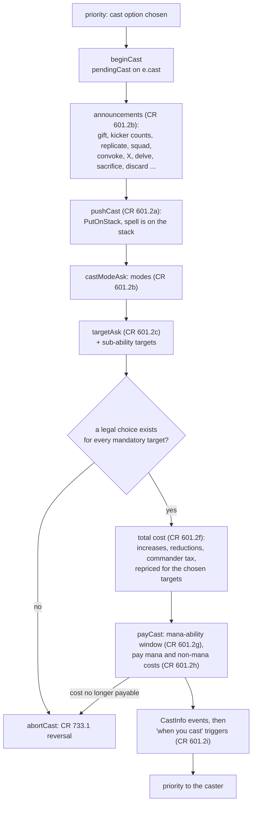
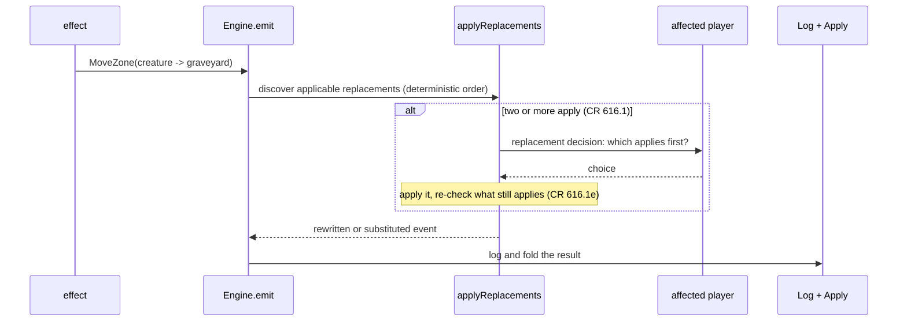
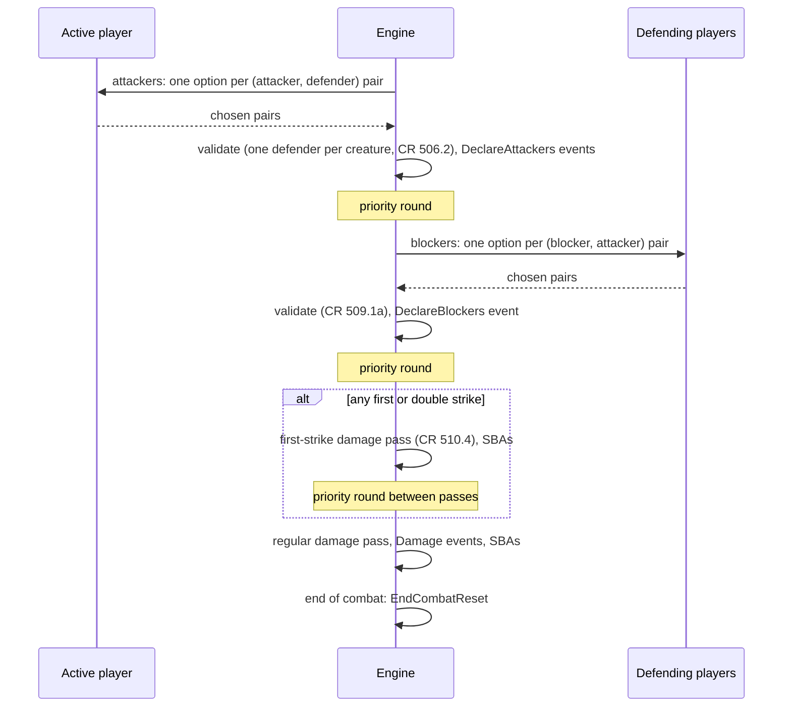
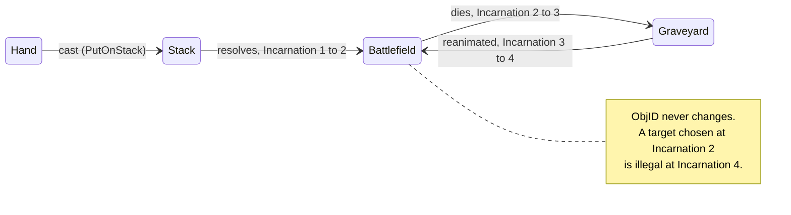

# The rules core

Package `engine/rules` is where the Comprehensive Rules (CR) live: casting and
the stack, state-based actions, triggers, replacement effects, the layer
system, combat and zones. This page walks through each mechanism with the
functions that implement it and the CR rules they cite, so that a developer
who knows Magic can find the code for a rule, and one who does not can see how
the pieces fit. It assumes you have read [Events and replay](events.md) and
[Game loop and decisions](game-loop.md).


## The shape of the package

`engine/rules` is the largest package in the repository. Around it sit seven
sub-packages that each compute one thing and never hold an engine:

<figure markdown>
<svg viewBox="0 0 780 330" width="100%" role="img" aria-label="The engine/rules package and its sub-packages, layered: orchestration on top, the resolution kernel, the subsystem packages, characteristic computation, effects, the cost vocabulary, and the core types">
  <rect x="10" y="10" width="760" height="50" rx="6" class="dg-box-accent"/>
  <text x="24" y="32" class="dg-text-bold">rules</text>
  <text x="120" y="32" class="dg-text">turn, step, priority, casting, stack, SBAs, triggers, replacements, layers' lifecycle, Clone</text>
  <text x="120" y="50" class="dg-text-muted">implements effects.Host and every sub-package's Board</text>
  <rect x="10" y="68" width="760" height="40" rx="6" class="dg-box"/>
  <text x="24" y="93" class="dg-text-bold">rules/resolve</text>
  <text x="200" y="93" class="dg-text-muted">checkpoint, answer tape, re-execution of a resolution</text>
  <rect x="10" y="116" width="248" height="56" rx="6" class="dg-box"/>
  <text x="24" y="138" class="dg-text-bold">rules/trigmatch</text>
  <text x="24" y="158" class="dg-text-muted">one matcher per Mode$</text>
  <rect x="266" y="116" width="248" height="56" rx="6" class="dg-box"/>
  <text x="280" y="138" class="dg-text-bold">rules/combat</text>
  <text x="280" y="158" class="dg-text-muted">attack/block legality</text>
  <rect x="522" y="116" width="248" height="56" rx="6" class="dg-box"/>
  <text x="536" y="138" class="dg-text-bold">rules/pay</text>
  <text x="536" y="158" class="dg-text-muted">mana and payment plans</text>
  <rect x="10" y="180" width="504" height="40" rx="6" class="dg-box"/>
  <text x="24" y="205" class="dg-text-bold">rules/chars</text>
  <text x="140" y="205" class="dg-text-muted">the CR 613 layer walk (read-only)</text>
  <rect x="522" y="180" width="248" height="40" rx="6" class="dg-box"/>
  <text x="536" y="205" class="dg-text-bold">rules/scriptfacts</text>
  <text x="660" y="205" class="dg-text-muted"></text>
  <rect x="10" y="228" width="504" height="40" rx="6" class="dg-box"/>
  <text x="24" y="253" class="dg-text-bold">effects (+ params)</text>
  <text x="180" y="253" class="dg-text-muted">api: primitives, filters, counts</text>
  <rect x="522" y="228" width="248" height="40" rx="6" class="dg-box"/>
  <text x="536" y="253" class="dg-text-bold">rules/cost</text>
  <text x="640" y="253" class="dg-text-muted">(leaf)</text>
  <rect x="10" y="276" width="760" height="44" rx="6" class="dg-box-muted"/>
  <text x="24" y="303" class="dg-text-bold">events, state, decision, cards</text>
  <text x="300" y="303" class="dg-text-muted">the vocabulary every layer above shares</text>
</svg>
<figcaption>Each band imports only bands below it. The sub-packages read the
game through a narrow <code>Board</code> interface that <code>rules</code>
implements; nothing below the top band emits an event. <code>internal/archtest</code>
pins the imports, and each <code>Board</code>'s method count may only shrink.</figcaption>
</figure>

Inside `rules` itself, a mechanism's files share a name prefix: `cast*`, `trigger*` and
`triggered_*`, `replace*`, `layer*`, `mana*`, `combat*`, `sba*`, `turn*`, and `stack.go`.

## Casting (CR 601)

A cast is a small state machine. `beginCast`
([`engine/rules/cast_begin.go`](https://github.com/adams-shaun/gorge/blob/main/engine/rules/cast_begin.go))
creates a `pendingCast` on `e.cast`, and `continueCast` runs its stages in
order. A stage that needs a player's answer poses a decision and returns; the
answer re-enters `continueCast`, which skips the stages already done.



Three properties matter:

- **Targets before payment.** Targets are chosen (`targetAsk`) before
  anything is paid (`payCast`), as CR 601.2c-h requires, and the total cost is
  recomputed for the chosen targets (`repriceForTargets`), because some
  costs depend on what you target.
- **Mandatory-target feasibility.** A cast whose mandatory targets cannot all
  be chosen aborts with `cast aborted: no legal target`. The check
  (`targetChoiceFeasible`) is the same predicate the priority offer used to
  decide the cast was available at all, so an offered cast can always
  announce a legal target.
- **Illegal casts are reversed forward, not erased** (CR 733.1). The log is
  append-only, so `abortCast` emits compensating events: the spell moves back
  to where it came from (`MoveZone` with text `reversed`), a
  `SpellCastReversed` event decrements the "spells cast this turn" tally that
  the `PutOnStack` had incremented, faces and choices are restored, and the
  held "when you cast" trigger is dropped. Mana taps in the announced payment
  window are undone the same way, one `ManaUndo` per tap. Repeating the same
  aborted cast twice removes the option for that window (CR 733.2), so a bot
  cannot loop on it.

`CastInfo` records how the spell was cast (the X value, kicker and
alternative-cost flags). It is emitted only at payment, so an aborted cast
leaves no cast-time trace.

## The stack and resolution

`Game.Stack` is a slice of object IDs; the top is the last element. Spells
and abilities are both objects in the arena: an ability object carries its
`*cards.SA`, its source and the source's incarnation.

`resolveTop` ([`engine/rules/stack.go`](https://github.com/adams-shaun/gorge/blob/main/engine/rules/stack.go))
resolves the top object:

1. For an ability, check that the source is still the same object (CR 400.7)
   and re-check an intervening "if" condition (CR 603.4).
2. **Re-check targets** (`legalTargets`, CR 608.2b). If every target is gone
   or illegal, the object leaves the stack without resolving ("fizzled: no
   legal targets remain"). A target that left and came back is a new object
   and so illegal; this is checked by comparing the incarnation stamped on
   the target when it was chosen.
3. Emit `Resolve` (for a spell) and call `effects.Resolve`, which walks the
   ability's sub-ability chain (see [Cards and primitives](cards.md#resolution-walking-the-chain)).
4. If a decision is needed mid-way, the resolution kernel takes over
   ([Game loop](game-loop.md#questions-asked-in-the-middle-of-a-resolution)).

## State-based actions (CR 704)

`checkStateBased` ([`engine/rules/sba.go`](https://github.com/adams-shaun/gorge/blob/main/engine/rules/sba.go))
applies state-based actions "until none apply, which is what CR 704.3
requires": a fixed-point loop of at most 32 passes, after which it emits a
`Note` instead of looping forever. One pass checks, in order:

| CR | Check |
|---|---|
| 704.5a-c | a player at 0 or less life, who drew from an empty library, or with 10 poison counters loses |
| 704.5q | +1/+1 and -1/-1 counters annihilate |
| 704.5f-h | toughness 0 or less, lethal damage, deathtouch damage |
| 704.5j | the legend rule: the controller chooses which to keep (a `choose` decision with `keep` options) |
| 704.5k | the world rule |
| 704.5i | a planeswalker with 0 loyalty |
| 704.5 | a battle with 0 defense |
| 704.5d-e | tokens and copies in the wrong zone cease to exist |
| 704.5m-n | illegal Auras, Equipment and Fortifications |
| 704.5s | Sagas past their last chapter |
| 704.5t | completed dungeons |

The checks run after every submitted answer (but never in the middle of a
cast), after draws, after each combat damage pass and at step boundaries.
Two fast paths keep this cheap: a quiet-skip when nothing relevant changed,
and a per-permanent prefilter.

## Triggers

<figure markdown>
<svg viewBox="0 0 780 200" width="100%" role="img" aria-label="Trigger flow: an event is logged, checkTriggers matches it against every trigger, matches are queued, sorted APNAP, ordered by each controller, and put on the stack before the next priority">
  <defs>
    <marker id="tr-a" viewBox="0 0 10 10" refX="9" refY="5" markerWidth="7" markerHeight="7" orient="auto"><path d="M0,0 L10,5 L0,10 z" class="dg-arrow"/></marker>
  </defs>
  <rect x="10" y="40" width="120" height="70" rx="8" class="dg-box"/>
  <text x="70" y="68" text-anchor="middle" class="dg-text-bold">event</text>
  <text x="70" y="88" text-anchor="middle" class="dg-text-muted">logged + applied</text>
  <rect x="160" y="40" width="150" height="70" rx="8" class="dg-box-accent"/>
  <text x="235" y="64" text-anchor="middle" class="dg-text-bold">checkTriggers</text>
  <text x="235" y="84" text-anchor="middle" class="dg-text-muted">interest prefilter,</text>
  <text x="235" y="100" text-anchor="middle" class="dg-text-muted">trigmatch.Match(mode)</text>
  <rect x="340" y="40" width="130" height="70" rx="8" class="dg-box"/>
  <text x="405" y="64" text-anchor="middle" class="dg-text-bold">pending queue</text>
  <text x="405" y="84" text-anchor="middle" class="dg-text-muted">pendingTriggers</text>
  <text x="405" y="100" text-anchor="middle" class="dg-text-muted">(visible in views)</text>
  <rect x="500" y="40" width="130" height="70" rx="8" class="dg-box"/>
  <text x="565" y="64" text-anchor="middle" class="dg-text-bold">APNAP sort</text>
  <text x="565" y="84" text-anchor="middle" class="dg-text-muted">CR 603.3b, then</text>
  <text x="565" y="100" text-anchor="middle" class="dg-text-muted">trigger_order ask</text>
  <rect x="660" y="40" width="110" height="70" rx="8" class="dg-box"/>
  <text x="715" y="64" text-anchor="middle" class="dg-text-bold">stack</text>
  <text x="715" y="84" text-anchor="middle" class="dg-text-muted">TriggerPush,</text>
  <text x="715" y="100" text-anchor="middle" class="dg-text-muted">modes, targets</text>
  <line x1="130" y1="75" x2="158" y2="75" class="dg-line" marker-end="url(#tr-a)"/>
  <line x1="310" y1="75" x2="338" y2="75" class="dg-line" marker-end="url(#tr-a)"/>
  <line x1="470" y1="75" x2="498" y2="75" class="dg-line" marker-end="url(#tr-a)"/>
  <line x1="630" y1="75" x2="658" y2="75" class="dg-line" marker-end="url(#tr-a)"/>
  <text x="235" y="140" text-anchor="middle" class="dg-text-muted">leaves-the-battlefield events are matched</text>
  <text x="235" y="156" text-anchor="middle" class="dg-text-muted">against the board as it was (look-back)</text>
  <text x="565" y="140" text-anchor="middle" class="dg-text-muted">drained by putTriggersOnStack,</text>
  <text x="565" y="156" text-anchor="middle" class="dg-text-muted">just before a player gets priority</text>
</svg>
<figcaption>Triggers are found after every event and placed only when a
player would next receive priority (CR 117.5).</figcaption>
</figure>

- **Matching.** After each event is logged and applied, `checkTriggers`
  ([`engine/rules/trigger_match.go`](https://github.com/adams-shaun/gorge/blob/main/engine/rules/trigger_match.go))
  looks for triggered abilities it made true. Each event kind carries a
  trigger-interest class from `events/kindinfo.go`, so only faces whose
  triggers could care are examined. The per-mode verdict comes from
  `trigmatch.Match`: a dense table with one matcher per trigger `Mode$`,
  registered from each mode's file in `rules/trigmatch` (a mode with no matcher
  never fires). Leaves-the-battlefield triggers are matched against
  a snapshot of the board from before the event (the CR 603.10a "look back").
- **Queueing and order.** Matches wait in `pendingTriggers` until
  `priorityRound` calls `putTriggersOnStack`. That sorts them APNAP (active
  player's first, CR 603.3b), asks each controller with two or more for a
  `trigger_order`, chooses modes at placement (CR 603.3c) and pushes each with
  a `TriggerPush` event. Waiting triggers are visible to every seat in the
  view, because they will hit the stack.
- **Optional triggers** ("you may") go on the stack unconditionally; the yes
  or no is asked as the trigger resolves (CR 603.5).
- **Delayed triggers** ("at the beginning of the next end step") are game
  state in `Game.Delayed`, registered by a `DelayedRegister` event and fired
  by `checkDelayedTriggers`.
- **Loop guard.** One trigger may fire at most 256 times for one source, and
  a livelock watcher aborts a game that repeats a cycle of events without
  progress.

## Replacement and prevention effects (CR 614-616)

Replacement effects ("if X would happen, Y happens instead") change an event
**before** it is logged. `Engine.emit` calls `applyReplacements`
([`engine/rules/replacement.go`](https://github.com/adams-shaun/gorge/blob/main/engine/rules/replacement.go))
first; if a replacement substitutes the event, the original is never logged,
and only the substitute's events are.



- The replaceable events are the script's `R:Event$` vocabulary, among them `Moved`, `DamageDone`, `Draw`, `GainLife`, `AddCounter`,
  `CreateToken`, `ProduceMana`, `Untap` and `BeginPhase`, most with their own
  `replacement_*.go` file.
- When several apply, the affected player (the object's controller, or the
  player for a draw) chooses through a `replacement` decision, and the
  event is parked until they answer. Applicability is re-evaluated after each
  rewrite (CR 616.1e), and an optional replacement gets an `apply`/`decline`
  ask.
- **Prevention is a replacement of the damage event** (CR 615.1):
  `Prevent$ True` replacements, "prevent all damage" keywords and fog
  effects are all applied on the damage path. Protection (CR 702.16) is
  checked even earlier, at the top of `emit`, and records a `Note`
  ("prevented: protection") instead of the `Damage` event.

## Continuous effects and the layer system (CR 613)

A permanent's current characteristics are its printed values with every
active continuous effect applied in the order CR 613 prescribes. The engine
never stores derived characteristics in `state.Game`; it computes them on
demand from the printed face plus the effect list.

<figure markdown>
<svg viewBox="0 0 780 470" width="100%" role="img" aria-label="The CR 613 layer stack as implemented: printed face at the bottom, then layers 1 copy, 2 control, 3 text, 4 type, 5 colour, 6 abilities, and layer 7 power and toughness with sublayers 7a to 7e, with current characteristics on top">
  <defs>
    <marker id="ly-a" viewBox="0 0 10 10" refX="9" refY="5" markerWidth="8" markerHeight="8" orient="auto"><path d="M0,0 L10,5 L0,10 z" class="dg-arrow-accent"/></marker>
  </defs>
  <rect x="150" y="10" width="480" height="36" rx="6" class="dg-box-solid"/>
  <text x="390" y="33" text-anchor="middle" class="dg-text-on">current characteristics: Engine.Derived(id) / Chars(id)</text>
  <!-- layer 7 -->
  <rect x="150" y="56" width="480" height="150" rx="6" class="dg-box-accent"/>
  <text x="164" y="76" class="dg-text-bold">7  power / toughness</text>
  <text x="440" y="76" class="dg-text-mono">LPT, chars.PT</text>
  <rect x="170" y="84" width="440" height="22" rx="4" class="dg-box"/><text x="182" y="100" class="dg-text">7e switching (SubSwitch)</text><text x="600" y="100" text-anchor="end" class="dg-text-muted">switch P and T</text>
  <rect x="170" y="108" width="440" height="22" rx="4" class="dg-box"/><text x="182" y="124" class="dg-text">7d counters (SubCounters)</text><text x="600" y="124" text-anchor="end" class="dg-text-muted">+1/+1, -1/-1 counters</text>
  <rect x="170" y="132" width="440" height="22" rx="4" class="dg-box"/><text x="182" y="148" class="dg-text">7c modifying (SubModify)</text><text x="600" y="148" text-anchor="end" class="dg-text-muted">+N/+N pumps, anthems</text>
  <rect x="170" y="156" width="440" height="22" rx="4" class="dg-box"/><text x="182" y="172" class="dg-text">7b setting (SubSet)</text><text x="600" y="172" text-anchor="end" class="dg-text-muted">"base P/T becomes 0/1"</text>
  <rect x="170" y="180" width="440" height="22" rx="4" class="dg-box"/><text x="182" y="196" class="dg-text">7a characteristic-defining (SubCDA)</text><text x="600" y="196" text-anchor="end" class="dg-text-muted">"P/T equal to cards in hand"</text>
  <!-- layers 6..1 -->
  <rect x="150" y="214" width="480" height="30" rx="6" class="dg-box"/><text x="164" y="234" class="dg-text-bold">6  abilities</text><text x="300" y="234" class="dg-text-muted">add / remove keywords and abilities; CR 613.8 dependency order</text>
  <rect x="150" y="250" width="480" height="30" rx="6" class="dg-box"/><text x="164" y="270" class="dg-text-bold">5  colour</text><text x="300" y="270" class="dg-text-muted">"is blue", "is all colours"</text>
  <rect x="150" y="286" width="480" height="30" rx="6" class="dg-box"/><text x="164" y="306" class="dg-text-bold">4  type</text><text x="300" y="306" class="dg-text-muted">add / remove types and subtypes (chars.Types)</text>
  <rect x="150" y="322" width="480" height="30" rx="6" class="dg-box"/><text x="164" y="342" class="dg-text-bold">3  text</text><text x="300" y="342" class="dg-text-muted">name changes, text substitution</text>
  <rect x="150" y="358" width="480" height="30" rx="6" class="dg-box"/><text x="164" y="378" class="dg-text-bold">2  control</text><text x="300" y="378" class="dg-text-muted">event-driven: ControlChange, timestamp order</text>
  <rect x="150" y="394" width="480" height="30" rx="6" class="dg-box"/><text x="164" y="414" class="dg-text-bold">1  copy</text><text x="300" y="414" class="dg-text-muted">Object.CopyFace, set by ClonePermanent</text>
  <rect x="150" y="430" width="480" height="30" rx="6" class="dg-box-muted"/><text x="390" y="450" text-anchor="middle" class="dg-text">printed face: cards.Face (Object.Face())</text>
  <!-- side annotations -->
  <line x1="120" y1="456" x2="120" y2="20" class="dg-line-accent" marker-end="url(#ly-a)"/>
  <text x="108" y="240" text-anchor="middle" class="dg-text-muted" transform="rotate(-90 108 240)">applied bottom to top</text>
  <text x="650" y="236" class="dg-text-muted">within a layer:</text>
  <text x="650" y="252" class="dg-text-muted">sublayer, then</text>
  <text x="650" y="268" class="dg-text-muted">timestamp</text>
  <text x="650" y="284" class="dg-text-muted">(stable sort)</text>
</svg>
<figcaption>The layers as implemented in <code>state.Layer</code> and
<code>state.Sublayer</code> (<code>engine/state/continuous.go</code>). The
engine numbers layer 7's sublayers 7a-7e, with counters in their own sublayer
before switching; the current CR text folds counters into 7c and calls
switching 7d. Counters and modifiers both add, so the result is the same.</figcaption>
</figure>

**The effect list.** A continuous effect is a `state.ContinuousEffect`: its
source, layer and sublayer, timestamp, an `Affects` filter (the same filter
language as `ValidTgts$`), and the modification (`AddPower`, `SetPower`,
`AddKeywords`, `AddTypes`, `SetName`, ...). Statics on permanents are
rescanned into effects; resolving spells add them through
`Host.AddContinuous`, which emits a `ClockTick` and stamps the new effect with
the game clock, so timestamps are themselves part of the log. The registry
lives on the engine (`Engine.continuous`) and is rebuilt identically on
replay by re-execution.

**Ordering.** `active()` ([`engine/rules/layers.go`](https://github.com/adams-shaun/gorge/blob/main/engine/rules/layers.go))
returns the live effects "sorted into CR 613 order: layer, then sublayer, then
timestamp", with a stable sort so equal keys keep registration order. An
effect whose source has left the battlefield drops out ("which is what makes
a lord's static bonus vanish the instant the lord dies"), except one-shot
until-end-of-turn effects, which outlive their source. In layer 6,
`abilityDependencyOrder` (`rules/chars`) applies CR 613.8 dependencies: one
effect that changes whether another applies goes first, and a dependency loop
falls back to timestamp order.

**The walk.** The read-only computation lives in package `rules/chars`:
`chars.Types` is the layer-4 walk, `chars.Compute` the full layer 3/5/6 walk,
`chars.PT` the layer-7 walk. A caller asks the engine:

```go
func (e *Engine) Derived(id state.ObjID) Derived   // type Derived = effects.Chars
func (e *Engine) Chars(id state.ObjID) *effects.Chars // the effects.Host form
func (e *Engine) Power(id state.ObjID) int32
func (e *Engine) Toughness(id state.ObjID) int32
```

The returned slices (keywords, types) alias the engine's scratch buffers and
are rewritten by the next call; callers copy what they keep. That rule is
what lets repeated derivation run without allocating.

**Caching.** Derivation happens constantly (every filter match reads
keywords and types), so several caches sit in front of it, each keyed on
something only an event can move:

| Cache | Keyed on | Why it is safe |
|---|---|---|
| `active()` effect list | log length, continuous-registry version, static build sequence | the board only changes through logged events |
| layer-inert reuse | the same key, ignoring `DecisionAsk`, `DecisionMade` and `Priority` events | those fold nothing a layer reads; they are about 70 % of a game's events |
| walk-scoped `Derived` memo | per legal-actions walk, plus log length, registry version and arena size | the walk is a pure read; inside one walk 75 % of derivations repeated an object already derived |
| incremental layer 4/5/6 tables | type, colour and keyword grants | rebuilt when their inputs change |

The layer-inert reuse and the `Derived` memo each have a verify mode
(`layerInertVerify`, `derivedMemoVerify`) that recomputes on every hit and
panics on a difference, so a stale entry fails loudly in tests.

## Combat

Combat is "CR 508-510 in miniature"
([`engine/rules/combat.go`](https://github.com/adams-shaun/gorge/blob/main/engine/rules/combat.go)):



- **Legality** (can this creature attack, can it block that one, menace,
  "attacks each combat if able", goad) is in package `rules/combat`, as pure
  predicates over a `Board`. The declaration flow, its validation and the
  events stay in `rules`.
- **Defenders.** Each attacker may attack any living opponent, a planeswalker
  or a battle independently; the decision's options are the legal pairs.
- **Damage assignment.** There is no damage assignment order: any division
  of damage that satisfies CR 510.1c is legal, and when the controller has a
  real choice it is asked as a `choose` decision.
- **First strike** is two passes inside the one combat damage step, with a
  priority round between them. `actsThisDamageStep` (CR 510.5) decides which
  creatures deal damage in each pass.

## Zones and object identity (CR 400.7)

**The arena.** Every card, token, spell and ability is a `state.Object` in
one dense slice, `Game.Objs`; `Objs[i]` has ID `i+1`, so `ObjID` 0 means "no
object". Zones are lists of IDs indexed by zone and player; the stack is its
own list.

**Identity.** An object keeps its `ObjID` for the whole match, in every zone.
CR 400.7 says a permanent that leaves the battlefield and returns is a *new*
object, so the object also carries an `Incarnation` counter, bumped by the
`MoveZone` fold whenever it crosses the battlefield boundary. Everything that
must refer to one particular incarnation (a chosen target, a delayed trigger,
an ability whose source must still be "the same" permanent) records the
incarnation along with the ID and compares both later. Leaving the
battlefield also resets the object: control returns to its owner, and
battlefield-only state such as damage, counters and attachments is cleared.



Why a stable ID with a counter rather than a fresh ID per zone change? A
fresh ID would make the log harder to read and every cross-zone reference
(the card a trigger "remembered", the creature an Aura was cast on) a lookup
through a forwarding table. A stable ID keeps the log and the views simple,
and the incarnation stamp keeps the rules exact. It also gives a fixed
mapping from each deck card to one object, which dirac's oracle relies
on.

**The game record.** `state.Game`
([`engine/state/game.go`](https://github.com/adams-shaun/gorge/blob/main/engine/state/game.go))
holds the players (life, pool, counters, per-turn tallies), the object arena,
the stack, turn, step, active player, priority holder and pass count, the
game-over flag and winner, extra turns and phases, the monarch and initiative,
the timestamp clock, delayed triggers, and the token and name tables set at
genesis. Its doc comment says it plainly: only the `events` package may
mutate it.

## Mana

Each player's pool is a fixed array, `state.Mana`, one slot per colour plus
colourless (with extra slots for typed mana), alongside restricted mana that
can only be spent on certain things. Mana abilities resolve immediately and
never use the stack (CR 605); activating one emits `ManaAdd`, and pools empty
at the end of each step (CR 500.4) with `ManaClear`. Payment planning is
described in [Cards and primitives](cards.md#costs-and-payment).

## Changing the rules core safely

- Mutate state only by emitting an event (`e.emit`); add a new event kind at
  the end of the list if no existing one fits.
- Read characteristics through `Derived`/`Chars`, never from the printed face.
- Ask through `e.ask` (or `Host.Ask` from an effect), and give the ask a
  deterministic fallback for a host that cannot answer.
- Run the focused tests for the mechanism and `TestHeads`; if a golden head
  moves, find the first diverging event before re-pinning
  ([Events and replay](events.md#golden-heads)).

[Invariants](../invariants.md) lists the rules these follow and what enforces
each one.
