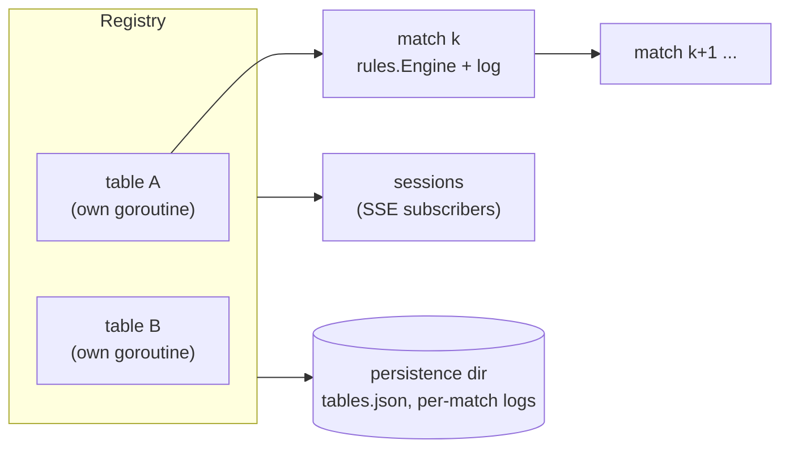
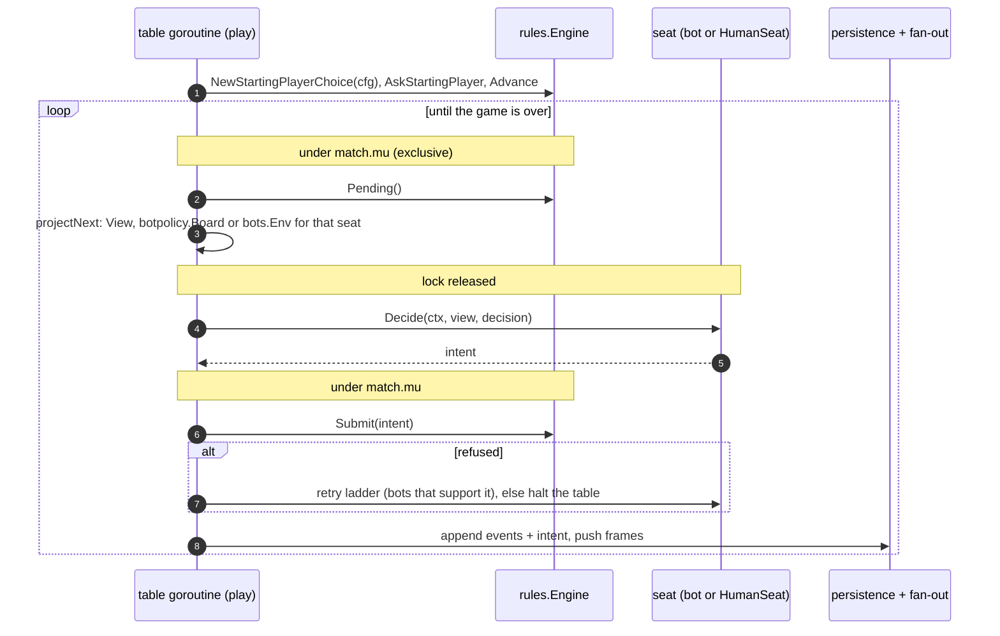
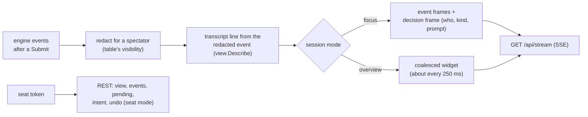

# The server tier

The engine is a library: it runs one game when something calls `Advance` and
`Submit`. Package `server/host` is that something for real play. It keeps
tables running, seats bots and humans, persists every match as an
append-only log, and fans events out to connected clients. This page
describes that architecture: how a table drives its engine, where locks and
goroutines are, what is written to disk and how clients are fed. To run a
server, see [Getting started](../../getting-started.md); the HTTP API and the
bot interfaces have their own pages in the user's and bot author's guides.

*Facts on this page are from `develop` @ `25d71cadc` (2026-10-27). Line
counts are `wc -l` over non-test files. Code links point at `main`.*

## Packages

| Package | Lines | Role |
|---|---|---|
| [`server/host`](https://github.com/adams-shaun/gorge/blob/main/server/host/doc.go) | 9,422 | the table registry, the match loop, seats, persistence, fan-out, undo, history |
| `server/host/httpapi` | 1,368 | REST routes and the server-sent event (SSE) stream over `host.Registry` |
| `server/protocol` | 758 | wire types only: frames, snapshots, events; never imports `rules` |
| `server/gorged` | 5,358 | the importable server: flags, wiring, seat tokens, extension points |
| `cmd/gorged` | | a thin `main`: `os.Exit(gorged.Main(os.Args[1:], gorged.Extensions{Review: reviewLoad}))`, plus the loader `gorged review` uses |

The package doc of `server/host` is a good summary of its intent: "one
goroutine per table that plays match after match with bot seats, sessions
that subscribe to overview widgets or a focused table's event stream,
turn-start snapshots that answer 'view at seq N', append-only persistence,
and crash handling that halts a table rather than hiding a bug. It imports
rules and seat but exposes neither." It is also the first package allowed to
import `time`, and the only clock it uses is an injected `Sleep`.

## Tables and matches

A **table** is a configuration (`TableConfig`: seats, decks, seed, bot
policies, which seats are human, spectator visibility, whether it is
perpetual or part of a series) plus a goroutine. `Registry.Start` launches
`run`, which loops: build a match, mark it live, play it, retire it, then
either stop (single-shot, aborted, crashed) or wait out a cooldown and start
the next one (perpetual). A **match** owns one `rules.Engine`, its files and
its turn-start snapshots.

Each match's seed is `MatchSeed(tableSeed, k)`, a splitmix64 mix of the
table's seed and the match number, so "a table's whole history is a pure
function of its configuration".

## The match loop

- **Genesis.** A match starts with `rules.NewStartingPlayerChoice`, poses the
  starting-player decision and runs `Advance`; with persistence on, the
  sidecar and the genesis events are written before the first decision.
- **Projection for the right kind of seat.** `projectNext` reads the pending
  decision and builds what that seat consumes: a `view.View` (humans and most
  bots), a `botpolicy.Board` (the heuristic bot's board model, built from the
  same information a seat view carries), or a host-built environment for
  search bots. Engine extras (payment plans, target hints) are attached only
  for seats that ask for them.
- **Deciding happens outside the lock.** A bot's `Decide` and a human's wait
  never hold `match.mu`, so viewers can read the match while a seat thinks.
- **A refused intent is a bug signal.** A bot that supports it gets a retry
  and then a fallback; any other refusal crashes the match and halts the
  table, with the panic recorded, rather than papering over it. A cap on
  intents per match and per turn stops a livelocked game.

## Human seats

`HumanSeat` is "just another seat.Seat": the engine hands it the same view and
decision as any bot, and `Decide` blocks until an intent arrives,
the context is cancelled, or the seat's think timeout passes. A remote client
submits through `Registry.SubmitIntent`, which "never drives the engine": it
validates the intent against the parked decision and hands it to the waiting
seat. `Engine.Submit` still runs on the table's goroutine.

Each human seat carries a **caretaker**: the deterministic bot that would have
occupied the seat in an all-bot game. When a decision times out, the
caretaker answers with exactly the intent it would have produced, so the
logged game still replays byte for byte.

## Locks and ordering

| Lock | Guards | Notes |
|---|---|---|
| `Registry` RW mutex | the table and session maps | |
| `table.mu` | the current match, history, archived matches | |
| `table.fanMu` | a subscriber's snapshot against concurrent fan-out | taken before `match.mu` |
| `match.mu` | the engine | held by the run loop for each `Submit`; projection takes it **exclusively**, because projecting fills the engine's derived-characteristic caches |

Historical views (`ViewAt`) clone the log and the nearest turn-start
snapshot under the lock, then replay outside it.

## Persistence

With a data directory configured, each match writes three files under
`<dir>/<table>/`:

| File | Contents |
|---|---|
| `<k>.events` | the event log, appended after every burst |
| `<k>.intents` | the intents, appended the same way |
| `<k>.json` | the sidecar: the configuration needed to rebuild the match, and its state |

and `tables.json` holds each table's configuration and current match number.
Sidecars carry no timestamp. A finished match is served by
`replay.Replay(log, cfg)` with the config rebuilt from its sidecar, so the
server keeps no finished engine in memory.

!!! note "No resume"
    A match that was live when the process stopped is rewritten as
    **aborted** on restart; a perpetual table simply starts its next match.
    Resuming an interrupted match by replay is possible in principle (the
    log has everything), but it is not implemented.

## Feeding clients

- **The SSE stream is for spectators.** `fanout` redacts every event for a
  spectator at the table's configured visibility (public or omniscient) and
  never blocks on a slow client: each session has a bounded resume ring,
  and overflow closes the session. Clients resume with `Last-Event-ID`.
- **A seat's private data goes over REST**, authorised by its token:
  `GET /api/tables/{t}/matches/{k}/view`, `/events`, `/pending`, and
  `POST .../intent` and `.../undo`. The view is projected in seat mode and
  carries the decision only for that seat at the live head
  ([Views](views.md#what-the-server-checks)).
- **Frames** are a small closed set (`hello`, `widget`, `match_start`,
  `snapshot`, `event`, `decision`, `match_end`, `table_halted`,
  `table_state`, `overflow`, `error`, `rewind`, plus four draft-event frames
  that only an events plugin sends) in a versioned envelope; the TypeScript
  client's types are generated from the Go structs.

## History and undo

The host clones the engine at every turn start. A request for the board at
an earlier point (`ViewAt`) starts from the nearest snapshot (or from genesis
with `replay.ReplayTo`) and re-submits the logged intents up to the requested
point.

Undo is a **rewind in place, never a fork**: the engine is rebuilt at the
requester's last decision with `replay.ReplayTo`, swapped into the live
match, and the log is truncated in memory and on disk; snapshots past the new
head are dropped and a `rewind` frame tells clients to discard later state.
The seed is not changed, because reseeding "would fork the hash chain and
break every replay guarantee the log carries". The accepted consequence is
that a rewound shuffle comes out the same, so undo is refused at any table
with a second human seat.

## Extension points

`server/gorged` is importable so another module can build its own server
binary:

- `gorged.Main(args, ext)` parses flags, listens and serves until a signal;
  `Serve` is the same without signals or the bind, for tests.
- `gorged.Extensions` is what a binary links in beyond the platform: an
  events plugin (organised events such as drafts), extra flags, and the
  loader `gorged review` uses to turn a saved game into a recorded match.
  gorge's own `cmd/gorged` sets only the review loader.
- `gorged.RegisterNetBot` and `RegisterClosedNetBot` link trained-network bot
  policies into the binary before `Main` runs; bot policies in general come
  from the `bots` registry.

gorge's own `cmd/gorged` links only gorge's bots. The private companion
module builds its own main over `server/gorged` to add draft events and
further bots; gorge never imports it.
