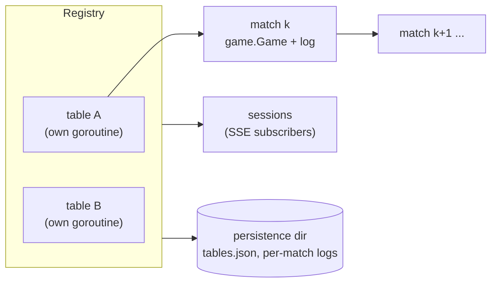
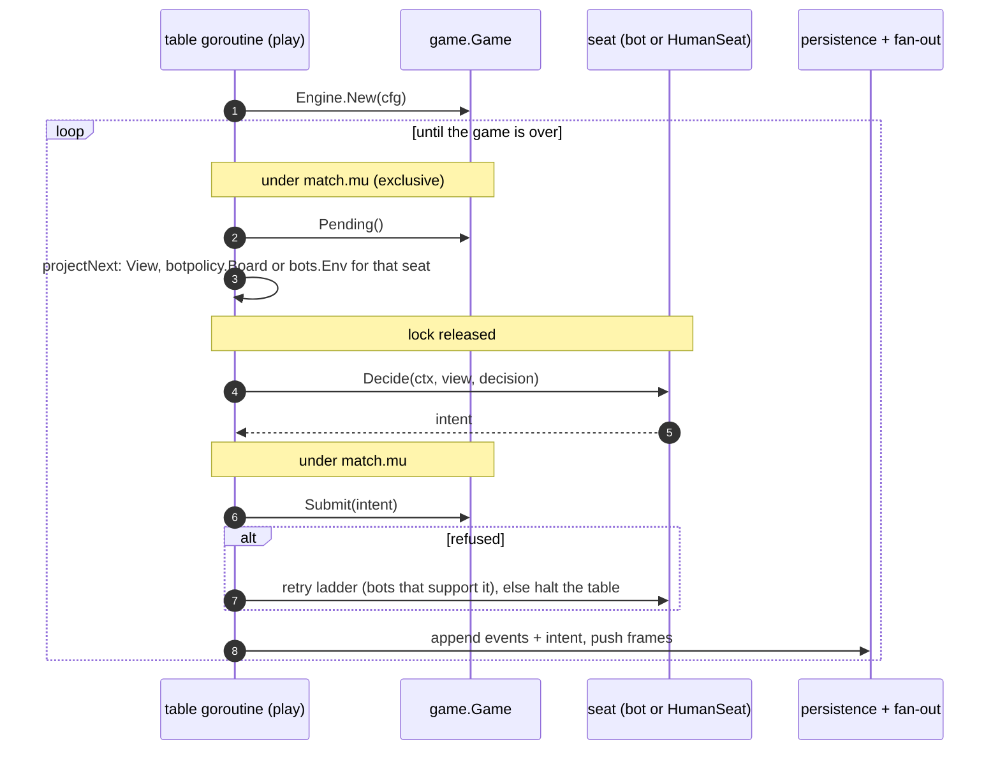
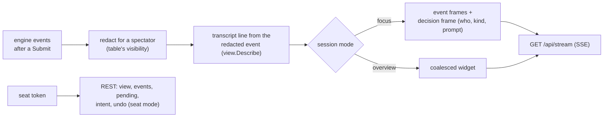

# The server tier

An engine is a library: it runs a game when something asks it the next decision
and submits the answer. Package `server/host` is that something for real play. It
keeps tables running, seats bots and humans, persists every match as an
append-only log, and fans events out to clients. This page covers how a table
drives its engine, where the locks and goroutines are, what is written to disk
and how clients are fed. To run a server see [Getting started](../../getting-started.md);
the [Interfaces](../../interfaces/index.md) and [Bots](../../bots/index.md) pages
cover the ways in.

## Packages

| Package | Role |
|---|---|
| [`server/host`](https://github.com/adams-shaun/gorge/blob/main/server/host/doc.go) | the table registry, the match loop, seats, persistence, fan-out, undo, history |
| `server/host/httpapi` | REST routes and the server-sent event (SSE) stream over `host.Registry` |
| `server/host/manabrewhttp`, `server/host/sbv2http` | the ManaBrew and SpellBench v2 routes ([Wires](../wires.md)) |
| `server/protocol` | wire types only: frames, snapshots, events; never imports `rules` |
| `server/manabrew`, `server/spellbench/*` | the ManaBrew and SpellBench v2 adapters |
| `server/matchrecord` | the portable one-file record of a played game that `gorged review` serves |
| `server/divergence` | records of where a human and a bot would have chosen differently |
| `server/gorged` | the importable server: flags, wiring, seat tokens, extension points |
| `cmd/gorged` | a thin `main`: `os.Exit(gorged.Main(os.Args[1:], extensions()))`, where `extensions()` names the [draft-event plugin](../draft.md) and the loader `gorged review` uses |

`server/host` imports `rules` and `seat` but exposes neither. Its only clock is an
injected `Sleep`. Each table runs on an engine through the
[`engine/game`](../index.md#the-engine-seam) interfaces: `Options.Engines` holds
what the binary links and `TableConfig.Engine` picks one.

## Tables and matches

A **table** is a `TableConfig` (seats, decks, seed, bot policies, which seats are
human, spectator visibility, perpetual or series) plus a goroutine.
`Registry.Start` launches `run`, which builds a match, marks it live, plays it,
retires it, then stops (single-shot, aborted, crashed) or waits out a cooldown
and starts the next (perpetual). A **match** owns one `game.Game`, its files and
its turn-start snapshots.

Each match's seed is `MatchSeed(tableSeed, k)`, a splitmix64 mix of the table seed
and match number, so a table's whole history is a pure function of its
configuration.

## The match loop

- **Genesis.** `Engine.New` builds the game and runs it to its first decision;
  with persistence on, the sidecar and genesis events are written first.
- **Projection per seat kind.** `projectNext` builds what the seat consumes: a
  `view.View` (humans and most bots), a `botpolicy.Board` (the heuristic bot's
  board model, from the same information a seat view carries), or a host-built
  environment for search bots. Engine extras (payment plans, target hints) go
  only to seats that ask.
- **Deciding happens outside the lock.** A bot's `Decide` and a human's wait never
  hold `match.mu`, so viewers can read the match while a seat thinks.
- **A refused intent is a bug signal.** A bot that supports it gets a retry
  ladder and a fallback; any other refusal crashes the match and halts the table
  with the panic recorded. A cap on intents per match (`defaultMaxIntents`, in
  `match.go`) and per turn stops a livelocked game.

## Human seats

`HumanSeat` is just another `seat.Seat`: it gets the same view and decision as a
bot, and `Decide` blocks until an intent arrives, the context is cancelled or the
think timeout passes. A remote client submits through `Registry.SubmitIntent`,
which never drives the engine: it validates against the parked decision and hands
the intent to the waiting seat. `Engine.Submit` still runs on the table's
goroutine.

Each human seat has a **caretaker**: the deterministic bot that would occupy the
seat in an all-bot game. On a timeout the caretaker answers with exactly the
intent it would have produced, so the logged game still replays byte for byte.

## Locks and ordering

| Lock | Guards | Notes |
|---|---|---|
| `Registry` RW mutex | the table and session maps | |
| `table.mu` | the current match, history, archived matches | |
| `table.fanMu` | a subscriber's snapshot against concurrent fan-out | taken before `match.mu` |
| `match.mu` | the engine | held by the run loop for each `Submit`; projection takes it **exclusively**, because projecting fills the engine's derived-characteristic caches |

Historical views (`ViewAt`) clone the log and the nearest turn-start snapshot
under the lock, then replay outside it.

## Persistence

With a data directory configured, each match writes three files under
`<dir>/<table>/`:

| File | Contents |
|---|---|
| `<k>.events` | the event log, appended after every burst |
| `<k>.intents` | the intents, appended the same way |
| `<k>.json` | the sidecar: the configuration to rebuild the match, and its state |

`tables.json` holds each table's configuration and current match number.
Sidecars carry no timestamp. A finished match is served by `Engine.Replay(log,
cfg)` with the config rebuilt from its sidecar, so the server keeps no finished
engine in memory.

!!! note "No resume"
    A match live when the process stopped is rewritten as **aborted** on restart
    (`Registry.load`, `server/host/restart.go`); a perpetual table starts its next
    match. Resuming by replay is possible in principle but not implemented.

## Feeding clients

- **The SSE stream is for spectators.** `fanout` redacts every event for a
  spectator at the table's visibility (public or omniscient) and never blocks on
  a slow client: each session has a bounded resume ring (`Options.Ring`) and
  overflow closes the session. Clients resume with `Last-Event-ID`.
- **A seat's private data goes over REST**, authorised by its token:
  `GET /api/tables/{t}/matches/{k}/view`, `/events`, `/pending`, and
  `POST .../intent` and `.../undo`. The view is projected in seat mode and
  carries the decision only for that seat at the live head
  ([Views](views.md#what-the-server-checks)).
- **Frames** are a closed set (`FrameType` in `server/protocol`) in a versioned
  envelope (`protocol.Version`), including four draft-event frames only an events
  plugin sends (`server/protocol/draftevent.go`). The TypeScript client's types
  are generated from the Go structs.

## History and undo

The host clones the engine at every turn start. A request for an earlier board
(`ViewAt`) starts from the nearest snapshot (or genesis, via `Engine.ReplayTo`)
and re-submits the logged intents up to the requested point.

Undo is a **rewind in place, never a fork** (`server/host/undo.go`): the engine
is rebuilt at the requester's last decision with `Engine.ReplayTo`, swapped into
the live match, and the log truncated in memory and on disk; snapshots past the
new head are dropped and a `rewind` frame tells clients to discard later state.
The seed does not change, because reseeding would fork the hash chain and break
every replay guarantee. The accepted consequence is that a rewound shuffle comes
out the same, so undo is refused at any table with a second human seat.

## Extension points

`server/gorged` is importable so another module can build its own server binary:

- `gorged.Main(args, ext)` parses flags, listens and serves until a signal;
  `Serve` is the same without signals or the bind, for tests.
- `gorged.Extensions` is what a binary links in beyond the platform: an events
  plugin (organised events such as drafts), extra flags (`Flags`), the loader
  `gorged review` uses to turn a saved game into a recorded match (`Review`), and
  further engines for `-engine`. gorge's own `cmd/gorged` sets the events plugin
  and the review loader.
- `gorged.RegisterNetBot` links a trained-network bot policy into the binary
  before `Main` runs, with its flags; bot policies in general come from the
  `bots` registry.

`cmd/gorged` links gorge's bots and [draft events](../draft.md), which serve only
with `-events`.
