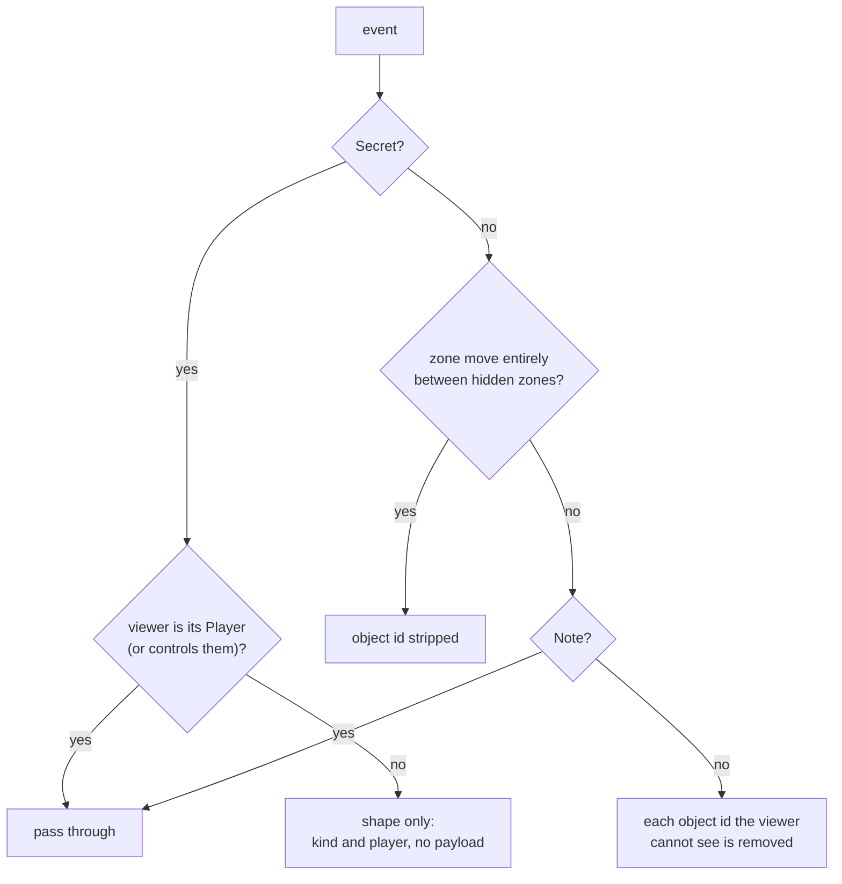

# Views and hidden information

Magic is a game of hidden information: your hand, the order of your library,
face-down cards. The engine sees everything; a player must see only what the
rules let them see. This page explains how gorge projects one seat's view of
a game, how the event log is redacted per seat, what the server checks before
it hands anything to a client or a bot, and how determinism keeps the
server's word authoritative. It is for client and bot authors and for anyone
touching `engine/view` or the server's HTTP layer.

## The boundary

<figure markdown>
<svg viewBox="0 0 780 250" width="100%" role="img" aria-label="The information boundary: the engine and its full game state are on the server side; only a redacted view.View and redacted events cross to seats, clients and spectators">
  <defs>
    <marker id="vw-a" viewBox="0 0 10 10" refX="9" refY="5" markerWidth="7" markerHeight="7" orient="auto"><path d="M0,0 L10,5 L0,10 z" class="dg-arrow"/></marker>
  </defs>
  <rect x="10" y="20" width="300" height="210" rx="10" class="dg-box-accent"/>
  <text x="160" y="46" text-anchor="middle" class="dg-text-bold">authoritative side</text>
  <rect x="30" y="62" width="260" height="44" rx="6" class="dg-box"/>
  <text x="160" y="89" text-anchor="middle" class="dg-text-mono">rules.Engine, state.Game</text>
  <rect x="30" y="114" width="260" height="44" rx="6" class="dg-box"/>
  <text x="160" y="141" text-anchor="middle" class="dg-text-mono">events.Log (unredacted)</text>
  <text x="160" y="182" text-anchor="middle" class="dg-text-muted">every hand, library order,</text>
  <text x="160" y="200" text-anchor="middle" class="dg-text-muted">face-down identities, the RNG</text>
  <line x1="350" y1="10" x2="350" y2="232" class="dg-line-dashed"/>
  <text x="350" y="248" text-anchor="middle" class="dg-text-muted">view.Project / view.RedactEvents</text>
  <rect x="400" y="20" width="370" height="60" rx="8" class="dg-box"/>
  <text x="414" y="44" class="dg-text-bold">Seat view</text>
  <text x="414" y="64" class="dg-text-muted">own hand, own decision, own deck list; others as counts</text>
  <rect x="400" y="94" width="370" height="60" rx="8" class="dg-box"/>
  <text x="414" y="118" class="dg-text-bold">Public view</text>
  <text x="414" y="138" class="dg-text-muted">spectator: every hand a count, no decision</text>
  <rect x="400" y="168" width="370" height="60" rx="8" class="dg-box"/>
  <text x="414" y="192" class="dg-text-bold">Omniscient view</text>
  <text x="414" y="212" class="dg-text-muted">every hand, never library order (bot-table spectators)</text>
  <line x1="310" y1="50" x2="398" y2="50" class="dg-line" marker-end="url(#vw-a)"/>
  <line x1="310" y1="124" x2="398" y2="124" class="dg-line" marker-end="url(#vw-a)"/>
  <line x1="310" y1="198" x2="398" y2="198" class="dg-line" marker-end="url(#vw-a)"/>
</svg>
<figcaption>Nothing on the left crosses the line except through package
<code>view</code>. Seats, bots, web clients and spectators all read the
right-hand side.</figcaption>
</figure>

The rule is structural, not a convention:

- A `seat.Seat` is handed a `view.View`, never a `*state.Game` or a
  `*rules.Engine` ([Game loop](game-loop.md#the-seat-contract)).
- `TestNoExportLeaksAnEngineGame` (`internal/archtest`) fails if any exported
  signature outside the engine exposes a `*state.Game` or `*rules.Engine`,
  and `TestNoRegistryDataResultIsAnEngineGame` checks the server's results at
  run time.
- Package `server/host` exposes neither `rules` nor the game:
  "a client sees protocol frames and view.Views only"
  ([`server/host/doc.go`](https://github.com/adams-shaun/gorge/blob/main/server/host/doc.go)).

## What a view contains

`view.View` ([`engine/view/view.go`](https://github.com/adams-shaun/gorge/blob/main/engine/view/view.go))
is a flat, JSON-ready record: the viewer and the visibility mode; turn,
round, step, phase, active and priority players; whether the game is over and
who won; one `PlayerView` per player; the stack; the pending (not yet placed)
triggers; and the decision, if it is the viewer's. It is everything a client
needs to draw the board and nothing that needs rules knowledge to interpret.
The package doc states its contract: "a hidden zone contributes a count and
nothing else unless the viewer owns it, another seat's decision is never
attached, and everything that can or will hit the stack is described for
every seat".

| Information | Seat (a player) | Public (spectator) | Omniscient (spectator) |
|---|---|---|---|
| Battlefield, graveyards, exile, command zone | all | all | all |
| Own hand | cards | n/a | n/a |
| Other players' hands | count | count | cards |
| Library | count; the owner also gets an **unordered** list (sorted by name) of what is still in it | count | count, never order |
| Top of library | only to its owner, only while an effect lets them look | no | no |
| Face-down cards (morph, manifest) | identity only to the controller (or a player allowed to look) | hidden | revealed |
| Mana pools and available mana | all players (public, CR 106.4) | all | all |
| Stack and pending triggers | all, described for every seat | all | all |
| Decision and its options | only the viewer's own | none | the current one |

Two details show the care involved. The owner's library list is sorted so it
"never leaks the library's actual order", even to the owner. And while the
pre-game starting-player choice is open, even your own opening hand is
blanked (CR 103.5), because the choice must be made before seeing it.

**Building one.** `view.Project(g, chars, viewer, decision)` is the plain
entry point; `ProjectFor` adds a visibility mode, `ProjectForControlled`
widens the view for a player who controls another's turn (CR 722), and the
`...Into` variants reuse the destination's buffers so steady-state projection
allocates nothing. The projection is a pure function of the game plus a small
`view.Chars` interface for derived characteristics, which `*rules.Engine`
implements, so `view` never imports `rules`. There is no incremental (diff)
projection: each view is built fresh.

## Redacting the log

Clients also receive the event stream, so the log needs the same treatment.
`view.RedactEvents(g, evs, viewer)`
([`engine/view/redact.go`](https://github.com/adams-shaun/gorge/blob/main/engine/view/redact.go))
applies three rules:

A secret that carries a library's order (a shuffle, or a `LibraryOrder`
recording a chosen new order) is shape-only for every seat, the library's
owner included: no player may know a library's order (CR 401.2). What an
owner knows about the cards they arranged comes from the decision they
answered, not from the event.

Redaction is *state-aware*, not just flag-aware, because an event's `Player`
field does not always name the seat whose secret it carries (a trigger's
controller and the owner of the card it remembered can differ). A `Note` is
public unless its own emitter marks it `Secret`: it is the engine's explicit
"tell everyone" channel. The server builds each transcript line from the
**redacted** event, so a hidden card's name cannot reach the text either.

Omniscient spectators get a lighter redaction that strips only what reveals
library order: shuffles, library orderings and secret moves into a library.

## What the server checks

Projection is half the boundary; the other half is who gets which
projection. In `server/host` and its HTTP layer:

- **A seat's identity comes from its credential, never from the request.**
  A seat token names both a table and a seat; a request for another table or
  seat is refused (403), and an intent is checked against the seat that
  presented the token. Tokens are 16 random bytes and never reach an event or
  a view.
- **The live stream is spectator-safe.** The server-sent event stream
  redacts for a spectator at the table's configured visibility; a decision
  frame carries only who is being asked what. A seat fetches its own view,
  pending decision and events over REST, where the projection is in seat
  mode and the decision is attached only for that seat, at the live head.
- **Bots get the same treatment.** A hosted bot is handed a seat view or a
  board model built from what that seat may know. A bot policy that reads
  decklists is refused at any table with a human. Policies that claim to use
  only public information must pass a privacy contract test
  (`RunClosedPrivacyContract`) before they may sit against a human; the test
  harness's `leakScan` walks everything the host hands the seat, unexported
  fields included, looking for a secret card's name or a pointer into its
  data.
- **The engine validates every answer.** `Engine.Submit` rejects any intent
  that was not offered, and `HumanSeat` pre-validates a submitted intent
  before it reaches the engine. A client cannot play a card it does not
  have, target something illegal or skip a cost.

## Determinism and the RNG

A hidden-information game is only fair if nobody, including the server
operator, can steer the shuffle after the fact, and a log is only evidence if
the same inputs always replay to the same result.

- **One RNG.** `rules.rng` ([`engine/rules/rng.go`](https://github.com/adams-shaun/gorge/blob/main/engine/rules/rng.go))
  is "the engine's only source of randomness": a `math/rand/v2` PCG seeded
  with `(seed, seed ^ 0x9e3779b97f4a7c15)`. It lives on the engine, not in
  `state.Game`, and a clone copies its exact position.
- **A draw counter.** Every draw increments `Draws`, "so a replay can assert
  it consumed exactly the same number of values", the cheapest detector that
  the engine changed under a log. Shuffles are Fisher-Yates and consume
  exactly `n-1` draws.
- **Results in events.** A shuffle's resulting order travels in the
  `Shuffle` event, marked `Secret`, so every other seat sees only that a
  shuffle happened. `Apply` installs the order without touching the RNG.
- **Seeds from configuration.** The server derives each match's seed from
  the table's seed and the match number through a splitmix64 finaliser, so
  "a table's whole history is a pure function of its configuration".
- **No clock.** Only the server tier, `draft/eventhost` and a few commands may import `time`
  (`TestTimeIsImportedOnlyByTheHost`); no game, event, view or replay reads
  the clock. `math/rand` v1 is banned (`TestNoLegacyMathRand`).

## Why the server is authoritative

Put together, these rules mean a client is never trusted with anything:

1. It never sees more than its view, so it cannot leak what it does not have.
2. It can only pick from options the engine offered, so it cannot cheat by
   construction.
3. Every game is a replayable, hash-chained log owned by the server, so any
   dispute (or bug report) is settled by replaying it.

A client that wants to show "what if" analysis can run its own engine, but
the server's engine is the only one whose result counts.
