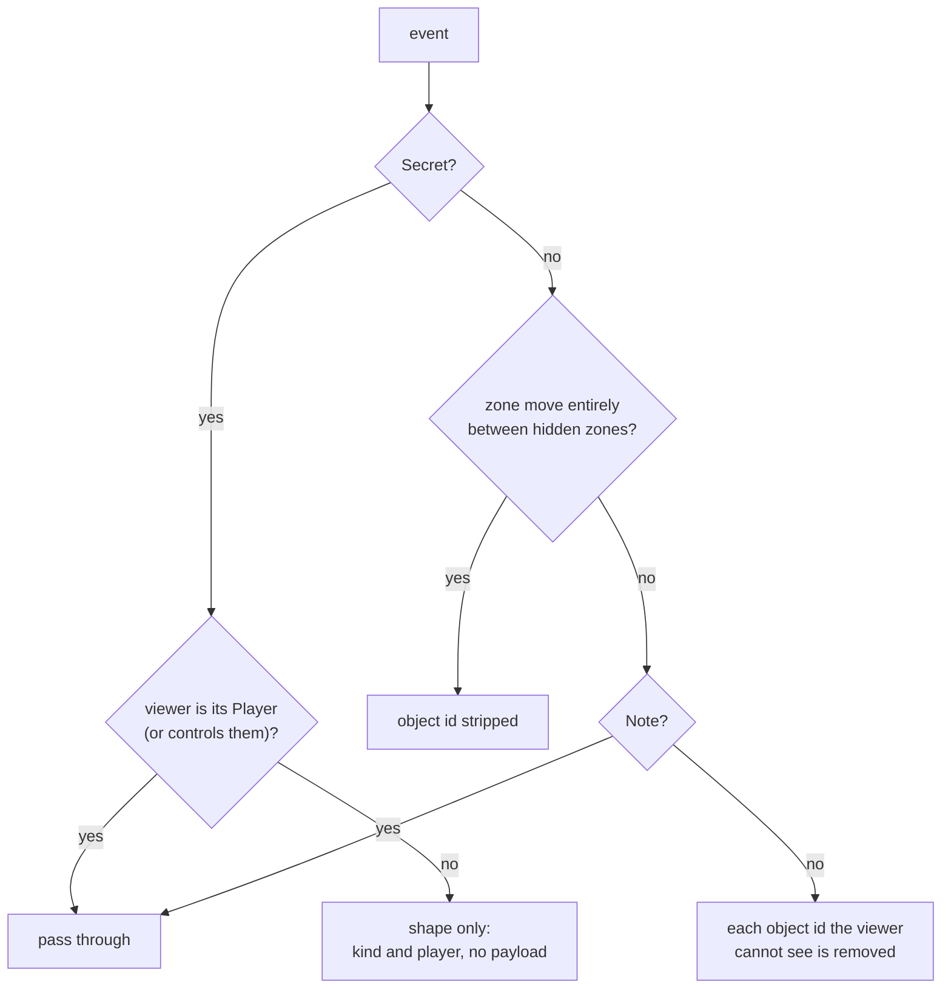

# Views and hidden information

Magic hides information: your hand, library order, face-down cards. The engine
sees everything; a player must see only what the rules allow. This page covers
how gorge projects one seat's view, how the event log is redacted per seat, what
the server checks before handing anything to a client or bot, and how
determinism keeps the server authoritative. For client and bot authors and
anyone touching `engine/view` or the server's HTTP layer.

## The boundary

<figure markdown>
<svg viewBox="0 0 780 250" width="100%" role="img" aria-label="The information boundary: the engine and its full game state are on the server side; only a redacted view.View and redacted events cross to seats, clients and spectators">
  <defs>
    <marker id="vw-a" viewBox="0 0 10 10" refX="9" refY="5" markerWidth="7" markerHeight="7" orient="auto"><path d="M0,0 L10,5 L0,10 z" class="dg-arrow"/></marker>
  </defs>
  <rect x="10" y="20" width="300" height="210" rx="10" class="dg-box-accent"/>
  <text x="160" y="46" text-anchor="middle" class="dg-text-bold">authoritative side</text>
  <rect x="30" y="62" width="260" height="44" rx="6" class="dg-box"/>
  <text x="160" y="89" text-anchor="middle" class="dg-text-mono">rules.Engine, state.Game</text>
  <rect x="30" y="114" width="260" height="44" rx="6" class="dg-box"/>
  <text x="160" y="141" text-anchor="middle" class="dg-text-mono">events.Log (unredacted)</text>
  <text x="160" y="182" text-anchor="middle" class="dg-text-muted">every hand, library order,</text>
  <text x="160" y="200" text-anchor="middle" class="dg-text-muted">face-down identities, the RNG</text>
  <line x1="350" y1="10" x2="350" y2="232" class="dg-line-dashed"/>
  <text x="350" y="248" text-anchor="middle" class="dg-text-muted">view.Project / view.RedactEvents</text>
  <rect x="400" y="20" width="370" height="60" rx="8" class="dg-box"/>
  <text x="414" y="44" class="dg-text-bold">Seat view</text>
  <text x="414" y="64" class="dg-text-muted">own hand, own decision, own deck list; others as counts</text>
  <rect x="400" y="94" width="370" height="60" rx="8" class="dg-box"/>
  <text x="414" y="118" class="dg-text-bold">Public view</text>
  <text x="414" y="138" class="dg-text-muted">spectator: every hand a count, no decision</text>
  <rect x="400" y="168" width="370" height="60" rx="8" class="dg-box"/>
  <text x="414" y="192" class="dg-text-bold">Omniscient view</text>
  <text x="414" y="212" class="dg-text-muted">every hand, never library order (bot-table spectators)</text>
  <line x1="310" y1="50" x2="398" y2="50" class="dg-line" marker-end="url(#vw-a)"/>
  <line x1="310" y1="124" x2="398" y2="124" class="dg-line" marker-end="url(#vw-a)"/>
  <line x1="310" y1="198" x2="398" y2="198" class="dg-line" marker-end="url(#vw-a)"/>
</svg>
<figcaption>Nothing on the left crosses the line except through package
<code>view</code>. Seats, bots, web clients and spectators all read the
right-hand side.</figcaption>
</figure>
The rule is structural:

- A `seat.Seat` is handed a `view.View`, never a `*state.Game` or
  `*rules.Engine` ([Game loop](game-loop.md#the-seat-contract)).
- `TestNoExportLeaksAnEngineGame` (`internal/archtest`) fails if an exported
  signature outside the engine exposes a `*state.Game` or `*rules.Engine`;
  `TestNoRegistryDataResultIsAnEngineGame` (`server/host/leak_test.go`) checks the
  server's results at run time.
- `server/host` exposes neither `rules` nor the game: "a client sees protocol
  frames and view.Views only"
  ([`server/host/doc.go`](https://github.com/adams-shaun/gorge/blob/main/server/host/doc.go)).

## What a view contains

`view.View` ([`engine/view/view.go`](https://github.com/adams-shaun/gorge/blob/main/engine/view/view.go))
is a flat, JSON-ready record: the viewer and visibility mode; turn, round, step,
phase, active and priority players; game-over and winner; one `PlayerView` per
player; the stack; pending (not yet placed) triggers; and the decision, if it is
the viewer's. A hidden zone contributes a count and nothing else unless the
viewer owns it; another seat's decision is never attached; everything that can or
will hit the stack is described for every seat.

| Information | Seat (a player) | Public (spectator) | Omniscient (spectator) |
|---|---|---|---|
| Battlefield, graveyards, exile, command zone | all | all | all |
| Own hand | cards | n/a | n/a |
| Other players' hands | count | count | cards |
| Library | count; the owner also gets an **unordered** list (sorted by name) of what is still in it | count | count, never order |
| Top of library | only to its owner, only while an effect lets them look | no | no |
| Face-down cards (morph, manifest) | identity only to the controller (or a player allowed to look) | hidden | revealed |
| Mana pools and available mana | all players (public, CR 106.4) | all | all |
| Stack and pending triggers | all, described for every seat | all | all |
| Decision and its options | only the viewer's own | none | the current one |

The owner's library list is sorted so it never leaks the actual order, even to
the owner. While the pre-game starting-player choice is open, even your own
opening hand is blanked (CR 103.5), because the choice precedes seeing it.

**Building one.** `view.Project(g, chars, viewer, decision)` is the plain entry
point; `ProjectFor` adds a visibility mode; `ProjectForControlled` widens the view
for a player who controls another's turn (CR 722); the `...Into` variants reuse
the destination's buffers so steady-state projection allocates nothing.
Projection is a pure function of the game plus the small `view.Chars` interface
for derived characteristics, which `*rules.Engine` implements, so `view` never
imports `rules`. There is no incremental (diff) projection: each view is built
fresh.

## Redacting the log

Clients also receive the event stream. `view.RedactEvents(g, evs, viewer)`
([`engine/view/redact.go`](https://github.com/adams-shaun/gorge/blob/main/engine/view/redact.go))
applies three rules:

A secret carrying a library's order (a shuffle, or a `LibraryOrder` recording a
chosen new order) is shape-only for every seat, the owner included: no player may
know a library's order (CR 401.2). What an owner knows about cards they arranged
comes from the decision they answered, not from the event.

Redaction is *state-aware*, not just flag-aware: an event's `Player` does not
always name the seat whose secret it carries (a trigger's controller and the
owner of the card it remembered can differ). A `Note` is public unless its
emitter marks it `Secret`. The server builds each transcript line from the
**redacted** event, so a hidden card's name cannot reach the text.

Omniscient spectators get a lighter redaction that strips only what reveals
library order: shuffles, library orderings and secret moves into a library.

## What the server checks

Projection is half the boundary; the other half is who gets which projection. In
`server/host` and its HTTP layer:

- **Identity comes from the credential, never the request.** A seat token names a
  table and a seat; a request for another table or seat is refused (403), and an
  intent is checked against the seat that presented the token. Tokens are 16
  random bytes and never reach an event or a view.
- **The live stream is spectator-safe.** The SSE stream redacts for a spectator at
  the table's configured visibility, and a decision frame carries only who is
  asked what. A seat fetches its own view, pending decision and events over REST,
  in seat mode, with the decision attached only for that seat at the live head.
- **Bots get the same treatment.** A hosted bot is handed a seat view or a board
  model built from what that seat may know. A policy that reads decklists is
  refused at any table with a human (`TableConfig.AllowDecklistBots` opts a
  bot-only table in). Policies that claim to use only public information must pass
  the privacy contract (`RunClosedPrivacyContract`, `bots/hosttest`) before they
  may sit against a human; the harness's `leakScan` (`server/host/leakscan.go`)
  walks everything the host hands the seat, unexported fields included, for a
  secret card's name or a pointer into its data.
- **The engine validates every answer.** `Engine.Submit` rejects any intent that
  was not offered, and `HumanSeat` pre-validates before the engine sees it. A
  client cannot play a card it does not have, target something illegal or skip a
  cost.

## Determinism and the RNG

A hidden-information game is fair only if nobody, the operator included, can
steer the shuffle after the fact, and a log is evidence only if the same inputs
always replay to the same result.

- **One RNG.** `rules.rng` ([`engine/rules/rng.go`](https://github.com/adams-shaun/gorge/blob/main/engine/rules/rng.go))
  is the engine's only source of randomness: a `math/rand/v2` PCG seeded with
  `(seed, seed ^ 0x9e3779b97f4a7c15)`. It lives on the engine, not in
  `state.Game`, and a clone copies its exact position.
- **A draw counter.** `Draws` counts every draw so a replay can assert it
  consumed the same number of values, the cheapest sign that the engine changed
  under a log. `Shuffle` is Fisher-Yates and consumes exactly `len(ids)-1`.
- **Results in events.** A shuffle's order travels in the `Secret` `Shuffle`
  event, so other seats see only that a shuffle happened. `Apply` installs the
  order without touching the RNG.
- **Seeds from configuration.** The server derives each match's seed from the
  table's seed and match number through a splitmix64 finaliser (`MatchSeed`), so
  a table's whole history is a pure function of its configuration.
- **No clock.** Only the server tier, `draft/eventhost` and a few commands may
  import `time` (`TestTimeIsImportedOnlyByTheHost`); `math/rand` v1 is banned
  (`TestNoLegacyMathRand`).

## Why the server is authoritative

1. A client never sees more than its view, so it cannot leak what it lacks.
2. It can only pick from options the engine offered, so it cannot cheat by
   construction.
3. Every game is a replayable, hash-chained log the server owns, so any dispute
   or bug report is settled by replaying it.

A client may run its own engine for "what if" analysis; only the server's engine
counts.
