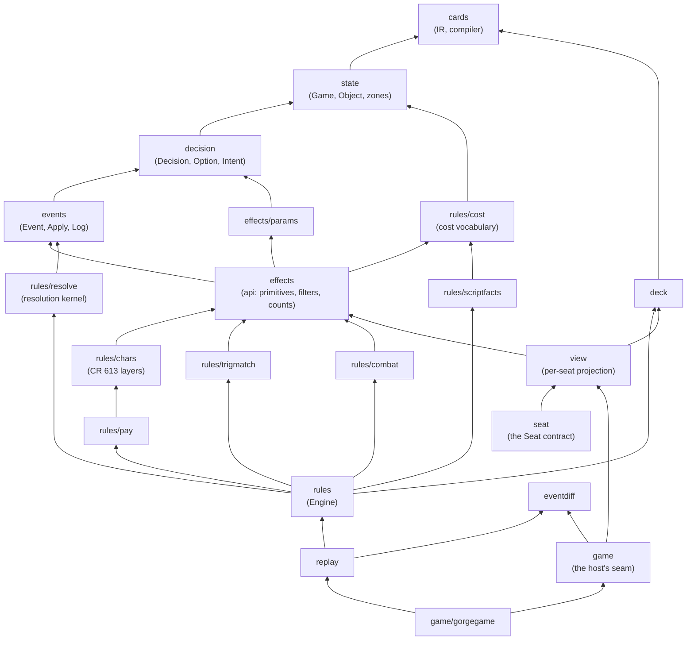
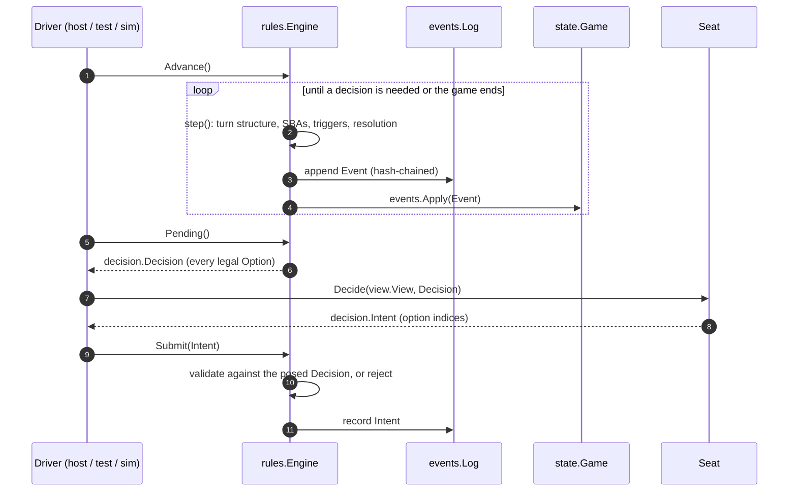

# Architecture

This section explains how gorge works inside: how a match is represented, how
card text becomes behaviour, how the rules core applies the Comprehensive
Rules (CR), and how the server drives all of it for players and bots. It is
written for Go developers who want to read or change the engine. If you only
want to run a game, start at [Getting started](../getting-started.md); if you
want to fix your first card, see [Your first card fix](../contributing/first-card-fix.md).

## The idea in one paragraph

gorge does not hand-write cards. It compiles Forge's card scripts (fetched at
build time, never committed, because they are GPL-3.0) into an intermediate
representation (IR), and implements the small set of named **primitives** that
IR refers to: effects such as `api:DealDamage`, trigger modes such as
`trig:ChangesZone`, keywords such as `kw:Flying`. A card is *playable* when
every primitive it uses is implemented. Every change to the game is an
**event** folded into state by one function, `events.Apply`, and appended to a
SHA-256 hash-chained log. With a seeded RNG and no clock reads, a match is a
pure function of its starting configuration and the answers its players gave,
so replay, history and undo, bug reproduction and search all reuse the same
machinery. Players never touch the engine: each seat gets a redacted
**view** and answers **decisions** drawn from a closed set of kinds.

Limited play sits above this: [draft events](draft.md) drive whole events through
the same tables and engine, and no draft concept reaches the rules core.

## Two engines

gorge is the full rules engine. **dirac** is a second, much smaller engine that
plays the same game much faster, for the cards its generator can lower. Its source
isn't in this repository yet. They do different jobs, and the smaller one is held
to the larger one.

<figure markdown>
<svg viewBox="0 0 760 300" width="100%" role="img" aria-label="The gorge engine and the dirac engine side by side, joined by a lockstep oracle check">
  <defs>
    <marker id="ix-arr" viewBox="0 0 10 10" refX="9" refY="5" markerWidth="7" markerHeight="7" orient="auto-start-reverse"><path d="M0,0 L10,5 L0,10 z" class="dg-arrow-accent"/></marker>
  </defs>
  <rect x="10" y="10" width="320" height="280" rx="10" class="dg-box-accent"/>
  <text x="170" y="38" text-anchor="middle" class="dg-text-bold">gorge</text>
  <text x="30" y="68" class="dg-text">The full rules engine</text>
  <text x="30" y="92" class="dg-text-muted">the whole Forge corpus</text>
  <text x="30" y="112" class="dg-text-muted">up to 8 seats, Constructed and Commander</text>
  <text x="30" y="132" class="dg-text-muted">state.Game: an object arena with pointers,</text>
  <text x="30" y="150" class="dg-text-muted">slices and maps; clone = deep copy</text>
  <text x="30" y="170" class="dg-text-muted">event-sourced: an append-only set of kinds,</text>
  <text x="30" y="188" class="dg-text-muted">hash-chained log, replay by re-execution</text>
  <text x="30" y="208" class="dg-text-muted">a closed set of decisions, redacted views</text>
  <text x="30" y="236" class="dg-text">Job: correctness for every card,</text>
  <text x="30" y="256" class="dg-text">hosting real games, the reference</text>
  <rect x="430" y="10" width="320" height="280" rx="10" class="dg-box"/>
  <text x="590" y="38" text-anchor="middle" class="dg-text-bold">dirac</text>
  <text x="450" y="68" class="dg-text">A 2-player engine</text>
  <text x="450" y="92" class="dg-text-muted">verified set by set against gorge</text>
  <text x="450" y="112" class="dg-text-muted">exactly two players</text>
  <text x="450" y="132" class="dg-text-muted">State is one fixed-size value: no pointers,</text>
  <text x="450" y="150" class="dg-text-muted">maps, slices or strings; clone = assignment</text>
  <text x="450" y="170" class="dg-text-muted">Step / Apply state machine over a</text>
  <text x="450" y="188" class="dg-text-muted">generated table of card operations</text>
  <text x="450" y="208" class="dg-text-muted">no event log; equal positions project ==</text>
  <text x="450" y="236" class="dg-text">Job: raw speed for self-play and</text>
  <text x="450" y="256" class="dg-text">search on its verified pools</text>
  <line x1="332" y1="150" x2="428" y2="150" class="dg-line-accent" marker-start="url(#ix-arr)" marker-end="url(#ix-arr)"/>
  <text x="380" y="138" text-anchor="middle" class="dg-text-bold">lockstep</text>
  <text x="380" y="172" text-anchor="middle" class="dg-text-muted">same seed,</text>
  <text x="380" y="188" text-anchor="middle" class="dg-text-muted">same options,</text>
  <text x="380" y="204" class="dg-text-muted" text-anchor="middle">equal projections</text>
</svg>
<figcaption>gorge is the authority. dirac imports nothing from gorge at
run time; its oracle package plays the same decks, seed and answers through
both engines and requires the same canonical option list at every decision and
the same canonical board projection after every action.</figcaption>
</figure>

| | gorge | dirac |
|---|---|---|
| Card pool | every Forge script is compiled; a card is playable when every primitive it names is implemented | the cards its generator lowers with no refusal; supported sets are verified in lockstep ([per set](../support/sets.md#per-set-support)) |
| Players | up to 8 per hosted table; the golden games cover 2, 4, 6 and 8 | 2 |
| Game state | `state.Game`: an arena of `state.Object` values plus maps and slices | a single fixed-size struct |
| Mutation | events proposed by the engine, folded by `events.Apply`, hash-chained | `Apply(action)` on the value |
| Copying a game | `Engine.Clone` (deep copy, shared log prefix) | plain assignment |
| Comparing two games | the chain head: the same head means the same history | its `Projection` (fixed arrays): equal positions project `==`; two States in the same position may differ in bookkeeping |
| Who checks it | its own golden replays, the compliance oracles | gorge, in lockstep |

A general engine that handles every card in the corpus needs open-ended data: arbitrary card
text, variable-length zones, continuous effects that come and go. That shape makes it correct
for everything and slower to copy and step. An engine that keeps every card's behaviour in a
read-only generated table can lay the whole game out as a fixed-size value and step it cheaply,
which is what large-scale self-play and tree search want. Keeping gorge as the oracle means the
fast engine never becomes a second source of rules truth. See [dirac](dirty-dirac/index.md) for
its [fixed-size State](dirty-dirac/state.md), its [Step/Apply loop](dirty-dirac/step-apply.md),
how [cards are compiled](dirty-dirac/cards.md) for it and the
[lockstep oracle](dirty-dirac/oracle.md).

## The engine seam

A host doesn't run `rules.Engine` directly. Package `engine/game` is what a host needs from a
running game, and each engine implements it:

| Interface | What it gives a host |
|---|---|
| `game.Engine` | `New`, `Replay`, `ReplayTo` and `Walk` build a game from a `game.Config`; `Accepts` says why a config can't play here, naming the limit or card; `Caps` says what the engine's games can do |
| `game.Game` | `Board`, `Chars` and `Log` to project from, `Pending` and `Submit` to answer, `Fork` to copy |
| `game.Caps` | what a game does beyond the interface (`SubBurstViews`, `ManualMana`, `SearchRoots`, `StartingAsk`). A false field is an honest absence: the host refuses or degrades and never substitutes |

`engine/game/gorgegame` runs `engine/rules` behind these interfaces. `gorged -engine <name>` picks
what a server's tables run on, and a name the binary doesn't link fails at startup. `server/host`
names `rules` only in the few files that serve gorge-only features such as search and review, and
`TestHostNamesRulesOnlyInGorgePaths` holds that list in both directions.
[`testkit/conformance`](wires.md) plays one game on two engines through a client wire and reports the
first thing the wire says differently.

## The tier stack

The repository is grouped by audience, and each group imports only the groups
below it. The engine imports nothing outside `engine/`, and the root `go.mod` has
no `require` lines.

<figure markdown>
<svg viewBox="0 0 760 380" width="100%" role="img" aria-label="The gorge tier stack: engine at the bottom, server and bots above it, commands at the top">
  <defs>
    <marker id="ix-up" viewBox="0 0 10 10" refX="9" refY="5" markerWidth="7" markerHeight="7" orient="auto"><path d="M0,0 L10,5 L0,10 z" class="dg-arrow"/></marker>
  </defs>
  <rect x="10" y="10" width="740" height="56" rx="8" class="dg-box"/>
  <text x="30" y="34" class="dg-text-bold">cmd/</text>
  <text x="110" y="34" class="dg-text-mono">gorged  forgec  repro  mtgsim  pkgmap  ...</text>
  <text x="30" y="54" class="dg-text-muted">thin mains; nothing imports a command</text>
  <rect x="10" y="82" width="360" height="96" rx="8" class="dg-box"/>
  <text x="30" y="106" class="dg-text-bold">server/</text>
  <text x="30" y="128" class="dg-text-mono">gorged  host  host/httpapi  protocol</text>
  <text x="30" y="146" class="dg-text-mono">divergence  manabrew  spellbench/...</text>
  <text x="30" y="166" class="dg-text-muted">tables, sessions, SSE, wire adapters</text>
  <rect x="390" y="82" width="360" height="96" rx="8" class="dg-box"/>
  <text x="410" y="106" class="dg-text-bold">bots/</text>
  <text x="410" y="128" class="dg-text-mono">botpolicy  heuristic  registry</text>
  <text x="410" y="146" class="dg-text-mono">hosted bots, search seats</text>
  <text x="410" y="166" class="dg-text-muted">every bot a table can seat</text>
  <rect x="10" y="196" width="740" height="174" rx="8" class="dg-box-accent"/>
  <text x="30" y="220" class="dg-text-bold">engine/</text>
  <rect x="30" y="234" width="130" height="40" rx="6" class="dg-box"/><text x="95" y="259" text-anchor="middle" class="dg-text-mono">seat</text>
  <rect x="170" y="234" width="130" height="40" rx="6" class="dg-box"/><text x="235" y="259" text-anchor="middle" class="dg-text-mono">view</text>
  <rect x="310" y="234" width="130" height="40" rx="6" class="dg-box"/><text x="375" y="259" text-anchor="middle" class="dg-text-mono">replay</text>
  <rect x="450" y="234" width="280" height="40" rx="6" class="dg-box"/><text x="590" y="259" text-anchor="middle" class="dg-text-mono">rules (+ 7 sub-packages)</text>
  <rect x="30" y="282" width="270" height="34" rx="6" class="dg-box"/><text x="165" y="304" text-anchor="middle" class="dg-text-mono">effects (+ params)</text>
  <rect x="310" y="282" width="130" height="34" rx="6" class="dg-box"/><text x="375" y="304" text-anchor="middle" class="dg-text-mono">events</text>
  <rect x="450" y="282" width="130" height="34" rx="6" class="dg-box"/><text x="515" y="304" text-anchor="middle" class="dg-text-mono">decision</text>
  <rect x="590" y="282" width="140" height="34" rx="6" class="dg-box"/><text x="660" y="304" text-anchor="middle" class="dg-text-mono">deck</text>
  <rect x="30" y="324" width="410" height="34" rx="6" class="dg-box"/><text x="235" y="346" text-anchor="middle" class="dg-text-mono">state</text>
  <rect x="450" y="324" width="280" height="34" rx="6" class="dg-box"/><text x="590" y="346" text-anchor="middle" class="dg-text-mono">cards (+ oracletext)</text>
  <line x1="190" y1="194" x2="190" y2="182" class="dg-line" marker-end="url(#ix-up)"/>
  <line x1="570" y1="194" x2="570" y2="182" class="dg-line" marker-end="url(#ix-up)"/>
  <line x1="380" y1="80" x2="380" y2="70" class="dg-line" marker-end="url(#ix-up)"/>
</svg>
<figcaption>An upper box may import a lower one, never the reverse. <code>draft/</code> sits above
<code>server/</code> and <code>bots/</code> and is linked by <code>cmd/gorged</code>
(<a href="draft/">Draft events</a>). <a href="packages/">Packages</a> has the sizes,
generated at every site build.</figcaption>
</figure>

Inside `engine/` the import graph is strictly layered. This is the real graph
(`go list -f '{{.Imports}}'` per package, in-repo edges only, transitive edges
dropped for readability). Arrows point from a package to the package it
imports:

Three things in that graph carry the design:

1. **`effects` never imports `rules`.** Card effects reach the engine only
   through the `effects.Host` interface, which `*rules.Engine` implements. An
   effect that needs something `Host` does not offer is doing rules work in
   the wrong place.
2. **The `rules` sub-packages read the game through narrow `Board`
   interfaces** and never hold a `*rules.Engine`. They compute; `rules`
   orchestrates and emits. `internal/archtest` pins each package's allowed
   imports.
3. **`view` and `seat` never import `rules`.** A seat is handed a
   `view.View`, never a `*state.Game` or an `*Engine`, so a bot sees exactly
   what a remote client would.

The [Packages](packages.md) page lists every package with its size, and
[Invariants](invariants.md) lists the rules above with the test that enforces
each one.

## How one decision flows

Everything the engine does happens between two decisions. This is the loop
the server, the test harness and every bot driver run:

Each step of that loop has its own page.

## The gorge engine, page by page

| Page | What it covers |
|---|---|
| [Events and replay](gorge/events.md) | `events.Apply` as the only mutation path, the event kinds, the hash chain and golden heads, replay by re-execution, clones and the resolution kernel's checkpoints |
| [Game loop and decisions](gorge/game-loop.md) | turns, steps and priority; the decision kinds; how a decision is posed, answered and validated; mulligans, the starting player and concede; the `Seat` contract |
| [Cards and primitives](gorge/cards.md) | Forge script to IR, keyword expansion, the IR cache and its fingerprint, how primitives are registered and how an unsupported one is caught; SVars, costs and payment |
| [The rules core](gorge/rules.md) | casting (CR 601), the stack, state-based actions, triggers, replacement effects, the layer system (CR 613), combat, zones and object identity |
| [Views and hidden information](gorge/views.md) | what each seat may see, how the view is projected and redacted, determinism and the RNG, why the server is authoritative |
| [The server tier](gorge/server.md) | how `server/host` and `gorged` drive engines: tables, matches, seats, persistence and event fan-out |

## Further reading

- [Packages](packages.md): every package with its purpose, size and status.
- [Invariants](invariants.md): the design rules and what enforces each.
- [Wires](wires.md): the client protocols and the tests that hold them.
- Decision records: [repository layout](https://github.com/adams-shaun/gorge/blob/main/docs/decisions/0001-repo-layout.md)
  and [public engines and draft](https://github.com/adams-shaun/gorge/blob/main/docs/decisions/0002-public-engines-and-draft.md).
