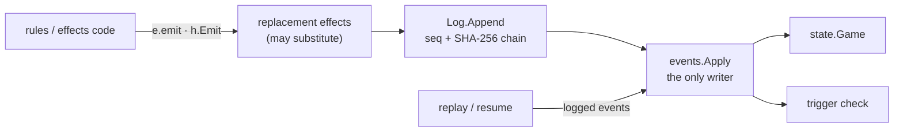

# Invariants

gorge rests on a short list of design rules. This page states each one, why
it exists, what goes red when you break it (by exact test name), the
legitimate way to change it, and the mistake people actually make. It is for
anyone changing engine, server or bot code: read it before your first
non-trivial change, and come back when a ratchet or golden test fails and you
want to know what it is protecting.

*Every test named here was checked to exist, and the ones in the summary run
green, on `develop` @ `513a2a0c3`, 2026-10-21.*

Where a rule is held only by convention (nothing mechanical catches you at
the point of writing), the page says so; the after-the-fact backstop is
usually the replay and golden-head tests.

## Summary

| # | Invariant | Enforced by |
|---|---|---|
| 1 | [All state mutation goes through `events.Apply`](#all-state-mutation-goes-through-eventsapply) | after the fact: `TestRepoDeckGamesReplayExactly`, `TestHeads`, `make sim` replay verification |
| 2 | [`events.Kind` is append-only](#eventskind-is-append-only) | `TestEveryKindHasADescriptor`, the golden heads and replay fixtures |
| 3 | [No nondeterminism](#no-nondeterminism) | `TestTimeIsImportedOnlyByTheHost`, `TestNoLegacyMathRand`; map order by convention |
| 4 | [No cgo, no third-party dependencies](#no-cgo-no-third-party-dependencies) | `TestRootModuleHasNoRequires`, `TestEngineCompilesFor32Bit` |
| 5 | [`engine/` imports nothing outside `engine/`](#engine-imports-nothing-outside-engine) | `TestDependencyOrderHolds` and the `layering_*` tests (named edges) |
| 6 | [Never commit Forge card scripts](#never-commit-forge-card-scripts) | `TestNoForgeScriptsTracked` |
| 7 | [The decision kinds are a closed set](#the-decision-kinds-are-a-closed-set) | `TestKindsListsEveryKindOnce` |
| 8 | [Seats see only their view; the server trusts no client](#seats-see-only-their-view-the-server-trusts-no-client) | `TestNoExportLeaksAnEngineGame`, the `engine/view` redaction tests, `decision.Validate`'s tests, the `httpapi` claim tests |
| 9 | [Ratchets only shrink](#ratchets-only-shrink) | `TestEveryRepoDeckIsFullySupported`, `TestEveryRepoDeckParamsAreRead`, `TestKnownApproximationsOnlyShrinks`, … |
| 10 | [Golden chain heads move only with a named cause](#golden-chain-heads-move-only-with-a-named-cause) | `TestHeads` |
| 11 | [Every test fits the budget](#every-test-fits-the-budget) | `cmd/testbudget` in the post-merge suite |
| 12 | [Corpus or it did not run](#corpus-or-it-did-not-run) | CI refuses to test without `.cards/`; locally, convention |

Two companion documents record behaviour that is *not* an invariant
violation even though it can look like one: the
[engine contracts](https://github.com/adams-shaun/gorge/blob/main/docs/design/2026-09-22-engine-contracts.md)
(deliberate behaviour, such as the deterministic fallback every asking
primitive uses when its host cannot answer) and `AGENTS.md`'s *Known
approximations* table (real, shrinking debt).

## All state mutation goes through `events.Apply`

**Rule.** Nothing outside `engine/events` writes a `state.Game` field. Engine
code *proposes* an event: `e.emit(events.Event{...})` in `engine/rules`,
`h.Emit(...)` (the `effects.HostEmit` methods) in `engine/effects`. The
event is appended to the log and then folded into state by `events.Apply`.

**Why.** A match is then completely described by its `Config` plus its event
log. Replaying a log, resuming a server after a restart, undo, search clones
and bug reproduction are all the same operation: feed the logged events back
through `events.Apply`. Going through `emit` also gives replacement effects
the chance to modify the event and lets triggers see it. A direct write is
invisible to all of that: the live game and its replay silently disagree.

**Enforced by.** After the fact, not at the line you write:
`TestRepoDeckGamesReplayExactly` (`engine/rules/acceptance_test.go`) replays
full games from their logs and compares event for event; `make sim` does the
same for 20 four-seat games (`mtgsim -verify`); `TestHeads` pins the chain
heads; `engine/replay` names the first divergent event
(`replay.FirstDivergence`).

**To change.** Never. If you need new state, add an event kind
([invariant 2](#eventskind-is-append-only)) and its `events.Apply` case.

**Classic mistake.** A rules helper sets `obj.Tapped = true` or bumps a
counter field directly "because it is only bookkeeping". Every test passes
today; the first replay of a game that reaches that line diverges. Test
*fixtures* may set state directly to build a position (`e.G.AddObject`,
`e.G.SetZone`); engine code may not.

## `events.Kind` is append-only

**Rule.** A new event kind goes after the last constant in
[`engine/events/event.go`](https://github.com/adams-shaun/gorge/blob/main/engine/events/event.go),
never between existing ones, and gets one entry in `kindInfo`
(`engine/events/kindinfo.go`: its name, trigger-interest class and optional
transcript template).

**Why.** `events.Kind` is a `uint8` assigned by `iota`, and the ordinal is part
of every event's hash. Inserting a kind renumbers every kind after it, which
moves the hash chain of every game and invalidates every recorded log:
golden heads, replay fixtures, saved server matches and feedback reports.

**Enforced by.** `TestEveryKindHasADescriptor` (`engine/events/kindinfo_test.go`)
fails when a kind has no `kindInfo` entry; `TestTriggerEventInterestMapping`
and its neighbours in `engine/rules/trigger_eligibility_test.go` check the
trigger classes. An insertion shows up as moved `TestHeads` goldens and a
`DIVERGED` replay of the committed `cmd/repro` fixtures.

**To change.** Append. Removing or reordering kinds is not done.

**Classic mistake.** Inserting `FooTapped` next to `Tap` "where it belongs".
Put it at the end and say in its comment what it relates to; the existing
comments in `event.go` show the form.

## No nondeterminism

**Rule.** The engine is a pure function of `(Config, intents)`:

- **No wall clock.** Only the packages in the `allowed` map of
  `TestTimeIsImportedOnlyByTheHost` (`internal/archtest/arch_test.go`) may
  import `time`: the server (`server/host`, `server/host/httpapi`,
  `server/host/manabrewhttp`, `server/gorged`) for its injected sleep, SSE
  keep-alive and deadlines, and three measurement commands (`cmd/cardfuzz`,
  `cmd/paymirror`, `cmd/enginebench`) that time only their own runs. Library
  code that needs timing takes an injected hook.
- **No ambient randomness.** The engine has one seeded PCG source with a draw
  counter (`engine/rules/rng.go`, `math/rand/v2`); a bot's generator is seeded
  from the match seed and its seat.
- **No `map` range whose order can reach** an event, a decision's option
  order, a trace or a checkpoint. Sort the keys, or use a dense slice or a
  bitset.
- Ties break by lowest option index.

**Why.** Byte-identical replay, the golden heads, reproducible bug reports,
reproducible benchmarks and reproducible training all depend on it. Go
randomises map iteration on purpose, so a map range on the event path is
nondeterministic even within one binary.

**Enforced by.** `TestTimeIsImportedOnlyByTheHost`, `TestNoLegacyMathRand`
(no `math/rand` v1 anywhere), `TestPayStaysDeterministic` (the payment layer
imports no clock, randomness, `sync`, `unsafe` or `os`) and
`TestPayMirrorClockStaysAtCommandBoundary`. Map order is **convention**: the
backstop is `TestHeads`, the replay tests and `make sim`, which catch it only
when the order happens to differ.

**To change.** To let a package import `time`, add it to the `allowed` map
with a paragraph in that test's doc comment arguing that no game, event,
replay or verdict can read the clock.

**Classic mistake.** Building a decision's option list by ranging over a
`map[ObjID]bool`. It passes locally, then a `TestHeads` run moves on one
machine and not another. That flakiness is the signature: suspect a map.

## No cgo, no third-party dependencies

**Rule.** The root `go.mod` has no `require` lines and `go.sum` is empty or
absent. The card pipeline, the rules core and the learned-policy stack are
pure Go, and the engine builds for 32-bit targets.

**Why.** Anyone can build gorge with only a Go toolchain: no C compiler, no
dependency audit, no supply chain. It is also what makes the
[repository boundary](../repos/index.md#dependency-direction-and-what-enforces-it)
structural: a module with no `require` cannot import a companion repository.

**Enforced by.** `TestRootModuleHasNoRequires`
(`internal/archtest/gomod_test.go`), `TestEngineCompilesFor32Bit`
(`internal/archtest/arch_test.go`), and `CGO_ENABLED=0` on every `make`
build.

**To change.** An experiment that genuinely needs a third-party module lives
in its own module that imports gorge, never the other way round. (AGENTS.md
records one planned exception, `wazero`, for a future plugin tier.)

**Classic mistake.** It happened: a GPU game pool added
`github.com/ebitengine/purego` to `go.mod` on 2026-10-08. It moved out of
gorge, and the test above was added so it cannot recur.

## `engine/` imports nothing outside `engine/`

**Rule.** Non-test code under `engine/` imports only the standard library
and other `engine/` packages. Within and around it, a set of named edges must
never appear, directly or transitively. The main ones:

| Never | Because |
|---|---|
| `engine/effects` → `engine/rules` | effects reach the engine only through `effects.Host`, so the effect library stays independent of the engine that hosts it |
| `engine/view` → `engine/rules`, `server/protocol` → `engine/rules` | nothing a client receives can carry rules knowledge |
| `engine/cards` → `engine/state`; `engine/deck` → `engine/rules` | the compiler and the deck reader sit below the game |
| `bots/botpolicy` → `engine/view`, `engine/rules`, `engine/seat` | the one policy reads a `Board`, never an engine |
| `bots/…` → `server/host`, `testkit/testutil` | bots are injected into hosts, not the reverse |
| `server/host`, `server/host/httpapi`, `server/gorged` → `testkit/testutil` | test scaffolding stays out of the server |

Inside `engine/rules`, each sub-package (`cost`, `chars`, `combat`,
`trigmatch`, `pay`, `resolve`, `scriptfacts`) has its own pinned import set
and reads the engine through a narrow `Board` interface whose method count
only shrinks.

**Why.** The engine stays testable and embeddable without the server or any
bot; a client can never be handed engine internals; and the layering inside
`engine/rules` keeps the biggest package from becoming one tangle.

**Enforced by.** `TestDependencyOrderHolds` (`internal/archtest/arch_test.go`)
for the named edges; `TestCostVocabularyIsALeaf`,
`TestCombatImportsStayBelowRules`, `TestTrigmatchImportsStayBelowL5`,
`TestScriptFactsImportsStayBelowRules`, `TestCharsImportsStayBelowRules`,
`TestResolveImportsStayBelowRules`, `TestPayImportsStayBelowRules` and the
`*BoardOnlyShrinks` tests for the sub-packages. The group rule itself
(`engine/` → nothing outside) is **measured, not yet one test**:
`go list -deps ./engine/...` showed no gorge package outside `engine/` and no
non-standard-library package on 2026-10-21. `cmd/pkgmap` draws any tier
back-edge in red on [Packages](packages.md).

**To change.** Adding a forbidden edge is welcome. Removing one needs a
design discussion first.

**Classic mistake.** An effect or a view needs one engine helper. Go itself
rejects `effects` → `rules` as an import cycle, so the helper gets moved into
a small shared package, which then grows a dependency on `rules`.
`TestDependencyOrderHolds` checks transitive edges and catches it. Extend
`effects.Host` with a narrow, named capability, or move the logic into
`rules`.

## Never commit Forge card scripts

**Rule.** Forge's card and token scripts are GPL-3.0 and gorge is
Apache-2.0. They live only in the gitignored `.cards/` and are never
committed: not as files, not embedded in a fixture, not pasted into a test, a
doc or an issue.

**Why.** Licence compatibility. gorge ships a compiler for the format and
fetches the corpus at a pinned commit (`FORGE_REF`), so nothing GPL-licensed
is distributed with it.

**Enforced by.** `TestNoForgeScriptsTracked`
(`engine/cards/boundary_test.go`), which checks the working tree, the index
and `HEAD` and recognises a script by content (a `Name:` first line and an
`Oracle:` line), not by path.

**To change.** Not negotiable. A script that is wrong is fixed on the fork
([adams-shaun/forge](https://github.com/adams-shaun/forge), branch `gorge`)
and sent upstream; gorge picks it up when `FORGE_REF` moves.

**Classic mistake.** Copying a card's script into a test so the test does not
need the corpus. Name the card and load it through
`testutil.CorpusRegistry(t)`, or write a minimal synthetic script of your own
(`card(t, "Name:Mountain\nTypes:Basic Land Mountain\nOracle:x\n")`). Replay
fixtures strip token-script text into the gitignored
`cmd/repro/testdata/.tokens/` for the same reason.

## The decision kinds are a closed set

**Rule.** When the engine needs a player's input it poses a
`decision.Decision` of one of exactly thirteen kinds (`decision.Kinds` in
`engine/decision/decision.go`): `priority`, `target`, `attackers`,
`blockers`, `mulligan`, `modes`, `trigger_order`, `trigger_optional`,
`commander_zone`, `choose`, `replacement`, `arrange`, `starting_player`.
Conceding is an option on every priority decision, not a kind.

**Why.** Every seat (bots, the web client, the wire protocol, the ManaBrew
and SpellBench adapters, gorge-compliance's scenario runner) must be able to
answer every kind. A new kind is a breaking change for all of them at once.

**Enforced by.** `TestKindsListsEveryKindOnce`
(`engine/decision/decision_test.go`); the exhaustive switches in the
consumers.

**To change.** A maintainer decision and a design first; then every consumer
is updated in the same change. Most new choices fit an existing kind:
`choose` already covers numbers, names, types, yes/no and card subsets.

**Classic mistake.** Adding a kind for a new card's choice instead of
expressing it as a `choose`.

## Seats see only their view; the server trusts no client

**Rule.** A seat (a bot, a test script or a person in a browser) never sees
the engine. It receives a `view.View`, built by `engine/view` for that seat,
and answers with a `decision.Intent` naming option indices. The engine
accepts only what it offered, and the server binds every seat credential to
one table and one seat.

- Hidden zones project as counts. Even the omniscient spectator view never
  exposes library order.
- `rules.Engine.Submit` runs `decision.Validate`: the intent must match the
  pending decision's sequence number and player, and choose only offered
  options within the allowed arity. "Anything the engine did not offer is
  rejected, which is what keeps the client rules-ignorant."
- Every seat-authorised HTTP route goes through `claimForTable`
  (`server/host/httpapi/rest.go`): no token is 401, a claim for another table
  is 403, and a `?seat=` the claim does not hold is refused.
- Search code that samples hidden information sees public state only, and
  clairvoyant measurement modes never reach a hosted table.

**Why.** A bot that can read hidden state produces meaningless strength
numbers, and one that does so on a hosted table is cheating a real player. A
server that trusts a client-sent seat or move can be driven by any
browser console.

**Enforced by.** `TestNoExportLeaksAnEngineGame` (no exported `server/host`
or `httpapi` function signature mentions `*state.Game` or `*rules.Engine`);
the view redaction tests such as
`TestPublicVisibilityRedactsEveryHandAndShowsEveryPublicZoneAndPool` and
`TestOmniscientRevealsEveryHandAndPoolNeverTheLibrary`
(`engine/view/visibility_pin_test.go`); `decision.Validate`'s tests
(`TestValidateRejectsWrongPlayer`, `TestValidateRejectsWrongSequence`,
`TestValidateRejectsOutOfRangeAndDuplicates`, …); and the claim tests in
`server/host/httpapi/seat_test.go` (`TestTableBoundSeatClaimRejectsEveryOtherTable`,
`TestIntentSubmitsThroughTheClaimAndRejectsOthers`).

**To change.** Never weaken. A new seat route goes through `claimForTable`;
new client-visible state goes through `engine/view`.

**Classic mistake.** A route that takes the seat from the query string or the
request body instead of the credential. An earlier claim format that did not
name its table carried cross-table privilege; such claims are now refused
outright rather than grandfathered.

## Ratchets only shrink

**Rule.** Several committed tables record known gaps, and each fails in
**both** directions: a new gap fails, and a listed gap that the build has
closed is stale and fails too. A branch deletes entries; it never adds one or
raises a ceiling.

| Table | Test | Today |
|---|---|---|
| `engine/rules/testdata/known-unsupported/` (one file per repo-deck card the build cannot fully play) | `TestEveryRepoDeckIsFullySupported` | 2 of 1,123 cards |
| `engine/rules/testdata/paramcensus/` (cards with a parameter no code reads) | `TestEveryRepoDeckParamsAreRead` | 16 of 1,123 cards |
| `knownUnmodelledCountHeads` | `TestEveryRepoDeckCountHeadResolves` (`engine/rules/count_head_ratchet_test.go`) | |
| `effects.modelledValueHeads` vs the evaluator | `TestValueHeadRegistryMatchesEvaluator` | |
| `AGENTS.md`'s *Known approximations* table | `TestKnownApproximationsOnlyShrinks` (`testkit/testutil/agentsdoc_test.go`) | 8 rows, none over 600 bytes |
| function-length and interface-width ceilings | `TestCodeShapeOnlyShrinks`, `TestLongFunctionsOnlyShrink` (`internal/codeshape`) | skipped by the maintainers since 2026-10-06; the direction still holds |
| test-budget exception lists | `cmd/testbudget` | see [invariant 11](#every-test-fits-the-budget) |

*"Today" from `go test -v -run 'TestEveryRepoDeckIsFullySupported|TestEveryRepoDeckParamsAreRead' ./engine/rules/`
and `agentsdoc_test.go`'s `knownApproximationRows`, 2026-10-21 at `513a2a0c3`.*

**Why.** "Supported" should only ever mean more. A two-way ratchet makes the
table the exact truth: it cannot silently understate a regression, and it
cannot keep claiming a gap that is gone.

**Enforced by.** The tests above, plus review.

**To change.** When your change closes a gap, delete its entry **in the same
commit**. The Known-approximations table is a closing register: a landing
change deletes its row's file in `docs/agents/known-approximations/` and its `ALLOWED.txt` line; a deviation it
cannot close goes in the commit message, never in a new row.

**Classic mistake.** Adding a `known-unsupported` file to turn a red test
green, or fixing a card and leaving its file behind (which also turns the
test red).

## Golden chain heads move only with a named cause

**Rule.** `TestHeads` (`engine/rules/heads_test.go`) plays one deterministic
bot game per seat count (2, 4, 6 and 8 seats, over the 12 Legacy repo decks)
and compares each game's final hash-chain head with
`engine/rules/testdata/heads/<seats>.txt`. A head may move only when the
change was meant to alter what those games do, and the commit message names
the first diverging event and its cause.

**Why.** The chain head is a 16-hex-digit fingerprint of everything that
happened in a game. If it moved, behaviour changed. The goldens turn "did
this refactor change anything?" into a yes/no answer.

**Enforced by.** `TestHeads` (also run as its own CI step).

**To change.** Re-pin with
`GORGE_UPDATE_HEADS=1 go test ./engine/rules/ -run '^TestHeads$'`, then find
the first diverging event with `cmd/headdiff` (`-dump` on the base, `-against`
on your branch; `go doc ./cmd/headdiff` has the recipe) and put it in the
commit message, not in a file.

**Classic mistake.** Re-pinning because "the heads always move". An
unexplained moved head is a bug, often nondeterminism
([invariant 3](#no-nondeterminism)).

## Every test fits the budget

**Rule.** Every single test fits **4 GB of RSS, 4 vCPUs and 1 minute of
wall time**. One that does not is a defect: split it into chunk tests that
share fixtures; never trim its coverage.

**Why.** The full suite (over 12,000 top-level `Test` functions on 2026-10-21) runs on shared machines after
every merge. One unbounded test can stall or kill everything else running
there.

**Enforced by.** `cmd/testbudget`, wired into the post-merge full suite: it
measures each test's wall time and each test binary's peak RSS, and fails on
any offender not already listed in the shrink-only
`testkit/testutil/testdata/wall_exceptions.txt` / `rss_exceptions.txt`.

**To change.** The limits are the maintainers' call. A branch never adds an
exception row.

**Classic mistake.** Loading the corpus with `cards.LoadRegistry` in a test
(hundreds of MB per fresh registry) instead of the shared
`testutil.CorpusRegistry(t)`; or running a known-heavy test whole "for a
baseline". How to run tests under the cap is on [Testing](../contributing/testing.md).

## Corpus or it did not run

**Rule.** Corpus-dependent tests load cards through
`testutil.CorpusRegistry(t)`, which **skips** when `.cards/` is absent. A
run without the corpus has tested very little and must not be reported
green.

**Why.** Skipping keeps `go test ./...` usable on a fresh clone with no
network. The cost is a trap: a package that prints `ok` in a couple of
milliseconds may have run nothing.

**Enforced by.** CI refuses to test without `.cards/` at `FORGE_REF` (the
"Refuse to run without the corpus" step of `ci.yml`). Locally it is
convention: run with `-v` and look for `SKIP`.

**Classic mistake.** Testing in a fresh `git worktree`, which carries only
tracked files and therefore no `.cards/`. Link it in:
`ln -s <main checkout>/.cards .cards`. See
[Contributing](../contributing/index.md#work-in-a-worktree).

## Changing an invariant

Each section's **To change** line is the legitimate route. For anything
beyond it (a new decision kind, a removed forbidden edge, a new dependency),
open an issue or a design document under `docs/design/` first, and record a
decided behaviour that is not debt in the
[engine contracts](https://github.com/adams-shaun/gorge/blob/main/docs/design/2026-09-22-engine-contracts.md)
in the same commit as the code.
