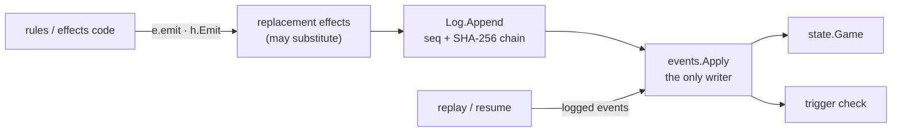

# Invariants

Each rule below says why it exists, which test goes red when you break it,
how to change it legitimately, and the mistake people actually make. Read it
before a non-trivial engine, server or bot change, and when a ratchet or golden
fails. Where a rule is held only by convention, the page says so; the backstop
is usually the replay and golden-head tests.

The terse, agent-facing version (the same rules, numbered differently) is
[`docs/agents/invariants.md`](https://github.com/adams-shaun/gorge/blob/main/docs/agents/invariants.md),
which also holds the contributor workflow. Test names are the authority: when
this page and a test disagree, the test wins.

## Summary

| # | Invariant | Enforced by |
|---|---|---|
| 1 | [All state mutation goes through `events.Apply`](#all-state-mutation-goes-through-eventsapply) | after the fact: `TestRepoDeckGamesReplayExactly`, `TestHeads`, `make sim` replay verification |
| 2 | [`events.Kind` is append-only](#eventskind-is-append-only) | `TestEveryKindHasADescriptor`, the golden heads and replay fixtures |
| 3 | [No nondeterminism](#no-nondeterminism) | `TestTimeIsImportedOnlyByTheHost`, `TestNoLegacyMathRand`; map order by convention |
| 4 | [No cgo, no third-party dependencies](#no-cgo-no-third-party-dependencies) | `TestRootModuleHasNoRequires`, `TestEngineCompilesFor32Bit` |
| 5 | [`engine/` imports nothing outside `engine/`](#engine-imports-nothing-outside-engine) | `TestDependencyOrderHolds`, `TestEngineTierImportsNeitherDraftNorDirac` and the `layering_*` tests (named edges) |
| 6 | [Never commit Forge card scripts](#never-commit-forge-card-scripts) | `TestNoForgeScriptsTracked`, `TestNoVerbatimForgeLines`, `TestPublicBoundary` |
| 7 | [The decision kinds are a closed set](#the-decision-kinds-are-a-closed-set) | `TestKindsListsEveryKindOnce` |
| 8 | [Seats see only their view; the server trusts no client](#seats-see-only-their-view-the-server-trusts-no-client) | `TestNoExportLeaksAnEngineGame`, the `engine/view` redaction tests, `decision.Validate`'s tests, the `httpapi` claim tests |
| 9 | [Ratchets only shrink](#ratchets-only-shrink) | `TestEveryRepoDeckIsFullySupported`, `TestEveryRepoDeckParamsAreRead`, `TestKnownApproximationsOnlyShrinks`, … |
| 10 | [Golden chain heads move only with a named cause](#golden-chain-heads-move-only-with-a-named-cause) | `TestHeads` |
| 11 | [Every test fits the budget](#every-test-fits-the-budget) | `cmd/testbudget` and the caps in `scripts/test-targets.sh` |
| 12 | [Corpus or it did not run](#corpus-or-it-did-not-run) | CI and `make test-*` refuse to run without `.cards/` |
| 13 | [A card dirac supports plays identically to gorge](#a-card-dirac-supports-plays-identically-to-gorge) | `scripts/dirac-gate.sh`, `make dirac-slices` in CI, `TestColdArraysHoldNoPointers`, `TestStateSize` |

Two companion documents record behaviour that is *not* an invariant
violation even though it can look like one: the
[engine contracts](https://github.com/adams-shaun/gorge/blob/main/docs/design/2026-09-22-engine-contracts.md)
(deliberate behaviour, such as the deterministic fallback every asking
primitive uses when its host cannot answer) and the
[known approximations](https://github.com/adams-shaun/gorge/tree/main/docs/agents/known-approximations)
(real, shrinking debt, one file per row).

## All state mutation goes through `events.Apply`

**Rule.** Nothing outside `engine/events` writes a `state.Game` field. Engine
code *proposes* an event (`e.emit(events.Event{...})` in `engine/rules`,
`h.Emit(...)` in `engine/effects`); it is appended to the log, then folded into
state by `events.Apply`.

**Why.** A match is its `Config` plus its event log, so replay, resume after a
restart, undo, search clones and bug reproduction are one operation: feed the
logged events back through `events.Apply`. `emit` also lets replacement effects
modify the event and triggers see it. A direct write is invisible to all of
that, and the live game and its replay silently disagree.

**Enforced by.** After the fact, not at the line you write:
`TestRepoDeckGamesReplayExactly` (`engine/rules/acceptance_test.go`) replays
full games from their logs event for event; `make sim` does the same for 20
four-seat games (`mtgsim -verify`); `TestHeads` pins the chain heads;
`replay.FirstDivergence` names the first divergent event.

**To change.** Never. New state means a new event kind
([append it](#eventskind-is-append-only)) and its `events.Apply` case.

**Classic mistake.** A rules helper sets `obj.Tapped = true` "because it is only
bookkeeping". Every test passes until a replay reaches that line. Test
*fixtures* may set state directly to build a position (`e.G.AddObject`,
`e.G.SetZone`); engine code may not.

## `events.Kind` is append-only

**Rule.** A new event kind goes after the last constant in
[`engine/events/event.go`](https://github.com/adams-shaun/gorge/blob/main/engine/events/event.go),
never between existing ones, and gets one `kindInfo` entry
(`engine/events/kindinfo.go`: name, trigger-interest class, optional transcript
template).

**Why.** `events.Kind` is a `uint8` assigned by `iota`, and the ordinal is part
of every event's hash. Inserting a kind renumbers all later ones, which moves
every game's hash chain and invalidates golden heads, replay fixtures, saved
server matches and feedback reports.

**Enforced by.** `TestEveryKindHasADescriptor` (`engine/events/kindinfo_test.go`)
fails on a kind with no `kindInfo` entry; `TestTriggerEventInterestMapping` and
its neighbours in `engine/rules/trigger_eligibility_test.go` check trigger
classes. An insertion shows up as moved `TestHeads` goldens and a `DIVERGED`
replay of the committed `cmd/repro` fixtures.

**To change.** Append. Removing or reordering kinds is not done.

**Classic mistake.** Inserting `FooTapped` next to `Tap` "where it belongs". Put
it at the end and say in its comment what it relates to.

## No nondeterminism

**Rule.** The engine is a pure function of `(Config, intents)`:

- **No wall clock.** Only the packages in the `allowed` map of
  `TestTimeIsImportedOnlyByTheHost` (`internal/archtest/arch_test.go`) may import
  `time`, each argued in the test's doc comment: the server tier (`server/host`,
  `server/host/httpapi`, `server/host/manabrewhttp`, `server/gorged`: injected
  sleep, SSE keep-alive, deadlines), `draft/eventhost` (lobby and pick timers),
  three measurement commands (`cmd/cardfuzz`, `cmd/paymirror`, `cmd/enginebench`)
  and six dirac packages (`dirac/oracle` and its watchdog, `dirac/oracle/cmd/kfuzz`,
  `khbot`, `ksbt`, `dirac/kgen` for build timing, `dirac/cmd/dplay`). None
  reaches a game. Library code that needs timing takes an injected hook.
- **No ambient randomness.** One seeded PCG source with a draw counter
  (`engine/rules/rng.go`, `math/rand/v2`); a bot's generator is seeded from the
  match seed and its seat.
- **No `map` range whose order can reach** an event, a decision's option order, a
  trace or a checkpoint. Sort the keys, or use a dense slice or bitset.
- Ties break by lowest option index.

**Why.** Byte-identical replay, golden heads, reproducible bug reports,
benchmarks and training all depend on it. Go randomises map iteration on
purpose, so a map range on the event path is nondeterministic even within one
binary.

**Enforced by.** `TestTimeIsImportedOnlyByTheHost`, `TestNoLegacyMathRand` (no
`math/rand` v1 anywhere), `TestPayStaysDeterministic` (the payment layer imports
no clock, randomness, `sync`, `unsafe` or `os`) and
`TestPayMirrorClockStaysAtCommandBoundary`. Map order is **convention**; the
backstop is `TestHeads`, the replay tests and `make sim`, which catch it only
when the order happens to differ.

**To change.** To let a package import `time`, add it to the `allowed` map with a
paragraph arguing that no game, event, replay or verdict can read the clock.

**Classic mistake.** Building a decision's option list by ranging over a
`map[ObjID]bool`. `TestHeads` then moves on one machine and not another; that
flakiness is the signature of a map.

## No cgo, no third-party dependencies

**Rule.** The root `go.mod` has no `require` lines and `go.sum` is empty or
absent. The card pipeline, the rules core and the learned-policy stack are pure
Go, and the engine builds for 32-bit targets.

**Why.** Anyone can build gorge with only a Go toolchain: no C compiler, no
dependency audit. It also makes the
[repository boundary](../repos/index.md#dependency-direction-and-what-enforces-it)
structural: a module with no `require` cannot import a companion repository.

**Enforced by.** `TestRootModuleHasNoRequires` (`internal/archtest/gomod_test.go`)
and `TestEngineCompilesFor32Bit` (`internal/archtest/arch_test.go`); the
Makefile's builds set `CGO_ENABLED=0`.

**To change.** An experiment that needs a third-party module lives in its own
module that imports gorge, never the other way round.

**Classic mistake.** Adding a helper module to `go.mod` for an experiment that
could live outside. The test fails as soon as a `require` appears.

## `engine/` imports nothing outside `engine/`

**Rule.** Non-test code under `engine/` imports only the standard library and
other `engine/` packages. Around it, named edges must never appear, directly or
transitively. The main ones:

| Never | Because |
|---|---|
| `engine/effects` → `engine/rules` | effects reach the engine only through `effects.Host`, so the effect library stays independent of its host |
| `engine/view` → `engine/rules`, `server/protocol` → `engine/rules` | nothing a client receives can carry rules knowledge |
| `engine/cards` → `engine/state`; `engine/deck` → `engine/rules` | the compiler and the deck reader sit below the game |
| `bots/botpolicy` → `engine/view`, `engine/rules`, `engine/seat` | the one policy reads a `Board`, never an engine |
| `bots/…` → `server/host`, `testkit/testutil` | bots are injected into hosts, not the reverse |
| `server/host`, `server/host/httpapi`, `server/gorged` → `testkit/testutil` | test scaffolding stays out of the server |

Inside `engine/rules`, each sub-package (`cost`, `chars`, `combat`, `trigmatch`,
`pay`, `resolve`, `scriptfacts`) has its own pinned import set and reads the
engine through a narrow `Board` interface whose method count only shrinks.

**Why.** The engine stays testable and embeddable without the server or any bot;
a client can never be handed engine internals; and the layering keeps
`engine/rules`, the biggest package, from becoming one tangle.

**Enforced by.** `TestDependencyOrderHolds` (`internal/archtest/arch_test.go`)
for the named edges; `TestCostVocabularyIsALeaf`, `TestCombatImportsStayBelowRules`,
`TestTrigmatchImportsStayBelowL5`, `TestScriptFactsImportsStayBelowRules`,
`TestCharsImportsStayBelowRules`, `TestResolveImportsStayBelowRules`,
`TestPayImportsStayBelowRules` and the `*BoardOnlyShrinks` tests for the
sub-packages; `TestEngineTierImportsNeitherDraftNorDirac` for the trees above.
The group rule as a whole is not one test: `go list -deps ./engine/...` shows it,
and `cmd/pkgmap` draws any tier back-edge in red on [Packages](packages.md).

**To change.** Adding a forbidden edge is welcome. Removing one needs a design
discussion first.

**Classic mistake.** An effect needs one engine helper. Go rejects `effects` →
`rules` as an import cycle, so the helper moves into a small shared package that
then depends on `rules`; `TestDependencyOrderHolds` catches the transitive edge.
Extend `effects.Host` with a narrow, named capability, or move the logic into
`rules`.

## Never commit Forge card scripts

**Rule.** Forge's card and token scripts are GPL-3.0 and gorge is Apache-2.0.
They live only in the gitignored `.cards/`: never committed as files, embedded in
a fixture, or pasted into a test, doc or issue.

**Why.** Licence compatibility. gorge ships a compiler for the format and
fetches the corpus at a pinned commit (`FORGE_REF`), so nothing GPL-licensed is
distributed with it.

**Enforced by.** `TestNoForgeScriptsTracked` (`engine/cards/boundary_test.go`)
checks the working tree, the index and `HEAD`, recognising a script by content
(a `Name:` first line and an `Oracle:` line), not by path. In `internal/archtest`,
`TestNoVerbatimForgeLines` catches a fragment in the draft stack and holds a
shrinking baseline elsewhere, and `TestPublicBoundary` fails on generated card
tables, private paths and imports of the private module. Tables generated from
the scripts are never committed, for the same reason.

**To change.** Not negotiable. A wrong script is fixed on the fork
([adams-shaun/forge](https://github.com/adams-shaun/forge)) and sent upstream;
gorge picks it up when `FORGE_REF` moves.

**Classic mistake.** Copying a card's script into a test so it needs no corpus.
Name the card and load it through `testutil.CorpusRegistry(t)`, or write a
minimal synthetic script (`card(t, "Name:Mountain\nTypes:Basic Land Mountain\nOracle:x\n")`).
Replay fixtures strip token-script text into the gitignored
`cmd/repro/testdata/.tokens/` for the same reason.

## The decision kinds are a closed set

**Rule.** When the engine needs a player's input it poses a `decision.Decision`
of one of the kinds in `decision.Kinds` (`engine/decision/decision.go`):
`priority`, `target`, `attackers`, `blockers`, `mulligan`, `modes`,
`trigger_order`, `trigger_optional`, `commander_zone`, `choose`, `replacement`,
`arrange`, `starting_player`. Conceding is an option on every priority decision,
not a kind.

**Why.** Every seat (bots, the web client, the wire protocol, the ManaBrew and
SpellBench adapters, gorge-compliance's scenario runner) must answer every kind,
so a new kind breaks all of them at once.

**Enforced by.** `TestKindsListsEveryKindOnce` (`engine/decision/decision_test.go`)
and the exhaustive switches in the consumers.

**To change.** A maintainer decision and a design first; then every consumer in
the same change. Most new choices fit an existing kind: `choose` already covers
numbers, names, types, yes/no and card subsets.

**Classic mistake.** Adding a kind for one card's choice instead of expressing it
as a `choose`.

## Seats see only their view; the server trusts no client

**Rule.** A seat (a bot, a test script or a person in a browser) never sees the
engine. It receives a `view.View` built by `engine/view` for that seat and
answers with a `decision.Intent` naming option indices. The engine accepts only
what it offered, and the server binds every seat credential to one table and one
seat.

- Hidden zones project as counts. Even the omniscient spectator view never
  exposes library order.
- `rules.Engine.Submit` runs `decision.Validate`: the intent must match the
  pending decision's sequence number and player and choose only offered options
  within the allowed arity.
- Every seat-authorised HTTP route goes through `claimForTable`
  (`server/host/httpapi/rest.go`): no token is 401, a claim for another table is
  403, and a `?seat=` the claim does not hold is refused.
- Search code that samples hidden information sees public state only, and
  clairvoyant measurement modes never reach a hosted table.

**Why.** A bot that reads hidden state produces meaningless strength numbers, and
on a hosted table it cheats a real player. A server that trusts a client-sent
seat or move can be driven from any browser console.

**Enforced by.** `TestNoExportLeaksAnEngineGame` (no exported `server/host` or
`httpapi` signature mentions `*state.Game` or `*rules.Engine`); the view
redaction tests, e.g. `TestPublicVisibilityRedactsEveryHandAndShowsEveryPublicZoneAndPool`
and `TestOmniscientRevealsEveryHandAndPoolNeverTheLibrary`
(`engine/view/visibility_pin_test.go`); `decision.Validate`'s tests
(`TestValidateRejectsWrongPlayer`, `TestValidateRejectsWrongSequence`,
`TestValidateRejectsOutOfRangeAndDuplicates`, …); and the claim tests in
`server/host/httpapi/seat_test.go` (`TestTableBoundSeatClaimRejectsEveryOtherTable`,
`TestIntentSubmitsThroughTheClaimAndRejectsOthers`).

**To change.** Never weaken. A new seat route goes through `claimForTable`; new
client-visible state goes through `engine/view`.

**Classic mistake.** A route that takes the seat from the query string or request
body instead of the credential.

## Ratchets only shrink

**Rule.** Several committed tables record known gaps, and each fails in **both**
directions: a new gap fails, and a listed gap the build has closed is stale and
fails too. A branch deletes entries; it never adds one or raises a ceiling.

| Table | Test |
|---|---|
| `engine/rules/testdata/known-unsupported/` (one file per repo-deck card the build cannot fully play) | `TestEveryRepoDeckIsFullySupported` |
| `engine/rules/testdata/paramcensus/` (cards with a parameter no code reads; absent while nothing is outstanding) | `TestEveryRepoDeckParamsAreRead` |
| `knownUnmodelledCountHeads` | `TestEveryRepoDeckCountHeadResolves` (`engine/rules/count_head_ratchet_test.go`) |
| `effects.modelledValueHeads` vs the evaluator | `TestValueHeadRegistryMatchesEvaluator` |
| the known approximations (`docs/agents/known-approximations/`, each file capped in `ALLOWED.txt`) | `TestKnownApproximationsOnlyShrinks` (`testkit/testutil/agentsdoc_test.go`) |
| interface-width and dispatch ceilings; per-function length and complexity ceilings over `engine/rules`, `engine/effects` and `dirac/` | `TestCodeShapeOnlyShrinks`, `TestLongFunctionsOnlyShrink`, `TestComplexFunctionsOnlyShrink` (`internal/codeshape`); growth only |
| test-budget exception lists | `cmd/testbudget`; see [its invariant](#every-test-fits-the-budget) |

**Why.** "Supported" should only ever mean more. A two-way ratchet makes the
table the exact truth: it cannot understate a regression or keep claiming a gap
that is gone.

**Enforced by.** The tests above, plus review.

**To change.** When your change closes a gap, delete its entry **in the same
commit**. The Known-approximations table is a closing register: a landing change
deletes its row's file and its `ALLOWED.txt` line; a deviation it cannot close
goes in the commit message, never a new row.

**Classic mistake.** Adding a `known-unsupported` file to turn a red test green,
or fixing a card and leaving its file behind (which also turns the test red).

## Golden chain heads move only with a named cause

**Rule.** `TestHeads` (`engine/rules/heads_test.go`) plays one deterministic bot
game per seat count (2, 4, 6 and 8 seats, over the Legacy repo decks in
`legacyDeckNames`, `testkit/testutil/decks.go`) plus the 4-seat Commander game,
and compares each final hash-chain head with its file in
`engine/rules/testdata/heads/`. A head may move only when the change was meant to
alter what those games do, and the commit message names the first diverging
event and its cause.

**Why.** The head is a fingerprint of everything that happened in a game. If it
moved, behaviour changed; the goldens turn "did this refactor change anything?"
into a yes/no answer.

**Enforced by.** `TestHeads`, also run as its own step in `ci.yml` (the "Golden
chain heads" step of shard 0). `TestSetHeads` is the same rule over pinned games
on Standard-set decks.

**To change.** Re-pin with
`GORGE_UPDATE_HEADS=1 go test ./engine/rules/ -run '^TestHeads$'`, then find the
first diverging event with `cmd/headdiff` (`-dump` on the base, `-against` on your
branch; `go doc ./cmd/headdiff`) and put it in the commit message, not in a file.

**Classic mistake.** Re-pinning because "the heads always move". An unexplained
moved head is a bug, often [nondeterminism](#no-nondeterminism).

## Every test fits the budget

**Rule.** Every single test fits **4 GB of RSS, 4 vCPUs and 1 minute of wall
time**. One that does not is a defect: split it into chunk tests that share
fixtures; never trim its coverage.

**Why.** The suite runs on shared machines. One unbounded test can stall or kill
everything else running there.

**Enforced by.** The make targets cap every run (`scripts/test-targets.sh`:
memory, CPU, `-timeout`). `cmd/testbudget` measures each test's wall time and
each test binary's peak RSS and fails on any offender not listed in the
shrink-only `testkit/testutil/testdata/wall_exceptions.txt` /
`rss_exceptions.txt`; no workflow in `.github/workflows/` runs it today.

**To change.** The limits are the maintainers' call. A branch never adds an
exception row.

**Classic mistake.** Loading the corpus with `cards.LoadRegistry` in a test
(hundreds of MB per fresh registry) instead of the shared
`testutil.CorpusRegistry(t)`, or running a known-heavy test whole "for a
baseline". Running tests under the cap is on [Testing](../contributing/testing.md).

## Corpus or it did not run

**Rule.** Corpus-dependent tests load cards through `testutil.CorpusRegistry(t)`,
which **skips** when `.cards/` is absent. A run without the corpus has tested very
little and must not be reported green.

**Why.** Skipping keeps a fresh clone with no network usable. The cost is a trap:
a package that prints `ok` in a couple of milliseconds may have run nothing.

**Enforced by.** CI refuses to test without `.cards/` at `FORGE_REF` (the "Refuse
to run without the corpus" step of `ci.yml`), and the `make test-*` targets report
a missing corpus as `ENV`, never green. A bare `go test` is convention: run with
`-v` and look for `SKIP`.

**Classic mistake.** Testing in a fresh `git worktree`, which carries only tracked
files and so no `.cards/`. Link it in with `scripts/link-cards.sh`, which picks the corpus of this tree's own `FORGE_REF`. See
[Contributing](../contributing/index.md#work-in-a-worktree).

## A card dirac supports plays identically to gorge

**The rule.** On a [supported card](dirac/index.md#what-it-supports), dirac poses
the same decisions with the same options as gorge and reaches the same positions.
gorge leads. A gorge change that alters behaviour on a supported card fixes dirac
in the same change, or refuses the card by name with `kgen -refuse`. `dirac.State`
holds no references beyond its views of one pointer-free buffer and its fork pool,
and the transition loop allocates nothing.

**Why.** dirac is a second engine only as long as it plays the same game.
Lockstep shows the two agree, not that they are right: a bug in both is not
caught ([what lockstep proves](dirac/oracle.md#what-lockstep-proves-and-what-it-doesnt)).

**What goes red.** `scripts/dirac-gate.sh <base>`: lockstep on the committed FDN
and BLB slices, both surfaces, the size bar, allocations and instructions per
transition; `TestColdArraysHoldNoPointers` and `TestStateSize`. CI runs
`make dirac-slices` on every merge-queue batch; the whole of `dirac/oracle` runs
on `main` about every 6 hours (`oracle.yml`), never on a pull request or a batch.
A capacity stall is a declared limit and is always counted, not a failure.

**To change.** Keep gorge's change, port it, and let the gate run. If a port does
not fit, refuse the card by name. Raising the size bar is a deliberate decision of
its own.

**Classic mistake.** Reading a green `make test-smart` as enough after a rules
change. Most of those tests do not play dirac: run `scripts/dirac-gate.sh <base>`
from a checkout where `make dirac-tables` has run.

## Changing an invariant

Each section's **To change** line is the legitimate route. For anything beyond it
(a new decision kind, a removed forbidden edge, a new dependency), open an issue
or a design document under `docs/design/` first, and record deliberate behaviour
that is not debt in the
[engine contracts](https://github.com/adams-shaun/gorge/blob/main/docs/design/2026-09-22-engine-contracts.md)
in the same commit as the code.
