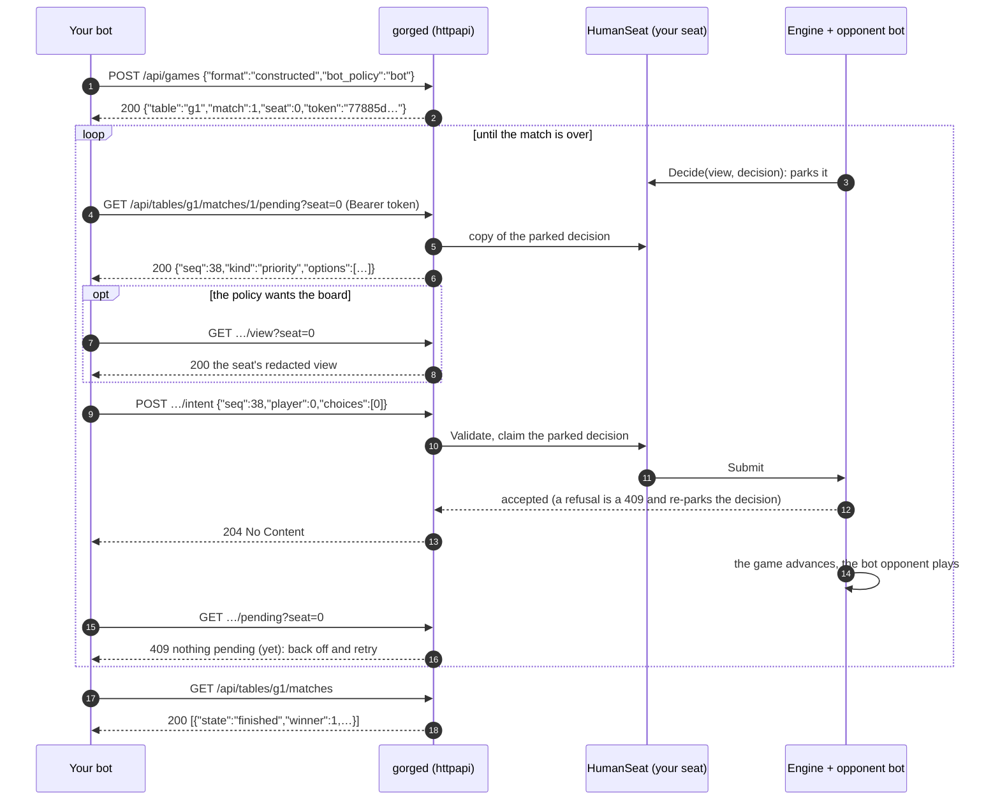

# Playing a seat over HTTP

This page is for authors of bots in any language who want to play a gorge seat over the network. It walks the decision
round trip with real requests and responses from a live `gorged` (2026-10-31 unless a line says otherwise), explains how to
answer each decision kind, and lists the errors and pitfalls. The field-by-field reference is the
[HTTP API reference](../api/http.md); working agents are on [Python and Java examples](examples.md).

The HTTP seat is the surface the browser client plays through: a seat the server treats as "human" parks each decision until
someone posts an answer. A bot is a program holding that seat's token.

## Start a server that has a seat for you

Two ways, both on `gorged` (build it with `go build ./cmd/gorged` in the repository root, after `make fetch-cards`; a bot
needs no browser client):

=== "On demand: POST /api/games"

    ```console
    $ ./gorged -addr 127.0.0.1:8080 -dir /tmp/gorge-bots -feedback /tmp/gorge-bots/feedback \
        -tables 0 -vsbot -max-on-demand-tables 0 -pace 0 -prewarm=false -bot-policy bot
    gorged: 0 tables of 4 on 127.0.0.1:8080 (dir /tmp/gorge-bots)
    ```

    `-vsbot` arms `POST /api/games`, which creates a private two-seat table,
    you (seat 0) against a hosted bot, and hands back that seat's token. A bot
    can open as many games as it likes. `-max-on-demand-tables 0` lifts the
    default cap of 32 retained tables, which a training loop hits quickly;
    `-pace 0` removes the 50 ms pause the server inserts after every
    decision for human spectators.

=== "Fixed seat: -humans"

    ```console
    $ ./gorged -addr 127.0.0.1:8080 -dir /tmp/gorge-bots -feedback /tmp/gorge-bots/feedback \
        -tables 1 -seats 2 -humans 0 -seat-token docs-token -pace 0 -prewarm=false -bot-policy bot
    gorged: 1 tables of 2 on 127.0.0.1:8080 (dir /tmp/gorge-bots)
    gorged: table t1 seat 0 joins at http://127.0.0.1:8080/t/t1?seat=0&token=docs-token
    ```

    `-humans 0` makes seat 0 of table `t1` an HTTP seat; `-seat-token`
    fixes its token (omit it and the server mints a random one and prints the
    join URL). Leave `-spectator` at its `public` default: that keeps every
    hand hidden from an unauthenticated spectator, including the one your bot
    is playing against. `-spectator omniscient` opens every hand.

Use a persistence directory of your own (`-dir`); two servers sharing one
corrupt each other.

The commands below use two shell variables:

```sh
GORGE=http://127.0.0.1:8080
TOKEN=<the seat's token>      # from the POST /api/games reply; docs-token on the fixed seat
```

## The round trip



`POST .../intent` waits for the engine's verdict. A `204` means the engine
accepted the answer and the game has moved past that decision. A `409`
means it was refused, by the wire checks or by the rules engine itself; the
decision stays pending, unchanged, and you can answer it again. The first
`POST` for a decision claims it, so a duplicate or concurrent `POST` of the
same answer is a `409`, never a second `204`. After a `204`, `GET .../pending`
answers `409` until the game asks your seat something new.

Instead of polling, a bot can open `GET /api/stream` (server-sent events),
subscribe to its table, and wait for a `decision` frame naming its seat
before it calls `/pending`. That is shown [below](#push-instead-of-poll-sse).

## Authentication

Every seat-scoped request carries the seat's token, as
`Authorization: Bearer <token>` (preferred) or `?token=<token>`. The token
is the credential: the server derives the table and seat from it and refuses
any request whose table or `?seat=` disagrees.

```console
$ curl -s -w ' [%{http_code}]\n' "$GORGE/api/tables/t1/matches/1/pending?seat=0"
{"code":"unauthorized","message":"request does not hold a seat claim"} [401]
$ curl -s -w ' [%{http_code}]\n' -H 'Authorization: Bearer docs-token' "$GORGE/api/tables/t1/matches/1/pending?seat=1"
{"code":"forbidden","message":"claim holds seat 0, not the requested seat 1"} [403]
```

Tokens are opaque, 16 random bytes in hex, held in the server's memory
only: they do not survive a restart, and they are not general
authentication (there are no users or accounts). Run the server on a
network you trust, or behind TLS.

## The endpoints a bot uses

| Endpoint | Auth | Purpose |
|---|---|---|
| `POST /api/games` | none | create a game against a hosted bot (needs `-vsbot`) |
| `GET /api/decks`, `GET /api/bot-policies` | none | what the server can deal and seat |
| `GET /api/tables/{t}/matches/{k}/pending?seat=N` | seat | the decision asked of your seat, or 409 |
| `GET /api/tables/{t}/matches/{k}/view?seat=N` | seat | your seat's redacted view (`&seq=` for a past point) |
| `POST /api/tables/{t}/matches/{k}/intent` | seat | answer the pending decision |
| `GET /api/tables/{t}/matches` | none | match state, winner, turns |
| `GET /api/tables/{t}/matches/{k}/events?seat=N&since=S` | seat | your seat's redacted event log |
| `GET /api/stream`, `POST /api/subscribe` | seat token for a private table | server-sent events: push notifications |

### Create a game

```console
$ curl -s -X POST -d '{"format":"constructed","bot_policy":"bot","human_deck":"mono-green-stompy","bot_deck":"mono-red-goblins"}' $GORGE/api/games
{"table":"g7","match":1,"seed":6673408969535470007,"seat":0,"token":"b63edb2dcd4ea366426123ebd99fe424","bot_policy":"bot","join":"/t/g7?seat=0&token=b63edb2dcd4ea366426123ebd99fe424"}
```

Every field is optional: `format` defaults to `constructed`, a missing deck is dealt at random, a missing `bot_policy` takes
the server's `-bot-policy`. `mulligans` (0 to 6) overrides the server's London mulligan allowance. Deck ids come from
`GET /api/decks`; an unknown one is a `400`. The seed is drawn by the server and returned; a client can't choose it. Your seat
is always seat 0, and the `join` path is the same game in a browser, which is a good way to watch your bot play. The table
appears a moment after the response, so retry a `404` on its first poll briefly.

### Read the pending decision

```console
$ curl -s -H "Authorization: Bearer $TOKEN" "$GORGE/api/tables/g2/matches/1/pending?seat=0"
{"seq":18,"player":0,"kind":"starting_player","prompt":"You won the toss. Choose who takes the first turn.","min":1,"max":1,"options":[{"index":0,"kind":"player","label":"You","player":0},{"index":1,"kind":"player","label":"Bot","player":1}]}
```

Every decision has the same shape: `seq` (which decision this is), `player`
(your seat), `kind`, a human-readable `prompt`, `min`/`max` (how many options
to pick) and `options`, each with an `index` and an option `kind`. `obj` names
the card or permanent the option is about (look it up in the view by `id`),
`player` a seat. Some decisions carry constraints a valid answer must meet
(`group`, `required`, `maxSum`, `minSum`, `groupLimit`, `payer_life`…); the
[reference](../api/http.md) lists them all.

When nothing is pending the answer is `409` with the server's reason:
`"host: no decision pending for player 0"` while the opponent thinks,
`"host: match 1 is finished, nothing pending"` once it is over.

### Read the view

```console
$ curl -s -H "Authorization: Bearer $TOKEN" "$GORGE/api/tables/g208/matches/1/view?seat=0" | jq '{viewer, visibility, turn, step, active, over, winner, me: .players[0] | {life, hand_size, library_size}, them: .players[1] | {life, hand_size, hand}}'
{
  "viewer": 0,
  "visibility": "seat",
  "turn": 0,
  "step": "untap",
  "active": 0,
  "over": false,
  "winner": null,
  "me": {
    "life": 20,
    "hand_size": 7,
    "library_size": 53
  },
  "them": {
    "life": 20,
    "hand_size": 7,
    "hand": null
  }
}
```

The opponent's `hand` is `null` (hidden) where yours is a list of cards with
`id`, `name`, `types`, `mana_cost` (`"1 W W"`), `power`, `toughness`,
`tapped` and more. Your own `library` is listed in a canonical order that
never reveals the real one. The view also embeds the pending `decision`, so a
policy that always wants the board can skip `/pending` and read both from one
`GET /view`, at about four times the cost ([below](#latency)).

### Answer

```console
$ curl -s -i -X POST -H 'Authorization: Bearer docs-token' -d '{"seq":22,"player":0,"choices":[0]}' "$GORGE/api/tables/t1/matches/1/intent"
HTTP/1.1 204 No Content
```

An intent is `{"seq", "player", "choices"}`: echo the decision's `seq` and
`player`, and list the option indices you pick. Unknown fields are refused,
so a typo is a `400`, not a silent default. Two other answer shapes exist for
casting spells, covered next: `payment` and `announce`.

### Casting a spell: payment actions

On a table with automatic mana payment (the default for `-vsbot` games), a
spell you cannot pay from mana already floating is not offered as a `cast`
option at all. It arrives as a **payment action** on the priority decision,
with one or more complete plans saying which permanents the engine will tap:

```json
{"seq":44,"player":0,"kind":"priority","prompt":"turn 1, main1 — You has priority","min":1,"max":1,
 "options":[{"index":0,"kind":"activate","label":"Activate Forest for mana","obj":11,"player":0},
            {"index":1,"kind":"pass","label":"Pass priority","player":0},
            {"index":2,"kind":"concede","label":"Concede","player":0}],
 "payment_actions":[{"id":"a1ef0fac…","cast":{"object":28,"face":0,"origin":"hand"},"label":"Cast Elvish Mystic",
   "plans":[{"version":1,"id":"79b02ab3…","cost":{"generic":0,"mana":[0,0,0,0,1,0]},
     "activations":[{"source":11,"source_zone_seq":41,"ability":{"kind":"intrinsic","intrinsic":"basic_land"},"produces":[0,0,0,0,1,0]}],
     "pool_spend":[0,0,0,0,0,0],"pool_after":[0,0,0,0,0,0]}]}]}
```

To cast it, answer with the action's id and one of its plans **echoed
verbatim** instead of `choices`:

```json
{"seq":44,"player":0,"payment":{"action_id":"a1ef0fac…","plan":{"version":1,"id":"79b02ab3…", "…": "the plan exactly as received"}}}
```

The server re-checks the plan against the live game before it admits the
intent. (A bot that prefers to tap by hand can `activate` its lands; once
the mana floats, the spell appears as an ordinary `cast` option.) An
`announce` answer (`{"announce":{"action_id":…}}`) starts the cast without
a plan and pays in a follow-up mana window, the way the browser's manual
payment works.

## Answering each decision kind

Every kind uses the same answer shape; what differs is how many options to pick and what the order means. The option kinds are
examples, not a closed list.

| Decision `kind` | What it asks | How to answer | Example option kinds |
|---|---|---|---|
| `priority` | What to do now | exactly one option, or a `payment` answer. Never pick `concede` by accident: it ends the game. | `pass`, `play_land`, `cast`, `activate` (mana abilities), `ability`, `concede` |
| `mulligan` | Keep or mulligan; then which cards to bottom | `keep`/`mulligan` phase: one option. Bottoming phase: exactly `min` distinct `bottom` options | `keep`, `mulligan`, `bottom` |
| `starting_player` | You won the toss: who plays first? | one option; `player` is the seat that would start | `player` |
| `target` | Targets for a spell or ability | `min`..`max` options; `target_effect` says what will happen to them (`{"api":"Destroy","removal":{"kind":"destroy"}}`) so you can avoid your own things | `permanent`, `player`, `spell`, `trigger` |
| `attackers` | Declare attackers | any subset, **at most one option per creature** (`obj`) and per `group`; include every `required` option | `attacker` |
| `blockers` | Declare blockers | any subset, at most one option per `group` (each blocker's group is `blocker:<id>`); `attacker` names who it blocks | `block` |
| `choose` | A list pick (X values, costs, searches, names, colours…) | `min`..`max` options; the shared option kind says what is chosen | `x`, `sacrifice`, `discard`, `search`, `dig`, `name`, `color`, `yes`, `pay_life`… |
| `modes` | A modal spell's modes, or "pay or decline" | `min`..`max` options; `mode` is `unless_pay` / `unless_decline` on a pay-or-decline ask | `mode` |
| `trigger_optional` | Put an optional trigger on the stack? | one of `yes` / `no` | `yes`, `no` |
| `trigger_order` | Order your simultaneous triggers | **all** options, as a permutation. The first you list goes on the stack first and so resolves **last** | `trigger` |
| `arrange` | Scry, surveil, look-at-the-top orders | an ordered subset, pile A: the ones you pick stay on top, the first you list closest to the top. The rest go where the shared option kind says; `"rest":[…]` orders them when `restable` is true | `bottom`, `graveyard`, `exile`, `hand` |
| `replacement` | Several replacement effects apply: which first? | one option | `replacement`, `apply`, `decline` |
| `commander_zone` | Your commander died or was exiled (or would go to hand/library): to the command zone? | one option; on an exile ask, a `leave` whose `mode` is `adventure_recast` / `foretell_cast` / `plot_cast` keeps that cast-from-exile permission | `command_zone`, `leave` |

Real examples, trimmed to their first options:

```json
{"seq":822,"player":0,"kind":"attackers","prompt":"turn 8 — declare attackers","min":0,"max":1,
 "options":[{"index":0,"kind":"attacker","label":"Attack with Monastery Swiftspear at Bot","obj":27,"player":1}]}

{"seq":1172,"player":0,"kind":"blockers","prompt":"turn 9 — declare blockers","min":0,"max":1,
 "options":[{"index":0,"kind":"block","label":"Snapcaster Mage blocks Goblin Guide","obj":57,"player":0,"attacker":82,"group":"blocker:57"}]}

{"seq":585,"player":0,"kind":"arrange","prompt":"Scry 1: pick the cards to keep on top, in order; the rest go to the bottom of your library in any order you give",
 "min":0,"max":1,"options":[{"index":0,"kind":"bottom","label":"Furycalm Snarl","obj":56,"player":0}],"source":66,"restable":true}

{"seq":2240,"player":0,"kind":"commander_zone","prompt":"Giada, Font of Hope is in the graveyard: put it into the command zone?",
 "min":1,"max":1,"options":[{"index":0,"kind":"command_zone","label":"Put Giada, Font of Hope into the command zone","obj":1,"player":0},
                            {"index":1,"kind":"leave","label":"Leave it in the graveyard","obj":1,"player":0}],"source":1}
```

A rules-ignorant fallback that is accepted almost always: at `priority` the
`pass` option; anywhere else the first `min` options. The example agents
try their policy's answer, then a few random answers that respect `min`,
`max`, `required` and the exclusivity rules, then that fallback.

## Errors

Every error body is `{"code": …, "message": …}`. Captured:

| Status | `code` | When | Example message |
|---|---|---|---|
| 400 | `bad_request` | malformed JSON, an unknown field, a missing `?seat=` on `/pending` | `malformed JSON body: json: unknown field "choice"` |
| 401 | `unauthorized` | no token, or an unknown one | `request does not hold a seat claim` |
| 403 | `forbidden` | the token is for another seat or table | `claim holds seat 0, not the requested seat 1` · `claim does not hold a seat at this table` |
| 404 | `not_found` | no such match (yet) | `host: not found` |
| 409 | `conflict` | nothing pending; a stale `seq`; an answer the decision does not allow; an answer the rules engine refuses | `intent seq 1, pending decision seq 22` · `choice 7 out of range (2 options)` · `attacker 38 declared against more than one defender` |

A refused intent leaves the decision pending and the game exactly where it was: read `/pending` again and send a different
answer. That holds for a refusal from the rules engine too.

## Timeouts and disconnects

`gorged` gives an HTTP seat **no deadline**: a parked decision waits until it is answered. If your bot dies, its game waits too,
and the seat's *caretaker*, the bot that would have played the slot, answers in your place only when the table shuts down.
An abandoned table still counts against `-max-on-demand-tables`, so a crashed training loop can exhaust it
(`host: on-demand table limit 32 reached`); `-max-on-demand-tables 0` lifts the cap. `-manabrew-think` is the one think-time knob, and
it applies only with the ManaBrew wire on.

## Push instead of poll (SSE)

`GET /api/stream` opens a server-sent-event stream. The first frame is
`hello` with a session id; post it to `/api/subscribe` with your table and
`"mode":"focus"`, and the stream carries a `snapshot`, every public `event`,
and a `decision` frame whenever a decision is posed, naming the seat.

A play-vs-bot table is private: open the stream with your seat's token
(`Authorization: Bearer <token>` or `?token=`), or the subscribe is answered
`404` (`host: not found`), exactly as for a table that does not exist. A
`-humans` table is public and needs no token.

```text
event: hello
data: {"v":1,"t":"hello","seq":0,"body":{"session":"sc4947f140c989e0c79de167ffc8caac7","tables":[…]}}

id: sc4947f140c989e0c79de167ffc8caac7:7
event: decision
data: {"v":1,"t":"decision","id":7,"table":"t1","match":1,"seq":38,"body":{"player":1,"kind":"priority","prompt":"turn 1, main1 — Player 2 has priority"}}
```

```console
$ curl -sN -H "Authorization: Bearer $TOKEN" $GORGE/api/stream      # keep this open
$ curl -s -X POST -d '{"session":"sc4947f140c989e0c79de167ffc8caac7","table":"g2","mode":"focus"}' $GORGE/api/subscribe
```

The stream is a *spectator* stream: it shows what the table's spectator
visibility allows, never your seat's options (the token only admits you to a
private table). Use
it as a wake-up: on a `decision` frame for your seat, `GET /pending`; on
`match_end`, stop. The stream sends a `: ping` comment every 15 s, resumes
from `Last-Event-ID` within 30 s of a disconnect, and closes with an
`overflow` frame if your reader falls 256 frames behind.

## Latency

`examples/bots/python/measure_latency.py` plays ten games answering every decision minimally and times each call. On 2026-10-20,
over loopback on a Ryzen 9 9950X with `gorged -pace 0`:

```console
$ python3 measure_latency.py http://127.0.0.1:8080 10
poll GET pending  median 0.12 ms, p95 0.19 ms (n=2116)
poll GET view     median 0.50 ms, p95 1.09 ms (n=2116)
poll POST intent  median 0.11 ms, p95 0.16 ms (n=2116)
poll answer -> next own decision visible  median 0.13 ms, p95 0.49 ms (n=2106)
sse  GET pending  median 0.20 ms, p95 0.29 ms (n=1932)
sse  GET view     median 0.53 ms, p95 1.52 ms (n=1932)
sse  POST intent  median 0.12 ms, p95 0.18 ms (n=1932)
sse  answer -> next own decision visible  median 0.24 ms, p95 0.67 ms (n=1922)
```

So one decision costs about 0.25 ms of HTTP when the bot needs only the decision and 0.75 ms when it also reads the view. Polling
flat out finds the next decision fastest but burns a core; the example agents back off from 2 ms to 50 ms while idle. SSE costs one
wake-up hop and nothing while idle.

There is no long-poll and no batching: an agent polls or takes the SSE wake-up, one decision per round trip. Training that needs
engine-speed rollouts should run in Go.

## Pitfalls

- **One creature, one defender.** An `attackers` decision has one option
  per (creature, defender) pair, and the pairs of one creature share no
  `group`. Pick at most one option per `obj`; an answer that sends one
  creature at two defenders is a `409` (`attacker 38 declared against more
  than one defender`).
- **Read a stream token-first.** A play-vs-bot table is private, so an
  SSE subscribe without the seat's token is a `404`
  ([above](#push-instead-of-poll-sse)).
- **Spectator visibility.** On a `-humans` server the default spectator
  visibility is `public`, so `/api/stream` and a seat-less `/view` hide every
  hand. Don't pass `-spectator omniscient` on a table with people at it.
- **Concede is an option.** A random policy that samples every priority
  option will concede in its first few turns. Filter it out.
- **The first poll can 404.** A fresh table goes live a moment after
  `POST /api/games` returns.
