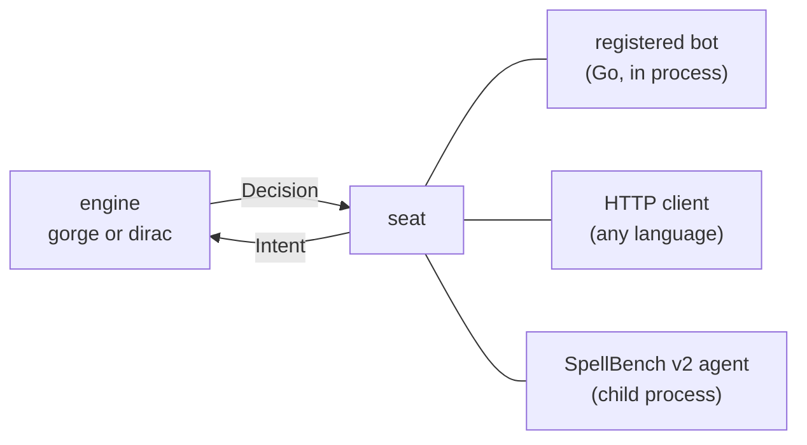

# Bots

A bot is a program that plays a gorge seat. The engine poses a **decision** that lists every legal option. The bot answers with
an **intent** naming option indices, and the engine rejects anything it did not offer. A bot sees one seat's redacted view of the
game: its own hand and the public board, never the opponent's hand or the library order.

## The six registered bots

Read from the registry, `bots/registry.go`, as linked by `bots/all`. [Each bot in detail](catalogue.md) gives the code behind every
verdict. Costs are measured on gorge, 2026-10-31, from [Bot speed](../performance/bots.md).

| Bot | What it does | Engines | Seats | Cost per decision | Fair or clairvoyant |
|---|---|---|---|---|---|
| `bot` | The default. Hand-written rules, a two-ply combat simulation on auto-pay tables, Forge's mulligan rule | gorge, dirac | any, human or bot | 29.7 µs | fair: sees only its redacted view |
| `forge-heuristic` | `bot` plus rules re-expressed from Forge's AI: targeting, removal timing, attachments, gang blocks | gorge, dirac | any, human or bot | not measured | fair |
| `forge-heuristic-hold` | `forge-heuristic` with `hold-instant` on: keeps instants back outside response windows | gorge, dirac | any, human or bot | not measured | fair |
| `lethal-pressure` | The older heuristic: an attack-into-lethal rule, no combat simulation, a coin-flip mulligan | gorge, dirac | any, human or bot | not measured | fair |
| `sb-tactical` | SpellBench's scored tactical heuristic, pricing plays through a redealt root | gorge, dirac | bot-only, 2 seats | not measured | fair on hidden cards, but reads every seat's decklist |
| `az-redeal` | AlphaZero-style tree search, 100 simulations per decision, no network | gorge only | bot-only, 2 seats | about 106 ms per searched decision | fair on hidden cards (determinised redeal), but reads every seat's decklist |

**Fair** means the bot uses only what its seat can see. **Clairvoyant** means it reads the opponent's hand, the library order or a
clone of the real engine. No registered bot is clairvoyant. The two search bots redeal the hidden cards from their own
observations, but deal from each seat's real decklist, so a server never seats them against a person. Clairvoyant search exists
only as a bench ceiling.

The four heuristic bots answer on every wire: in process, over HTTP, and as a SpellBench v2 agent
(`spellbench-gorge-agent -policy <name>`). The two search bots need an engine root, which `gorged` and `testkit/bench` supply and
`mtgsim` and the v2 agent (`server/spellbench/agent/policies.go:44`) do not. dirac serves the first five; it deals no search roots.

## Where to go

| I want to | Page |
|---|---|
| choose a bot, play one, or connect mine | [Using and plugging in bots](using.md) |
| see what each bot does and why it is fair | [Each bot in detail](catalogue.md) |
| write a Go policy | [Writing a native Go bot](native-go.md) |
| answer a seat from Python, Java or any HTTP client | [Playing a seat over HTTP](http.md), [examples](examples.md) |
| run SpellBench v2 agents | [SpellBench v2 agents](spellbench.md) |
| evaluate and ship a policy | [Training and adoption](training-and-adoption.md) |
| watch bots play each other | [Bot-vs-bot games](../guide/bot-games.md) |
| size a table or budget a search | [Bot speed](../performance/bots.md) |
| use a search bot's net runtime | [Search and bots on dirac](../architecture/dirac/search.md) |
