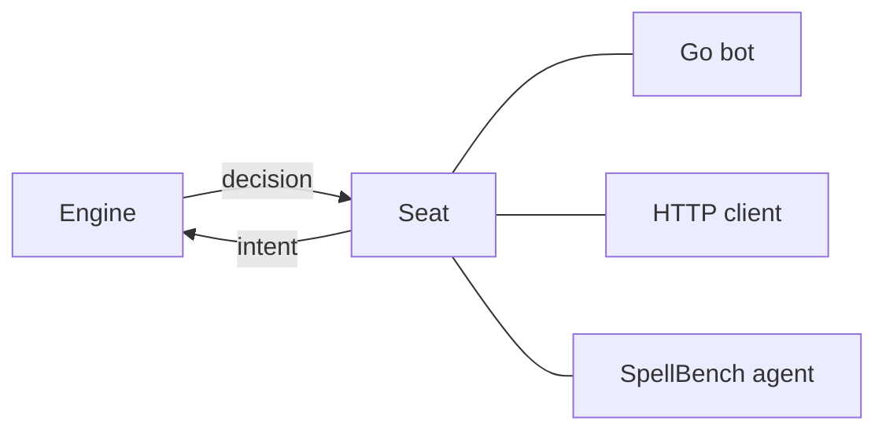

# Bots

A bot is a program that plays a seat. It sees its own hand and the public board, and answers each decision with a legal choice. { .gg-lede }

- :material-robot: **[Pick a bot](catalogue.md)**

    Six bots, each fair or clairvoyant.

- :material-play-circle: **[Use a bot](using.md)**

    Play one in the browser, pit bots against each other, or seat one over HTTP.

- :material-language-go: **[Write your own](native-go.md)**

    In Go, or in any language over [HTTP](http.md) with [examples](examples.md).

- :material-speedometer: **[Cost and strength](../performance/bots.md)**

    Per decision and per simulation, plus [SpellBench agents](spellbench.md) and [adoption](training-and-adoption.md).

