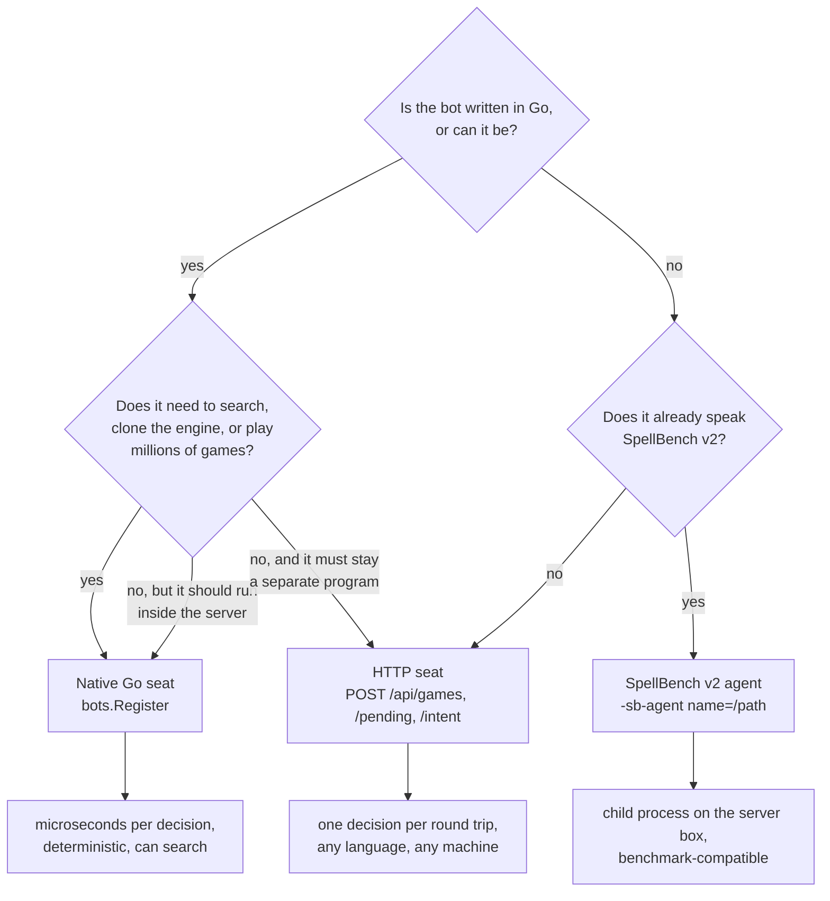

# Bots and strategies

This section is for anyone who wants a program, not a person, to play
gorge: a Go developer adding a policy to the engine, a Python or Java author
wiring an existing strategy to a server, or a benchmark harness. This page
surveys the bots gorge ships and the three ways to plug one in, and helps you
pick. The pages after it walk through each surface with working code.

*Facts on this section's pages were read from the code at commit `ad3777023`
(2026-10-20). Every latency was measured on 2026-10-20 on an AMD Ryzen 9
9950X over loopback, with the command named next to it.*

## The one contract every bot answers

Whatever the transport, a bot does one thing: the engine poses a
**decision** listing *every* legal option, and the bot answers with an
**intent** naming option indices
([glossary](../contributing/glossary.md)). The engine validates the answer
against what it offered, so a bot can choose badly but never cheat its way to
an illegal move. There are thirteen decision kinds and the set is closed
(`decision.Kinds`, [`engine/decision/decision.go`](https://github.com/adams-shaun/gorge/blob/main/engine/decision/decision.go)):
`priority`, `target`, `attackers`, `blockers`, `mulligan`, `modes`,
`trigger_order`, `trigger_optional`, `commander_zone`, `choose`,
`replacement`, `arrange` and `starting_player`. Conceding is an option on a
priority decision, not a kind. [Playing a seat over HTTP](http.md) explains
how to answer each one.

A bot sees one seat's redacted **view** of the game (its own hand, the public
board, counts for hidden zones), never the opponent's hand or the library
order.

## The bots gorge ships

These register themselves in the bot registry
([`bots/registry.go`](https://github.com/adams-shaun/gorge/blob/main/bots/registry.go))
from packages that [`bots/all`](https://github.com/adams-shaun/gorge/blob/main/bots/all/all.go)
links. `GET /api/bot-policies` on a running server lists the ones it offers,
with each policy's recorded strength and cost; measured results are on
[Bots and learned policies](../performance/bots.md).

| Policy | How it decides | Where it can play |
|---|---|---|
| `bot` | The production heuristic ([`bots/heuristic`](https://github.com/adams-shaun/gorge/blob/main/bots/heuristic), rules in [`bots/botpolicy`](https://github.com/adams-shaun/gorge/blob/main/bots/botpolicy)): scores each option with hand-written rules; on tables with automatic mana payment it simulates combat to pick attacks and blocks. Also the *caretaker* that answers for a disconnected human. | everywhere; the default |
| `lethal-pressure` | The same heuristic with its own lethal-pressure combat rules instead of the combat simulation. | everywhere; `gorged`'s default for a play-vs-bot game that names no policy |
| `forge-heuristic` | `bot` plus target-selection and removal-timing rules re-expressed from Forge's AI behaviour (land colour, prominent colour, fatal-copy filter, hold removal for a bigger threat). | everywhere |
| `sb-tactical` | The SpellBench tactical heuristic: scores creature values, timing, the damage race and removal over what the seat can see, and prices its plays through a payment planner built on an *honest root* (a redeal of the hidden cards, never the real ones). | bench tools and bot-only tables: it builds its planner over every seat's real decklist, so `gorged` never seats it against a human |
| `az-redeal` | AlphaZero-style tree search ([`bots/azmcts`](https://github.com/adams-shaun/gorge/blob/main/bots/azmcts)): 100 simulations per searched decision over worlds freshly redealt from its own observations, a heuristic leaf value, and `bot` for every decision it does not search. | as `sb-tactical`; about a quarter of a second per searched decision |

Three more kinds of policy appear at runtime:

- **A SpellBench v2 agent** registered with `-sb-agent name=/path/to/agent`
  becomes a policy like any other ([SpellBench v2 agents](spellbench.md)).
- **A network-backed search bot.** `gorged` reserves the names `az-c3`,
  `az-c4` and `az-c5` and their flags; a downstream binary links an
  implementation in through `gorged.RegisterNetBot`
  ([`server/gorged/netbots.go`](https://github.com/adams-shaun/gorge/blob/main/server/gorged/netbots.go)).
  gorge itself ships the inference code but no trained networks, so on a
  plain `gorged` those flags refuse to start.
- **Your own Go policy**, linked into a binary of your own
  ([Writing a native Go bot](native-go.md)).

`bots/searchseat` (a determinized rollout seat) and the learned-policy
runtime in `bots/policynet` are engine-side building blocks used by the
benches; they are not hosted policies.

## Three ways to plug a bot in

<figure markdown>
<svg viewBox="0 0 780 400" width="100%" role="img" aria-label="Inside one gorged process the rules engine and the host match loop drive three kinds of seat: native Go seats called in-process, a HumanSeat that parks a decision for the HTTP API, and a SpellBench seat adapter. Across the process boundary, HTTP clients in any language answer the HumanSeat over HTTP and JSON with a bearer token, and a SpellBench v2 agent process answers the adapter over stdin and stdout NDJSON.">
  <defs>
    <marker id="bt-arr" viewBox="0 0 10 10" refX="9" refY="5" markerWidth="7" markerHeight="7" orient="auto-start-reverse"><path d="M0,0 L10,5 L0,10 z" class="dg-arrow"/></marker>
    <marker id="bt-arr-acc" viewBox="0 0 10 10" refX="9" refY="5" markerWidth="7" markerHeight="7" orient="auto-start-reverse"><path d="M0,0 L10,5 L0,10 z" class="dg-arrow-accent"/></marker>
  </defs>
  <rect x="16" y="30" width="474" height="340" rx="8" class="dg-box-muted"/>
  <text x="30" y="52" class="dg-text-bold">one process: gorged, mtgsim or testkit/bench</text>
  <rect x="36" y="74" width="150" height="62" rx="6" class="dg-box"/>
  <text x="111" y="100" text-anchor="middle" class="dg-text-bold">rules engine</text>
  <text x="111" y="120" text-anchor="middle" class="dg-text-muted">Decision → Intent</text>
  <rect x="36" y="176" width="150" height="170" rx="6" class="dg-box"/>
  <text x="111" y="250" text-anchor="middle" class="dg-text-bold">match loop</text>
  <text x="111" y="270" text-anchor="middle" class="dg-text-muted">server/host or bench</text>
  <line x1="111" y1="138" x2="111" y2="174" class="dg-line" marker-start="url(#bt-arr)" marker-end="url(#bt-arr)"/>
  <rect x="236" y="74" width="234" height="72" rx="6" class="dg-box-accent"/>
  <text x="353" y="98" text-anchor="middle" class="dg-text-bold">① native Go seats</text>
  <text x="353" y="117" text-anchor="middle" class="dg-text-muted">bot, sb-tactical, az-redeal, yours</text>
  <text x="353" y="134" text-anchor="middle" class="dg-text-mono">Decide(ctx, View, Decision)</text>
  <rect x="236" y="176" width="234" height="72" rx="6" class="dg-box"/>
  <text x="353" y="200" text-anchor="middle" class="dg-text-bold">② HumanSeat + httpapi</text>
  <text x="353" y="219" text-anchor="middle" class="dg-text-muted">parks the decision until an intent</text>
  <text x="353" y="236" text-anchor="middle" class="dg-text-mono">/pending /intent /view</text>
  <rect x="236" y="276" width="234" height="72" rx="6" class="dg-box"/>
  <text x="353" y="300" text-anchor="middle" class="dg-text-bold">③ SpellBench seat adapter</text>
  <text x="353" y="319" text-anchor="middle" class="dg-text-muted">server/spellbench/seat (-sb-agent)</text>
  <text x="353" y="336" text-anchor="middle" class="dg-text-mono">hello · game_start · choose</text>
  <path d="M188,200 C212,200 212,110 234,110" class="dg-line" marker-end="url(#bt-arr)"/>
  <line x1="188" y1="212" x2="234" y2="212" class="dg-line" marker-end="url(#bt-arr)"/>
  <path d="M188,224 C212,224 212,312 234,312" class="dg-line" marker-end="url(#bt-arr)"/>
  <line x1="500" y1="20" x2="500" y2="380" class="dg-line-dashed"/>
  <text x="506" y="36" class="dg-text-muted">process boundary</text>
  <rect x="580" y="176" width="190" height="72" rx="6" class="dg-box"/>
  <text x="675" y="202" text-anchor="middle" class="dg-text-bold">HTTP client</text>
  <text x="675" y="222" text-anchor="middle" class="dg-text-muted">Python, Java, a browser…</text>
  <text x="675" y="239" text-anchor="middle" class="dg-text-muted">any machine that can reach it</text>
  <rect x="580" y="276" width="190" height="72" rx="6" class="dg-box"/>
  <text x="675" y="302" text-anchor="middle" class="dg-text-bold">v2 agent process</text>
  <text x="675" y="322" text-anchor="middle" class="dg-text-muted">spawned per match, any language</text>
  <text x="675" y="339" text-anchor="middle" class="dg-text-muted">same machine only</text>
  <line x1="472" y1="212" x2="578" y2="212" class="dg-line-accent" marker-start="url(#bt-arr-acc)" marker-end="url(#bt-arr-acc)"/>
  <text x="508" y="204" class="dg-text-muted">HTTP + JSON</text>
  <text x="508" y="230" class="dg-text-muted">bearer token</text>
  <line x1="472" y1="312" x2="578" y2="312" class="dg-line" marker-start="url(#bt-arr)" marker-end="url(#bt-arr)"/>
  <text x="508" y="304" class="dg-text-muted">stdin/stdout</text>
  <text x="508" y="330" class="dg-text-muted">NDJSON</text>
  <text x="580" y="102" class="dg-text-muted">① has nothing outside:</text>
  <text x="580" y="120" class="dg-text-muted">the seat is a Go value</text>
  <text x="580" y="138" class="dg-text-muted">in the same address space</text>
</svg>
<figcaption>The integration surfaces. Native seats are called directly; an HTTP client answers a parked HumanSeat across the network; a SpellBench v2 agent is a child process on the same machine.</figcaption>
</figure>

1. **Native Go** ([guide](native-go.md)). Implement `seat.Seat`, register it
   with `bots.Register`, link it into `gorged` or a bench. The fastest path
   and the only one that can search: a Go seat can clone the engine or ask the
   host for an honest redealt world.
2. **HTTP seat** ([guide](http.md), [examples](examples.md)). A server started
   with `-vsbot` (or `-humans`) parks a seat's decision behind
   `GET .../pending`; any program that speaks HTTP and JSON answers it with
   `POST .../intent`. One decision per round trip, any language, any machine.
   This is the surface the Python and Java examples use.
3. **SpellBench v2** ([guide](spellbench.md)). gorge speaks the SpellBench
   benchmark protocol in both directions: an external v2 agent can take a
   gorge seat (`-sb-agent`), and any gorge bot can be served as a v2 agent
   (`cmd/spellbench-gorge-agent`). Its transport is newline-delimited JSON on
   a child process's stdin and stdout, so it is for agents that already speak
   v2, not for new remote bots.

## Which one should I use?

## How the surfaces compare

| | Native Go seat | HTTP seat | SpellBench v2 agent seat |
|---|---|---|---|
| **Language** | Go | anything with HTTP and JSON | anything that reads and writes lines on stdio |
| **Transport** | a function call | HTTP/1.1 + JSON; SSE for push notifications | stdin/stdout, one JSON object per line |
| **Where the bot runs** | inside the host process | anywhere that can reach the server | a child process the host spawns, one per match |
| **Latency per decision** | 21–34 µs for a whole two-seat game step, engine and both seats included (`go run ./cmd/duel` in `examples/bots/go`, 40 games) | `GET /pending` 0.12 ms + `POST /intent` 0.11 ms median; `GET /view` 0.50 ms; next decision visible 0.13 ms after the answer when polling flat out, 0.24 ms via SSE (`measure_latency.py`, 10 games). The example agents average 1.6–3.2 ms per decision with their polling backoff | `choose` round trip 0.05 ms median (a Python agent that picks candidate 0) to 0.18 ms (gorge's own bot served over v2); about 0.4 s to start the gorge agent process per match |
| **Hidden information** | the seat is handed a redacted View; the code is trusted (it runs in the server) | enforced by the server: the bearer token names the one seat it may read and act for | the host projects a neutral v2 observation for the agent's seat |
| **Can it search or clone the engine?** | yes: `Engine.Clone`, `CloneHypothetical`, or an honest root via `bots.EnvSeat` | no engine access; bring your own simulator | no, unless the agent embeds one (gorge's own v2 agent does) |
| **Determinism** | a pure function of the seed: replays byte-identically | the server records every intent, so a finished game replays; the bot's own randomness is yours to seed | the host passes an `agent_seed`; the game replays from its log |
| **Many games at once** | goroutines (`testkit/bench.RunPairs`) | one token per seat; open as many games as the server allows (`-max-on-demand-tables`, default 32 retained). 16 Python agents in parallel: 4,156 decisions in 1.27 s | one process per seat per match |
| **What happens on a timeout** | hosted search seats have a 2 s budget and fall back to their heuristic | `gorged` waits forever by default; the seat's caretaker bot answers only when the table shuts down | the host's per-decision budget (2 s in `gorged`, none in `mtgsim`); a timeout forfeits the agent's game |

The HTTP numbers come from the measurement loop described on
[Playing a seat over HTTP](http.md#latency); the SpellBench numbers from a
relay that timed each request between `mtgsim` and the agent
([SpellBench v2 agents](spellbench.md)). The operator-facing assessment of
each surface, and what it would take to make them fit for remote agents at
scale, is the [interface review](interfaces-review.md).

## Where next

- [Writing a native Go bot](native-go.md): a complete policy, registered,
  configured, tested, and served.
- [Playing a seat over HTTP](http.md): the endpoints, real requests and
  responses, and how to answer each decision kind.
- [Python and Java examples](examples.md): two agents that play complete
  games against `gorged`.
- [SpellBench v2 agents](spellbench.md): the benchmark protocol in both
  directions.
- [Training and adoption](training-and-adoption.md): what the engine offers
  search and learning code, how to evaluate a policy, and the ladder a policy
  climbs before it plays real users.
- [Interface review](interfaces-review.md): the gaps, ranked.
- [Bot-vs-bot games](../guide/bot-games.md): running fair matchups between
  registered policies.
