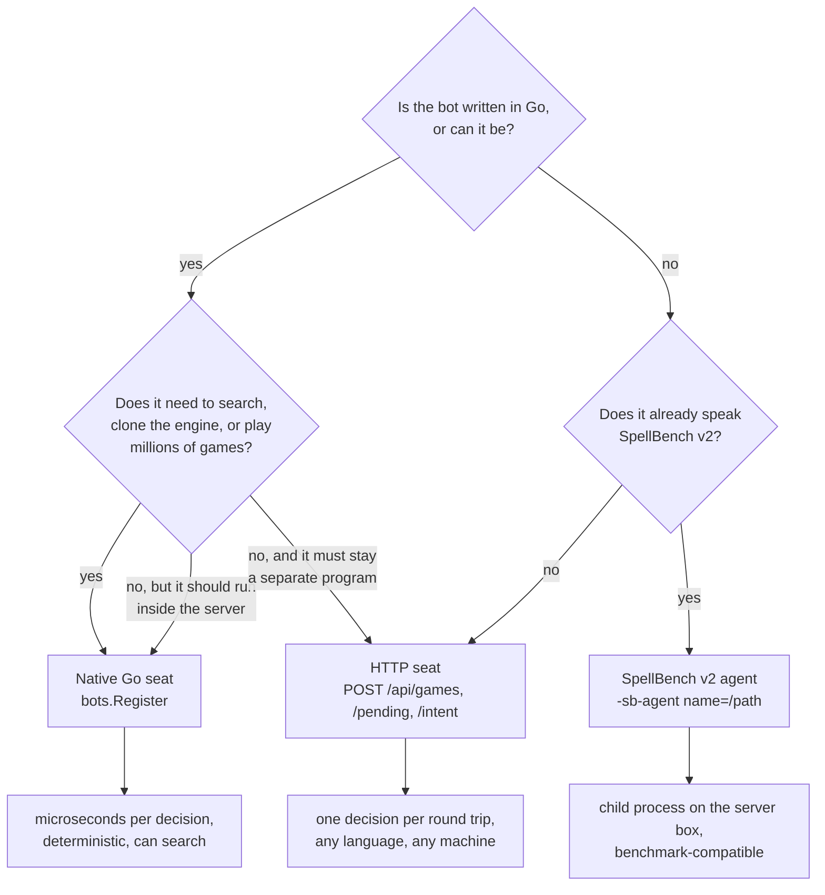

# Bots and strategies

This section is for anyone who wants a program, not a person, to play
gorge: a Go developer adding a policy to the engine, a Python or Java author
wiring an existing strategy to a server, or a benchmark harness. This page
surveys the bots gorge ships and the three ways to plug one in, and helps you
pick. The pages after it walk through each surface with working code.

*Facts on this page were rechecked against the code at commit
`25d71cadc` (2026-10-27); the other pages in this section give their own date. Unless a figure says otherwise, latencies were
measured on 2026-10-20 at `ad3777023` on an AMD Ryzen 9 9950X over
loopback, with the command named next to them.*

## The one contract every bot answers

Whatever the transport, a bot does one thing: the engine poses a
**decision** listing *every* legal option, and the bot answers with an
**intent** naming option indices
([glossary](../contributing/glossary.md)). The engine validates the answer
against what it offered, so a bot can choose badly but never cheat its way to
an illegal move. There are thirteen decision kinds and the set is closed
(`decision.Kinds`, [`engine/decision/decision.go`](https://github.com/adams-shaun/gorge/blob/main/engine/decision/decision.go)):
`priority`, `target`, `attackers`, `blockers`, `mulligan`, `modes`,
`trigger_order`, `trigger_optional`, `commander_zone`, `choose`,
`replacement`, `arrange` and `starting_player`. Conceding is an option on a
priority decision, not a kind. [Playing a seat over HTTP](http.md) explains
how to answer each one.

A bot sees one seat's redacted **view** of the game (its own hand, the public
board, counts for hidden zones), never the opponent's hand or the library
order.

## The bots gorge ships

Six policies register themselves in the bot registry
([`bots/registry.go`](https://github.com/adams-shaun/gorge/blob/main/bots/registry.go))
from the packages [`bots/all`](https://github.com/adams-shaun/gorge/blob/main/bots/all/all.go)
links, so every gorge binary that imports `bots/all` (`gorged`, `mtgsim`,
`cmd/spellbench-gorge-agent`, your own program) has all six. Each entry's
`bots.Info` carries its label, tier, formats, seat limit, a description, its
recorded strength claims and its cost. `GET /api/bot-policies` on a running
server returns exactly that record for the policies the server offers.

| Name | Label | Tier | Formats, seats | Offered by `gorged` | Package |
|---|---|---|---|---|---|
| `bot` | Bot | production | constructed and Commander, any | yes | [`bots/bot`](https://github.com/adams-shaun/gorge/blob/main/bots/bot/bot.go) |
| `forge-heuristic` | Forge heuristic | experimental | constructed and Commander, any | yes | [`bots/forgeheuristic`](https://github.com/adams-shaun/gorge/blob/main/bots/forgeheuristic/forgeheuristic.go) |
| `forge-heuristic-hold` | Forge heuristic + hold | experimental | constructed and Commander, any | yes | [`bots/forgeheuristic`](https://github.com/adams-shaun/gorge/blob/main/bots/forgeheuristic/forgeheuristic.go) |
| `lethal-pressure` | Lethal Pressure | experimental | constructed and Commander, any | yes; `gorged`'s default `-bot-policy` | [`bots/lethalpressure`](https://github.com/adams-shaun/gorge/blob/main/bots/lethalpressure/lethalpressure.go) |
| `sb-tactical` | sb-tactical (SpellBench tactical heuristic) | experimental | constructed, 2 | no: reads every seat's decklist | [`bots/sbtactical`](https://github.com/adams-shaun/gorge/blob/main/bots/sbtactical/sbtactical.go) |
| `az-redeal` | az-redeal (AlphaZero search) | experimental | constructed, 2 | no: reads every seat's decklist | [`bots/azredeal`](https://github.com/adams-shaun/gorge/blob/main/bots/azredeal/azredeal.go) |

### What each one does

**`bot`** is the production heuristic: hand-written rules
([`bots/botpolicy`](https://github.com/adams-shaun/gorge/blob/main/bots/botpolicy),
driven by [`bots/heuristic`](https://github.com/adams-shaun/gorge/blob/main/bots/heuristic))
that score each offered option. On a table with automatic mana payment (the
default for hosted bots, `-bot-auto-mana`) it casts through the engine's
payment plans and picks attacks and blocks with a two-ply combat simulation;
on a manual-tap table it is the plain heuristic. It answers the London
mulligan with a re-expression of Forge's keep/bottom rule
(`botpolicy.MulliganForge`). It is the baseline every other policy is
measured against. (A human seat's caretaker, the bot that answers when its
player times out or the table shuts down, is the table's own bot policy,
not always `bot`.)

**`forge-heuristic`** is `bot`, built by the same constructor
(`bot.BaseWithSim`, so the same combat simulation, payment plans and
mulligan), with every opt-in rule family re-expressed from Forge's AI
switched on. Each family is a clean-room rule in gorge's own vocabulary,
not translated Forge code:

| Family | Rules armed |
|---|---|
| A1 removal timing | hold a one-shot destroy, damage or bounce spell until the best opposing creature is a real threat (about a 4/4, less with evasion), the spell is lethal to a face, or it could never hit a creature |
| A2 targeting | prefer a land the opponent's colours depend on, prefer the opponent's prominent colour, skip a target that is a strictly worse copy of another of their creatures |
| A3 Forge AI hints | a card's `PlayMain1` hint earns a first-main-phase bonus; a `RemoveDeck` card is never chosen |
| A4 deck-shape posture | an aggro deck releases its last held-back blocker, the combat simulation weighs life by deck shape, and the mana reserve scales by shape (a control deck keeps instant mana up) |
| A5 attachments | aim an Aura by its `AttachAILogic` hint (boons on its own creatures, curses on the opponent's), rank its own creatures as carriers, hold a boon Aura while nothing can carry it |
| A6 timing | counter only the top foreign spell; hold draw and token spells for Forge's window (a sorcery until the second main phase, an instant draw until an opponent's end step, an instant token until an opponent attacks); cast an instant pump only at declare blockers, and only when it saves a creature, wins a fight or makes an unblocked attack lethal |
| A7 combat (inside the simulation) | gang blocks, a gang-aware predicted reply, Double Strike in blocked combat |

The rules live in `bots/botpolicy` (`TargetRules`, `RemovalRules`,
`TimingRules`, `AIHints`, `AttachRules`, `PostureRules`, `CombatRules`), and
`bots/forgeheuristic.New` shows how to arm any subset on a policy of your
own.

**`forge-heuristic-hold`** is `forge-heuristic` with its one option,
`hold-instant`, switched on: the A6 hold rule keeps instants back outside
the respond, opponent post-combat and combat-trick windows. Its registry
entry records no measurement.

**`lethal-pressure`** is the older heuristic configuration: the plain
heuristic plus the AR7 lethal-pressure attack rule (a creature whose
unblocked power reaches the defender's life attacks even into a cheaper
blocker). It has no combat simulation on any table, and it keeps the
heuristic's original mulligan (a one-in-three coin, whatever the hand).

**`sb-tactical`** is the scored tactical heuristic from the SpellBench
project, in its hosted shape. It values creatures, timing, the damage race
and removal over what its seat can see, reads printed card facts from the
card registry, and at priority prices its plays through a payment planner
built on an *honest root*: a copy of the game with every hidden card
redealt from what the seat has seen. That redeal draws from each seat's real
decklist, which is why the policy is marked `Env` and is never seated
against a person.

**`az-redeal`** is an AlphaZero-style tree search
([`bots/azmcts`](https://github.com/adams-shaun/gorge/blob/main/bots/azmcts))
with no network: a uniform prior and a heuristic leaf value. At each
priority, attackers, blockers and target decision it runs 100 simulations,
each over a freshly redealt world built from its own observations, and
`bot` answers every other decision. Like `sb-tactical` it builds its worlds
over every seat's real decklist (`Env`), so it plays only where a driver
supplies those worlds (see below). A hosted search seat has a 2-second
budget per decision (`hostedDecisionDeadlineMS`); a search that runs out
plays `bot`'s answer.

### Recorded strength

These are the claims each registry entry records (`bots.Info.Strength`),
with the setting and source it names; `GET /api/bot-policies` serves the
same text. Percentages are win rates with 95% confidence intervals. Several
were measured against an older `bot`, as noted.

| Policy | Claim | Setting | Source |
|---|---|---|---|
| `bot` | 53.17% [52.68, 53.65] constructed, 53.69% [52.73, 54.64] Commander, against the plain auto-pay bot | held-out auto-pay tables, before the Forge mulligan became the default | commit `66aa546dd` |
| `bot` | 31.5% [27.1, 36.2] against Forge's AI over 400 games (28.5% with the coin mulligan it replaced) | Forge games over a stdio bridge, the 12 Legacy decks, 144 ordered pairs, seats traded | Forge bridge runs, 2026-10-20 |
| `forge-heuristic` | 32.0% [27.6, 36.7] against Forge's AI over 400 games, +0.5 points over `bot` with the same mulligan (inside noise) | as above | Forge bridge run, 2026-10-20 |
| `forge-heuristic` | 46.8% [41.9, 51.6] against `bot` over 400 games, indistinguishable from the 46.5% bot-vs-bot control | constructed, seats traded; measured before it gained the combat simulation and the Forge mulligan | [A2 target rules](https://github.com/adams-shaun/gorge/blob/main/docs/design/2026-10-19-a2-target-rules.md) |
| `lethal-pressure` | 51.65% [50.10, 53.20] against the bot before AR7 | held-out, manual mana | archived AR7 design note ([`docs/design/ARCHIVE.md`](https://github.com/adams-shaun/gorge/blob/main/docs/design/ARCHIVE.md)) |
| `sb-tactical` | 110-18 against the SpellBench `bot` arm on the Pauper kernel decks (benchmark seed), 106-22 at seed 99991, 87-41 on FDN mirrors; Elo 1507 against `bot`'s 1242 | SpellBench's measured table | [SpellBench agent design](https://github.com/adams-shaun/gorge/blob/main/docs/design/2026-09-28-spellbench-agent-design.md) §3.4 |
| `az-redeal` | 70.5% [68.5, 72.5] against `bot` over 2,000 games (+20.5 points over the 50.0% control); its 25-simulation variant rated 1382 against `bot`'s 1264 | UW Tempo against the five mono decks with true lists visible; SpellBench's eight-deck mirror pool | [SpellBench agent design](https://github.com/adams-shaun/gorge/blob/main/docs/design/2026-09-28-spellbench-agent-design.md) §12.5 |

A current check, run for this page on 2026-10-21 at `513a2a0c3` with the
matchup program on [Bot-vs-bot games](../guide/bot-games.md#a-fair-matchup-with-testkitbench)
(every pair of the 12 Legacy decks, 20 games per pair, seats traded):
`forge-heuristic` won 636 of 1,320 games against `bot` (48.2%, ±2.7
points) where `bot` against itself won 630 (47.7%). Today the two are
indistinguishable in 1v1 constructed. Cost per decision is on
[Bots: cost and strength](../performance/bots.md).

### How to select one

| Where | How |
|---|---|
| `gorged`, play-vs-bot | `POST /api/games` with `"bot_policy": "<name>"`; omit it to get the server's `-bot-policy` (default `lethal-pressure`). `-bot-policies a,b,…` limits what the server offers (default: every registered policy that does not read decklists). |
| `gorged`, bot-only tables | `-bot-policy <name>` seats that policy in every bot seat of the startup tables. |
| `mtgsim` | `-a <name>` on seat 0, `-b <name>` on seat 1; every other seat plays the plain heuristic. |
| A Go program | `bots.New(name, bots.Options{Seed, AutoPayMana, Deps: bots.Deps{Cards: reg}})` after a blank import of `bots/all`; [`testkit/bench`](https://github.com/adams-shaun/gorge/blob/main/testkit/bench/bench.go) drives it. |
| SpellBench v2 | `spellbench-gorge-agent -policy <name>` serves it as a v2 agent ([SpellBench v2 agents](spellbench.md)). |

`-bot-common-sense` (default off) wraps `bot`, `forge-heuristic` and
`sb-tactical` in the `bots/sanity` guard, which drops hostile removal that
could only hit the bot's own permanents.

`sb-tactical` and `az-redeal` need a driver that supplies their honest roots
and the card registry. `testkit/bench.PlayGame` with
`Hooks{EnvSeats: true, HonestRoot: true}` does, so they play at full
strength in your own Go program. `mtgsim` does not: `-a sb-tactical` fails
with `Deps.Cards is nil`, and `-a az-redeal` runs but never searches. A
`gorged` server never offers them, because a play-vs-bot table always seats
a person and `-bot-policy` refuses a decklist-reading policy.

### Which bot to pick

- **To play against, or as the opponent for an HTTP bot:** `bot`. It is
  the production policy, and no policy a server offers has measured
  stronger. Start `gorged` with `-bot-policy bot` to make it the default;
  the flag's own default is `lethal-pressure`.
- **As the baseline for your own policy:** `bot`, with a `bot`-against-`bot`
  control on the same seeds.
- **A Forge-style opponent:** `forge-heuristic`. It plays like `bot` with
  Forge's targeting, timing and attachment habits, and measures the same.
- **A stronger two-player sparring partner in a bench:** `sb-tactical` (a
  heuristic; its registry entry estimates about 1 ms per decision) or `az-redeal` (the strongest recorded
  claim, at roughly a quarter of a second per searched decision). Both read
  every seat's decklist, so use them only where that is acceptable.
- **`lethal-pressure`** keeps the older heuristic configuration for
  tables that want it. On an auto-pay table it does without the combat
  simulation `bot` uses.

### Other policies at runtime

- **A SpellBench v2 agent** registered with `-sb-agent name=/path/to/agent`
  becomes a policy like any other ([SpellBench v2 agents](spellbench.md)).
- **Network-backed search bots.** `gorged` reserves a few policy names and
  flags for search bots that need a trained network (see `gorged -h`); a
  downstream binary links an implementation in through `gorged.RegisterNetBot`
  ([`server/gorged/netbots.go`](https://github.com/adams-shaun/gorge/blob/main/server/gorged/netbots.go)).
  gorge ships the inference code but no trained networks, so on a plain
  `gorged` those flags refuse to start.
- **Your own Go policy**, linked into a binary of your own
  ([Writing a native Go bot](native-go.md)).

`bots/searchseat` (a determinized rollout seat), `bots/searchprobe` and the
learned-policy runtime in `bots/policynet` are building blocks for benches;
they are not registered policies.

## Three ways to plug a bot in

<figure markdown>
<svg viewBox="0 0 780 400" width="100%" role="img" aria-label="Inside one gorged process the rules engine and the host match loop drive three kinds of seat: native Go seats called in-process, a HumanSeat that parks a decision for the HTTP API, and a SpellBench seat adapter. Across the process boundary, HTTP clients in any language answer the HumanSeat over HTTP and JSON with a bearer token, and a SpellBench v2 agent process answers the adapter over stdin and stdout NDJSON.">
  <defs>
    <marker id="bt-arr" viewBox="0 0 10 10" refX="9" refY="5" markerWidth="7" markerHeight="7" orient="auto-start-reverse"><path d="M0,0 L10,5 L0,10 z" class="dg-arrow"/></marker>
    <marker id="bt-arr-acc" viewBox="0 0 10 10" refX="9" refY="5" markerWidth="7" markerHeight="7" orient="auto-start-reverse"><path d="M0,0 L10,5 L0,10 z" class="dg-arrow-accent"/></marker>
  </defs>
  <rect x="16" y="30" width="474" height="340" rx="8" class="dg-box-muted"/>
  <text x="30" y="52" class="dg-text-bold">one process: gorged, mtgsim or testkit/bench</text>
  <rect x="36" y="74" width="150" height="62" rx="6" class="dg-box"/>
  <text x="111" y="100" text-anchor="middle" class="dg-text-bold">rules engine</text>
  <text x="111" y="120" text-anchor="middle" class="dg-text-muted">Decision → Intent</text>
  <rect x="36" y="176" width="150" height="170" rx="6" class="dg-box"/>
  <text x="111" y="250" text-anchor="middle" class="dg-text-bold">match loop</text>
  <text x="111" y="270" text-anchor="middle" class="dg-text-muted">server/host or bench</text>
  <line x1="111" y1="138" x2="111" y2="174" class="dg-line" marker-start="url(#bt-arr)" marker-end="url(#bt-arr)"/>
  <rect x="236" y="74" width="234" height="72" rx="6" class="dg-box-accent"/>
  <text x="353" y="98" text-anchor="middle" class="dg-text-bold">① native Go seats</text>
  <text x="353" y="117" text-anchor="middle" class="dg-text-muted">bot, forge-heuristic, az-redeal, yours</text>
  <text x="353" y="134" text-anchor="middle" class="dg-text-mono">Decide(ctx, View, Decision)</text>
  <rect x="236" y="176" width="234" height="72" rx="6" class="dg-box"/>
  <text x="353" y="200" text-anchor="middle" class="dg-text-bold">② HumanSeat + httpapi</text>
  <text x="353" y="219" text-anchor="middle" class="dg-text-muted">parks the decision until an intent</text>
  <text x="353" y="236" text-anchor="middle" class="dg-text-mono">/pending /intent /view</text>
  <rect x="236" y="276" width="234" height="72" rx="6" class="dg-box"/>
  <text x="353" y="300" text-anchor="middle" class="dg-text-bold">③ SpellBench seat adapter</text>
  <text x="353" y="319" text-anchor="middle" class="dg-text-muted">server/spellbench/seat (-sb-agent)</text>
  <text x="353" y="336" text-anchor="middle" class="dg-text-mono">hello · game_start · choose</text>
  <path d="M188,200 C212,200 212,110 234,110" class="dg-line" marker-end="url(#bt-arr)"/>
  <line x1="188" y1="212" x2="234" y2="212" class="dg-line" marker-end="url(#bt-arr)"/>
  <path d="M188,224 C212,224 212,312 234,312" class="dg-line" marker-end="url(#bt-arr)"/>
  <line x1="500" y1="20" x2="500" y2="380" class="dg-line-dashed"/>
  <text x="506" y="36" class="dg-text-muted">process boundary</text>
  <rect x="580" y="176" width="190" height="72" rx="6" class="dg-box"/>
  <text x="675" y="202" text-anchor="middle" class="dg-text-bold">HTTP client</text>
  <text x="675" y="222" text-anchor="middle" class="dg-text-muted">Python, Java, a browser…</text>
  <text x="675" y="239" text-anchor="middle" class="dg-text-muted">any machine that can reach it</text>
  <rect x="580" y="276" width="190" height="72" rx="6" class="dg-box"/>
  <text x="675" y="302" text-anchor="middle" class="dg-text-bold">v2 agent process</text>
  <text x="675" y="322" text-anchor="middle" class="dg-text-muted">spawned per match, any language</text>
  <text x="675" y="339" text-anchor="middle" class="dg-text-muted">same machine only</text>
  <line x1="472" y1="212" x2="578" y2="212" class="dg-line-accent" marker-start="url(#bt-arr-acc)" marker-end="url(#bt-arr-acc)"/>
  <text x="508" y="204" class="dg-text-muted">HTTP + JSON</text>
  <text x="508" y="230" class="dg-text-muted">bearer token</text>
  <line x1="472" y1="312" x2="578" y2="312" class="dg-line" marker-start="url(#bt-arr)" marker-end="url(#bt-arr)"/>
  <text x="508" y="304" class="dg-text-muted">stdin/stdout</text>
  <text x="508" y="330" class="dg-text-muted">NDJSON</text>
  <text x="580" y="102" class="dg-text-muted">① has nothing outside:</text>
  <text x="580" y="120" class="dg-text-muted">the seat is a Go value</text>
  <text x="580" y="138" class="dg-text-muted">in the same address space</text>
</svg>
<figcaption>The integration surfaces. Native seats are called directly; an HTTP client answers a parked HumanSeat across the network; a SpellBench v2 agent is a child process on the same machine.</figcaption>
</figure>

1. **Native Go** ([guide](native-go.md)). Implement `seat.Seat`, register it
   with `bots.Register`, link it into `gorged` or a bench. The fastest path
   and the only one that can search: a Go seat can clone the engine or ask the
   host for an honest redealt world.
2. **HTTP seat** ([guide](http.md), [examples](examples.md)). A server started
   with `-vsbot` (or `-humans`) parks a seat's decision behind
   `GET .../pending`; any program that speaks HTTP and JSON answers it with
   `POST .../intent`. One decision per round trip, any language, any machine.
   This is the surface the Python and Java examples use.
3. **SpellBench v2** ([guide](spellbench.md)). gorge speaks the SpellBench
   benchmark protocol in both directions: an external v2 agent can take a
   gorge seat (`-sb-agent`), and any gorge bot can be served as a v2 agent
   (`cmd/spellbench-gorge-agent`). Its transport is newline-delimited JSON on
   a child process's stdin and stdout, so it is for agents that already speak
   v2, not for new remote bots.

## Which one should I use?

## How the surfaces compare

| | Native Go seat | HTTP seat | SpellBench v2 agent seat |
|---|---|---|---|
| **Language** | Go | anything with HTTP and JSON | anything that reads and writes lines on stdio |
| **Transport** | a function call | HTTP/1.1 + JSON; SSE for push notifications | stdin/stdout, one JSON object per line |
| **Where the bot runs** | inside the host process | anywhere that can reach the server | a child process the host spawns, one per match |
| **Latency per decision** | 21–34 µs for a whole two-seat game step, engine and both seats included (`go run ./cmd/duel` in `examples/bots/go`, 40 games) | `GET /pending` 0.12 ms + `POST /intent` 0.11 ms median; `GET /view` 0.50 ms; next decision visible 0.13 ms after the answer when polling flat out, 0.24 ms via SSE (`measure_latency.py`, 10 games). The example agents average 1.6–3.2 ms per decision with their polling backoff | `choose` round trip 0.05 ms median (a Python agent that picks candidate 0) to 0.18 ms (gorge's own bot served over v2); about 0.4 s to start the gorge agent process per match |
| **Hidden information** | the seat is handed a redacted View; the code is trusted (it runs in the server) | enforced by the server: the bearer token names the one seat it may read and act for | the host projects a neutral v2 observation for the agent's seat |
| **Can it search or clone the engine?** | yes: `Engine.Clone`, `CloneHypothetical`, or an honest root via `bots.EnvSeat` | no engine access; bring your own simulator | no, unless the agent embeds one (gorge's own v2 agent does) |
| **Determinism** | a pure function of the seed: replays byte-identically | the server records every intent, so a finished game replays; the bot's own randomness is yours to seed | the host passes an `agent_seed`; the game replays from its log |
| **Many games at once** | goroutines (`testkit/bench.RunPairs`) | one token per seat; open as many games as the server allows (`-max-on-demand-tables`, default 32 retained). 16 Python agents in parallel: 4,156 decisions in 1.27 s | one process per seat per match |
| **What happens on a timeout** | hosted search seats have a 2 s budget and fall back to their heuristic | `gorged` waits forever by default; the seat's caretaker bot answers only when the table shuts down | the host's per-decision budget (2 s in `gorged`, none in `mtgsim`); a timeout forfeits the agent's game |

The HTTP numbers come from the measurement loop described on
[Playing a seat over HTTP](http.md#latency); the SpellBench numbers from a
relay that timed each request between `mtgsim` and the agent
([SpellBench v2 agents](spellbench.md)). The operator-facing assessment of
each surface, and what it would take to make them fit for remote agents at
scale, is the [interface review](interfaces-review.md).

## Where next

- [Writing a native Go bot](native-go.md): a complete policy, registered,
  configured, tested, and served.
- [Playing a seat over HTTP](http.md): the endpoints, real requests and
  responses, and how to answer each decision kind.
- [Python and Java examples](examples.md): two agents that play complete
  games against `gorged`.
- [SpellBench v2 agents](spellbench.md): the benchmark protocol in both
  directions.
- [Training and adoption](training-and-adoption.md): what the engine offers
  search and learning code, how to evaluate a policy, and the ladder a policy
  climbs before it plays real users.
- [Interface review](interfaces-review.md): the gaps, ranked.
- [Bot-vs-bot games](../guide/bot-games.md): running fair matchups between
  registered policies.
