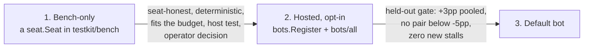

# Training and adoption

This page is for people who build, search with, train or ship a bot policy
for gorge. It covers what the engine offers search and learning code, how to
evaluate a policy honestly, and the ladder a policy climbs from a bench
experiment to the default bot that plays real users. gorge ships the
engine-side interfaces, the hosted bots and their inference code; training
tools and research bots live outside this repository and are not covered
here.

## The contract a policy answers

Everything a bot does is answer a `decision.Decision`: the engine lists every
legal option, the bot names option indices in a `decision.Intent`, and
`Decision.Validate` rejects anything not offered. A policy must answer every
decision kind, usually by delegating the kinds it does not specialise in to
the default bot. [Bots and strategies](index.md) has the kinds and the
integration surfaces; [Writing a native Go bot](native-go.md) the
`seat.Seat` interface and its optional extensions.

## What the engine offers search and learning code

| Capability | API | Notes |
|---|---|---|
| Step environment | `rules.New(Config)`, `Engine.Pending()`, `Engine.Submit(Intent)`, `Engine.Advance()` | Deterministic: the same `Config.Seed` plus the same intents gives the same events. |
| Legal actions | `Decision.Options`; `decision.PotentialAction` | The action space *is* the option list. Mana taps are options too unless automatic payment is on. |
| Intent-level mana | `seat.PaymentPlanConsumer`; `Engine.PotentialPaymentPlans`; `bots/spellbench/payexec` | Plan "cast X paid this way" and lower the plan to taps afterwards, so taps never enter a search tree. |
| Fork and simulate | `Engine.Clone()`, `Engine.CloneInto(*Spare)`, `Engine.Release()` | Clone at an intent boundary. Recycle spares on hot paths. |
| Chance-honest worlds | `rules.NewHypothetical`, `Engine.CloneHypothetical(seed)`, `SubmitHypothetical`, `AdvanceHypothetical` | A search clone gets a fresh chance stream, so it cannot peek at the real game's future shuffles and draws. |
| Hidden-information sampling | `bots/searchprobe`: `NewCollector`, `Sample`, `Redealer`, known-card tracking; `azmcts.NewRedeal` | Determinization from the seat's own observations: `Sample` never sees the real engine, log, seed or hidden cards. |
| Honest roots in a hosted seat | `bots.EnvSeat`, `bots.RootSeed`, `searchseat.HonestRoot` | The host builds the redealt world for the seat; the seat never touches the live engine. |
| Observation | `view.Project`, `view.ProjectFor` (seat, public, omniscient); `policynet.EncodeState`, `policynet.EncodeOption` | Hidden zones are counts. Even the omniscient projection never exposes library order. |
| Terminal and reward | `View.Over`, `View.Winner`; `searchprobe.LeafValue`; the `policynet` value head | No shaped reward is built in: win or loss is the ground truth. |
| Replay and audit | `events.Log` (SHA-256 chain, `Head()`), `replay.Replay`, `replay.ReplayTo` | Any game a policy plays can be re-run and checked event for event. |
| Game runner | `testkit/bench`: `PlayGame`, `RunPairs` | Watchdogs, livelock recovery, no clock. |
| Search | `bots/azmcts` (`azmcts.Search(ctx, root, worldSource, net, opts)`, the `azmcts.Env` seam), `bots/searchseat` | AlphaZero-style PUCT (single-perspective tree, value-scored leaves, no rollouts) and a determinized rollout seat. Clairvoyant worlds are refused unless the driving command opts in; no hosted path does. |
| Learned policies | `bots/policynet`, `heuristic.NewPolicyNetBot` | Pure-Go hashed features, an MLP scorer and an optional value head, hand-derived gradients; `.gpol` checkpoints refuse to load on an encoder-hash mismatch. Kinds the net does not answer go to the default bot. |

Engine speed (turns per second, clone and step costs, search rates) is on
[Engine speed](../performance/engine.md); measured bot results on
[Bots and learned policies](../performance/bots.md).

## Evaluating a policy

`testkit/bench` is gorge's game runner: `PlayGame` plays one seeded game
between any `seat.Seat` implementations, and `RunPairs` runs a deck-pair
matrix with seats traded, across workers.

- Game *i* is seeded `base + i`, and seats trade policies every game.
- Always run the incumbent against itself on the same seeds as a control:
  deck matchups and seat order are not 50/50.
- Report the command, seeds, game count and a confidence interval against
  that control.

Sample size decides what a result can show:

| Games | Smallest effect detectable |
|---:|---|
| 95 | about +100 Elo |
| 379 | about +50 Elo |
| 1,792 | about +23 Elo (3.3 percentage points) |

A 200-game run is about ±7 percentage points: a smoke test, not a verdict.
[Bot-vs-bot games](../guide/bot-games.md) walks through running a fair
matchup.

## The adoption ladder

A policy moves up one rung at a time, and each rung has a gate.

1. **Bench-only.** A `seat.Seat` you drive through `testkit/bench`. No gate
   beyond the rules below. Research modes (clairvoyant worlds, oracle
   features) stay here.
2. **Hosted, opt-in.** Registered in the bot registry (`bots.Register` from
   an `init`) and linked from `bots/all`, so `POST /api/games` can select it
   with `bot_policy` (unless it reads every seat's decklist, like
   `sb-tactical` and `az-redeal`: those stay off tables with people).
   `forge-heuristic` is a hosted, opt-in policy today. Requirements:
    - It is seat-honest: no clairvoyance, nothing the view does not show
      (an Env seat reads only its honest root).
    - It is deterministic from (match seed, seat).
    - It fits the hosted latency budget: a hosted search seat has 2 s per
      decision before it falls back to its heuristic.
    - A host test pins it: the hosted-policy determinism and contract rows
      (`host.RunContractTable` and friends) run on every registered entry.
    - An operator decision.
3. **Default `bot`.** Requirements:
    - It passes the **held-out gate**: seed 1,000,000, 400 games per deck
      pair, seats traded.
    - It gains **at least +3 percentage points pooled** over the current
      `bot`.
    - **No pair falls below −5 points.**
    - **Zero new stalls or errors.**
    - The same merge regenerates the golden replay heads (`TestHeads`),
      naming the policy change as the cause.
    - Development iterations are gated at +1.96σ against the current best
      before they spend a held-out run.
    - Promotion is the operator's decision.

## Rules for bot code

- **Determinism.** Seeded `math/rand/v2` only, and no `map` order in
  anything that reaches a decision or a checkpoint. No `time` in library
  code: inject a clock hook the way `searchseat` and `azmcts` do. Only the
  host and a few allow-listed commands may read a clock, and only for
  deadlines and reporting.
- **Pure Go, in-repo.** No cgo, no third-party modules, and no external ML
  runtime for anything that ships.
- **Honesty.** A policy or value model that will play must read the redacted
  view only. The `mz-oracle` and `mz-opphand` feature sets and clairvoyant
  worlds are diagnostic ceilings: `policynet.WriteCheckpoint` refuses the
  oracle feature sets, and the one exception, `WriteOracleCheckpoint`,
  exists only for a search leaf scored inside an already-sampled world.
- **Artifacts.** Small JSON weight profiles may be committed. Neural
  checkpoints are not committed without an operator decision. Nothing
  derived from Forge card-script text is ever committed (the scripts are
  GPL-3.0).
- **Report what you measured,** with the command, the seeds, the game count
  and a confidence interval against a same-seed control.
