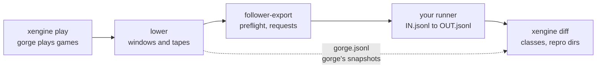

# Bring your engine

<div class="gg-area" markdown>

This section is for people who write Magic rules engines. If your engine can place a board, take a
scripted action and report what a player would see, it can replay the games gorge plays and tell you,
position by position, where it and gorge disagree.
{ .gg-lede }

Forge and XMage take part today. Followers for [phase.rs](https://github.com/phase-rs/phase) and
[ManaBrew](https://github.com/witchesofthehill/manabrew) are being built. These pages are written so
that a third engine's authors can do the same without reading our Java drivers.

</div>

## What you get

- **Thousands of positions, for free.** gorge plays whole games between two-colour decks and cuts them
  into one-turn windows and game prefixes. Each is a self-contained request: a board, a list of
  actions, and every choice gorge made. Your engine replays it and returns snapshots.
- **A diff at the first field that differs.** Every disagreement comes back as the checkpoint, the field
  and both values (`step 2 (cast)`, `p1.life`, gorge `20`, you `19`), with a repro directory that
  re-runs that one item.
- **A classifier that separates driver gaps from rules differences.** A position your driver can't
  express is `harness` or `decision_shape`, not a bug in your engine. Only `diverge` is a lead.
- **Independent votes.** When your engine and another engine family agree against gorge, that is a
  strong lead on a gorge bug, and the reverse. [What agreement means](#what-agreement-means) below
  says how far to trust it.

Nothing here ever files a bug by vote. A finding is a lead for a person, who reads the printed card
and the Comprehensive Rules.

## How it works



1. **Play.** gorge plays games with an exploring bot and records every decision. gorge leads: the other
   engine replays gorge's choices and never makes its own ([who leads](engine-notes.md#who-leads)).
2. **Lower.** Each game becomes one whole-game *tape* and one *window* per turn. gorge's own runner
   must reproduce each one before it is sent anywhere.
3. **Export.** `oraclediff follower-export` asks your runner which cards it lacks, holds back the items
   that use them, and writes one request line per remaining item.
4. **Replay.** Your runner reads the requests and writes one result row per line, with a snapshot after
   setup and after every step.
5. **Diff.** `xengine diff` compares your snapshots with gorge's and gives each item a class.

The work on your side is a single program, the *runner*:

```console
$ your-runner IN.jsonl OUT.jsonl          # replay requests, write result rows
$ your-runner --preflight NAMES.txt       # print the cards you lack
```

The [follower protocol](protocol.md) is the full contract. The [quickstart](quickstart.md) gets a
do-nothing runner through every stage in about ten minutes.

## What it costs you

The Forge driver is the only complete follower, so its files give a fair idea of the work. Its sizes,
in lines of Java:

| Piece | Forge driver files | Lines | Notes |
|---|---|---|---|
| Batch loop, request reader, ref table, result row, errors | `ScenarioReplay`, `Request`, `RefTable`, `ResultRow`, `HarnessError`, `StrictMiss` | 680 | Mechanical; the schema is small |
| Setup: place a board with no entry effects | `SetupBuilder` | 533 | Usually needs an engine hook, see [Place a board](howto.md#place-a-board-without-entry-effects) |
| Step machine: play, cast, activate, pass, combat | `StepMachine` | 1,739 | The core of the driver |
| Answering gorge's recorded decisions | `ScriptedController`, `ScriptedCostDecision`, `DecisionQueue` | 1,547 | Grows with the decision kinds you support |
| Snapshot writer in gorge's vocabulary | `SnapshotWriter` | 313 | |

That is about 4,800 lines. Most of the other ~3,200 lines in the driver's directory are for letting
Forge's AI play whole matches, which this protocol doesn't use; the rest is start-up code. You don't need all of it to start. A runner
that only places the board and writes the `"setup"` snapshot already gets compared, and every item it
can't finish becomes a `harness` row instead of a false finding. [Suggested milestones](howto.md#grow-the-runner-in-milestones)
shows the order that pays off fastest.

## What agreement means

Engines are counted by *family*, not one by one, because engines that share card data share its bugs:

| Family | Engines | Card data |
|---|---|---|
| gorge | gorge, dirac | Forge card scripts, compiled by gorge; dirac is lowered from gorge's tables |
| Forge | Forge, ManaBrew | Forge card scripts, read by each engine |
| XMage | XMage | Hand-written Java per card |
| phase.rs | phase.rs | Its own parser over the Oracle text |

gorge and Forge agreeing tells you less than gorge and XMage agreeing, because a typo in a Forge script
misleads both. A new family, with its own reading of the printed text, is the most valuable thing an
engine can add. A second engine in an existing family is still useful: it checks that family's
engines and drivers against each other.

Agreement is still evidence, not proof. Two families can share a misreading of the rules, and a ruling
always rests on the printed card or the Comprehensive Rules.

## Status

As of 2026-11-11:

| Engine | Family | State |
|---|---|---|
| XMage | XMage | Running in sweeps. Windows only by default |
| Forge | Forge | Running in sweeps. Windows and tapes |
| phase.rs | phase.rs | Follower being built; the engine builds and its card-support check is the first milestone |
| ManaBrew | Forge | Follower planned, after phase.rs; the engine builds on stable Rust |
| dirac | gorge | Checked in [lockstep](../lockstep.md) with gorge, not through this protocol |

The first corpus for new engines is the 196 Pauper-legal commons of Foundations (FDN), 1v1. It is
small, uses evergreen mechanics, and both phase.rs and ManaBrew already support most of it.

## Where to go next

<div class="grid cards" markdown>

- :material-rocket-launch: **[Quickstart](quickstart.md)**

    Set up, register a toy follower and run it through play, export, replay and diff.

- :material-file-document-outline: **[The follower protocol](protocol.md)**

    The runner's command line, the request and result schemas, snapshots and comparison rules.

- :material-wrench: **[How-to guides](howto.md)**

    Place a board, drive priority, answer decisions, match abilities, run a sweep.

- :material-chart-bar: **[Reading results](results.md)**

    Every class, the repro directories, and which results are leads.

- :material-language-rust: **[Engine integration notes](engine-notes.md)**

    How Forge and XMage are wired in, which seams their drivers use, and the plans for phase.rs and ManaBrew.

- :material-frequently-asked-questions: **[FAQ](faq.md)**

    Licences, shuffles, mulligans, card spellings, upstreaming, and more.

</div>
