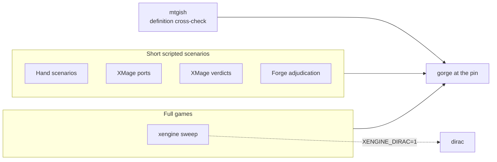

# Engine comparison: gorge-compliance

The comparison against other engines lives in a separate public repository,
[gorge-compliance](https://github.com/adams-shaun/gorge-compliance). It pins one
gorge commit (`GORGE_PIN`), depends on gorge's public packages only, and plays
its corpora through the oracle runner `engine/rules` exports
(`RunOracleScenarioJSON`, `RunOracleAuditScenarioJSON`,
`CheckOracleScenarioJSON`). gorge never imports it. Its
[oracles page](https://github.com/adams-shaun/gorge-compliance/blob/main/docs/oracles.md)
says what each check sees and cannot see.



## What agreement means

Agreement is evidence, not proof. gorge compiles Forge's scripts, so the two can share a script bug;
dirac lowers gorge's own IR, so it shares gorge's reading of the rules; XMage is written by hand and
shares neither. A ruling that gorge is wrong rests on the printed card or the CR, never a vote.

## The checks

| Check | Compares gorge with | Blocks CI? |
|---|---|---|
| Hand scenarios | Oracle text and the CR, as an author read them | Yes |
| XMage ports | XMage's own test assertions | Yes |
| XMage verdicts | XMage's engine, one generated scenario per card or ability | Yes, on committed verdicts |
| Forge adjudication | Forge's engine, on the same scenarios | No |
| xengine | XMage and Forge, on windows and prefixes of full games | No |
| mtgish | An independent encoding of each card's Oracle text | Yes |

## Scenarios and verdicts

A hand scenario is one JSON file per card: a board, steps through gorge's runner, and assertions on
what a player can observe (zones, life, P/T, counters, stack, offered options), written from the
printed card, not gorge's script.

For XMage, `oraclediff gen` writes scenarios from a set's manifest: Level A one per card, Level B
adds one per activated ability, trigger, static and attack or block. A Java driver
(`oracle/xmageoracle`) replays each in XMage and `oraclediff diff` compares snapshots at each
checkpoint. A verdict is `agree`, `gorge_wrong`, `xmage_wrong` (with a ruling citing the rules),
`diverge` (untriaged), `harness` (the driver could not express it) or `xmage_lacks`; only `agree`
and `xmage_wrong` count toward a set's claim. Sets are declared at A or B in
`oracle/compliance/declared.json` and `ratchet.json` holds each set's outstanding count, which can
only fall (`make compliance-status`). Per-set numbers: [support page](../support/sets.md).

Neither level says gorge is right about a whole game. Scenarios are short, and
interactions between cards go untested.

## The four-way full-game harness (xengine)

`xengine` plays whole games, then asks the other engines whether they agree.

1. **Play.** gorge plays exploring-bot games between two-colour decks from a set's supported cards,
   weighted to the least-exercised; a coverage ledger records what each sweep played and compared.
2. **Lower.** Each game is cut into windows (a position plus a few decisions) and prefixes (start to
   turn N), each a tape a follower can replay. gorge's runner must reproduce the lowering first;
   windows it cannot lower are refused with a reason.
3. **Follow.** XMage (Java driver) and Forge ([our fork](https://github.com/adams-shaun/forge)'s
   harness) replay the tapes. Their output is never committed (Forge is GPL-3.0). Any engine can
   join: [Bring your engine](engines/index.md).
4. **Diff and classify.** `xengine diff` compares snapshots with gorge's stored result and writes
   each item as a repro directory with a class: `agree`, `diverge`, `rng`, `projection_gap`,
   `decision_shape`, `payment_choice`, `forge_skips_damage_step`, `harness`, `not_sent`, `turn_cap`,
   `xmage_lacks`, `lower_gap`. A follower that cannot express a position (`decision_shape`) is not an
   engine bug.
5. **Adjudicate.** `xengine adjudicate` combines the followers' diffs into a three-way pattern.
6. **dirac as a fourth side.** With `XENGINE_DIRAC=1`, decks hold only dirac-playable cards and each
   game first runs in [lockstep](lockstep.md); each item then also gets `D=G`, `D!=G`, or `D-`.

### Disagreement classes

Letters name the engines: **G** gorge, **F** Forge, **X** XMage. A bar
separates groups that disagree. Below, a filled dot sides with at least one
other engine and a ring stands alone.

<div class="gg-matrix" markdown>

| Pattern | gorge | Forge | XMage | Label | Usual meaning |
|---|:---:|:---:|:---:|---|---|
| `AGREE3` | <span class="gg-dot gg-dot--full" title="gorge sides with another engine"></span><span class="gg-sr">agrees</span> | <span class="gg-dot gg-dot--full" title="Forge sides with another engine"></span><span class="gg-sr">agrees</span> | <span class="gg-dot gg-dot--full" title="XMage sides with another engine"></span><span class="gg-sr">agrees</span> |  | nothing to do |
| `FX\|G` | <span class="gg-dot gg-dot--none" title="gorge stands alone"></span><span class="gg-sr">alone</span> | <span class="gg-dot gg-dot--full" title="Forge sides with another engine"></span><span class="gg-sr">agrees</span> | <span class="gg-dot gg-dot--full" title="XMage sides with another engine"></span><span class="gg-sr">agrees</span> | `gorge_suspect` | a likely gorge bug |
| `GF\|X` | <span class="gg-dot gg-dot--full" title="gorge sides with another engine"></span><span class="gg-sr">agrees</span> | <span class="gg-dot gg-dot--full" title="Forge sides with another engine"></span><span class="gg-sr">agrees</span> | <span class="gg-dot gg-dot--none" title="XMage stands alone"></span><span class="gg-sr">alone</span> | `xmage_suspect` | an XMage bug, or a script bug gorge and Forge share |
| `GX\|F` | <span class="gg-dot gg-dot--full" title="gorge sides with another engine"></span><span class="gg-sr">agrees</span> | <span class="gg-dot gg-dot--none" title="Forge stands alone"></span><span class="gg-sr">alone</span> | <span class="gg-dot gg-dot--full" title="XMage sides with another engine"></span><span class="gg-sr">agrees</span> | `forge_suspect` | a Forge bug |
| `G\|F\|X` | <span class="gg-dot gg-dot--none" title="gorge stands alone"></span><span class="gg-sr">alone</span> | <span class="gg-dot gg-dot--none" title="Forge stands alone"></span><span class="gg-sr">alone</span> | <span class="gg-dot gg-dot--none" title="XMage stands alone"></span><span class="gg-sr">alone</span> | `three_way` | read the rules by hand |

</div>

Combined with dirac: `AGREE3 D!=G` points at dirac. `FX|G D=G` is a gorge suspect
that dirac shares.

Nothing here rules. A `GF|X` item yields a note, never an `xmage_wrong` ruling.
A sweep commits nothing: its findings are leads for a person.

## From a finding to a fix

1. **Triage.** The adjudicator drafts a ticket per `FX|G` cluster; a person reads the printed card
   and the CR and decides who is wrong.
2. **Corroborate** a gorge suspect against both other engines; if two agree against gorge, the
   rules still decide.
3. **Fix gorge first.** dirac follows in the same change, or the card is refused by name.
4. **Pin.** gorge-compliance bumps its pin by pull request; stale ratchet rows show what the fix
   closed ([Pinning](https://github.com/adams-shaun/gorge-compliance/blob/main/docs/PINNING.md)).
5. **Upstream.** Before an engine is listed as buggy, a person confirms the printed card or CR, reads
   the cause in its current upstream source, and reproduces it with the harness ruled out. It is then
   reported upstream (a Forge script that disagrees with the card is also fixed on our fork). The
   list is [upstream-bugs.md](https://github.com/adams-shaun/gorge-compliance/blob/main/docs/upstream-bugs.md).

A pattern such as `GF|X` is a suspect, and does not go on that list by itself.

## Known blind spots

- Windows the harness cannot lower. A sweep of two FDN games on 2026-11-02 refused
  25 of 46 windows (from the repository's oracles page).
- Forge skips the second damage step when no creature is left in combat. Those
  items get the class `forge_skips_damage_step` and are not compared past that
  checkpoint.
- Rare cases where XMage and Forge agree with each other against the rules, which
  are read from their code and not fixed in gorge.
- XMage answers an unexpected choice with its AI, so a scenario can flip on a
  rerun. Replay twice before believing a flip.

## Running it

See the repository README for setup. The commands you need most:

```sh
make boundary oracle-audit ORACLE_RUN=Fatal_Push   # one hand scenario
make compliance-status                              # per-set status and the ratchet check
make xengine-sweep SETS=FDN CHUNKS=1 GAMES=2        # full-game sweep, needs both builds
```
