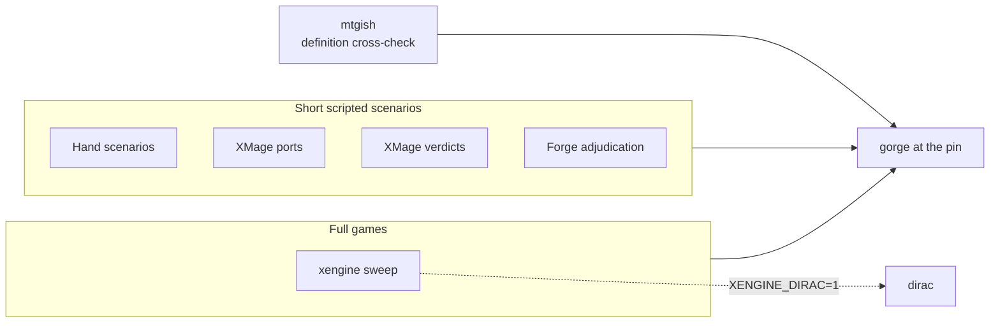

# Engine comparison: gorge-compliance

The comparison against other engines lives in a separate public repository,
[gorge-compliance](https://github.com/adams-shaun/gorge-compliance). It pins one
gorge commit (`GORGE_PIN`), depends on gorge's public packages only, and plays
its corpora through the oracle runner `engine/rules` exports
(`RunOracleScenarioJSON`, `RunOracleAuditScenarioJSON`,
`CheckOracleScenarioJSON`). gorge never imports it. Its
[oracles page](https://github.com/adams-shaun/gorge-compliance/blob/main/docs/oracles.md)
says what each check sees and cannot see.



## What agreement means

Two engines agreeing is evidence, not proof. gorge compiles Forge's card
scripts, so gorge and Forge can share a script bug. dirac lowers gorge's own
compiled IR, so it shares gorge's reading of the rules. XMage is written
by hand and shares neither. A ruling that gorge is wrong rests on the printed
card or the Comprehensive Rules, never on a vote of engines.

## The checks

| Check | Compares gorge with | Blocks CI? |
|---|---|---|
| Hand scenarios | Oracle text and the CR, as an author read them | Yes |
| XMage ports | XMage's own test assertions | Yes |
| XMage verdicts | XMage's engine, one generated scenario per card or ability | Yes, on committed verdicts |
| Forge adjudication | Forge's engine, on the same scenarios | No |
| xengine | XMage and Forge, on windows and prefixes of full games | No |
| mtgish | An independent encoding of each card's Oracle text | Yes |

## Scenarios and verdicts

A hand scenario is one JSON file per card. It sets up a board, takes steps
through gorge's runner, and asserts what a player can observe: zones, life, P/T,
counters, the stack and the options offered. It is written from the printed
card, not from gorge's script.

For XMage, `oraclediff gen` writes scenarios from a set's manifest. Level A is
one per card. Level B adds one per activated ability, trigger, static and
attack or block. A Java driver (`oracle/xmageoracle`) replays each in XMage,
and `oraclediff diff` compares the two engines' snapshots at each checkpoint.
A verdict's status is one of `agree`, `gorge_wrong`, `xmage_wrong` (with a
ruling that cites the rules), `diverge` (not triaged), `harness` (the driver
could not express it) or `xmage_lacks`. Only `agree` and `xmage_wrong` count
toward a set's claim.

Each set is declared at level A or B in `oracle/compliance/declared.json`, and
`ratchet.json` holds each set's outstanding count so it can only fall. Run
`make compliance-status` for the declared sets and their level counts.
Current per-set numbers are on the [support page](../support/sets.md).

Neither level says gorge is right about a whole game. Scenarios are short, and
interactions between cards go untested.

## The four-way full-game harness (xengine)

`xengine` plays whole games, then asks the other engines whether they agree.

1. **Play.** gorge plays games with an exploring bot between two-colour decks
   drawn from a set's supported cards, weighted toward the cards least
   exercised so far. A coverage ledger records which cards each sweep played
   and compared.
2. **Lower.** Each game is cut into windows (a position plus a few decisions)
   and prefixes (the game from the start to turn N). Each becomes a tape that a
   follower can replay. Gorge's own runner must first reproduce the lowering.
   Windows it cannot lower are refused, with a reason.
3. **Follow.** XMage and Forge each replay the tapes. XMage is driven by the Java
   driver. Forge is driven by a harness in
   [our Forge fork](https://github.com/adams-shaun/forge). Their output is never
   committed, because Forge is GPL-3.0. Any engine can join as a follower:
   [Bring your engine](engines/index.md) is written for their authors.
4. **Diff and classify.** `xengine diff` compares each follower's snapshots
   with gorge's stored result and gives each item a class, written as a repro
   directory: `agree`, `diverge`, `rng`, `projection_gap`, `decision_shape`,
   `payment_choice`, `forge_skips_damage_step`, `harness`, `not_sent`,
   `turn_cap`, `xmage_lacks` and `lower_gap`. A follower that cannot express a
   position (`decision_shape`) is not an engine bug.
5. **Adjudicate.** `xengine adjudicate` combines the two followers' diffs into a
   three-way pattern per item.
6. **dirac as a fourth side.** With `XENGINE_DIRAC=1`, decks hold only cards
   dirac plays, and each game first runs in [lockstep](lockstep.md) between
   gorge and dirac. Each item then also gets dirac's answer: `D=G`, `D!=G`, or
   `D-` where dirac has none.

### Disagreement classes

Letters name the engines: **G** gorge, **F** Forge, **X** XMage. A bar
separates groups that disagree. Below, a filled dot sides with at least one
other engine and a ring stands alone.

<div class="gg-matrix" markdown>

| Pattern | gorge | Forge | XMage | Label | Usual meaning |
|---|:---:|:---:|:---:|---|---|
| `AGREE3` | <span class="gg-dot gg-dot--full" title="gorge sides with another engine"></span><span class="gg-sr">agrees</span> | <span class="gg-dot gg-dot--full" title="Forge sides with another engine"></span><span class="gg-sr">agrees</span> | <span class="gg-dot gg-dot--full" title="XMage sides with another engine"></span><span class="gg-sr">agrees</span> |  | nothing to do |
| `FX\|G` | <span class="gg-dot gg-dot--none" title="gorge stands alone"></span><span class="gg-sr">alone</span> | <span class="gg-dot gg-dot--full" title="Forge sides with another engine"></span><span class="gg-sr">agrees</span> | <span class="gg-dot gg-dot--full" title="XMage sides with another engine"></span><span class="gg-sr">agrees</span> | `gorge_suspect` | a likely gorge bug |
| `GF\|X` | <span class="gg-dot gg-dot--full" title="gorge sides with another engine"></span><span class="gg-sr">agrees</span> | <span class="gg-dot gg-dot--full" title="Forge sides with another engine"></span><span class="gg-sr">agrees</span> | <span class="gg-dot gg-dot--none" title="XMage stands alone"></span><span class="gg-sr">alone</span> | `xmage_suspect` | an XMage bug, or a script bug gorge and Forge share |
| `GX\|F` | <span class="gg-dot gg-dot--full" title="gorge sides with another engine"></span><span class="gg-sr">agrees</span> | <span class="gg-dot gg-dot--none" title="Forge stands alone"></span><span class="gg-sr">alone</span> | <span class="gg-dot gg-dot--full" title="XMage sides with another engine"></span><span class="gg-sr">agrees</span> | `forge_suspect` | a Forge bug |
| `G\|F\|X` | <span class="gg-dot gg-dot--none" title="gorge stands alone"></span><span class="gg-sr">alone</span> | <span class="gg-dot gg-dot--none" title="Forge stands alone"></span><span class="gg-sr">alone</span> | <span class="gg-dot gg-dot--none" title="XMage stands alone"></span><span class="gg-sr">alone</span> | `three_way` | read the rules by hand |

</div>

Combined with dirac: `AGREE3 D!=G` points at dirac. `FX|G D=G` is a gorge suspect
that dirac shares.

Nothing here rules. A `GF|X` item yields a note, never an `xmage_wrong` ruling.
A sweep commits nothing: its findings are leads for a person.

## From a finding to a fix

1. **Triage.** The adjudicator writes a ticket draft per `FX|G` cluster. A
   person reads the printed card and the CR and decides who is wrong.
2. **Corroborate.** A gorge suspect is checked against both other engines
   before anyone touches gorge. If two engines agree against gorge, a reading of
   the rules still decides.
3. **Fix gorge first.** If gorge is wrong, the fix lands in gorge. dirac follows
   in the same change, or the card is refused by name.
4. **Pin.** gorge-compliance moves to the fixed commit by a pin-bump pull
   request, and the stale ratchet rows show what the fix closed. See
   [Pinning](https://github.com/adams-shaun/gorge-compliance/blob/main/docs/PINNING.md).
5. **Upstream.** If the other engine is wrong, a person confirms three things
   before it is listed as a bug: the printed card or the CR says what should
   happen; the cause is read in that engine's source at its current upstream
   branch; and a replay reproduces it with the harness ruled out. It is then
   reported to the upstream project, and a Forge script that disagrees with the
   printed card is also fixed on our fork. The confirmed list, with upstream
   links and states, is in
   [upstream-bugs.md](https://github.com/adams-shaun/gorge-compliance/blob/main/docs/upstream-bugs.md).

A pattern such as `GF|X` is a suspect, and does not go on that list by itself.

## Known blind spots

- Windows the harness cannot lower. A sweep of two FDN games on 2026-11-02 refused
  25 of 46 windows (from the repository's oracles page).
- Forge skips the second damage step when no creature is left in combat. Those
  items get the class `forge_skips_damage_step` and are not compared past that
  checkpoint.
- Rare cases where XMage and Forge agree with each other against the rules, which
  are read from their code and not fixed in gorge.
- XMage answers an unexpected choice with its AI, so a scenario can flip on a
  rerun. Replay twice before believing a flip.

## Running it

See the repository README for setup. The commands you need most:

```sh
make boundary oracle-audit ORACLE_RUN=Fatal_Push   # one hand scenario
make compliance-status                              # per-set status and the ratchet check
make xengine-sweep SETS=FDN CHUNKS=1 GAMES=2        # full-game sweep, needs both builds
```
