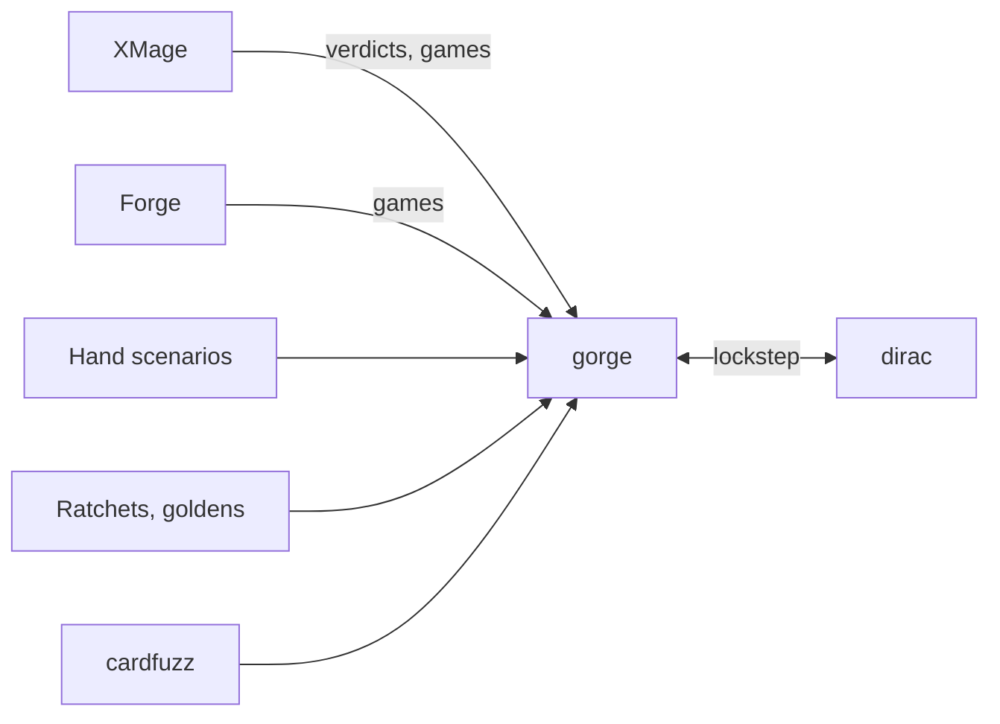

# Compliance and validation

How we know the engines are right, and how far to trust them. No single check is enough, so each layer sees something the others cannot.
{ .gg-lede }

Agreement is evidence, not proof. A ruling that gorge is wrong rests on the printed card or the Comprehensive Rules, never on a vote of engines.

- :material-scale-balance: **[Engine comparison](harness.md)**

    Do Forge, XMage and gorge play the same game? Does one card do what its printed text says?

- :material-sync: **[Lockstep](lockstep.md)**

    Does dirac play every decision as gorge does?

- :material-shield-check: **[Rules guards](conformance.md)**

    Ratchets, golden heads, CR coverage, known approximations and cardfuzz.

- :material-timer-sand: **[What runs where](conformance.md#what-runs-where)**

    Focused tests while you work, the full suite after merge and in CI.

- :material-puzzle-plus: **[Bring your engine](engines/index.md)**

    Write a rules engine? Replay gorge's games in it and see where the two disagree.

