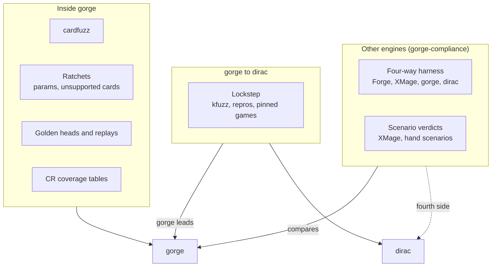

# Compliance and validation

How we know the engines are right, and how far to trust them. No single check
is enough, so there are several layers. Each one sees something the others
cannot.

## The layers

| Layer | Question it answers | Page |
|---|---|---|
| Four-way harness | Do Forge, XMage and gorge play the same game? | [Engine comparison](harness.md) |
| Scenario verdicts | Does one card do what its printed text says? | [Engine comparison](harness.md#scenarios-and-verdicts) |
| gorge and dirac lockstep | Does dirac play every decision as gorge does? | [Lockstep](lockstep.md) |
| cardfuzz | Does gorge survive games no curated deck reaches? | [Rules guards](conformance.md#cardfuzz) |
| Ratchets and goldens | Did a change move behaviour it should not have? | [Rules guards](conformance.md#ratchets) |
| CR coverage | Which rules are followed, and where is the code? | [Rules guards](conformance.md#cr-coverage-tables) |
| Known approximations | What does the engine still stand in for? | [Rules guards](conformance.md#known-approximations) |

## What agreement means

Two engines agreeing is evidence, not proof. gorge compiles Forge's card
scripts, so gorge and Forge can share a script bug. dirac lowers gorge's own
compiled IR, so it shares gorge's reading of the rules. XMage is written
by hand and shares neither. A ruling that gorge is wrong rests on the printed
card or the Comprehensive Rules, never on a vote of engines.

## The rules we hold ourselves to

- gorge leads. dirac plays every supported card the same way, decision by
  decision. A gorge change that alters a supported card fixes dirac in the same
  change, or makes kgen refuse the card by name.
- A ratchet only tightens. A new gap is a regression, and a closed gap must be
  deleted from its table in the same change.
- A confirmed bug in another engine is fixed in our fork and reported upstream.

## What runs where

Per change, you run focused tests with `-run`. The full suite runs after merge
and in CI. See [Testing](../contributing/testing.md) for the budget and the
focused commands, and [Invariants](../architecture/invariants.md) for the
design rules these guards enforce.
