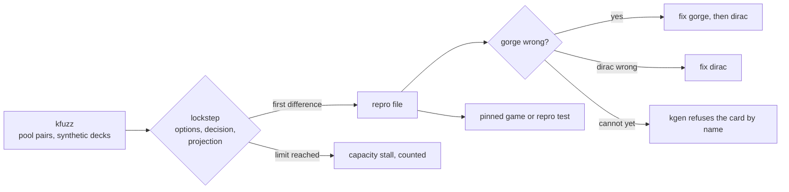

# gorge and dirac lockstep

dirac is trusted only as far as it plays what gorge plays. `dirac/oracle` runs
both engines on the same decks, seed and answers, and stops at the first
difference. The mechanics, the compared fields and the verdict table are on
[Verification](../architecture/dirac/oracle.md). This page is the map of the
guards around it.

## The zero-divergence rule

A card dirac supports plays identically to gorge, decision by decision. gorge
leads. A gorge change that alters behaviour on a supported card fixes dirac in
the same change, or makes kgen refuse the card by name (`kgen -refuse`). There is
no list of tolerated divergences. `scripts/dirac-gate.sh <base>` holds this: it
runs `kfuzz -absolute` on the committed FDN and BLB slices on both surfaces, and
also checks the size, allocation and instruction budgets, the refused entries
and a short synthetic run.

Two kinds of difference are not divergences, and each is listed in
[`dirac/docs/DEVIATIONS.md`](https://github.com/adams-shaun/gorge/blob/main/dirac/docs/DEVIATIONS.md):
a canonical-surface difference (the engines say the same thing in different words and
the oracle's adapter translates), and a declared capacity limit.

## kfuzz and the two surfaces

`kfuzz` (`dirac/oracle/cmd/kfuzz`) plays seeded pairs of decks. The surface
chooses which options both sides offer.

| Surface | Offers | Used for |
|---|---|---|
| `autopay` | No plain cast that gorge's payment planner never prices; no mana-ability options | the surface a hosted bot casts through |
| `full` (default) | Those casts too | the stricter surface |

`make dirac-slices` plays the first 1,500 pairs of the `fdn` and `blb` pools at
seed 1 on both surfaces with `-absolute`. The slices are committed under
`dirac/oracle/testdata/slices`. Build the tables first with `make dirac-tables`.
Beyond the slices, `kfuzz -synth <pool>` deals synthetic decks from a card list so
that cards the slices do not reach still get games. The flags are listed with
`kfuzz -h`. Other modes: `-features` also compares the network inputs
(`dirac/feat` against `bots/policynet`) at every decision, and `-v2 transcript`
checks the SpellBench v2 adapter against gorge's.

### Verdicts

Every game that started ends in one of these:

| Verdict | Meaning |
|---|---|
| clean | agreed to the end, or to a turn or decision cap |
| capacity | dirac hit a declared limit; agreed up to there |
| unmodelled | dirac stopped at something gorge does and it does not |
| divergent | the engines differed; a panic counts |
| hang | no result inside `-game-timeout` |

A pair holding a card or combination dirac does not support is not played, and is
counted as `refused-card` or `refused-pair`. `-absolute` fails on any divergence,
hang, unmodelled stall or error, and when too few games were played.

## Repro files

A divergence is written with `-out DIR` as a portable repro: the two decks by card
name, the seed, the run knobs and the canonical actions, shrunk by `-shrink N`.
`kfuzz -repro FILE` replays it with no deck pool. The fixed ones are kept under
`dirac/oracle/testdata/*.repro.json` and replayed by tests, so a fixed divergence
cannot return silently.

## Pinned games

A pinned game is a recorded game: two decklists by card name, a seed and the
canonical actions, under `dirac/oracle/testdata/pins`. Each is played in lockstep.
It must reach the conditions its test names, such as a card entering or a trigger
resolving, and stay clean. Because it does not depend on how a synthetic pool
deals its pairs, lowering or refusing another card cannot move it. A game that no
longer reaches its condition fails, so a fix cannot hide by changing the path.

## Mutation tests

A clean lockstep run proves nothing if the comparison cannot fail. Many
class tests have a mutation twin (the `...Mutation` tests in `dirac/oracle`):
the same games with one behaviour deliberately made wrong, which must diverge.
`TestAbilitycastMutation` fails if its mutated games do not. The class test shows
a feature agrees. The mutation test shows the oracle would have seen it differ.

## Refused entries

When a card lowers and still plays wrong, it is refused by name. Each entry is a
JSON file in `dirac/support/refused/` with the card, a class (such as
`unmodelled-...`), a reason and a repro pair. The rules:

- A card is refused only while it diverges. `TestRefusedEntriesStillDiverge`
  fails if an entry's card no longer diverges anywhere in its pool, and the entry
  is deleted.
- A card cannot leave the evidence lists in `dirac/support/evidence/` unless the
  change refuses it. `dirac-gate.sh` step 0 checks this.
- Refusals are generated into dirac's
  [support page](https://github.com/adams-shaun/gorge/blob/main/dirac/docs/support.md),
  held current by `TestSupportDocIsCurrent`.

## Capacity stalls

dirac has fixed capacities: the battlefield, objects, pending triggers, the stack,
and some rings that track the turn. A game that outgrows one stops as a named
stall. It is a declared limit, counted per table, printed in the summary line, and
not compared past that point. It earns coverage up to where it stopped. Raise a
limit when realistic play hits it. A limit only random play hits is evaluated,
not raised by default. The list is in
[`DEVIATIONS.md`](https://github.com/adams-shaun/gorge/blob/main/dirac/docs/DEVIATIONS.md).

## dirac's CR coverage

`dirac/crcoverage` is a rule-by-rule table with the code that decides each rule,
held to the code by `TestCRCoverageIsCurrent`. A row marked `inherits gorge`
copies gorge's behaviour, so [gorge's table](conformance.md#cr-coverage-tables)
decides it.

## What lockstep does not show

It shows agreement, not correctness. dirac lowers gorge's compiled IR, so a shared
reading of the rules is shared by both sides. That is why gorge is also checked
against engines that do not share its source: see
[Engine comparison](harness.md).
