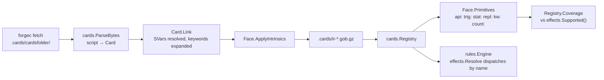

# The card pipeline

How a Forge card script becomes behaviour in a game, and how gorge measures
which cards it can play: the contributor's how-to view, for someone about to
change a card, a parser or a primitive. The runtime internals (the IR types
in depth, how the engine dispatches primitives during play) are in
[the card pipeline architecture page](../architecture/gorge/cards.md).



## 1. Fetch

`make fetch-cards` builds `bin/forgec` and runs `forgec fetch`
(`engine/cards/fetch.go`). It does a sparse checkout of Forge's
`cardsfolder` and token scripts from the fork
[adams-shaun/forge](https://github.com/adams-shaun/forge) at the commit
pinned by `FORGE_REF` in the `Makefile`, into the gitignored `.cards/`, and
writes `.cards/cards.lock` recording the ref, commit and license. When the
lock changes, the target clears Go's test cache, because the corpus lives
outside the module and `go test` cannot see that it changed.

The scripts are GPL-3.0 and gorge is Apache-2.0. Nothing under `.cards/` is
ever committed, and `engine/cards/boundary_test.go` fails the build if a
script is tracked.

## 2. Parse and link

`engine/cards` is the compiler. It depends on nothing else in the module.

- `cards.ParseBytes(path, src)` (`engine/cards/parse.go`) turns one script
  into a `*cards.Card` with one `*cards.Face` per printed face, each holding
  its `Abilities`, `Triggers`, `Statics`, `Repls`, `Keywords`, `SVars` and
  raw `Params` maps (`engine/cards/ir.go`). Problems come back as
  non-fatal `cards.Diag`s. The whole corpus produces only a handful.
- `Card.Link()` (`engine/cards/link.go`) resolves the SVar references
  (`Execute$`, `SubAbility$`, …) into sub-ability trees, and first runs
  `expandKeywords` (`engine/cards/keywords.go`). That rewrites a keyword the
  engine implements through ordinary machinery into the lines Forge itself
  would expand it to. For example, `kw_prowess.go` turns Prowess into a
  `SpellCast` trigger with a `Pump` effect. Each expander is one
  `engine/cards/kw_*.go` file registered with `registerKeyword`.
- `Face.ApplyIntrinsics()` (`engine/cards/intrinsic.go`) adds what the rules
  grant rather than the script prints, such as a basic land's mana ability.

`cards.CompileDir` does all three for every script, in sorted path order, so
the output is byte-identical run to run.

## 3. The IR cache

`make compile-cards` (`forgec compile`) saves the compiled registry to
`.cards/ir-<fingerprint>.gob.gz` (`cards.CachePath`, `engine/cards/open.go`).
The fingerprint is `cards.CompilerFingerprint`, a hash of the `engine/cards`
sources that affect the IR (`engine/cards/fingerprint.go`). So a branch that
changes the parser writes and reads its own cache file, and never reads one
built by a different parser. Beside it sits a binary image of the same corpus,
`.cards/ir-<fingerprint>.seg`, which keeps the loaded corpus out of the garbage collector's
way. Compiling prunes older sibling caches.

Programs and tests open the corpus with `cards.OpenCorpus(dir)` or
`cards.SharedCorpus(dir)`. Both load the cache, or recompile from
`cardsfolder` when it is missing or older than `cards.lock`. Tests use
`testutil.CorpusRegistry(t)`, which opens the shared registry once per test
binary and **skips** when `.cards/` is absent.

## 4. The registry

`cards.Registry` (`engine/cards/registry.go`) holds every card and token.
`Registry.Lookup(name)` finds a card by name, and `Registry.Tokens` the token
scripts. Decks (`engine/deck`) resolve card names against it, and
`rules.New(rules.Config{Decks: ...})` deals the resulting `*cards.Card`s
into a game.

## 5. Primitives and their implementations

`Face.Primitives()` (`engine/cards/primitive.go`) lists every engine symbol
a face needs, prefixed by kind, after keyword expansion and following
sub-ability chains and SVar bodies: `api:DealDamage`, `trig:ChangesZone`,
`stat:Continuous`, `repl:Moved`, `kw:Flying`. `Card.ValueHeads()`
(`engine/cards/value_heads.go`) adds the `count:` heads that its value
SVars read.

The engine side registers what it implements:

- `effects.Register("DealDamage", fn)` in an `init()` in `engine/effects`
  installs an `api:` effect, an `effects.Effect` function
  `func(h Host, c *Ctx, sa *cards.SA)`. At resolution, `effects.Resolve`
  walks an ability and its `SubAbility$` chain and calls each node's
  registered function. The function reads the game and proposes events
  through `effects.Host`, never touching `rules` directly.
- `effects.RegisterNonAPI("kw:Flying", ...)` declares keyword, trigger,
  static and replacement primitives. Those are implemented in `engine/rules`
  (combat, layers, the trigger matcher, replacement handling); the
  registration only records that the build supports them.
- `count:` heads are evaluated in `engine/effects/count*.go` and listed in
  `modelledValueHeads` (`engine/effects/value_heads.go`).

`effects.Supported()` returns the union, in the same prefixed form.

## 6. Coverage

`Registry.Unsupported(card, effects.Supported())` (`engine/cards/validate.go`)
is a card's missing primitives. An empty result means the card is
*playable*. `Registry.Coverage` aggregates that over the corpus.

```sh
make report     # cards: 34074  playable: 32390 (95.1%) on 2026-10-31, then the top missing primitives
make coverage   # the same as markdown tables in .coverage/ (gitignored), by type, colour, mana value
```

"Playable" means every primitive is registered. It does not mean every
parameter is honoured or every interaction is right. Three things narrow
that gap:

- the param census (`TestEveryRepoDeckParamsAreRead`), which tracks
  parameters no code reads;
- the oracle scenarios, which check behaviour against the printed text;
- the compliance oracles, which compare gorge with XMage and Forge.

The scenarios and the oracles live in the public companion repository
[gorge-compliance](https://github.com/adams-shaun/gorge-compliance), which measures a pinned
gorge revision. The per-set figures are on [Support by set](../support/sets.md).
