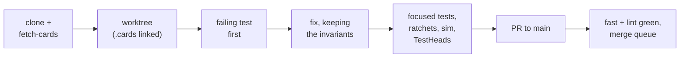

# Contributing

How to set up a checkout, run tests the way the project expects, read the
ratchets that will fail on you, and get a change merged. Unfamiliar words (IR,
primitive, ratchet, chain head) are in the [glossary](glossary.md).



## Clone and fetch the card corpus

[Install and build](../guide/install.md#prerequisites) lists the prerequisites.

```sh
git clone https://github.com/adams-shaun/gorge && cd gorge
make fetch-cards      # Forge card + token scripts at FORGE_REF into .cards/ (about 140 MB on disk)
make compile-cards    # parse them into the IR cache, .cards/ir-<fingerprint>.gob.gz
make report           # corpus coverage against the implemented primitives
```

[Getting started](../getting-started.md#1-fetch-and-compile-the-card-corpus)
shows what `make report` prints. The scripts come from gorge's fork
[adams-shaun/forge](https://github.com/adams-shaun/forge) (`FORGE_REPO`) at
the commit pinned by `FORGE_REF` in the `Makefile`; every coverage number and
golden test is relative to that pin. They are GPL-3.0, gorge is Apache-2.0,
so they live only in the gitignored `.cards/` and are **never committed**,
not even a line pasted into a test. See
[The three repositories](../repos/index.md#licensing-and-the-forge-card-scripts).

When the pin moves, `make fetch-cards` also clears Go's test cache, because
`go test` cannot see a change in the corpus.

Optionally enable the git hooks:

```sh
git config core.hooksPath .githooks
```

`pre-commit` and `pre-merge-commit` run `go run ./cmd/pkgmap -check` when you add, delete or rename a
Go file, so a package without a tier entry in `docs/site/architecture/packages.tiers.json` fails
before CI. `pre-push` runs the race detector, one package at a time, only when you push `main` with
`RACE=1`.

## Work in a worktree

Make each change in its own [git worktree](https://git-scm.com/docs/git-worktree),
branched from `origin/main`, so your main checkout stays clean:

```sh
git fetch origin
git worktree add ../gorge-myfix -b myfix origin/main
ln -s "$PWD/.cards" ../gorge-myfix/.cards      # the corpus is untracked: link it in
cd ../gorge-myfix
```

!!! warning "A worktree without `.cards/` reads green and tests nothing"
    A worktree carries only tracked files. Corpus-dependent tests load cards
    through `testutil.CorpusRegistry(t)`, which **skips** when `.cards/` is
    missing, so a raw run still prints `ok` in a couple of milliseconds. The
    make test targets report that as `ENV`. CI refuses to run without the
    corpus.

## Run tests

Use the make targets, never raw `go test`: [Testing](testing.md#focused-runs).

## Lint

```sh
make lint    # gofmt, go vet ./..., gentypes -check, plus the web client's svelte-check and eslint (needs Node)
```

`make lint` needs `web/node_modules`. CI's `lint` job runs the Go half plus
`make fresh-clone-check`.

## The ratchets you will hit

A **ratchet** is a test whose expected value is a committed table and which
fails in both directions: a new gap fails, and a gap your change closed is a
stale entry that fails too. Delete the entry in the same commit; never add one
([why](../architecture/invariants.md#ratchets-only-shrink)).
[Testing](testing.md#ratchets-and-goldens-what-a-failure-means) lists each
ratchet and what to do when it fails.

## Commits and pull requests

**Landing.** Open your PR **against `main`**. Nothing is pushed to `main`
directly.

1. Mergify queues every non-draft PR (no label, no approval) once its two
   checks pass: `lint` (above) and `fast` (`scripts/ci-fast.sh`: the packages
   your diff touches, every package whose tests import them, and the named
   test groups, run with `-short`).
2. Mergify batches up to 10 queued PRs on a `mergify/merge-queue/*` branch. CI
   (`.github/workflows/ci.yml`) runs the full suite once per batch: the six test
   shards (`scripts/ci_shard.sh`, with `TestHeads` as its own step),
   `examples` (`scripts/examples-smoke.sh`), `wire-matrix`
   ([Wires](../architecture/wires.md)), `dirac-slices` (dirac against gorge on
   the committed FDN and BLB slices) and `browser` (`make smoke`, not part of
   `ci-ok`).
3. The batch merges with a merge commit when `ci-ok` is green; a red batch is
   split.
4. A fix for a red `main` goes on a `hotfix/*` branch (or carries the `hotfix`
   label): it is batched first and may interrupt a running batch.

The whole of `dirac/oracle` never runs on a PR or a batch. It runs on `main`
from `.github/workflows/oracle.yml` (hourly cron that starts a run only if none
began in the last 5h30m, so about every 6 hours) and on demand. A PR that
touches `docs/site/`, `dirac/docs/support.md` or `mkdocs.yml` also gets a
strict docs build. [Branch flow](../repos/index.md#branch-flow) has the diagram.

**Commit messages.**

- Subject `kind(area): what changed`, as in the history:
  `fix(effects): …`, `feat(bots): …`, `test(spellbench): …`, `docs(design): …`.
- The body says **why**: the rule you implemented with its Comprehensive
  Rules number (`CR 113.6`), what was wrong and where, and what you measured.
  If you counted how many corpus cards share the bug's shape, give the
  numbers ([measure the class, not the card](first-card-fix.md#5-measure-the-class-not-the-card)).
- If `TestHeads` moved, name the first diverging event and its cause.
- Plain messages: **no attribution trailers** (`Co-Authored-By:`,
  "Generated with …") and no issue-tracker references
  (`CONTRIBUTING.md`).

**The pull request.** `.github/pull_request_template.md` asks for an overview,
the changes by area, how you tested, and notes for reviewers. `make pr` pushes
your branch and opens (or refreshes) the PR against `main` with a generated
overview. It needs an authenticated `gh`; `DRY=1` prints the body without
pushing, `DRAFT=1` opens a draft.

**Checklist.** Modelled on the first outside contribution,
[`786510b3f`](https://github.com/adams-shaun/gorge/commit/786510b3f):

- [ ] A test that fails without your change, in the package you changed,
      named for the behaviour, plus a control showing the card still works
      where it should.
- [ ] `make lint` (or `gofmt -l` and `go vet` on your packages, and
      `go run ./cmd/gentypes -check` if you changed `server/protocol`).
- [ ] `make test-targeted` while iterating and `make test-smart` once before
      you open the PR, **with `.cards/` present** (a verdict of `ENV` is not green).
- [ ] `make sim`: every game prints `replay OK`.
- [ ] `TestHeads` passes, or the heads were re-pinned with a named cause
      ([Testing](testing.md#ratchets-and-goldens-what-a-failure-means)).
- [ ] Any ratchet entry your change closed is deleted in the same commit.

## Reproduce a feedback report

A bug report filed from a game on `gorged` carries a replayable snapshot (`match.json`, `log.json`,
the seat's `view.json`). `cmd/repro` turns it into a failing test:

```sh
go run ./cmd/repro <feedback-dir>                     # replay, verify the chain head, print the board
go run ./cmd/repro -list <feedback-dir>               # the timeline of recorded answers (intents)
go run ./cmd/repro -at N <feedback-dir>               # stop at intent N
go run ./cmd/repro -omniscient <feedback-dir>         # show every hand
go run ./cmd/repro -emit-test ./engine/rules <feedback-dir>   # copy the snapshot, write a failing test skeleton
```

Try the committed fixture: `go run ./cmd/repro cmd/repro/testdata/feedback/20260914T120000Z-fb01`
prints `== feedback report 20260914T120000Z-fb01 …`, `replayed 26 of 26 recorded intents`, then the board.

Exit status 0 means the rebuilt event stream matched the recording event for
event. `DIVERGED` names the first mismatching event; a corpus pin change
since the report was filed is a real and expected cause, so read that event
before assuming an engine bug. The `-emit-test` skeleton uses
`feedback.EngineAt(t, dir, n)` from `testkit/testutil/feedback`; replace its
TODO with your assertion.

## Documentation

This site is `docs/site/`, built by MkDocs Material from `mkdocs.yml` and
published from `main` by `.github/workflows/docs.yml`. To preview it:

```sh
go run ./cmd/pkgmap > docs/site/architecture/_generated_packages.md   # the generated package tables
python3 scripts/docs_sets.py --dirac-support dirac/docs/support.md      # the set tables, without gorge's columns
uvx --with mkdocs-material==9.7.7 mkdocs serve                        # or: pip install -r docs/site/requirements.txt
```

[Regenerating the tables](../support/regenerating.md) has the full set tables.
The build is `--strict`, so a broken link fails it. CI also parses every Mermaid
diagram in a headless browser (`scripts/docs_mermaid_check.py`), which
`--strict` does not. Link between pages with relative `.md` paths, and to code
as `https://github.com/adams-shaun/gorge/blob/main/<path>`.

## Where next

- [Your first card fix](first-card-fix.md): one bug from report to merged fix.
- [Testing](testing.md): helpers, oracle scenarios and the ratchets in depth.
- [The card pipeline](card-pipeline.md): how a script becomes behaviour, and
  how coverage is measured.
- [Repository layout](repo-layout.md): the tree, the tiers, and where a
  change goes.
- [Invariants](../architecture/invariants.md): the rules every change keeps.
- [The three repositories](../repos/index.md): what lives in gorge-compliance
  and why gorge never imports a companion.
- [Glossary](glossary.md).
